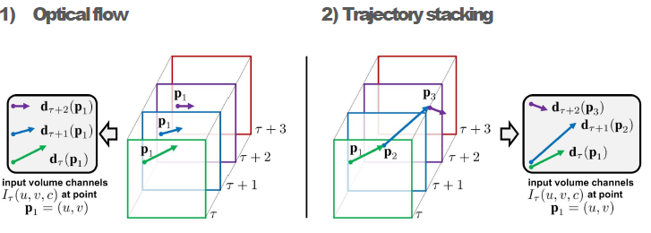
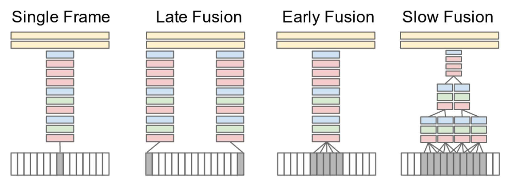
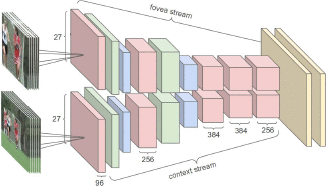
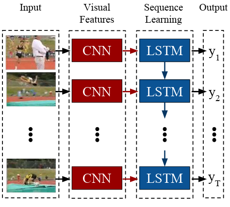
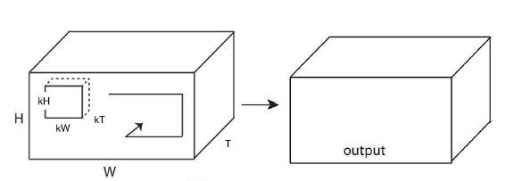
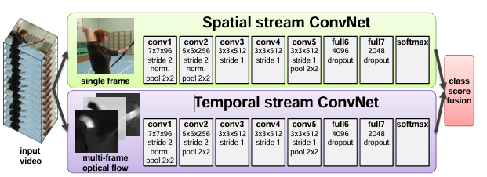
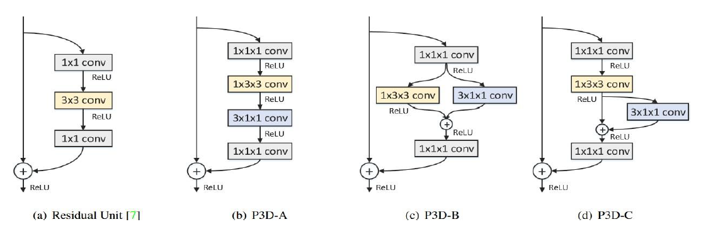
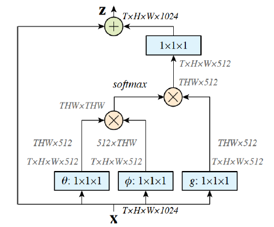

# Video Understanding

Video understanding focuses on analyzing and interpreting video data to extract meaningful information interpreting spatio-temporal patterns between video frames.

Video, different to images have **temporal dimension** and this means that, beyonn capturing spatial informarmation in frames, models have to capture also the relationship between frames and how they evolve over time. This is crucial for tasks like action recognition, event detection, video summarization, and video captioning that need to understand how frame content changes over time. Formally, a video can be represented as a sequence of frames $V = \{F_1, F_2, ..., F_T\}$ where each frame $F_t$ is an image at time $t$. Frames are sampled at a certain frame rate (e.g., 30 frames per second) and can be represented as a 3D tensor of shape $(T, H, W, C)$ where $T$ is the number of frames, $H$ is the height, $W$ is the width, and $C$ is the number of color channels (e.g., 3 for RGB).  Not always the frame rate is fixed, and in some cases, frames can be sampled at different rates or even irregularly, depending on the application and the nature of the video data.

The main challenge working with video data are the size of video that are biggert than images and this lead also to na higer computational power needded to precess frames. Moreover, video can have low resolution, motion brur, occlusions, and varying lighting conditions that can make it difficult to extract meaningful information.

In the pre-deep learning era feature for vdideo understanding were hand-crafted with HOG local descriptor augmented with HOF (Histogram of Optical Flow); or with **trajectory-based features** that capture the motion of key points across frames, like Dense Trajectories and Improved Dense Trajectories (IDT) that track dense points in video and extract features based on their trajectories. This tecnhique work well but the problem ara alway the same: they are data-specific and not generalize well to new data, and require a lot of manual effort to design and extract features.

To understand the variation of frame further that optical flow methods, another approch is the **trajectory stacking** that, instead of calculating motion vector for eache pixel in frames, followe a *particle* or feature across frames. If a point $p_1$ moves to $p_2$ in the next frame, and then to $p_3$, the system "tracks" it. We then stack the displacement vectors $d$ measured along that path: $d_\tau(p_1), d_{\tau+1}(p_2), d_{\tau+2}(p_3)$.

{height="50%"}

## Deep Learning for Video Understanding

### CNN based approaches

One first approach was to process video frame by frame feeding each of them to a CNN and than aggregate the features extracted using a pooling operation. The main problem of this approach is that pooling operations do not capture temporal relationships between frames.

So, to capture temporal relationships between frames, a proposed solution is to fuse information along the temporal doman.
Karpathy, A., Toderici, G., Shetty, S., Leung, T., Sukthankar, R., & Fei-Fei, L. this bros propose various fusion strategies to combine information across frames. They took the **single frame* strategy as baseline to compare the performance fusion strategies. In this strategy, each frame is processed independently by a CNN and the final prediction is made by averaging the predictions across all frames. This approach does not capture any temporal information and serves as a baseline for evaluating the effectiveness of fusion strategies.

{height="50%"}

The **Early Fusion** approach collapses time into the very first layer extending the kernel filters to look across the entire temporal window at once. The network sees the pixel-level changes immediately. It can detect **precise local motion** (the direction and speed of a specific edge) because the very first neurons are looking across the whole temporal window at once.
It forces the network to handle a huge amount of data in the first layer, which can be computationally "heavy" and harder to optimize.

The **Late Fusion** keeps time separate until the very last moment.
We take two frames (placed 15 frames apart) and run them through two identical, parallel CNN "towers" that share the same weights.
The "towers" only meet at the first **Fully Connected (FC)** layer.
Each tower focuses purely on high-level semantics (e.g., "Left tower sees a hand," "Right tower sees a cup"). Neither tower can see motion. However, the FC layer can compare their results and infer **global motion**. 
  
The last approach, **Slow Fusion** don't fuse everything at the start, and don't wait until the end. Fuse information **gradually** as you go deeper into the network. It uses **temporal convolutions**.

Higher layers get access to progressively more global information. It builds a **spatiotemporal hierarchy**, where early layers find local motion and deep layers find complex behavioral patterns. By the third layer, the network has integrated information across the entire 10-frame clip.

The problem of using CNN is related to the fact they take a lot of time  to train. Bros propose to use a **multi-resolution architecture** that processes video at multiple temporal resolutions to speed up the train process.

{height="50%"}

The Context Stream This stream focuses on the **global layout** of the scene, capturing low-frequency information that provides context about the environment and overall scene structure (e.g., "we are in a stadium" or "this is a hospital room").

* **Input:** The entire original frame ($170 \times 170$ pixels) is downsampled by a factor of 2.
* **Resolution:** It receives a $89 \times 89$ pixel image.

The **Fovea Stream** focuses on *high-frequency details* in the center allowing to capture fine-grained information about the objects and actions in the scene  (e.g., the specific movement of a surgical tool or a ball).

* **Input:** A center crop is taken from the original $170 \times 170$ frame.
* **Resolution:** It also receives a $89 \times 89$ pixel image, but because it is a crop and not downsampled, it preserves the original pixel density.

Both streams pass through two separate sets of convolutional layers. These layers usually share similar architectures but do not necessarily share weights in all implementations.
After the feature maps from the Context and Fovea streams are concatenated (merged) only at the end, typically before entering the **Fully Connected (FC)** layers. The merged "global + local" representation is used by the Softmax layer to predict the action class.

#### Limitations of CNN-based approaches

We can treat video as a timeseries of frames and use CNN to extract spatial features from each frame, but this approach does not capture the temporal dynamics between frames. This because CNN are not designed to capture temporal dependencies.
The next frame can be predict by looking at the previous frame relying on a fixed-size window of frames, but this approach is limited in its ability to capture long-term dependencies and complex temporal relationships.

Using a windows size too large fastly increases the number of parameters and computational cost, while using a small window size may not capture enough temporal information. Moreover, CNN want  a fixed-size input, but videos can have variable lengths, tahta can be resolved by using padding or truncation, but this can lead to loss of information or introduce noise.

### RNN-based approaches

Videos can be treated as sequences of frames, so, we RNN can be used to capture temporal dependencies between frames. RNN can process variable-length sequences and can capture long-term dependencies, but they can be difficult to train and may suffer from vanishing or exploding gradients. 

Combining CNN and RNN can be an effective way to capture both spatial and temporal information in videos. This type of architecture works well but the problem is that it can not parallelizable due to the sequential nature of RNN, and this can lead to long training times.

{height="50%"}

Alternative to RNN, we can also use LSTM (Long Short-Term Memory) or GRU (Gated Recurrent Unit) that are designed to capture long-term dependencies and mitigate the vanishing gradient problem. However, they still suffer from the same issues of RNN in terms of training time and parallelization.

### 3D CNN-based approaches

2D CNN can be extended to capture temporal relationships between frames by using **3D convolution operators** that convolce across spatial and temporal dimensions.

**3D convolution** slides s 3D kernel across the video allowing to convolve both spatial and temporal dimensions simultaneously capturing spatio-temporal features.
So input is a 4D tensor of shape $(C, T, H, W)$ where $T$ is the number of frames. The 3D convolutional layer applies a 3D kernel of shape $(C_{out}, C_{in}, K_t, K_h, K_w)$ where $C_{out}$ is the number of output channels, $C_{in}$ is the number of input channels, and $K_t$, $K_h$, and $K_w$ are the temporal, height, and width dimensions of the kernel respectively.

The output dimension can be computed as the same of 2D convolution but with an additional temporal dimension:
$$T_{out} = \left\lfloor \frac{T + 2P - D \times (K - 1) - 1}{S} \right\rfloor + 1$$

{height="50%"}

The same rule works for the 3D pooling operation, where the pooling kernel also has a temporal dimension.
This type of net learn spatio-temporal features frm videos. This type of nets learn:

- **static apperance**, like objects, scenes, textures, so feature that allow net to recognize the context of the video.
- **dynamic motion**, like how objects move and interact over time, so feature that allow net to recognize the action in the video.

and use both of them to make a final prediction. However, 3D CNNs can be computationally expensive and require a large amount of training data to learn effective spatio-temporal features. Moreover, they can be difficult to optimize and may suffer from overfitting if not properly regularized.

### Two-Stream Networks

{height="50%"}

The core idea is inspired by the **biological hypothesis** of the human visual system, which suggests we have two separate pathways: the *ventral stream* (for object recognition) and the *dorsal stream* (for motion perception).

The **Spatial Stream** is a standard CNN that operates on individual video frames and it captures static information—objects, scenes, and lighting. While, the **Temporal Stream** looks only at motion. Take as input, a stack of **Optical Flow displacement fields**. Specifically, it takes $L$ consecutive frames and computes the horizontal ($u$) and vertical ($v$) flow. If $L=10$, the input is a "volume" of $224 \times 224 \times 20$ channels. By looking at how pixels move across 10 frames, the network learns to recognize motion patterns (e.g., "moving a hand from left to right") without being distracted by what the hand looks like.

After the feature extracted are fused at end. Both streams produce a **Softmax score** (probability for each class). These scores are then combined, usually by **averaging** them or training a multi-class **Linear SVM** on the concatenated features. Another possibility is fused the streams at a specific convolutional layer in several ways to combine the feature maps $x_a$ and $x_b$:

* **Sum Fusion:** $y = x_a + x_b$. Simple, but assumes the filters in both streams are aligned.
* **Max Fusion:** $y = \max(x_a, x_b)$. Useful for picking the most "salient" feature.
* **Concatenation:** $y = [x_a, x_b]$. This doubles the number of channels, allowing a subsequent $1 \times 1$ convolution to "learn" how to best combine them. **This was found to be the most effective.**

The same can be applied for time dimension using **3D Pooling** to better handle the time dimension. Instead of just pooling spatially ($2 \times 2$), they pool across a temporal window (e.g., $3 \times 3 \times 3$). This helps the model become invariant to small temporal shifts and captures the "evolution" of the fused features over a short clip.

### Inflated training

Generally to capture spatio-temporal featurea is a good idea create a net with two branches, one that capture spatial information, and one that capture temporal one. Another approach is to **inflate** temporal information starting from a pretrain 2D CNN. This is the idea behind **I3D (Inflated 3D ConvNets)** that takes a 2D CNN architecture (e.g., Inception) and "inflates" the filters and pooling kernels to 3D, allowing it to learn spatio-temporal features from video data. This is done replicating the weights of the 2D CNN across the temporal dimension to initialize the 3D CNN. For example, a 2D convolutional filter of size $K \times K$ can be inflated to a 3D filter of size $K \times K \times K_t$ by replicating the weights across the temporal dimension.
The weights of the 2D CNN are used to initialize the 3D CNN, which can help speed up training and improve performance. After inflation, the network is fine-tuned on video data to learn the spatio-temporal features necessary for video understanding tasks. This approach allows the model to leverage the rich spatial features learned from large image datasets while also capturing temporal dynamics in videos.

So we decompose the learning of spatio-temporal features into two steps:

1. **Spatial Feature Learning:** We start with a 2D CNN that has been pre-trained on a large image dataset (e.g., ImageNet). This network has already learned to extract useful spatial features from images, such as edges, textures, and object parts.
2. **Temporal Feature Learning:** We then "inflate" the 2D convolutional filters into 3D filters by adding a temporal dimension. 

This technique can be applied to any 2D CNN architecture, making it a flexible and powerful approach for video understanding tasks. However, it can still be computationally expensive and may require a large amount of training data to achieve good performance.

### Pseudo-3D CNNs

This authors try to simplify the 3D convolution kernels decomposing them into two different kernel:

- 2D spatial convolution, that capture only spatial information in each frame
- 1D temporal convolution, that capture only temporal information across frames.

**Pseudo-3D (P3D) ResidualNet** introduced this kind of approach. A standard 3D convolutional layer uses a spatio-temporal kernel of size $3 \times 3 \times 3$ to simultaneously capture spatial and temporal features. P3D breaks this down into:

- **Spatial Convolution**: A $1 \times 3 \times 3$ kernel acting exclusively on the spatial domain (height and width).
- **Temporal Convolution**: A $3 \times 1 \times 1$ kernel acting exclusively along the temporal dimension (frames).
$$3 \times 3 \times 3 \implies (1 \times 3 \times 3) + (3 \times 1 \times 1)$$

The architecture generally leverages three variations:

- **P3D-A (Cascaded)**: Spatial and temporal convolutions are executed sequentially ($S \rightarrow T$). It assumes a direct serial dependency between space and time.
- **P3D-B (Parallel)**: Both paths run in parallel, and their outputs are accumulated. This treats spatial layout and temporal dynamics as independent features influencing the final output.
- **P3D-C (Self-Residual)**: The temporal loop acts as a residual connection directly to the spatial shortcut, balancing both sequential and parallel benefits.

{height="50%"}

In this way the number of parameters is reduced and the model can be trained more efficiently while still capturing both spatial and temporal features effectively.

- Standard 3D / Inflated 3D: For $C_{in}$ input channels and $C_{out}$ output channels, a $3 \times 3 \times 3$ kernel requires:$$\text{Parameters} = 3 \times 3 \times 3 \times C_{in} \times C_{out} = 27 \cdot C_{in} \cdot C_{out}$$
- Pseudo-3D (P3D): The factorized layers require:$$\text{Parameters} = (1 \times 3 \times 3 \times C_{in} \times C_{out}) + (3 \times 1 \times 1 \times C_{in} \times C_{out}) = 12 \cdot C_{in} \cdot C_{out}$$

### Non-local Neural Networks

The main problem of convolutional approaches is that is not able to capture long-range relatioships thhing that in a video is important to capture for the understanding of the video.

**Non-local NN** introduce a **non-local operation** where each output position is computed as a weighted sum of features from all input positions. Like a sort of attention mechanism. The weighting is based on how relevant or similar each position is to the one being updated. Formally, the non-local operation can be defined as:
$$y_i = \frac{1}{C(x)} \sum_{\forall j} f(x_i, x_j) g(x_j)$$

Where:
- $y_i$ is the output at position $i$.
- $x_j$ is the input feature at position $j$.
- $f(x_i, x_j)$ is a function that computes the relationship (e.g., similarity) between positions $i$ and $j$.
- $g(x_j)$ is a function that transforms the input feature at position $j$.
- $C(x)$ is a normalization factor that ensures the weights sum to 1.

The block that authors introduce is a **non-local block** that can be inserted into existing CNN architectures. It computes the non-local operation and adds it as a residual connection to the original features. This allows the network to capture long-range dependencies and interactions between different parts of the video, which can be crucial for understanding complex actions and events.

{height="50%"}

Input: A feature map (from a CNN or another network layer)
θ, ϕ, and g: The input is passed through three separate 1×1 convolutions (or linear layers), each producing:
θ(x) for the query
ϕ(x) for the key
g(x) for the value
Similarity Matrix: The similarity between every position is calculated using f(θ(x), ϕ(x)) — this gives you a matrix of how much each position should attend to others.
Aggregation: Each output position is computed as a weighted sum of all positions using g(x), guided by the similarity scores.
Final Transform: The result is passed through one more 1×1 convolution (often followed by batch norm).
Residual Connection: Finally, this transformed output is added back to the original input, just like in ResNet.
This residual structure helps the block preserve information and allows easy integration into existing deep models.

The input feature map $X$ is passed through three separate $1 \times 1$ convolutions (or linear layers) to project the input into three distinct spaces:

* **Query:** $\theta(X)$
* **Key:** $\phi(X)$
* **Value:** $g(X)$

The pairwise relationship between all spatial positions is calculated using a dynamic function:

$$f(\theta(X), \phi(X))$$

This operation computes a dot-product attention matrix that represents the similarity scores, dictating how much each specific position should attend to every other position across the entire feature map.

The output at each spatial position is computed as a weighted sum of all positions in the value feature map $g(X)$, guided and scaled by the normalized similarity scores obtained in the previous step.

The aggregated representation undergoes a final transformation and is reintegrated into the main pipeline through the following steps:

* **Linear Mapping:** Passed through a final $1 \times 1$ convolution, often followed by Batch Normalization (BN).
* **Residual Addition:** The transformed output is added back to the original input feature map $X$, following the standard ResNet formulation:

$$Y = W_z \cdot z + X$$

> **Key Advantage:** This residual structure acts as a bottleneck that preserves the original information flow, allowing the non-local block to be seamlessly inserted into any pre-trained deep learning architecture without disrupting its initial behavior.
