# Motion

Video is a sequence of image, ore frames, that is in a ordered set and has a temporal relationship. 
We work with a 3D data structure where the third dimension is time. Time dimension is not always cosnstant, some frame can be skipped, and some frames can be duplicated, this depending on the video encoding. The difference in time between two frames is called inter-frame time and it is measured in frames per second (fps). The higher the fps, the smoother the video will be, but also the larger the file size.

Human process motion thanks two two paths in our brain; one of this is the **dorsal pathway** that is responsible for processing motion and spatial information, while the other is the **ventral pathway** that is responsible for processing object recognition and form. Sensor try to do the same, they try to extract motion information from the video and use it to understand the scene. 
But the problem is that **real motion** cannot be computed by data, can be only inferred **from the change of pixels between frames**. This is because the motion is not a physical quantity that can be measured, but it is a concept that we use to describe the change of pixels over time.

There are different types of motion:

- **motion of points** which try to track the movement of points in the scene, this is called **optical flow**.
- **motion of objects** which try to track the movement of objects in the scene, this is called **object tracking**.
- **estimation motion of detected objects** which try to estimate the motion of detected objects in the scene, this is called **motion estimation**. 
- **motion of the camera** due to the movement of the camera itself, this is called **egomotion**. This type is recognizable by the fact, if we represent the motion with vectors, all of this vectors will point in the same direction, because they are all caused by the movement of the camera. Not all vector will have the same lenght, due to the motion parallax, but they will all point in the same direction; and often, also abjects that can not move, like the sky, will have a motion vector, because they are affected by the movement of the camera.

The motion of camera can be kwown if we kwow what is the acquisition system and its configuration. The classical configuration is havig the **camera fixed**, so the motion detected in the frame belong to an object or target. **Cameras with Constrained Motion** consist of heving the camera always fixed but can zoom in and out, rotating, or tilting. The camera is moving, so the background is moving in the video feed. However, because the motion is constrained by known mechanical inputs (the system knows exactly how many degrees it panned left), the algorithm can mathematically reverse that specific movement to stabilize the background and isolate the moving object.
In same case we have not constrained motion of camere, so the camera can move freely, and the motion of the camera is not known. In this case, we need to estimate the motion of the camera and then use that information to stabilize the background and isolate the moving object; oe another configuration can be with **onstrais but unknown egocentric motion** where the camera is fixed but the motion of the camera is not known, this can happen when we have a camera that is mounted on a moving object, like a car, and we want to estimate the motion of the camera to stabilize the background and isolate the moving object. In this case, we need to estimate the motion of the camera and then use that information to stabilize the background and isolate the moving object.

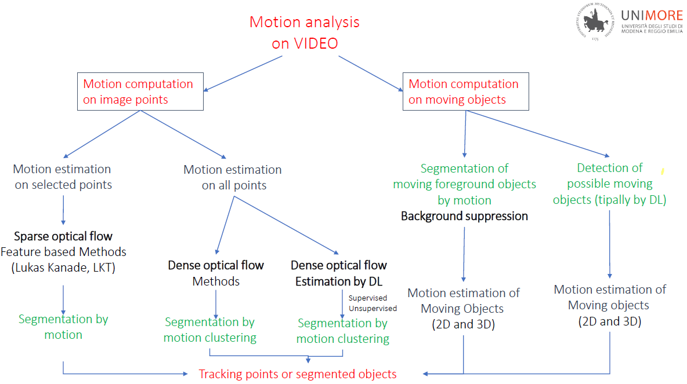{height="50%"}

!!!note Definition
    **Motion** is the movement in the real world that is inferred from the change of pixels between frames. It is not a physical quantity that can be measured, but it is a concept that we use to describe the change of pixels over time.

    **Motion field** is the projection of 3D point in 2D planes, it is a vector field that represents the motion of points in the scene. It is a 2D vector field that represents the motion of points in the scene.
    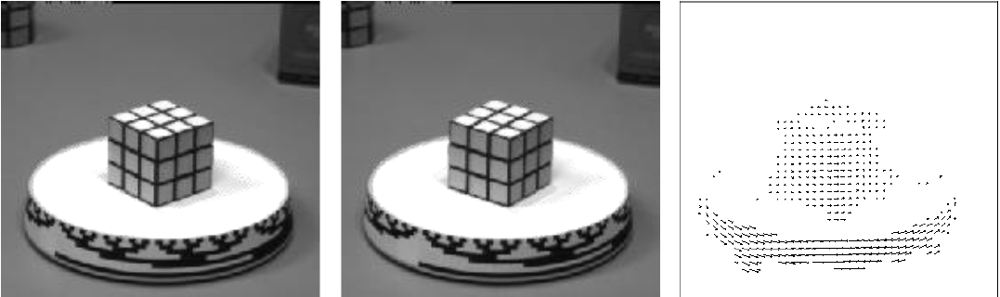{height="50%", width="70%"}

The motion can be represented as a **vector field**, where each vector represents the motion of a point in the scene. The motion field is the projection of 3D point in 2D planes, it is a vector field that represents the motion of points in the scene. Ideal for sparse optical flow (tracking specific corners or edges). Plotting vectors for every single pixel results in unreadable visual clutter.
Instead, for dense optical flow, we can use a **color coding scheme** to represent the motion vectors. For example, we can use the hue to represent the direction of the motion and the saturation to represent the magnitude of the motion.

## Motion field derivation

A 3D poin following a trajectory in the real world $P(t) = (X(t), Y(t), Z(t))$ moving with a £D velocity $\dot{P}(t) = (\dot{X}(t), \dot{Y}(t), \dot{Z}(t))$. The projection of the 3D point in the 2D plane is given by the function $p(t) = (x(t), y(t))$, with its velocity $\dot{p}(t) = (\dot{x}(t), \dot{y}(t))$. 

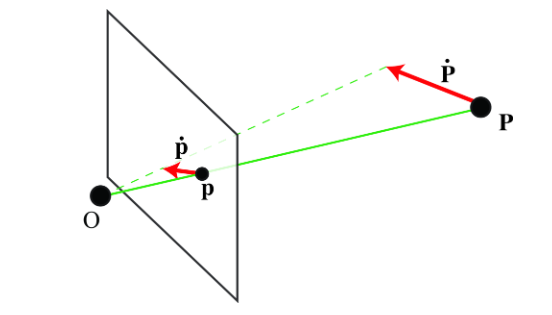

Using perspective relation:

$$\mathbf{p} = f \frac{\mathbf{P}}{Z}$$

we can find the position of the point on the 2D screen ($\mathbf{p}$) given its 3D position ($\mathbf{P}$) and its depth ($Z$). The focal length $f$ is a property of the camera that determines how much the 3D points are projected onto the 2D plane.
To find the velocity of that point on the 2D screen ($\mathbf{v}$), you must take the derivative of its position with respect to time. Because both the 3D position $\mathbf{P}$ and its depth $Z$ can change over time, you must use the **quotient rule** for differentiation.

Applying the quotient rule results in the two most important equations for understanding 2D motion fields:

$$v_x = \frac{f V_x - V_z x}{Z}$$

$$v_y = \frac{f V_y - V_z y}{Z}$$

These equations mathematically prove three massive concepts in computer vision:

1. **The $1/Z$ Depth Factor (Parallax):** Notice that $Z$ is in the denominator. This mathematically proves **Motion Parallax**. If an object is close to the camera (small $Z$), dividing by a small number makes the 2D velocity ($v_x, v_y$) very large. If the object is far away (large $Z$), the 2D velocity becomes tiny.
2. **The Need for Calibration:** The focal length $f$ is multiplied directly against the physical velocities $V_x$ and $V_y$. Without calibrating the camera to find $f$, it is mathematically impossible to isolate the true physical speed of the target.
3. **Pure Translation** means that the camera is moving through space without rotating or panning.

If the camera is moving straight forward along the Z-axis, the lateral physical movements ($V_x$ and $V_y$) are zero. If you substitute $V_x = 0$ and $V_y = 0$ into the previous equations, they simplify drastically.

$$\mathbf{v} = \frac{1}{Z}(\mathbf{v}_0 - V_z\mathbf{p})$$

Because $V_z$ (forward speed) is the dominant force, all the 2D motion vectors $\mathbf{v}$ will appear to radiate outward from a single, static central point on the image plane. This point is called the **Focus of Expansion (FOE)** (or Focus of Contraction if moving backward).

If $V_z \neq 0$, the camera is moving forward or backward through space together with the object, and the motion vectors will radiate outward from (or converge inward toward) a single mathematical point, $\mathbf{v}_0$. This point is called the **Focus of Expansion (FOE)**.

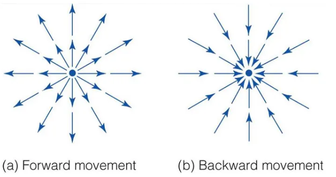

Instead if $V_z = 0$, camera moves purely laterally (left/right, up/down) without moving forward or backward into the scene.  If we set $V_z = 0$ in the  equation, the $- V_z\mathbf{p}$ term disappears entirely, leaving us with:

$$\mathbf{v} = \frac{1}{Z}\mathbf{v}_0$$

Since $\mathbf{v}_0 = (fV_x, fV_y)$ is a global constant based on the camera's physical speed, this simplified equation tells us two critical things about the 2D motion field:

1. **Uniform Direction:** Every single motion vector in the entire image will be perfectly parallel. They will all point in the exact opposite direction of the camera's movement.
2. **Magnitude = Depth:** The *only* variable left that can change the length of a vector $\mathbf{v}$ is the depth $Z$.

This is called **motion parallax**. Objects that are closer to the camera (small $Z$) will have longer motion vectors, while objects that are farther away (large $Z$) will have shorter motion vectors.
Because the vector length is inversely proportional to depth ($1/Z$), the system can instantly generate a relative depth map.

## Optical Flow

!!!note Optical Flow
    **Optical flow** is an approximation  of the motion field, It is the *apparent* mption of pixels brightness between two frames, it is a 2D vector field that represents the motion of points in the scene.

    *apparent* motion means that the motion is not the real motion, but what we perceive as motion based on the change of pixels between frames. 

The stimation is difficult to evaluate because of is difficult to get a ground truth of the motion field, because the motion is not a physical quantity that can be measured.

There are two fundamental families of algorithms used to calculate Optical Flow in practice. 

1. **Direct Methods (Gradient-Based)**

   * **How it works:** This uses the exact spatial and temporal gradients ($\nabla I$ and $I_t$) we derived earlier. It attempts to solve the Optical Flow Constraint Equation for *every single pixel* in the image.
   * **The Limitation:** Because this method relies on a first-order Taylor series approximation, it mathematically **only works if the motion is extremely small** (typically 1-2 pixels between frames). If an object moves 20 pixels in a single frame, the local gradient math completely breaks down, and the algorithm fails.
   * **The Output:** **Dense** Optical Flow. You get a complete map of the scene, but it is highly sensitive to noise, lighting changes, and fast movement.

2. **Feature-Based Methods (Matching)**

   * **How it works:** Instead of calculating gradients everywhere, the algorithm first runs a detector to find highly distinct, trackable points (specifically corners or heavily textured areas). It extracts a small patch of pixels around that corner in Frame 1, and then literally searches the surrounding area in Frame 2 to find the best matching patch.
   * **The Advantage:** Because it relies on discrete block-matching rather than infinitesimal calculus, it can successfully track objects even if they make **large, sudden jumps** (10s of pixels) between frames.
   * **The Output:** **Sparse** Optical Flow. You get highly robust tracking, but only for a few dozen points in the entire image. The spaces between the corners are left blank.

!!!note Assumptions of Optical Flow
    1. **Brightness Constancy:** The intensity of a pixel does not change between frames. This means that the color and brightness of the object remain constant as it moves.
    2. **Spatial Coherence:** Neighboring pixels in the image belong to the same object and therefore have similar motion. This allows the algorithm to infer motion for pixels that may not have a strong gradient by looking at their neighbors.
    3. **Temporal Persistence:** The motion of objects is smooth and continuous over time. This means that objects do not suddenly jump to a completely different location between frames.
    

    1. **Small Motion & Small Acceleration (The Taylor Series Limit):** As we derived previously, optical flow relies on a first-order Taylor series expansion. This mathematical approximation *only* works if the displacement ($\Delta x, \Delta y$) and the time step ($\Delta t$) approach zero. If an object moves too fast (large motion) or accelerates suddenly, the linear approximation collapses, and the algorithm outputs chaotic, incorrect vectors.
    2. **Uniform Movement (No Rotation):** Standard local algorithms assume pure 2D translation. If an object rotates, the velocity vectors of the pixels near the edge of the object are completely different from the pixels near the center. The local mathematical model cannot easily account for this angular velocity without complex, higher-order parameterization.
    3. **Spatial Coherence (The Lucas-Kanade Fix):** This is the direct solution to the Aperture Problem. A single pixel only gives us one equation for two unknowns $(u, v)$. By assuming "spatial coherence"—that a small window of neighboring pixels (e.g., $3 \times 3$) all move in the exact same direction at the exact same speed—we suddenly have 9 equations for 2 unknowns, allowing us to solve the system using Least Squares.
    4. **Rigid Body (Shape Constancy):** This ensures the spatial gradients ($I_x, I_y$) of the object remain identical between Frame 1 and Frame 2. If a body deforms (like a pulsing artery or spreading blood), the distance between pixels changes, the local brightness gradients warp, and the Brightness Constancy assumption is fundamentally broken.

**What we would like to have**

1. **Smoothness**: flow field should be smooth over the interior of objects in the scene.
2. **Sharpness**: Flow should be sharp at object boundaries.
3. **Alignment**: Flow map should be well aligned with object boundaries.
4. **Stability**: It should be temporally stable over frame sequences.

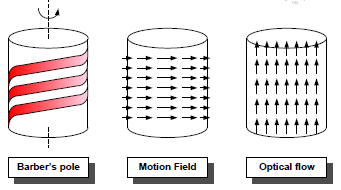{height="50%"}

!!!tip When Optical Flow and Motion Flow Are Not the Same

    There are a number of scenarios where motion in the image brightness does not correspond to the motion of the 3D points in the scene. Here there are some examples where it is unclear how motion should be defined:

    - Rotating Lambertian sphere with a static illumination will produce no changes in the image. If the sphere is static, and the light source moves, we will see motion in spite of the sphere being static.
    - Moving in front of a textureless wall produces no change on the image.
    - Waves in water: waves appear to move along the surface but the actual motion of the water is up and down (well, it is even more complicated than that).
    - A rotating mirror will produce the appearance of a faster motion. And this will happen in general with any surface that has some specular component.
    - A camera moving in front of a specular planar surface will not produce a motion field corresponding to a homography.

    Motion estimation should not just measure pixel motion, it should also try to assign to each source of variation in the image the physical cause for that change. The models we will study in this chapter will not attempt to do this.

### Mathematical Formulation of Optical Flow

The flow field in optical flow predicts shifts in pixel locations.

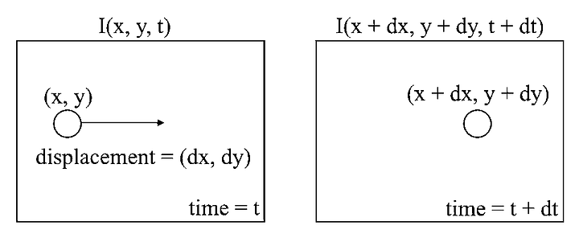{height="50%"}

The basic assumption is that the pixel intensity does not change as it moves through space and time:

$$I(x, y, t) = I(x + dx, y + dy, t + dt)$$

To derive the differential constraint, we apply a first-order Taylor series expansion to the right side of the equation:

$$I(x + dx, y + dy, t + dt) \approx I(x, y, t) + \frac{\partial I}{\partial x}dx + \frac{\partial I}{\partial y}dy + \frac{\partial I}{\partial t}dt$$

Since we assume the intensity remains constant, the total variation must be zero ($dI = 0$). By substituting the expansion and simplifying $I(x, y, t)$ from both sides, we get the exact differential equation:

$$\frac{\partial I}{\partial x}dx + \frac{\partial I}{\partial y}dy + \frac{\partial I}{\partial t}dt = 0 \\
(\text{Brightness Constancy Equation})$$

By dividing the entire expression by the time differential $dt$, we introduce the velocity vector components, namely $u = \frac{dx}{dt}$ (horizontal velocity) and $v = \frac{dy}{dt}$ (vertical velocity). This leads to the final **Horn and Schunck OFE**:

$$\frac{\partial I}{\partial x}u + \frac{\partial I}{\partial y}v + \frac{\partial I}{\partial t} = 0$$

The problem is having one equation with two unknowns, so we need to make some assumptions to solve it. If we know the shapes of the objects in the scene, we can use this to assume how it move. This is known as the **aperture problem**.

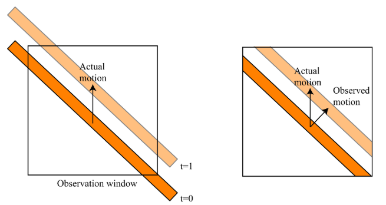{height="50%"}

Rewriting Horn and Schunck OFE:

$$\frac{\partial I}{\partial x}u + \frac{\partial I}{\partial y}v = - \frac{\partial I}{\partial t} \\ \nabla I \cdot V = - I_t$$
where:
$\nabla I = (I_x, I_y)$ and the unknown velocity vector $\vec{V} = (u, v)$

The spatial gradient $\nabla I$ is a vector that always points in the direction of the greatest intensity change, meaning it always points **perfectly perpendicular to an edge**.

Because of the dot product, this single equation only allows us to calculate the projection of the velocity vector that aligns with this gradient. To compute magnitude (the speed perpendicular to the edge):

$$v_{normal} = -\frac{I_t}{\sqrt{I_x^2 + I_y^2}}$$

If an object moves *parallel* to its own edge, the pixel intensities along that edge do not change ($I_t$ is zero for that specific movement). Because the algorithm relies entirely on brightness changes to track movement, **any motion parallel to an edge is mathematically invisible.**

Therefore, the true velocity $(u, v)$ is ambiguous. It could be the pure normal velocity, or it could be the normal velocity plus any arbitrary amount of parallel sliding $(u', v')$. A local gradient algorithm has no way to tell the difference.

Because real-world cameras have sensor noise, lighting fluctuations, and compression artifacts, the Optical Flow Constraint Equation ($I_x u + I_y v + I_t = 0$) will almost never perfectly equal zero.

Therefore, computer vision reframes the math as an **Optimization Problem**: we cannot find a perfect zero, so we must write an algorithm to find the velocities $(u, v)$ that minimize the error.

The first equation, $E_{SSD-OF}$, measures the "photometric error."
$$E_{SSD-OF} = \sum_{i=1}^{N} (I_0(x_i, y_i) - I_1(x_i + u_i, y_i + v_i))^2$$
It takes the pixel intensity in Frame 0 ($I_0$) and subtracts the intensity of the displaced pixel in Frame 1 ($I_1$). Squaring the difference ensures that negative and positive errors don't cancel each other out, and it heavily penalizes large mistakes. The algorithm's goal is to find the motion vectors $\{\mathbf{u}_i\}$ that drive this sum as close to zero as possible.

As we established with the Aperture Problem, trying to minimize the error for a single pixel is impossible because there are infinite mathematically valid solutions along an edge. To force the algorithm to pick *one* unique solution, we must add artificial rules, known mathematically as **Regularization Constraints**.
- **Lucas-Kanade**
- **Horn-Schunck**

#### Lucas-Kanade

Lucas-Kanade is a **local** and **sparse** method, meaning it only applies the Optical Flow Constraint Equation to a small, localized patch of pixels (e.g., $5 \times 5$) and only at specific feature points (corners). It works on two basic assumptions to calculate the values of u and v in the Optical Flow equation:

1. Flow is smooth locally. It means that the motion of objects or points in a small, localized region of an image is relatively consistent and does not exhibit sudden or abrupt changes.
2. Neighboring pixels have the same displacement. In other words, neighboring pixels in the selected region are assumed to have similar motion, allowing the algorithm to represent the overall motion with a single vector.

Assume having 5 $\times$ 5 image patch, we have 25 pixels, and for each pixel we can write the Optical Flow Constraint Equation. This gives us 25 equations with only 2 unknowns (u and v).

1. The temporal gradient can be computed with the backward derivative
2. The spatial gradient can be computed with Sobel

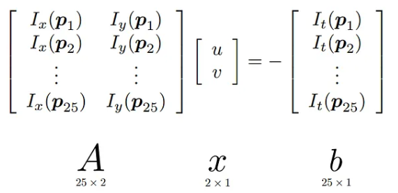{height="50%"}

The $\mathbf{A}$ matrix contains is not square so there is no perfect $\mathbf{v}$ to solve all equation. The solution is to find the $\mathbf{v}$ that minimizes the error, this is done with the least squares method. We multiply both sides by the transpose of the gradient matrix ($A^T$):$$A^T A \mathbf{v} = A^T \mathbf{b}$$This successfully converts the rectangular matrix $A$ into a square, $2 \times 2$ invertible matrix $A^T A$. We can now isolate the velocity vector $\mathbf{v}$:$$\mathbf{v} = (A^T A)^{-1} A^T \mathbf{b}$$

The $2 \times 2$ matrix $A^T A$ is known as the second-moment matrix:

$$A^T A = 
\begin{bmatrix}
\sum I_{xi}^2 & \sum I_{xi} I_{yi} \\
\sum I_{xi} I_{yi} & \sum I_{yi}^2
\end{bmatrix}$$

This relies entirely on its eigenvalues, $\lambda_1$ and $\lambda_2$:

* **Flat Region ($\lambda_1 \approx 0, \lambda_2 \approx 0$):** Gradients are zero. The matrix is singular and cannot be inverted. The math fails.
* **Straight Edge ($\lambda_1 \gg 0, \lambda_2 \approx 0$):** Gradients exist in only one direction. The matrix is mathematically ill-conditioned. The Aperture Problem remains unsolved.
* **Corner / Textured Region ($\lambda_1 \gg 0, \lambda_2 \gg 0$):** Gradients are strong in two orthogonal directions. The matrix is easily invertible, and the least-squares solution is highly robust.

To identify regions where the motion will be reliable, we can use the following quantity (proposed by Harris), which relates to the conditioning of the matrix $\mathbf{A}$:
$$R= det(A) - \lambda \cdot trace(A)^2$$

This mathematical requirement for two strong eigenvalues is the exact reason why the Lucas-Kanade method is a **sparse** optical flow algorithm. It only computes valid vectors at specific, high-contrast feature points (corners) and ignores the rest of the image.

#### Horn-Schunck

Horn-Schunck is a **global** method, meaning it applies a regularization constraint across the entire image, not just locally. It assumes that the motion field is smooth everywhere, which allows it to fill in the gaps between the sparse points calculated by Lucas-Kanade.

This methods is based on minimizing directly the **photometric error** adding a regurarization term that penalizes fast variations in the flow field:
$$ E = \sum_{i=1}^{N} (I_0(x_i, y_i) - I_1(x_i + u_i, y_i + v_i))^2 + \alpha R(u, v)$$

The regularization term $R(u, v)$ can penalized large velocities (**slow prior**):
$$R(u, v) = \sum_{i=1}^{N} (u_i^2 + v_i^2)$$; or variations in the flow field (**smoothness prior**):
$$R(u, v) = \sum_{i=1}^{N} \left(\left(\frac{\partial u}{\partial x}\right)^2 + \left(\frac{\partial u}{\partial y}\right)^2 + \left(\frac{\partial v}{\partial x}\right)^2 + \left(\frac{\partial v}{\partial y}\right)^2\right)$$

Running gradient descent on this loss function. At each iteration $\mathcal{n}$, the esitmated otical flow will be used to compute an updated for $\delta u$ and $\delta v$. The velocities for the next iteration step ($k+1$) are calculated based on the local averages ($\bar{u}, \bar{v}$) of the current step ($k$):
$$u^{k+1} = \bar{u}^k - \frac{I_x(I_x \bar{u}^k + I_y \bar{v}^k + I_t)}{\alpha^2 + I_x^2 + I_y^2} \\
v^{k+1} = \bar{v}^k - \frac{I_y(I_x \bar{u}^k + I_y \bar{v}^k + I_t)}{\alpha^2 + I_x^2 + I_y^2}$$

The algorithm iteratively updates every pixel's vector using the average of its neighbors until the entire field converges into a smooth map. It forces the computer to guess the interior motion, resulting in a 100% **Dense** flow field.

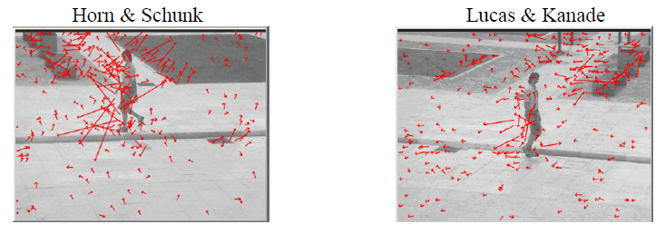{height="50%"}

#### Farneback

The algorithm approximates image motion by modeling the neighborhood of each pixel using **quadratic polynomials**. Tracking how these quadratic surfaces translate from one frame to the next yields the displacement field. Instead of exhaustive search or block matching, the method relies on a **polynomial expansion transform** to compute the approximations efficiently.
The image intensity signal is expressed locally in a coordinate system using the following quadratic formulation:
$$f(x) \sim x^T A x + b^T x + c$$

$A$ is a symmetric matrix capturing structural details like edges and corners, $b$ represents the local gradient, and $c$ is the absolute intensity.

### Dense optical flow DL methods

Nowadays, we can use deep learning to estimate the optical flow. The idea is to train a neural network to predict the optical flow from a pair of images. The network is trained on a large dataset of image pairs with known optical flow, and it learns to generalize to new image pairs.

One of the most popular architectures for dense optical flow estimation is the **FlowNet** an  encoder-decoder network, which consists of a convolutional neural network that takes two images as input and outputs a *dense flow field*. The network is trained using a combination of supervised and unsupervised loss functions to ensure accurate flow estimation.

The first variant, **FlowNet Simple**, adopts an **early fusion strategy**. The two input images are concatenated along the channel dimension, forming a tensor of shape $(6, H, W)$, which is directly fed into the encoder. Consequently, the network learns both feature extraction and motion matching jointly from the very first convolutional layer.

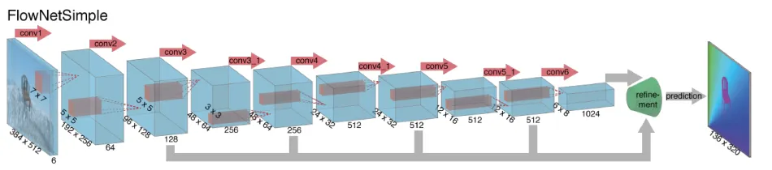{height="50%"}

By stacking raw pixels at the very beginning, the network has no hardcoded concept of two separate frames. It is a generic architecture where the network must implicitly deduce the concept of spatial matching.

The second variant, **FlowNet Corr** (FlowNetC), introduces a **feature-level** (intermediate) **fusion strategy**. Instead of concatenating the images at the input, each image is first processed independently by two identical convolutional streams arranged in a Siamese architecture with shared weights. This design allows the network to learn feature representations separately before comparing them. The fusion between the two streams is performed by a correlation layer, which explicitly measures the similarity between local feature patches extracted from the two images. Given two feature maps $f_1$ and $f_2$, the correlation between patches centered at locations $x_1$ and $x_2$ is defined as:

$$
c(x_1, x_2) = \sum_{o \in [-k, k] \times [-k, k]} \langle f_1(x_1 + o), f_2(x_2 + o) \rangle
$$

where:

$x_1, x_2$ are the centers of the compared patches;
$o$ denotes the offset within the patch;
$\langle \cdot,\cdot \rangle$ represents the dot product between feature vectors.

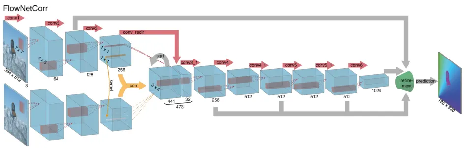{height="50%"}

To be specific, for each location f1, the authors limit the range of f2 by computing correlations in a neighborhood of size $D = 2d+1$, and d is a given maximum displacement. The size of an output is $(w \times h \times D^2)$. Afterwards, the authors concatenate the feature map, which is extracted from f1 using convolution layer, with the output.

By delaying the fusion until after feature extraction, the network first focuses purely on learning robust, invariant visual representations. The correlation layer then performs an explicit matching operation. It provides a strong geometric inductive bias tailored specifically for motion estimation. The Siamese branches only need to learn how to encode discriminative visual descriptors. The post-correlation layers do not have to learn how to compare data

However, after a series of convolution layers and pooling layers, resolution has been reduced. Thus, the authors refine the coarse pooled representation by ‘upconvolution’ layers, consisting of unpooling and upconvolution. After upconvolutioning the feature maps, the authors concatenate it with corresponding feature maps and an upsampled coarse flow prediction.

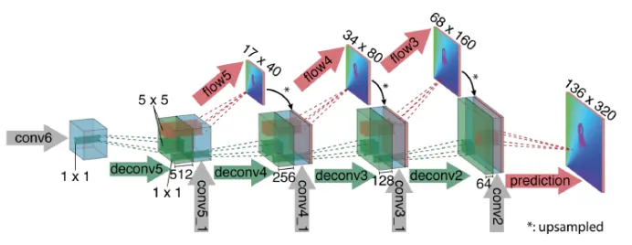{height="50%"}

The loss function of FlowNet is designed to handle the multi-scale nature of the network's refinement phase. Since the model predicts flow at several resolutions during upsampling, it doesn't just calculate loss at the final output but aggregates errors across different layers.
The loss for each scale is the **Average Endpoint Error (EPE)**. It represents the Euclidean distance between the predicted flow vector $\mathbf{w}_{pred} = (u, v)$ and the ground truth vector $\mathbf{w}_{gt} = (u^*, v^*)$, averaged over all pixels $N$:

$$EPE = \frac{1}{N} \sum_{i=1}^{N} \sqrt{(u_i - u_i^*)^2 + (v_i - v_i^*)^2}$$

In a deep learning context, this acts as the $L_2$ loss on the displacement field.

#### Difference between FlowNetS and FlowNetC

The main difference between FlowNetS and FlowNetC is the way they fuse the two input images. 

