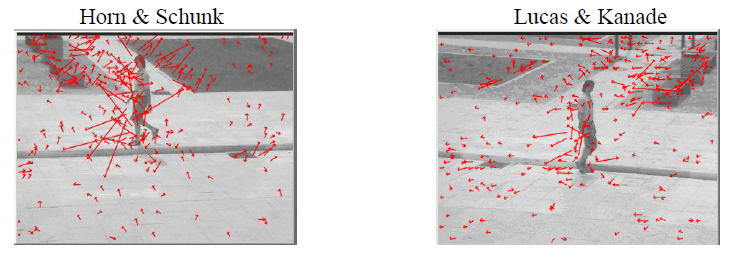
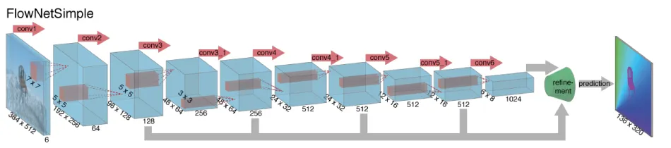
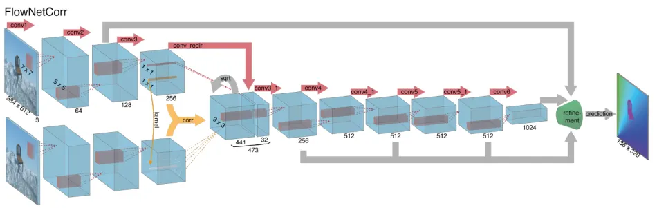

# Mobility Networks

Parent: [[0_Graph_Analytics_MOC]]

I problemi della mobilità urbana sono complessi e coinvolgono molteplici fattori, tra cui la pianificazione urbana, le infrastrutture di trasporto, le abitudini di viaggio e le dinamiche sociali. Per affrontare questi problemi, è possibile utilizzare i **Graph Mobility Networks** (**GMN**), che rappresentano le reti di mobilità come grafi.

La gestione della mobilità moderna deve affrontare problematiche critiche come la congestione stradale, l'impatto ambientale, la sicurezza e la resilienza ai cambiamenti climatici.

I dati utili che possiamo usara per modellare il problema della mobilità sono dati relativi, ad esempio, agli orario degli autobus, alla posizione dei mezzi di trasporto, alle infrastrutture stradali, e i point of interest (POI) come negozi, ristoranti, scuole, ecc. Questi sono dati **statici** che cambiano raramente, ma che modellano la dimensione spaziale del problema. Mentre, i dati **dinamici**, cambiano frequentemente e modellano la dimensione temporale e spaziale. Esempi sono traiettorrie dei mezzi di trasporto, flussi di traffico in tempo reale, condizioni del traffico e abitudini di viaggio delle persone.

Le **Matrici Origine-Destinazione**, vengono usate dai comuni per mostrare i flussi di spostamentto tra le diverse zone della città in certi orari. Utile per capire i flussi di spostamento e pianificare le infrastrutture di trasporto per ridurre eventuali congestioni e migliorare la mobilità urbana.

Per poter analizzare il problema della mobilità urbana, abbiamo bisogno sia di informazioni spaziali che temporali. Queste informazioni possono essere aggregate o non aggregate, a seconda del livello di dettaglio e della scala dell'analisi.

- **Spazio Fisso e Tempo Variabile (Serie Temporali)**: 
- **Spazio Non Aggregato e Tempo Fisso (Mappe)**
- **Spazio e Tempo Non Aggregati (Dinamica Real-Time)**

I **dati geospaziali** sono informazioni che identificano la posizione geografica di caratteristiche e confini sulla Terra. Possono essere coordinate (espliciti) o descrizioni (impliciti) di luoghi, come indirizzi o nomi di città. Possono essere reppresententati anche su diversi livelli di dettaglio, come rete stradale, zone urbane, zone rurali, ecc. In questo caso li rappresentiamo come uno stack di matrici, dove ogni matrice rappresenta una differente vista della zona che consideriamo.

I sistemi di coordinate ci permettono di localizzare univocamente un punto nello spazio. Esistono due tipi principali di sistemi di coordinate:

* **Geographic Coordinate System (GCS):** identifica la posizione di un punto direttamente sulla superficie curva della Terra. Si basa su una rete di linee immaginarie chiamata **Graticular Network**.
  * **Paralleli (Latitudine):** linee orizzontali parallele all'**Equatore**.
  * **Meridiani (Longitudine):** linee verticali che passano per i poli, con riferimento al **Meridiano di Greenwich** (Prime Meridian).
* **Projected Coordinate System (PCS):** definisce le modalità con cui la superficie curva viene proiettata su un piano bidimensionale.

Per interpretare correttamente una coordinata, è necessario definire un **SRS (Spatial Reference System)**, che si compone di diversi elementi:

  * **Datum:** è un set di parametri e regole matematiche che definiscono l'origine, la scala e l'orientamento del sistema. Il datum standard più diffuso è il **WGS 84**.
  * **SRID (Spatial Reference Identifier):** è un codice identificativo univoco che richiama un SRS specifico.
    * *Esempio:* il codice **EPSG:4326** corrisponde al sistema WGS84.

Quindi la *proiezione* di una coordinata geografica dipende dal sistema di riferimento spazio-temporale utilizzato. Ad esempio, se si utilizza un sistema di coordinate geografiche (GCS), la proiezione sarà basata su latitudine e longitudine, mentre se si utilizza un sistema di coordinate proiettate (PCS), la proiezione sarà basata su coordinate cartesiane (x, y).

Questi dati possono essere rappresentanti sotto forma **vettoriale** che rappresenta punti, linee e poligoni. La codifica dei vettori può avvenire i due standard:

- **Well Known Text (WKT)** è un linguaggio di markup leggibile dall'uomo che descrive la geometria spaziale attraverso coordinate testuali.
- **Well Known Binary** è la versione binaria del WKT, che è più efficiente in termini di spazio e velocità di elaborazione, ma meno leggibile.

sotto forma **raster** che rappresenta dati spaziali come una griglia di celle. I dati vettoriali sono più adatti per rappresentare caratteristiche discrete come strade, edifici e confini, mentre i dati raster sono più adatti per rappresentare fenomeni continui come l'altitudine, la temperatura o la copertura del suolo.
Oltre alla classica rappresentazione 2D, i geodati possono assumere forme più complesse per scopi analitici o di visualizzazione: 

- **2D Depth Map**: Mappe di profondità in due dimensioni.  
- **3D Point Cloud**: Nuvole di punti che definiscono oggetti in uno spazio tridimensionale.  
- **4D Dynamic Point Cloud**: Nuvole di punti che evolvono nel tempo, integrando la dimensione temporale.

Queste informazioni geospaziali possono essere memorizzate e gestite in database spaziali, che supportano query spaziali e operazioni di analisi. Alcuni dei principali database spaziali includono:

- **R-Tree**: è indice basato sul concetto della gerarchia spaziale. Invece di indicizzare i singoli punti, raggruppa gli oggetti vicini all'interno di rettangoli chiamati MBR (Minimum Bounding Rectangles). Per ricercare un oggetto, l'R-Tree esegue una ricerca ricorsiva attraverso i nodi dell'albero, confrontando i MBR con la query spaziale. Se un MBR interseca la query, il processo continua fino a raggiungere i nodi foglia, dove vengono restituiti gli oggetti che soddisfano la query.
{height="50%"}
- **GiST (Generalized Search Tree)**: non è un singolo indice, ma un framework che consente di implementare vari tipi di indici, inclusi quelli spaziali. Invece di usare solo rettangoli, può gestire gli oggetti in base alla loro posizione, al fatto che si sovrappongano o che siano contenuti l'uno nell'altro.

## Graph Mobility Networks

Supponiamo di modellare la rete stradale di una città. Cosa rappresentare come nodo e cosa rappresentare come arco dipende dallo scopo dell'analisi che facciamo.

### Trovare gli incroci più congestionati

Un modo per rappresentare le rete stradale è quella di considerare gli incroci come nodi e le strade come archi. Questa rappresentazione è detta **primal** e permette risolvere problemi come trovare gli incroci più congestionati, identificare i percorsi più brevi tra due punti, o analizzare la connettività della rete. 

{height="50%"}

Per rappresentar in maniera più fedele le strade dal punto di vista spaziale, gli archi che modellano le strade invece di andare direttamente da un incrocio all'altro, possono essere spezzati in più segmenti, con nodi intermedi che rappresentano punti di interesse lungo la strada (ad esempio, semafori, fermate degli autobus, ecc.). Quindi la strada viene rappresentata da molti archi e nodi, permettendo di modellare in maniera più precisa la geometria della strada e le sue caratteristiche.

Nonostante il grafo diventa più complesso, risualta avere vantaggi nella precisione del calcolo del routing minimo; migliora anche la rappresentazione delle informazioni del traffico, visto che su una strada possono esserci più segmenti con condizioni di traffico diverse, endendo l'analisi della congestione molto più accurata.

Per poter individuare i nodi più congestionati, possiamo utilizzare misure di centralità come la **betweenness centrality**, ma il limite è che questa descrive solo la topologia del grafo e non tiene conto di fattori dinamici come il traffico in tempo reale o le condizioni stradali. Modellando le informazioni di traffico come pesi sugli archi, possiamo misurare la congestione tramite **weighted degree centrality**, tipicamente basato sull'AADT (Annual Average Daily Traffic):
$$W = \frac{AADT}{distance}$$Un nodo con un weighted degree elevato rappresenta un incrocio dove converge fisicamente un grande volume di traffico, identificandolo come punto di congestione.  

### Trovare gli incroci o strade principali

Un altro modo per rappresentare la rete stradale è quella di considerare le strade come nodi e gli incroci come archi. Questa rappresentazione è detta **dual** e permette di identificare le strade più importanti o centrali nella rete, analizzando la loro connettività e il loro ruolo nella struttura complessiva della rete.

Viene costruito dal primal, tramite un modello di generalizzazione (es. Named Street o Intersection Continuity Negotiation) che permette di riconoscere la continuità delle strade attraverso una pluralità di archi nel primal graph. Genera un grafo con meno nodi (le strade) ma più densi (gli incroci diventano archi), che permette di analizzare la rete stradale da una prospettiva diversa, focalizzandosi sulle relazioni tra le strade piuttosto che sugli incroci.

{height="50%"}

In questo modo possiam calcolcare tramite l'algoritmo **PageRank**quanto una strada sia "centrale" o influente nel sistema.

- Una strada riceve un punteggio di PageRank elevato se è connessa a molte altre strade.
- Il punteggio aumenta se le connessioni avvengono attraverso incroci critici (quelli che nel *Primal Graph* hanno un alto punteggio di *Degree Centrality*).

#### Multi Layer Multi Modal Graph

Con il **Multi Layer Multi Modal Graph**  trasformando il semplice grafo stradale in un **Digital Twin** della città.

Invece di forzare tutti i dati in un unico piano, il sistema è esteso con strati aggiuntivi per i diversi mezzi di trasporto:

* **Cycle Path Graph**: dedicato alla mobilità dolce, include nodi di tipo `PATH` e relazioni come `CROSSING` per modellare gli attraversamenti.
* **Road Network Graph (Primal Graph)**: lo strato stradale standard dove i nodi rappresentano le intersezioni (`Junction`) e possono essere inclusi i `POI` (Punti di Interesse).
* **Public Transport Graph**: lo strato del trasporto pubblico, con nodi `STOP` (fermate) collegati da linee specifiche (es. `BUS 1`, `BUS 2`).

La vera potenza del modello risiede nella capacità di connettere questi strati indipendenti per simulare spostamenti reali e complessi:

* **Relazioni NEAREST**: vengono create connessioni (archi) tra nodi appartenenti a strati diversi che si trovano fisicamente vicini.
* **Integrazione Spaziale**: ad esempio, un nodo `PATH` della pista ciclabile o una fermata `STOP` del bus vengono collegati alla `Junction` stradale più vicina.
* **Routing Multimodale**: questo permette di calcolare percorsi che prevedono il cambio di modalità (es. bici + bus) passando da uno strato all'altro tramite questi archi di collegamento.
