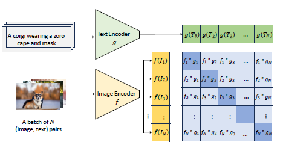
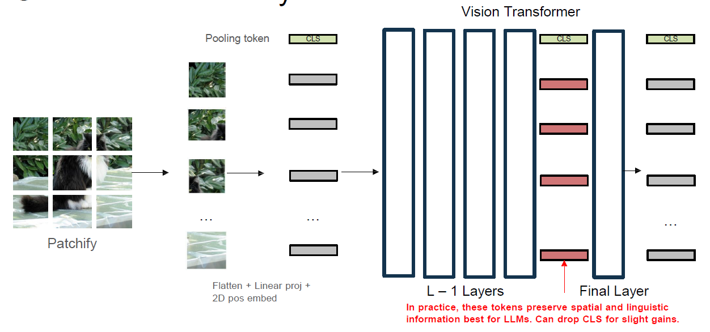
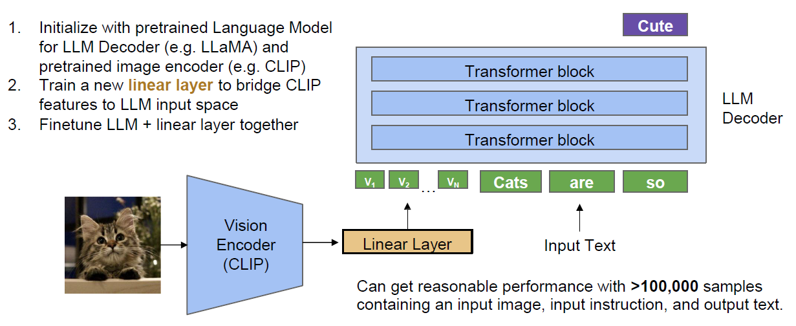
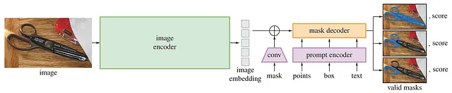
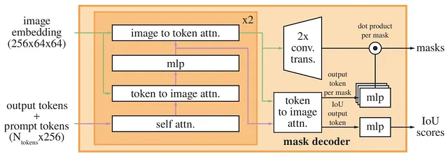

# Unified Language-Vision Models

Parent: [[0-Computer_Vision_MOC.md]]

Until now nets that have been trained only in one modality and on a limited dataset, like ImageNet. Another problem is that label is not descriptive enough making then not generalize well to other types of tasks; furthermore, the number of classes is limited, and the model can only learn to recognize those specific classes.

## Foundation Models

This type of scenario is called **closed vocabulary** and it is a problem because the model will not be able to recognize objects that are not in the training set, and it will not be able to generalize to new tasks. So, nowadays, the trend is to move toward **open vocabulary** datasets, that have a large amoutn of classes and have a label that is more descriptive than having a single word as a label.

!!!note Unified Language-Vision Models
    These models are trained on large datasets that contain both images and text, and they are able to learn a joint representation of both modalities. This allows them to perform a wide range of tasks, such as image captioning, visual question answering, and image retrieval.

    Some examples of unified language-vision models include:
    - CLIP (Contrastive Language-Image Pretraining)
    - ALIGN (A Large-scale ImaGe and Noisy-text embedding)
    - Florence (A Large-Scale Multimodal Foundation Model)

### CLIP (Contrastive Language-Image Pretraining)

CLIP is a model that is trained on a large dataset of images and their corresponding text description as a labels. In thsi way the dataset is open vocabulary and more desceriptive allowing models to generalize better to new tasks on which is not trained on.

CLIP has two separate encoders, one for images (CNN like) and one for text (Transformer Encoder). This two encoders have the objective of learning how to map images and text in the same latent space, in a way that images and their corresponding description are close to each other in the space. More descriptive labes give the model the possibility to learn better visual features respect other backbone that use only label for the task. So, text lead model to better understanding of image representation.
To achive this objective, CLIP is trained in a *contrastive learning*, a self-supervised approach that learns to distinguish between similar and dissimilar pairs of data. SO in this way similar pairs (image and its description) are pulled together in the latent space, while dissimilar pairs (image and a random description) are pushed apart.

The train loss used is the **Contrastive Loss** that is computed as follows: 
$$L = -\frac{1}{N} \sum_{i=1}^{N} \left[ \log \frac{\exp(\text{sim}(v_i, t_i) / \tau)}{\sum_{j=1}^{N} \exp(\text{sim}(v_i, t_j) / \tau)} + \log \frac{\exp(\text{sim}(t_i, v_i) / \tau)}{\sum_{j=1}^{N} \exp(\text{sim}(t_i, v_j) / \tau)} \right]$$

```python
def forward(image, text):
    image_features = self.image_encoder(image) # (N, D)
    text_features = self.text_encoder(text) # (N, D)
    
    #normalizedfeatures
    image_features=image_features/image_features.norm(dim=1,keepdim=True) text_features=text_features/text_features.norm(dim=1,keepdim=True)
    
    # cosine similarity as logits
    logit_scale =self.logit_scale.exp()
    logits= logit_scale* image_features @ text_features.t() # (N,N)

    #fill in the loss
    target=torch.arange(image_features.shape[0],device=image_features.device)
    loss_image =F.cross_entropy(logits, target)
    loss_text=F.cross_entropy(logits.t(),target)

    # average the two losses
    loss=(loss_image +loss_text) /2.0
    return loss
```

{height="50%"}

Encoders are trained jointly with the aim of maximizing cosine similarity between $N$ real pairs of image-text, while minimizing cosine similarity of $N^2-N$ incorrect pairing. This is done computing cosine similarity between each pair of image-text vectors taht two encoder generate. So, a similarity matrix is build whch during train is force to have high value to similarity on the principal diagonal (correct pairs) and low value in the rest of matrix (incorrect pairs). To do this, softmax and CE are applied row-by-row and column-by-column to have probability.

Projecting image and text in the same space make model able to compute other tasks like retrieval starting from text or image; and also the possibilty to classify unseen images based on the point close to theri projection in the space, like how work k-NN.

To turn a pre-trained, frozen CLIP model into a classifier, we have two options:

- Zero-Shot Classification that maps images directly to text descriptions using the shared cross-modal embedding space. It requires no parameter updates and generalizes immediately to arbitrary classes.
- Linear Probing with which it froze both the image and text encoders entirely, extract the raw image embeddings, and train a shallow, supervised logistic regression or linear layer directly on top of those static features.

## Multi-modal Foundation Models

!!!note Multi-modal Foundation Models
    A **Multi-modal Foundation Model** is a model train on very general-purpose large dataset to make then easily adaptible to different tasks and capable to process more than one type of inputs.

### Image to text - LLaVA

Starting with CLIP we could build a model that is multi-modal because it is already trained on a very largest dataset and are very good in the discriminative tasks but its training rely too much on the batch sizes to master distinct visual concepts. Small batch sizes only allow the model to learn macro-categories, whereas scaling the batch size to 32,000 enables fine-grained recognition. Even within an immense batch of 32K, it is highly improbable to encounter the exact paired hard negatives needed to learn subtle semantic boundaries.  
Relying solely on image-level internet captions provides weak training signals for complex, localized vision tasks

To overcame these limitations one approach is to make CLIP autoregressive combining it with a LLM. **LLaVA** (Large Language and Vision Assistant) is based on autoregressive token generation of trasformer adapted also to manage images as input. To do this we have to make image token representation compatible with the text ones.

To do this, we take from penultime layers of CLIP visual features which have more spatial informatation instead of the ones of last layer that are a less fine-graine and have noise due to the losing of supervised caused by tge contrastive loss that optimave only the embeddings for the compare to the text. Taking the $L-1$ feature maps is the better choice because is also to easily mapped in the space of word embeddings. During CLIP's backpropagation, gradients flowing through the CLS token still pass through these intermediate feature maps, ensuring they align robustly with linguistic concepts.  

{height="50%"}

After the feature are generated this are projected in the same space of the text token thank to a *Linear Layer* that is trainable to make the projection more close with the text token. To achieve optimal alignment, LLaVA employs a two-stage training pipeline:

1. Feature Alignment (Pre-training): Both the Vision Encoder and the LLM are kept frozen. Only the Linear Layer is trained on simple image-caption pairs to align the visual and textual token spaces.
2. Visual Instruction Tuning (Fine-tuning): The LLM and the Linear Layer are unfrozen and trained together on rich, GPT-4 generated instruction-following data (conversations, detailed descriptions, complex reasoning steps) to unlock true multimodal chat capabilities.  

   
{height="50%"}

### SAM (Segment Anything Model) 

SAM is a model that is trained on a large dataset of images and their corresponding segmentation masks. It is able to segment any object in an image, regardless of its class or category.

{height="50%"}

Model consists of:

- **Image encoder** (masked autoencoder) to extract the image embedding. It is run once and the image embedding is stored in a cache to be used for multiple prompts. The image encoder is a masked autoencoder that takes as input an image and outputs a feature map that is used as the image embedding. The image encoder is trained to reconstruct the input image from the feature map, which allows it to learn a rich representation of the image.
- **Prompt encoder** that takes in different types of prompt (like points, boxes, text) and encode them in the same space of the image embedding. Can take as input also a mask that is used to focus the attention of the model on a specific region of the image.
- **Mask decoder** that maps the image embedding and the prompt embedding to a segmentation mask. It is a transformer decoder that takes as input the image embedding and the prompt embedding and outputs a segmentation mask. Is inspired by the architecture of the transformer decoder used in the LLM, and use prompt self-attention and cross-attention in two directions (prompt-to-image embedding and vice-versa) to update all embeddings.


One problem of SAM is that the user prompt can be **ambiguous** wher it select a point or drawing a box that can be interpreted in different ways. The model does not know the level of granularity that user what to achive.
This is resolved that to the Mask decoder. Instead of predicting one simgle mask, the model produce a set of valid masks. Thosse mask correspond to different levels of granularity (Whole, Part, e Sub-part).
During training, losso is compute only for the best mask with respect to the ground truth.

The main problem of training SAM was the lack of large annotated dataset of segmentation masks. To overcome this problem, the authors of SAM created a new dataset called **SA-1B** (Segment Anything 1 Billion). This dataset was created using a combination of manual annotation and automatic annotation. The manual annotation was done by a team of annotators who were asked to segment objects in images using a simple annotation tool. The automatic annotation was done using the output of a model to generate segmentation masks for a large number of images.

!!!danger
    SAM can not be considered as a model that perform semantic segmentation tasks because it is not trained to segment a limited number of classes of objects. Furthermore, SAM output separate masks for each object in the image also if they are overlapped.
