# Generative Models

Until now all task we have performed were a **supervised tasks**, in which we had a dataset with labels to train a model for a certain type of task. But not alway we have a dataset with labels. In this case, we can train a modela in a **unsupervised way** to learn the hidder structure of data from dataset and perform other type od task, like *generation*.
Generally this type of approach consist on learnng a **density function** that describe the data distribuition, and then we can sample from this distribution to generate new data that are similar to the original data. In this way we can create different type of models to perform different type of task, like:

- **Discriminative models**: this tyoe of model learn a function that map the input data to a label, so they are used for classification task. They learn the **conditional probability** $P(y|x)$, where $y$ is the label and $x$ is the input data. If there is images that model have never seen before, the model can predict the label of that image based on the features it has learned from the training data.
- **Generative models**: learn a function that map input data to a *latent space*, a lower dimensionality space that capture the most important feature of the data, and then learn a function that map the latent space to the original data space. They learn the **joint probability** $P(x,y)$, where $x$ is the input data and $y$ is the label. If there is images that model have never seen before, the model can generate new images based on the features it has learned from the training data. But if we ask to generate an image wth things that model have never seen before, the model will generate an image that is similar to the training data but with some variations, because the model has learned the underlying structure of the data and can generate new data that is similar to the original data.
- **Conditional generative models**: are better for the generation with same constraints (prompt). this kind of model map alway how to maps input to latent space, but this is constrained by a certain condition. So, thy learn the **conditional probability** $P(x|y)$, where $x$ is the input data and $y$ is the label.

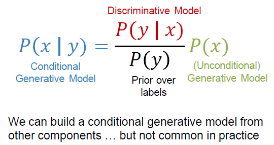{height="50%"}

For the text-to-image generation, we have the same problem of the text generation: ambiguity. There are many possible outputs $x$ for an input $y$, we want to model $P(x|y)$. This is the case of text-to-image generation, where we have a text description (input) and we want to generate an image (output) that corresponds to that description. The model needs to learn the underlying structure of the data and be able to generate new data that is similar to the original data, but with some variations. This is why we need a conditional generative model, because we want to generate an image that is conditioned on a certain input (the text description).

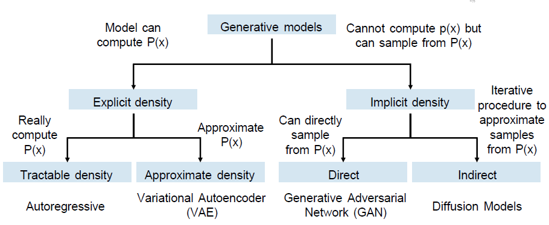{height="50%"}

## Autoregressive Models

Let a sequence of data points (such as text tokens, audio samples, or image pixels) be represented as a vector $X = (x_1, x_2, \dots, x_T)$.

The goal is to model the joint probability distribution $P(X)$. According to the **chain rule of probability**, any joint distribution can be factorized without loss of generality into a product of conditional probabilities:

$$P(X) = P(x_1, x_2, \dots, x_T) = \prod_{t=1}^T P(x_t \mid x_1, x_2, \dots, x_{t-1})$$

To simplify notation, we define the history up to time $t-1$ as $x_{<t}$. Thus, the factorization becomes:

$$P(X) = \prod_{t=1}^T P(x_t \mid x_{<t})$$

Training an autoregressive model relies on **Maximum Likelihood Estimation (MLE)**. We minimize the Negative Log-Likelihood ($\mathcal{L}$) over the training dataset:

$$\mathcal{L}(\theta) = -\sum_{t=1}^T \log P(x_t \mid x_{<t}; \theta)$$

To implement this mathematical formulation in deep learning, the architecture must strictly respect the **causal property**: the prediction at step $t$ cannot have access to information from steps $t, t+1, \dots, T$.

The problem of using this kind of approach for images is due to the large amount of pixel to predict, so we need to use a lot of computational resources and time to train the model. A solution could be treat images as a sequence of pathches to reduce the number of pixel to generate, but the problem is the same.

## GANs

A better model to use for image generation is the **Generative Adversarial Networks (GANs)**, that is a non-parametric approach to generative modeling based on the minmax optimization between two nets:

- **Generator ($G$)**:  Takes a random noise vector $z$ sampled from a known prior distribution $p_z$ (typically a Gaussian or uniform distribution) and maps it to the data space, $G(z) \sim p_g$, attempting to replicate the true data distribution $p_{\text{data}}$
- **Discriminator ($D$)**: Acts as a binary classifier. It receives an input $x$ (alternating between real training samples $x \sim p_{\text{data}}$ and synthetic samples $G(z) \sim p_g$) and outputs a scalar $D(x) \in [0, 1]$, representing the probability that $x$ came from the real dataset rather than the generator.

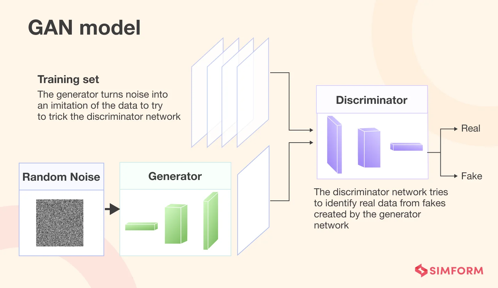{height="50%"}

The optimization of GANs is formulated as a **minimax game** with the value function $V(D, G)$ defined as:

$$\min_G \max_D V(D, G) = \mathbb{E}_{x \sim p_{\text{data}}(x)}[\log D(x)] + \mathbb{E}_{z \sim p_z(z)}[\log(1 - D(G(z)))]$$

The training process fot he two nets is iterative and separate for the two nets.

* Maximizing $V(D,G)$ with respect to $D$
* Minimizing $V(D,G)$ with respect to $G$

Maximizing with the respect to $D$ means that the discriminator is able to recognize good real data. So we want that the term $D(x)$ is close to 1, for the real data, and the term $D(G(z))$ is close to 0, for the fake data. So we want to maximize the first term and minimize the second term.

While minimizing with respect to $G$ means that the generator is able to generate good fake data. So we want that the term $D(G(z))$ is close to 1, for the fake data, to fool the discriminator.

To find the optimal discriminator $D^*$, we compute the functional derivative with respect to $D(x)$ and set it to 0. For an objective of the form $f(y) = a \log(y) + b \log(1-y)$, the maximum occurs at $y = \frac{a}{a+b}$. Substituting $a = p_{\text{data}}(x)$ and $b = p_g(x)$:

$$D^*_G(x) = \frac{p_{\text{data}}(x)}{p_{\text{data}}(x) + p_g(x)}$$

While the optimal discriminator $D^*_G$ is a function of the generator $G$, we can substitute it back into the value function to analyze the generator's objective. This lead to having to having $p_{\text{data}} = p_g$. Training achieves its global optimum when the generative network perfectly copies the target data distribution.

Training Generative Adversarial Networks (GANs) is difficult because a bad configuration of the generator can lead to a discriminator that is too strong, which in turn provides no useful gradient signal for the generator to learn from. This is the problem of **vanishing gradients**, due to the fact that the generator minimizes $\mathbb{E}_{z}[\log(1 - D(G(z)))]$. Early in training, the generator $G$ is highly inaccurate, producing samples that look nothing like the real data. Consequently, the discriminator $D$ easily learns to distinguish them, meaning $D(G(z)) \to 0$. As $D(G(z)) \to 0$, the term $\log(1 - D(G(z)))$ saturates. The gradient magnitude becomes vanishingly small, preventing the generator from learning anything.

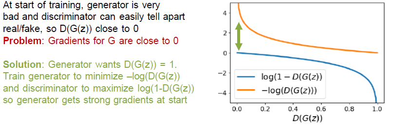

To solve this problem, we can change the generator's objective to maximize $\mathbb{E}_{z}[\log D(G(z))]$ instead of minimizing $\mathbb{E}_{z}[\log(1 - D(G(z)))]$. This alternative formulation provides stronger gradients early in training, as it encourages the generator to produce samples that the discriminator classifies as real, rather than trying to minimize the probability of being classified as fake.

When a GAN is successfully trained, the Generator maps a simple, low-dimensional latent space $Z \subset \mathbb{R}^d$ to a complex data manifold. Interpolation involves selecting two distinct vectors in this latent space, $z_A$ and $z_B$, and computing a path of intermediate vectors between them. Passing these intermediate vectors through the Generator reveals whether the network has truly learned a smooth, continuous semantic mapping or has merely memorized discrete training samples.

The trajectory from $z_A$ to $z_B$ is parameterized by a scalar variable $\gamma \in [0, 1]$. The choice of the interpolation function depends entirely on the geometric properties of the prior distribution assigned to the latent space.

Linear interpolation computes a straight line segment between the two endpoints:

$$z_\gamma = (1 - \gamma)z_A + \gamma z_B$$

The corresponding generated samples are obtained by forwarding the trajectory through the Generator: $X_\gamma = G(z_\gamma)$.

This means that if the Generator has learned a smooth, continuous mapping from the latent space to the data space, then the generated images along the interpolation path should exhibit gradual, semantically meaningful transformations. For example, if $z_A$ corresponds to an image of a smiling face and $z_B$ corresponds to a non-smiling face, then as $\gamma$ varies from 0 to 1, we should see a smooth transition from a smiling expression to a neutral one. If the intermediate frames show sudden jumps or chaotic distortions where one object abruptly transforms into another without plausible intermediate shapes, the latent space is fractured. This indicates that the Generator has memorized specific clusters of training data and lacks a coherent topological structure between them.

### Deep Convolutional GANs

**Deep Convolutional Generative Adversarial Networks (DCGANs)** allowed the generation of higher-resolution, spatially coherent images.

DCGAN eliminates elements like max-pooling and fully connected layers, replacing them with spatial convolutions and specific activation patterns.

Instead of using deterministic spatial pooling layers (like Max Pooling or Average Pooling) to alter spatial dimensions, DCGAN allows the networks to learn their own spatial downsampling and upsampling:

* **In the Discriminator:** Max pooling is replaced with **Strided Convolutions**. This allows the network to learn downsampling parameters directly.
* **In the Generator:** Upsampling is handled via **Fractionally-strided Convolutions** (commonly referred to as **Transposed Convolutions**).

CNN classifiers terminate in fully connected (FC) dense layers. DCGAN removes FC hidden layers entirely to reduce parameter overhead and prevent early mode collapse.

Batch Normalization normalizes the input to each layer to have zero mean and unit variance. This prevents the generator from collapsing all sample outputs to a single point (mode collapse) and stabilizes the gradient flow.
$BN$ is applied to all layers in both the Generator and Discriminator, with two exceptions: the **Output layer of the Generator** and the **Input layer of the Discriminator** (to avoid sample distortion and variance instabilities at the data boundaries).

* **Generator:** Uses **ReLU** for all hidden layers, and **Tanh** for the output layer. The Tanh activation bounds the output pixels to $[-1, 1]$, which matches the normalized input range of the training data.
* **Discriminator:** Uses **LeakyReLU** for all hidden layers. Unlike regular ReLU, LeakyReLU allows a small, non-zero gradient when the unit is inactive ($f(x) = \max(\alpha x, x)$, where $\alpha = 0.2$):

$$\text{LeakyReLU}(x) = \begin{cases} x & \text{if } x > 0 \\ 0.2x & \text{if } x \leq 0 \end{cases}$$

This prevents the discriminator's gradients from dying out completely when it heavily outperforms the generator.

### StyleGAN

lll

## Diffusion Models

Diffusion model are generative models working by learni how to reconstruct images from noise.
The intuition behind this kind of model is starting from a image full of noise (genereally sampled froma Gaussian distribution) and durin training process, at each step, try to remove noise from the image to reconstruct original images.

The training process of a diffusion model consists of two main phases:

1. **The Forward Process** in which clean data are corrupted over a series of steps. Tiny increments of random noise are added to the data. This process is fixed and requires no machine learning.
2. **The Reverse Process** or **Denoising Process** in which a neural network is trained to learn how to reverse the forward process. It learns to predict the noise added at each step, allowing it to iteratively remove noise and reconstruct the original data.

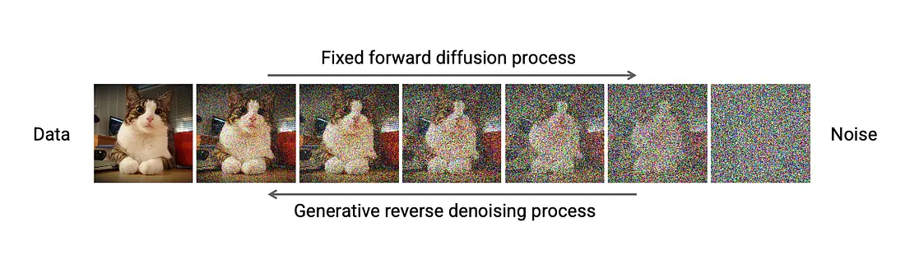{height="50%"}

The objective during training is to optimize a parameterized function $f_{\theta}(x_t, t)$ that predicts the noise injected into the data at a specific time step $t$. By subtracting this predicted noise, the model learns to approximate the reverse transition from step $t$ to step $t-1$.

After the training, model can generate new images by starting from a noise image and iteratively removing noise until it reaches a clean image that is similar to the training data.

### Rectified Flow

Classic diffusion models approaches learning a curved denoising trjectory that is computationally expensive to compute and require a lot of steps to converge. 

**Diffusion models with rectified flow** try to learn a direct, straight-line mapping from noise to data reducoing the number of steps required for the convergence.

Suppose we have a data distribution $p_{\text{data}}$ and a $p_{noise}$ distribution (e.g., Gaussian noise) mapped in the same space.

What model done is construct a direct liner interpolation between  $p_{\text{data}}$ and $p_{noise}$, and learn how to move along this interpolation to arrive at the data distribution starting from the noise distribution.

At each time step $t \sim \text{Uniform}(0, T)$:

1. sample $\text{z} \sim p_{noise}$ (a noise sample)
2. sample $x \sim p_{data}$ (a data sample)
3. set $x_t = (1-t)x + tz$ (a noisy version of the data sample)
4. compute the derivative of $x_t$ with respect to $t$: $\frac{dx_t}{dt} = z - x$ (the velocity vector pointing from the data sample to the noise sample)
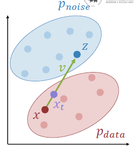{height="50%"}
5. train a model $f_{\theta}(x_t, t)$ to predict $v$ from $x_t$ and $t$ minimizing the MSE loss function:
   $$\mathcal{L}(\theta) = \| f_{\theta}(x_t, t) - v \|^2$$

In the sampling phase, we start with a noise sample and iteratively apply the learned velocity to move towards the data distribution:

1. sample $z \sim p_{noise}$ 
2. for $\text{t in }[1, 1 - \frac{1}{T}, \dots, 0]$:

    - evaluate $v_t = f_{\theta}(x_t, t)$
    - update $x_{t-1} = x_t - \frac{v_t}{T}$
3. return $x_0$

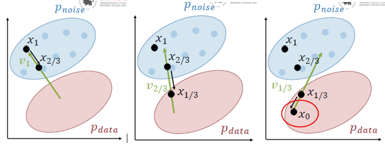{height="50%"}

The problem of this approache is the velocity of convergence. To clean a image from a noise require a large number of steps ($T=50$ usually). One solution can be the distillation.

For generating images from a prompt, we can use a **conditional diffusion model** that is trained to predict the noise added to the data at each step, given both the noisy image and the conditioning information (the prompt). During training, the model learns to associate specific features in the noisy image with the corresponding conditioning information, allowing it to generate images that are not only clean but also semantically aligned with the provided prompt.

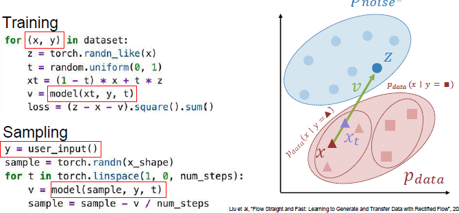{height="50%"}

This kind of models do not scale well for image generation because generate image pixel by pixel, and is computationally expensive. Another problem is that this approach is not parallelizable, because each step depends on the previous one, so we cannot generate multiple images at the same time.

### Latent Diffusion Models

To solve this problem, we can use a **latent diffusion model**. 

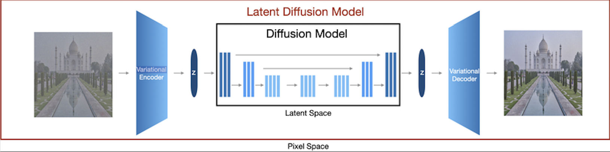{height="50%"}

The main idea is to apply the diffusion process in the latent space where the dimensionality is lower and with a more compact and meaningful representation of the data. 

Is used an autoencoder to learn a mapping from the data space to a latent space, and decoder to learn mapping from noised latent space (after the diffusion process) to the data space. 

The autoencoder used is a *VAE* trained to maximize ELBO while minimizing the KL divergence between the latent distribution and a prior distribution (e.g., Gaussian). The problem of VAE is that blured images during the reconstruction. So to have a higher resolution, one way is to add a discriminator at the end of decoder that that the real image and the generated image from decoder, and train this like a GAN, to have a sharper image.

One example of this approach is the **Stable Diffusion model**.

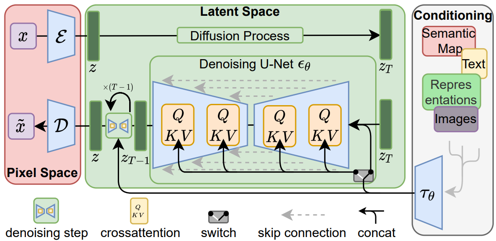{height="50%"}

After the diffusion process, the latent vector $z_t$ is passed to the U-Net powered with a backbone with the cross attention mechanism. Latter net act as conditioning generating a vector $\tau_{\theta}(y)$ that is combined, in the U-Net encoder, with the attention mechanism, to guide the generation process based on the prompt $y$. The same for the decoder of U-Net.

The aim of U-Net is to predict noise $\epsilon$ at timestep $t$ to remove from the latent vector $z_t$. The motvation behind its use is that downsampling and upsampling with residual connections allow net to preserve geometrical information and capture both local and global features of the image, which is crucial for generating high-quality images.
The cross attention mechanism allows the model to focus on specific parts of the latent representation that are relevant to the conditioning information (the prompt), enabling more accurate and semantically meaningful image generation.

U-Net is trained for the noise prediction at timestep $t$. The objective function is defined as:
$$L_{LDM} := \mathbb{E}_{\mathcal{E}(x), y, \epsilon \sim \mathcal{N}(0,\mathbf{I}), t} \left[ \left\| \epsilon - \epsilon_\theta(z_t, t, \tau_\theta(y)) \right\|_2^2 \right]$$

### Difffusion Transformer

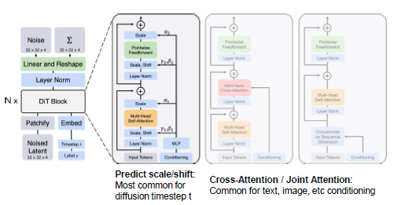{height="50%"}

This kind of model instead of using U-Net, use a trasformer to predict the noise at each timestep.
The challeng was how to inject the conditioning information int the trasformer blocks.

1. **In-Context Conditioning** (Sequence Conditioning) The conditioning metadata is treated as an extension of the input sequence. These conditioning tokens are simply prepended or appended directly to the sequence of spatial image patch tokens. The standard self-attention mechanism processes the entire combined sequence uniformly. The model naturally learns the cross-modal relationships between the conditioning tokens and the visual tokens without requiring any architectural modifications to the standard Transformer block.

2. **Cross-Attention Conditioning** This method adopts the classical approach used in U-Net backbones. A dedicated cross-attention module is explicitly integrated into each Transformer block, typically positioned right after the spatial self-attention layer. The image patch embeddings act as the *Queries* ($Q$), whereas the external conditioning vectors (e.g., embeddings extracted from text encoders like CLIP or T5) are projected to form the *Keys* ($K$) and *Values* ($V$). This allows each visual token to explicitly query relevant semantic context from the conditioning prompt.

3. **Adaptive Layer Normalization**(adaLN) Rather than injecting the conditioning directly into the attention layers, this technique shifts the modulation to the normalization layers, altering the global statistical properties of the feature maps. The standard Layer Normalization parameters—scale ($\gamma$) and shift ($\beta$)—are dynamically regressed via a Multi-Layer Perceptron (MLP) that takes the conditioning vector (such as the diffusion timestep $t$ or class labels) as input. In optimized variants like **adaLN-Zero**, the MLP also outputs a dimension-wise scaling factor ($\alpha$) applied immediately before the residual connections, which initializes the blocks as identity mappings and significantly stabilizes early training.