# Tracking

!!!note Tracking
    Tracking is the activity of identifying and followiing an object across the frame of a video while maintaining a consisten identity. The core goal is to determine the location, trajectory, and sometimes the state of an object as time progresses. A typical tracker outputs a bounding box around the target object in every frame.

The difficulty lies in retaining the same identity across frames, even when the object:

- temporarily disappears due to **occlusion**. The algorithm loses the visual features of the target. When the object reappears, the tracker must reconnect it to the previous ID rather than initializing a new one. Often, tracker can focus on the "wrong" object, which is visually similar to the target but is not the same one. This is especially problematic when the target:
- changes speed or direction deforms or rotates. The bounding box or segmentation mask must dynamically adapt its geometric parameters without losing the semantic representation of the object.
- or is surrounded by visually similar objects. Environments are often noisy and densely packed with **distractors** — objects that share highly similar textures, colors, or shapes with the target. If the feature extraction network is not discriminative enough, the tracker will easily suffer an identity crisis, jumping from the true target to a visually identical neighbor.

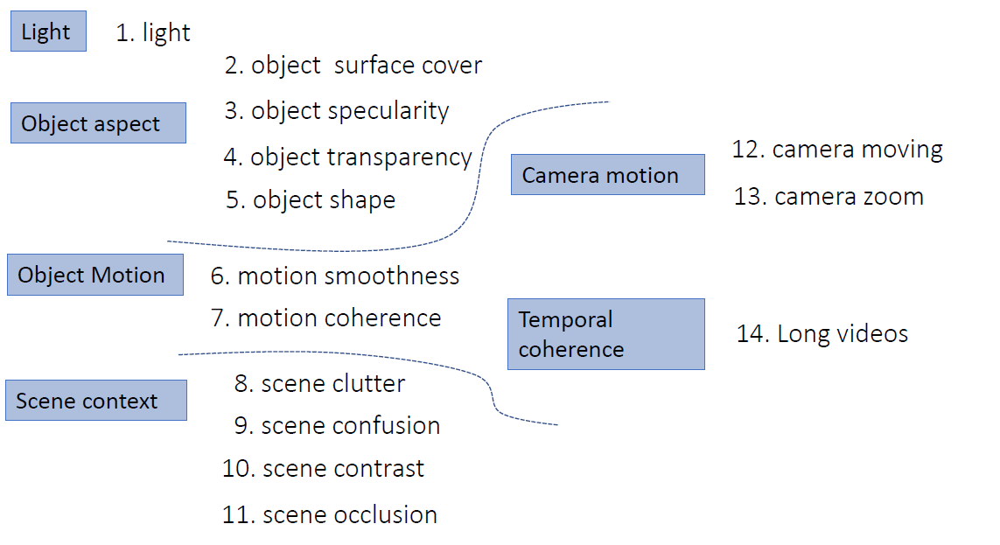{height="50%"}

Successful object tracking demands robust spatial and temporal reasoning.

Based on the number of object beign tracked, tracking can be categorized into:

- **Single Object Tracking (SOT)**: The tracker focuses only on one single object at a time.
- **Multiple Object Tracking (MOT)**: The tracker must identify and maintain the identities of multiple objects simultaneously. This involves not only tracking each object but also correctly associating detections across frames, especially when objects interact, occlude each other, or enter/exit the scene.

Object tracking different from Detection focuses on identifying and localizing objects in a single frame. Tracking involves also temporal consistency and identity preservation across frames. There are two main paradigms for how a tracking architecture can be designed:

- **Tracking-by-Detection (TbD)**
- **Detection-by-Tracking (DbT)**

**Tracking-by-Detection** treats every frame as an independent image. A robust spatial detector evaluates the entire frame to extract all objects of interest and generate bounding boxes or masks. Only *after* detection is complete does a separate data association algorithm (e.g., SORT, DeepSORT, Hungarian algorithm) evaluate the detections to link them to existing trajectories.
* **Architecture Flow:** Frame $t$ $\rightarrow$ Full Frame Detection $\rightarrow$ Detections $D_t$ $\rightarrow$ Data Association with Tracks $T_{t-1}$ $\rightarrow$ Updated Tracks $T_t$.
* **Strengths:** * **Robust to Occlusion:** Because it searches the entire frame from scratch every time, it easily re-acquires targets that disappear and reappear.
* **No Drift:** It does not accumulate spatial errors over time.

* **Weaknesses:** It is computationally expensive because a heavy spatial feature extractor must run over the entire high-resolution frame at every step. It also completely ignores temporal context during the detection phase; if motion blur degrades a single frame, the detector fails, and the track is broken.

Instead, **Detection-by-Tracking** uses the temporal history (kinematics or deep spatiotemporal features) of previously tracked objects to predict their current state and location. The "detection" step is then highly localized or heavily biased by this temporal prior.
* **Architecture Flow:** Tracks $T_{t-1}$ $\rightarrow$ Predict State in Frame $t$ $\rightarrow$ Localized/Refined Detection $\rightarrow$ Updated Tracks $T_t$.
* **Strengths:** * **Computational Efficiency:** By restricting the spatial search to a predicted Region of Interest (ROI), it saves significant computational cycles, aiding in real-time ($\geq30$ FPS) execution.
* **Handles Visual Degradation:** If an object is momentarily blurred or obscured by smoke, the temporal memory can "force" a detection based on expected trajectory.
* **Weaknesses:** * **Drift:** If the predictive tracker makes a slight error, the subsequent localized detection will be off-center. This error compounds over time until the tracker completely loses the target.
* **Initialization:** It struggles to detect entirely *new* objects entering the frame unless periodically combined with a full-frame detector.

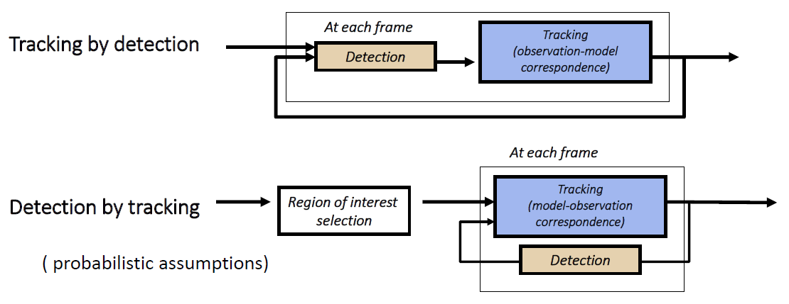{height="50%"}

A general architecture for a tracking system have four main components:

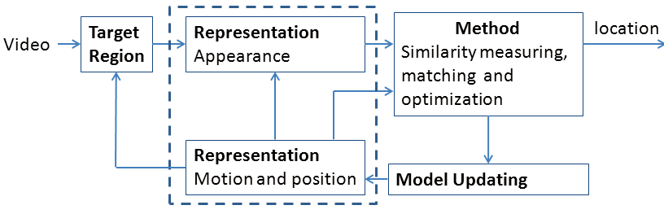{height="50%"}

1. **Target Region** that take in input the video frames and extracts the RoI where the object is likely to be located.
2. **Representation** tracker have two internal memory of the frames it have seen before.
   * **Appearance:** This encodes *what* the object looks like. It extracts spatial visual features (deep CNN embeddings, texture, color). When tracking blood accumulation, this representation mathematically describes the specific red hues, specular reflections, and fluid boundaries of that exact pool.
   * **Motion and position:** This encodes *where* the object is and *how* it is moving. It represents the temporal kinematics, updating coordinates, velocity, and trajectory (typically managed by mathematical models like a Kalman Filter).
3. **Method**, where it measures the similarity between the incoming *Target Region* from the new frame and the stored *Representations* from previous frames to confirm identity. It measures the spatial overlap using the *Motion* data, and the visual similarity using the *Appearance* data. An optimization algorithm evaluates these scores to guarantee the object in frame $t$ is the same as the object in frame $t-1$. Once confirmed, it outputs the final **location**.
4. **Model Updating**  that updates the internal representations with the new data from the current frame because objects are not static. They can deform, change in appearance, or alter their motion patterns. The tracker must continuously learn and adapt to these changes to maintain accurate tracking over time.

## Single Object Tracking

Single Object Tracking (SOT) is the task of tracking a single target object across video frames. The tracker is initialized with the target's location in the first frame (often provided as a bounding box) and must maintain the identity of that object throughout the video, even in the presence of challenges like occlusion, deformation, or background clutter.

### Near Cross Correlation

The simple approach for SOT is use the general architecture without any motion analysis relying only on the apperence representation of objects in the frame. The assumption is that the shape not change a lots and motion happens only in a small area of the frame. As method block is used the **Near cross correlation** that measures the similarity between the target region and the stored appearance representation. The tracker outputs the location of the object in each frame based on this similarity. NCC is a highly localized form of **Detection-by-Tracking**. It uses the temporal memory of where the object *was* to define a small search area, and then runs a spatial detection (template matching) exclusively inside that box.

!!!note Steps
    1. **Initialization:** The tracker is given the initial bounding box of the target object in Frame 1. This serves as the reference for all future tracking. This snapshot is your **Template** ($I_0$).
    2. **Search Area Definition:** When Frame 2 arrives, algorithm don't search in whole image because assuming that object hasn't moved far, so define a localized **Search Area** around its last known position. Template $I_0$ slide over every single possible pixel position ($u$) within that search area. At every stop calculate a mathematical similarity score between the Template and the pixels currently underneath it ($I_1$).

    $$E_{NCC}(u) = \frac{\sum_i [I_0(x_i) - \overline{I_0}] [I_1(x_i + u) - \overline{I_1}]}{\sqrt{\sum_i [I_0(x_i) - \overline{I_0}]^2} \sqrt{\sum_i [I_1(x_i + u) - \overline{I_1}]^2}}$$

    * **The Numerator (Covariance):** It checks if the pixels in your Template ($I_0$) and the candidate patch ($I_1$) vary in the same way. If a pixel is bright in the template, is it also bright in the patch?
    * **The Denominator (Normalization):** This is the crucial part. By subtracting the mean pixel intensity ($\overline{I}$) and dividing by the standard deviation, the formula becomes invariant to global lighting changes.
    * **Why it matters:** If you are tracking tissue in a surgical cavity and a tool casts a shadow over your target region, the raw pixel values change drastically. Because NCC is *normalized*, it ignores the drop in overall brightness and still recognizes the underlying pattern.

The two major limitations that make pure NCC virtually unusable for complex, non-rigid tracking tasks is that sliding a window pixel-by-pixel and calculating complex statistical math at every stop is computationally heavy.
Model do no perform an update of what model seen. The tracker only ever remembers what the object looked like in Frame 1. This is a problem because objects are not static and can lead to a *drift*.

### Siamese-RPN

A more sofisticated approach is to use **Siamese networks** tha.t learn the cross-correlation with a deep learning way.

!!!quote Recall: Siamese Networks
    A Siamese network consists of two identical subnetworks that share weights and parameters. Each subnetwork processes one of the two input images (the template and the search area) to extract feature representations.

One of the subnet take as input the template frame (target patch) and the other one take frame as it is. Thsi two branches are formed by a CNN based on AlexNet but without using padding because can effect negatetively on the matching process.

The outputs of these subnetworks going to a Region Proposal Network split in two sections: 
- one is the **Classification Branch**, that act as foreground-background classification. So it is a binary classification that determine if the object is present in the search area or not. It outputs a score for each anchor box, indicating the likelihood of the target being located there.  So hvave a depth of $2k$ where $k$ is the number of anchor boxes per spatial location. Each anchor box has two channels: one for the foreground score and one for the background score.
- - the other one is the **Regression Branch** that act as bounding box regression. It outputs the spatial adjustments needed to refine the anchor boxes into accurate bounding boxes around the target object. Each anchor box has four channels corresponding to the adjustments in the x and y coordinates, width, and height ($dx, dy, dw, dh$). So have a depth of $4k$.

!!!note If there are $k$ anchors, network needs to output $2k$ channels for classification and $4k$ channels for regression.

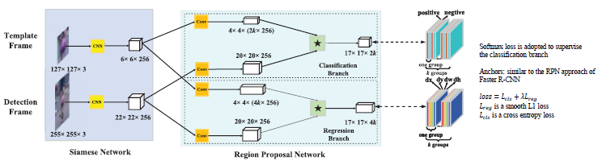{height="50%"}

The correlation is computed on both branches:

$$A_{w \times h \times 2k}^{cls} = [\varphi(x)]_{cls} \star [\varphi(z)]_{cls} \\ A_{w \times h \times 4k}^{reg} = [\varphi(x)]_{reg} \star [\varphi(z)]_{reg}$$

### One-Shot Detector

> In recent years, more and more attention has been paid to the one-shot learning topic in deep learning. Bayesian statistics based approaches and the meta-learning approaches are two major methods to solve the problem. In [20], object categories are represented by probabilistic models and Bayesian estimation is adopted in the inference phase. In another way, meta-learning approaches aim to get the ability of learning to learn, that is to say, being aware of and taking control of one’s own learning. Concretely, [1] utilizes a neural network to predict the gradient of the target network during the back-propagation. [30] learns a network that maps a small labelled support set and an unlabelled example to its label. Although these meta-learning based methods have got competitive results, these approaches are often evaluated on classification task and very few of them has extended to the tracking task. Learnet [2] is the first work to utilize the meta-learning method to solve the tracking task, which predicts the parameters of a pupil network from a single exemplar. However, the performance of Learnet is not competitive the modern DCF based methods, e.g. CCOT in multiple benchmarks.

## Multiple Object Tracking

!!!note Definition
    **Multiple Object Tracking (MOT)** is the computational process of continuously localizing multiple targets within a video sequence while maintaining their unique identities over time. This pipeline fundamentally requires two steps: extracting spatial detections in every individual frame and resolving temporal data association to link current objects with their historical trajectories.

MOT architectures are generally classified across three main dichotomies:

* **Online Tracking:** Processes video streams in real-time. The system processes each frame strictly as it becomes available, relying only on past and current states. This is the mandatory approach for live downstream applications like robotics or autonomous navigation.
* **Offline Tracking:** Operates via batch processing on pre-recorded videos. Because the algorithm has access to the entire temporal sequence before execution begins, it can leverage future frames to optimize trajectories globally and correct past association errors.

* **Data-Driven:** Leverages Machine Learning and Deep Learning to implicitly extract and learn complex visual appearance embeddings and spatiotemporal motion features directly from large datasets.
* **Model-Driven:** Relies on explicit, deterministic mathematical state estimators (such as the Kalman Filter) to predict kinematic motion and track target appearance based on predefined physical rules.

* **Object-Specific:** Constrained to tracking predefined semantic classes (e.g., tracking exclusively vehicles, pedestrians, or surgical instruments), heavily relying on specialized spatial detectors.
* **Generic (Class-Agnostic):** Designed to track any distinct, moving entity that enters the field of view, regardless of its specific semantic category or whether the network has seen that class during training.

The classic architecture can be exteded to MOT by adding a data association block and a model updating block. The main difference lies in managing and reconciling two distinct sets of data:

- **observations**, what the system sees *right now*
- **states**, what the system *remembers* from the past.

The problem of MOT is **reidentification**: how to correctly associate the current detections (observations) with the existing tracks (states) to maintain consistent identities over time. This is especially challenging when multiple objects of the same class are present, or when objects occlude each other.

There are three main paradigm for multiple object tracking:

- Tracking-by-detection:
• is a traditional approach in multiple object tracking where new detections at time 𝑡 are assigned to existing tracks.
• Methods: SORT, DeepSORT, ByteTrack …
- Tracking-by-regression:
• is a deep learning approach where the new position of existing tracks at time 𝑡 is directly predicted using a regression function,
while simultaneously detecting new potential tracks.
• Methods: Tracktor, CenterTrack, FairMOT …
- Tracking-by-attention:
• Tracking-by-attention is a transformer-based approach that treats multiple object tracking as a set prediction task. It utilizes
the attention mechanism of the transformer architecture to propagate the identity of each object across different time steps.
• Methods: TrackFormer, TransMOT, MOTR …

### Probabilistic framework

In a model-driven tracking setup, visual tracking is formulated as a state estimation problem where the state of the target changes dynamically over time, and noisy observations are obtained from image frames.

Given

- **Object ($o_i$)**, the entity being tracked, in a RoI or to the segmented region.
- **State ($x_t$ or $X_i$):** A random variable modeling the kinematics and appearance of the target object at time $t$. The state vector typically includes spatial coordinates, velocity, and an appearance feature vector $A_i$ (e.g., pixels, histograms).
  * **Dynamic Model (Prior/Prediction):** $x_t = f(x_{t-1}, w_t)$, where $f$ describes the state evolution and $w_t$ represents the process noise.
- **Observation ($z_t$):** The measurement extracted from the current frame (e.g., a Region of Interest or a bounding box derived from an object detector).
  * **Observation Model (Likelihood):** $z_t = g(x_t, v_t)$, where $g$ maps the true state to the measurement space and $v_t$ is the measurement noise.

To make the computation tractable in real-time, two main assumptions are introduced:

1. **First-Order Markov Assumption:** The current state depends *exclusively* on the immediately preceding state. All past history is summarized in $x_{t-1}$.

$$p(x_t|x_{t-1}) = p(x_t|x_{t-1}, x_{t-2}, \dots, x_1)$$

2. **Observation Independence:** The observation at time $t$ depends solely on the state at time $t$.

The algorithmic goal is to maximize the posterior probability, defined as the **Belief**: $Bel(x_t) = p(x_t|z_1 \dots z_t)$. We apply Bayes' Theorem:

$$p(x|z) = \frac{p(z|x)p(x)}{p(z)}$$

Since the exact computation of the normalization term in the denominator, $p(z) = \int p(z|x) p(x) dx$, is often intractable, optimization techniques are used:

* **Maximum A Posteriori (MAP):** The normalization constant is ignored, and the product of the Likelihood and the Prior is maximized.

$$\arg\max_x [p(z|x)p(x)]$$

* **Maximum Likelihood (MLE):** If no prior information is available (a uniform Prior for all $x$), the term $p(x)$ becomes a constant, and the estimation depends solely on the observation model.

$$\arg\max_x [p(z|x)]$$

Combining the Markov assumption with Bayes' rule, the update for a single frame can be operationally summarized as:

$$p(x_t|z_t, x_{t-1}) \propto p(z_t|x_t) p(x_t|x_{t-1})$$

Which translates to: **Inference $\propto$ Measurement Likelihood $\times$ Prediction**.

This is **Recursive Bayesian Filter** that divided the tracking process into two main stages:

- **Step 1: Prediction**: The future state is estimated based on the motion model and the posterior estimation from the previous step, before processing the new frame. $$p(x_k|z_{1:k-1}) = \int f(x_k|x_{k-1}) p(x_{k-1}|z_{1:k-1}) dx_{k-1}$$

- **Step 2: Update (Correction)**: Once the new measurement $z_k$ is extracted from the image, the prediction is corrected by computing the new posterior.$$p(x_k|z_{1:k}) = \frac{g(z_k|x_k) p(x_k|z_{1:k-1})}{\int g(z_k|x_k) p(x_k|z_{1:k-1}) dx_k}$$

Some of the most common algorithms that implement this probabilistic framework are:

- Kalman filter
- Extended Kalman filter
- Condensation
- Mean-shift

#### Kalman Filter

The Kalman Filter works by predicting what the state will be in the next time instance $t+1$, based on its current state $x_{t}$.Then, at the next time instance $t+1$, the Kalman filter compares its prediction to the sensor output. The difference between the prediction and the actual position is used to adjust the estimate of the objects's position, making it more accurate.

The Kalmanfiltering is a recursive linear estimation in the special case of Gaussian distribution.

In continuous time, the theory comes from Fokker-Plank: the density xtdrifts a

The peak of the curve is our best guess (the mean), and the width of the curve represents our uncertainty (the variance). 
The algorthmic process of the Kalman Filter can be visualized as a dynamic transformation of this Gaussian curve over time, influenced by three main effects:

1. **The Deterministic Drift (Prediction)** based on **kinematic motion model**.  The entire Gaussian curve simply **translates** (shifts) along the x-axis. The shape does not change, only its position.
2. **The Stochastic Diffusion (Prediction Noise)** due to the imperfections in the mathematical model, there are always unmodeled forces, slight accelerations, or friction. To account for this, the filter adds "process noise" to the prediction. Because time has passed since our last actual measurement, our uncertainty naturally grows.
The Gaussian curve **spreads out and flattens**. The area under the curve remains 1, but the wider base means we are less confident about the exact position.
3. **The Reactive Effect (Measurement Update)** computer vision system provides a new observation ($z_t$) for the current frame. This measurement is not perfectly accurate either, so it is also represented by its own Gaussian curve. The Kalman Filter fuses your predicted belief (the flattened curve from step 2) with this new measurement.
The PDF is "pulled" toward the new measurement $z_t$. Because you are combining two sources of information (the prediction and the measurement), your overall uncertainty decreases. The resulting Gaussian curve **narrows** and becomes taller, centering itself on the optimal compromise between what you predicted and what you measured.

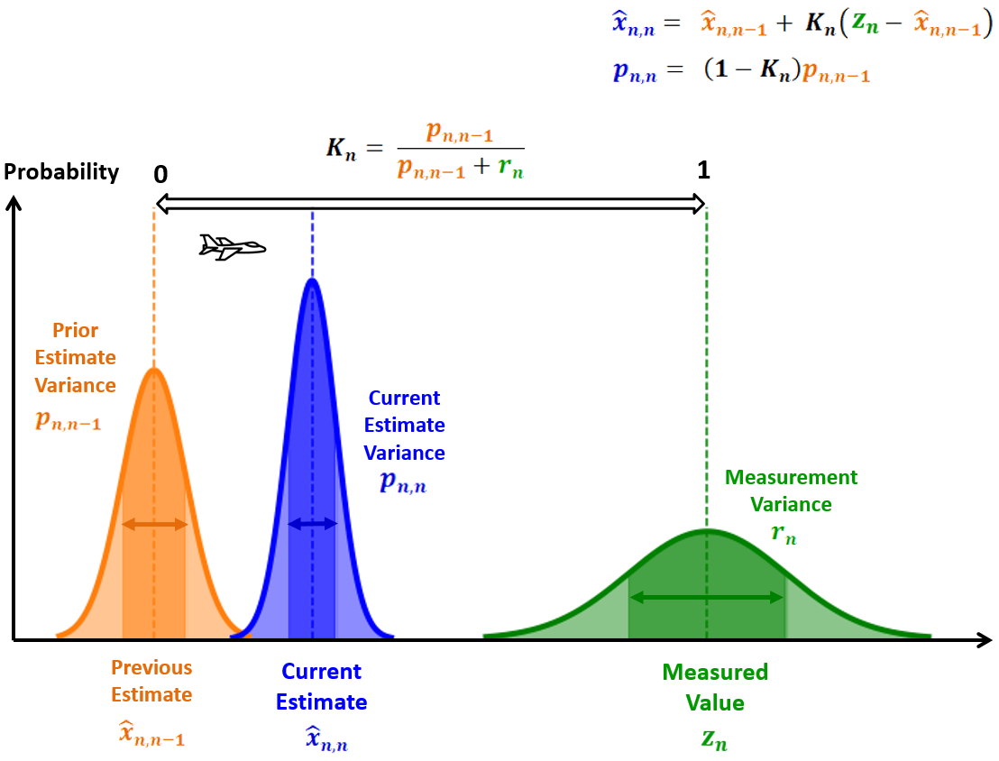{height="50%"}

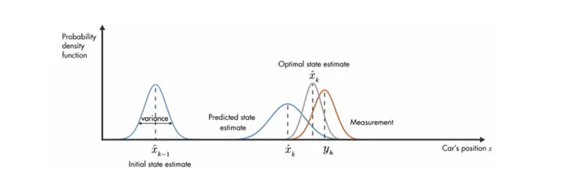{height="50%"}

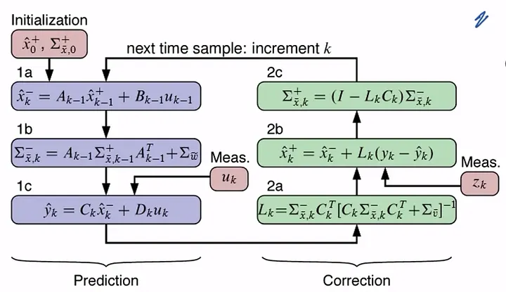

In tracking,we have two main mathematical objects that represent our belief about the target's state at any given time:

* **The State Vector ($\hat{\mathbf{x}}$):** A column vector containing the target's physical parameters. For a 2D tracking problem, it typically includes position ($x, y$) and velocity ($\dot{x}, \dot{y}$):

$$\hat{\mathbf{x}} = \begin{bmatrix} x \\ y \\ \dot{x} \\ \dot{y} \end{bmatrix}$$

* **The Covariance Matrix ($\mathbf{P}$):** A square matrix representing our uncertainty. The diagonal elements represent the variance (uncertainty) of each individual state variable, while off-diagonal elements represent correlations between them.

!!!!quote The subscript notation $t|t-1$ is read as "the estimate at time $t$, given all knowledge up to time $t-1$".

At the beginning, we define an initial state $\mathbf{x}_{0|0}$ and an initial uncertainty $\mathbf{P}_{0|0}$. Since we usually know where an object starts but have no idea how fast it is moving, the initial covariance matrix is initialized with a large constant $L$ on the diagonal, indicating high initial uncertainty.

The first steps of the Kalman Filter is the **2. State Prediction (The Deterministic Drift)** that ue kinematic model to predict where the object will be in the next frame

$$\hat{\mathbf{x}}_{t|t-1} = \mathbf{F}_t \hat{\mathbf{x}}_{t-1|t-1}$$

$\mathbf{F}_t$ is the **State Transition Matrix** (or kinematic matrix). It encodes Newtonian mechanics into the system. Assuming a constant velocity model where $\Delta t$ is the time between frames, the matrix multiplication looks like this:

$$\begin{bmatrix} x_t \\ y_t \\ \dot{x}_t \\ \dot{y}_t \end{bmatrix} = \begin{bmatrix} 1 & 0 & \Delta t & 0 \\ 0 & 1 & 0 & \Delta t \\ 0 & 0 & 1 & 0 \\ 0 & 0 & 0 & 1 \end{bmatrix} \begin{bmatrix} x_{t-1} \\ y_{t-1} \\ \dot{x}_{t-1} \\ \dot{y}_{t-1} \end{bmatrix}$$

If you multiply this out, you get the standard equations of motion:

* $x_t = x_{t-1} + \dot{x}_{t-1}\Delta t$
* $\dot{x}_t = \dot{x}_{t-1}$ (velocity remains constant)

!!!note Non-Linear Models
    The motion model represented by matrix $F$, must belinear. If the model is not linear the model must be linearized in some working point, this is the *Extended Kalman Filter*.

Without any new measurement due to the constant velocicty assumption the covariance matrix grows larger meaning that the uncertainty is increasing. This is the *diffusion effect*, which is mathematically represented by adding a process noise covariance matrix $Q$ to the predicted covariance.

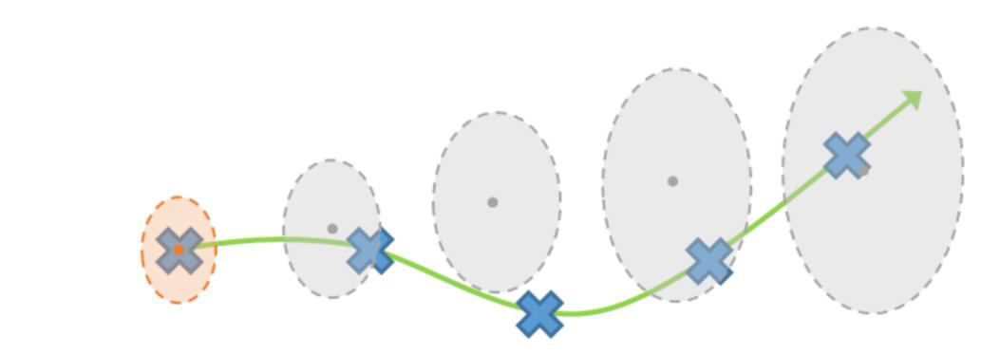{height="50%"}

So, algorithm perform the **Covariance Prediction (The Stochastic Diffusion)** that determonate how much the prediction is wrong.

$$\mathbf{P}_{t|t-1} = \mathbf{F}_t \mathbf{P}_{t-1|t-1} \mathbf{F}_t^T + \mathbf{Q}_{t-1}$$

This equation has two parts:

1. **$\mathbf{F}_t \mathbf{P}_{t-1|t-1} \mathbf{F}_t^T$:** In linear algebra, if you apply a linear transformation $\mathbf{F}$ to a random variable, its covariance matrix transforms by multiplying by $\mathbf{F}$ on the left and $\mathbf{F}^T$ (the transpose) on the right. This shifts our previous uncertainty bubble to the new predicted location.
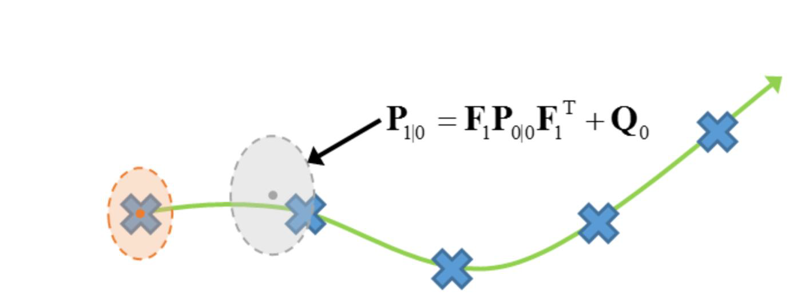{height="50%"}
1. **$+\mathbf{Q}_{t-1}$:** This is the **Process Noise Covariance Matrix**. It represents the "diffusion" from the previous slide. Because our constant velocity model ($\mathbf{F}$) is imperfect, we must inject mathematical doubt into the system. Adding the matrix $\mathbf{Q}$ physically forces the covariance matrix $\mathbf{P}$ to become larger.

After the noisy measurement has been obtained the correction step begins. It incorporates Kalman filter update which includes state update and uncertainty update (decreasing the uncertainty).

When  we receive noisy measurement (e.g. from YOLO) the update process begins. The noisy measurement $z(t)$ is modeled as a single Gaussian, where the noise is modeled as covariance matrix $R(t)$ which is usually constant.

$$\mathbf{z}_t = \mathbf{H} \mathbf{x}_t + \mathbf{v}_t\\ \begin{pmatrix} x_z \\ y_z \end{pmatrix} = \underbrace{\begin{pmatrix} 1 & 0 & 0 & 0 \\ 0 & 1 & 0 & 0 \end{pmatrix}}_{\mathbf{H}} \begin{pmatrix} x \\ y \\ \dot{x} \\ \dot{y} \end{pmatrix} + \mathbf{v}_t$$

This matrix multiplication formally demonstrates how the **model selection matrix** $\mathbf{H}$ isolates the measurable position variables ($x, y$) from the full state vector, discarding the hidden velocity variables ($\dot{x}, \dot{y}$), while accounting for the measurement noise $\mathbf{v}_t$.

$$\tilde{\mathbf{y}}_t = \mathbf{z}_t - \mathbf{H} \hat{\mathbf{x}}_{t|t-1}$$

This is simply the **Prediction Error**. It is the mathematical difference between what your tracking model predicted you would see ($\mathbf{H} \hat{\mathbf{x}}_{t|t-1}$) and the actual pixel coordinates your detector just gave you ($\mathbf{z}_t$). Thi is the **Residual / Innovation ($\tilde{\mathbf{y}}_t$**). It is computer also the **Residual Covariance ($S_t$)**,
$$\mathbf{S}_t = \mathbf{H}_t \mathbf{P}_{t|t-1}\mathbf{H}_t^T + \mathbf{R}_t$$
which represents the total uncertainty in this error. It combines the uncertainty of our prediction ($\mathbf{P}$) with the inherent noise of our detector ($\mathbf{R}$).

Now it time to decide how much trust on the detector. This is model by **Kalman gain**
$$\mathbf{K}_t = \mathbf{P}_{t|t-1} \mathbf{H}^T \mathbf{S}_t^{-1}$$

The Kalman Gain is a dynamic weighting matrix that decides how much the new measurement should alter our predicted state. It continuously evaluates a balance games between two uncertainties:

* **Trust the Measurement:** If the measurement noise ($\mathbf{R}$) is very low (e.g., you have a highly confident segmentation mask), $\mathbf{K}$ approaches $1$. The filter will aggressively pull the state estimate toward the new observation, largely ignoring the physics prediction.
* **Trust the Model:** If the measurement noise ($\mathbf{R}$) is very high (e.g., the target is heavily occluded or blurry), $\mathbf{K}$ approaches $0$. The filter rejects the noisy measurement and relies almost entirely on its constant-velocity prediction.

The final step is the **correction**

$$\hat{\mathbf{x}}_{t|t} = \hat{\mathbf{x}}_{t|t-1} + \mathbf{K}_t \tilde{\mathbf{y}}_t$$

Finally, the filter updates its uncertainty:
$$\mathbf{P}_{t|t} = (\mathbf{I} - \mathbf{K}_t \mathbf{H}_t) \mathbf{P}_{t|t-1}$$ Because we have successfully fused two independent sources of information (the physical model and the visual measurement), the overall uncertainty shrinks.

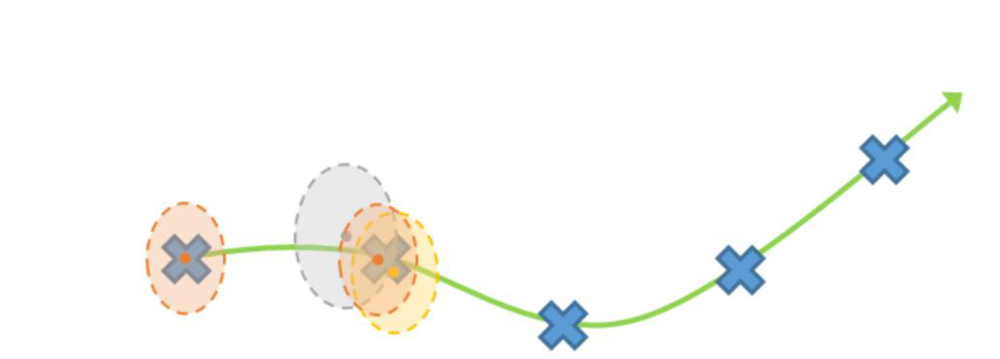{height="50%"}

### SORT (Simple online and realtime tracking)

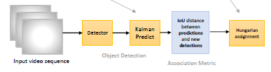{height="50%"}

The **SORT (Simple Online and Realtime Tracking)** relies on  Kalman Filter and the Hungarian Algorithm to link those detections across time.

1. **Detection**: At frame $t$, a CNN processes the image and outputs a set of bounding boxes (or segmented regions converted to bounding boxes). SORT completely ignores the visual pixels inside these boxes; it only cares about the geometric coordinates: $[x, y, scale, ratio, \dot{x}, \dot{y}, dot{scale}]$.

2. **Prediction**:  Simultaneously, SORT looks at the tracks established in previous frames. It uses a linear constant-velocity Kalman Filter to predict the spatial location of these existing tracks in the current frame $t$, independently and before looking at the new detections.

3. **Data Association**: Having two sets of geometry the **Predicted Boxes** (where the Kalman filters think the objects are) and the **Detected Boxes** (what CNN just found). SORT must figure out which detection belongs to which prediction.

   1. **The Cost Matrix:** SORT calculates the **Intersection over Union (IoU)** between *every single predicted box* and *every single detected box*. If you have 3 predictions and 3 detections, this creates a $3 \times 3$ matrix.  Since the Hungarian Algorithm is a minimization method, the values are formulated into a cost matrix as $C = 1 - IoU$. For $N$ predictions and $M$ detections, this yields an $N \times M$ matrix.
   2. **The Hungarian Algorithm:** This matrix is fed into the Hungarian algorithm, a combinatorial optimization method that solves the bipartite matching problem. It finds the 1-to-1 assignment that maximizes the total IoU across the entire frame.
   3. **Thresholding:** If the best possible match for a box has an IoU lower than a strict threshold (e.g., $IoU_{min} = 0.3$), SORT rejects the match entirely.

4. **Track Lifecycle Management (Update)** Based on the Hungarian matching, SORT updates the system:
   * **Matched Tracks:** The detection box  $\mathbf{z}_t$ is fed into the corresponding Kalman Filter as the measurement update ($\mathbf{z}_t$), correcting its trajectory.
   * **Unmatched Detections:** Any detection that didn't match an existing track is assumed to be a brand new object entering the scene. A fresh Kalman filter is initialized for it.
   * **Unmatched Predictions:** If a Kalman filter predicted an object, but no YOLO detection matched it (e.g., a surgical instrument was temporarily occluded by tissue), SORT marks it as "lost". If it stays lost for $T_{lost}$ consecutive frames (usually just 1 or 2 in base SORT), the track is permanently deleted.

SORT is fast, but it is fragile to **occlusions**. Because it *only* uses bounding box geometry (IoU) to match objects, if two surgical tools cross over each other and their bounding boxes overlap heavily, the Hungarian algorithm gets confused. When they separate, SORT often assigns the wrong ID to the wrong tool (an **ID Switch**).

### DEEP SORT

To solve this, **DeepSORT** adds a deep learning feature extractor to the Data Association step, matching objects not just by IoU geometry, but by their visual appearance (features/histograms).

To do this introduce **appearance embeddings** compute using a deep neural network that is trained to extract discriminative features from object images. This network is pre-trained on a Re-Identification (ReID) dataset. The apperance embedding allows to re-identificate each disappeared target when re-enters in the scene.

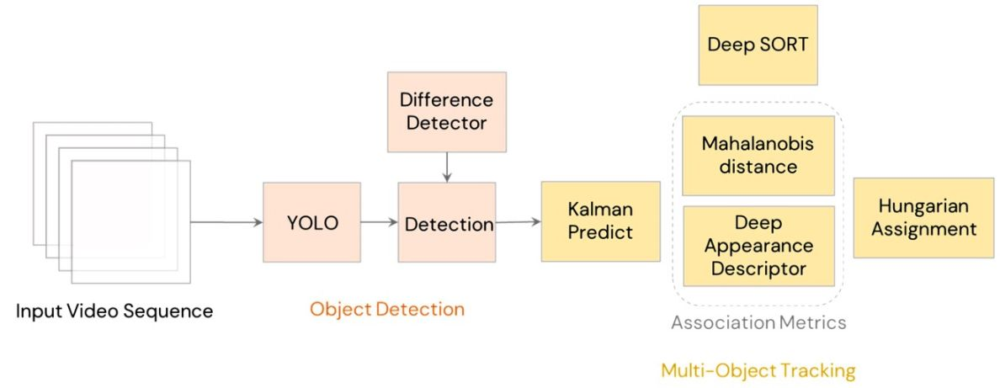{height="50%"}

Instead of relying only on bounding box overlap (IoU), DeepSORT calculates assignments using a weighted combination of two distinct mathematical distances: one evaluating spatial coherence and the other assessing visual similarity.

To incorporate *motion information*, DeepSORT uses the squared **Mahalanobis distance** between predicted Kalman states and newly arrived measurements. This metric scales the spatial distance dynamically based on the tracker's uncertainty.

$$d^{(1)}(i,j) = (\mathbf{d}_j - \mathbf{y}_i)^T \mathbf{S}_i^{-1} (\mathbf{d}_j - \mathbf{y}_i)$$

where:
* $\mathbf{d}_j = (u_j, v_j, \gamma_j, h_j)$ represents the $j$-th detected bounding box, where $(u_j, v_j)$ is the center coordinate, $\gamma_j$ is the aspect ratio, and $h_j$ is the height.
* $(\mathbf{y}_i, \mathbf{S}_i)$ represents the projection of the $i$-th track distribution into the measurement space.
* $\mathbf{y}_i$ is the predicted state of the object, and $\mathbf{S}_i$ is the state covariance matrix (representing the uncertainty), both computed by the Kalman Filter.

If the tracker is confident (small $\mathbf{S}_i$), it strictly penalizes detections outside a tight prediction window. If the tracker is highly uncertain (e.g., due to occlusion), the covariance matrix grows, and the metric "relaxes" to accept detections further away.

To evaluate **visual similarity**, DeepSORT extracts a **deep appearance descriptor** $\mathbf{r}_j$ for each bounding box detection $\mathbf{d}_j$, normalized so that its magnitude is exactly 1 ($\|\mathbf{r}_j\| = 1$).

$$d^{(2)}(i,j) = \min\{1 - \mathbf{r}_j^T \mathbf{r}_k^{(i)} \mid \mathbf{r}_k^{(i)} \in \mathcal{R}_i\}$$

where:

* $\mathcal{R}_i = \{\mathbf{r}_k^{(i)}\}_{k=1}^{L_k}$ is the "gallery"—a rolling memory buffer that keeps the last $L_k = 100$ associated appearance descriptors for the $i$-th track.
* The equation calculates the smallest cosine distance between the new $j$-th detection and the entire visual history of the $i$-th track in the high-dimensional appearance space.

By selecting the minimum distance across the last 100 frames, the system robustly re-identifies objects even if they undergo rotation, partial occlusion, or lighting changes.

The final cost matrix fed into the Hungarian Algorithm is a weighted sum of both metrics:

$$C_{i,j} = \lambda \cdot d^{(1)}(i,j) + (1 - \lambda) \cdot d^{(2)}(i,j)$$

The Mahalanobis distance ($d^{(1)}$) acts as a hard geometric gate, rejecting physically impossible coordinate jumps. The Cosine distance ($d^{(2)}$) drives the actual ID assignment decision based on discriminative visual features.

!!!note Question: Which value of 𝜆 ∈ [0,1] is more suitable when there is substantial camera motion?
    When dealing with substantial camera motion, a value of **$\lambda = 0$** (or extremely close to 0) is the most suitable choice.

    If the camera moves abruptly, the constant-velocity assumption completely breaks down. The objects will appear to jump erratically across the frame, causing the Kalman Filter to generate wildly inaccurate spatial predictions and, consequently, highly unreliable motion costs. Unlike 2D spatial coordinates, the visual identity of an object is generally invariant to camera movement.

    By setting $\lambda = 0$ in the cost matrix equation $C = \lambda \cdot D_{motion} + (1 - \lambda) \cdot D_{appearance}$, remove the corrupted spatial predictions from the Hungarian Algorithm's assignment logic. The actual matching decision is driven 100% by the visual appearance ($C = D_{appearance}$); and rejects physically impossible coordinate jumps (setting the cost to infinity) but leaves the final optimal 1-to-1 matching purely to the CNN embeddings.

If an object is occluded for 30 frames, its Kalman prediction will be highly uncertain. If you throw it into the Hungarian algorithm alongside an object that was visible in the previous frame, the tracker gets confused.

In standard tracking architectures, the Hungarian Algorithm resolves data association by minimizing a global cost matrix across all active tracks and new detections simultaneously. However, when an object (e.g., a surgical instrument) is temporarily occluded, its Kalman Filter continues to predict its state without measurement updates. This lack of update causes the state covariance matrix ($\mathbf{P}$) to grow, reflecting increased uncertainty.

If all tracks are evaluated in a single pass, a highly uncertain track (lost for many frames) effectively has a wider, more permissive spatial prediction. This inflated prediction can inadvertently overlap with a new detection that rightfully belongs to a recently seen track, causing the Hungarian algorithm to assign the wrong ID (an ID switch) to minimize the global Mahalanobis distance.

DeepSORT introduces **Cascade Matching** to prevents this by transforming the data association into a multi-stage process. Instead of a single global assignment, it prioritizes tracks based on their *age* — defined as the number of consecutive frames since their last successful measurement update, denoted as $n$.

**Algorithm Workflow**

1. **Initialization:** The system gathers the pool of all current unmatched detections and all active tracks (both visible and temporarily lost).
2. **Iterative Matching:** The algorithm loops through the track age parameter $n$, starting from $1$ up to the maximum allowed lost frames threshold ($A_{max}$).
3. **Stage-Level Assignment:** At each stage $n$, the Hungarian algorithm computes the cost matrix and resolves assignments **only** between the available pool of unmatched detections and the specific subset of tracks that have been lost for exactly $n$ frames.
4. **Pool Reduction:** Any detection successfully matched during stage $n$ is removed from the available pool.
5. **Progression:** The algorithm moves to stage $n+1$, carrying over only the leftover, unassigned detections.

By strictly enforcing this hierarchy, Cascade Matching guarantees that a detection will always be evaluated against a track lost just $1$ frame ago before it can even be considered for a track lost $30$ frames ago. This significantly improves robustness against ID switches during frequent, temporary occlusions, which is critical for maintaining temporal consistency in complex visual environments.

## Tracking metrics

When building robust tracking pipelines—especially for targets with complex, non-rigid morphologies where bounding boxes might not capture the full reality of the object—choosing whether to evaluate at the **object level** or the **pixel/area level** is a critical architectural decision.

### Base Classifications (Frame-Level)

Before calculating sequence metrics, each frame is evaluated to determine if the tracker successfully found the object. In SOT, "detected" and "identified" are synonymous (unlike MOT, where ID switches matter).

* **True Positive ($n_{tp}^t$):** Target is correctly identified and localized.
* **False Positive ($n_{fp}^t$):** Tracker identifies a background element or non-target as the target.
* **False Negative ($n_{fn}^t$):** Tracker completely misses the target.
* *Note:* In SOT, these values are binary per frame $\in \{0, 1\}$.

### Overlap & Area-Based Metrics

These metrics evaluate *how well* the predicted track ($T$) aligns with the Ground Truth ($GT$).

* **Intersection over Union (IoU):** The standard measure for spatial overlap.

$$IoU = \frac{|T^t \cap GT^t|}{|T^t \cup GT^t|}$$

* **Thresholding:** Usually, a track is considered a True Positive if $IoU \geq 0.5$ (PASCAL criterion).

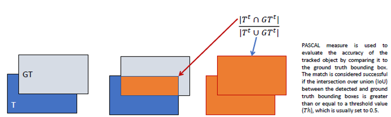{height="50%"}

* **DICE Measure (Pixel-level):** Often more descriptive than bounding boxes for irregular shapes (like fluids or biological tissues). It evaluates area accuracy in terms of precision and recall:
  * If $T$ is entirely inside $GT$: $Precision = 1$, $Recall < 1$.
  * If $GT$ is entirely inside $T$: $Recall = 1$, $Precision < 1$.

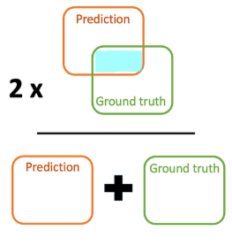{height="50%"}

### Sequence-Level Metrics (Temporal)

These metrics aggregate the frame-by-frame classifications over the entire video sequence ($N_{frames}$).

* **Precision:** How often the tracker was right when it predicted an object.

$$Precision = \frac{\sum n_{tp}^t}{\sum n_{tp}^t + \sum n_{fp}^t}$$

* **Recall:** How much of the actual ground truth the tracker successfully captured.

$$Recall = \frac{\sum n_{tp}^t}{\sum n_{tp}^t + \sum n_{fn}^t}$$

* **F-Score (Correct Track Ratio):** The harmonic mean of Precision and Recall.

$$F = 2 \frac{Precision \times Recall}{Precision + Recall}$$

* **OTA (Object Tracking Accuracy):** Evaluates overall tracking reliability by penalizing both false positives and false negatives, normalized by the total ground truth objects ($g^t$).

$$OTA = 1 - \frac{\sum_{t=1}^{N_{frame}} (n_{fp}^t + n_{fn}^t)}{\sum_{t=1}^{N_{frame}} g^t}$$

* **OTP (Object Tracking Precision):** Averages the IoU *only* across the subset of frames ($M_s$) where a successful match occurred. It measures localization tightness, ignoring lost frames.

$$OTP = \frac{1}{|M_s|} \sum_{t \in M_s} \frac{|T^t \cap GT^t|}{|T^t \cup GT^t|}$$

### Position & Distance Metrics

Sometimes overlap isn't enough, and you need to measure how far the predicted centroid ($CT$) drifted from the ground truth centroid ($CGT$).

* **Deviation:** Uses the **L2 norm** (Euclidean distance) between centroids for matched frames.

$$Deviation = 1 - \frac{\sum_{t \in M_s} d(CT_t, CGT_t)}{|M_s|}$$

* **PBM (Position Based Matching):** Uses the **L1 norm** (Manhattan distance) normalized by the average semi-perimeter ($sp_{ave}$) of the bounding boxes, making it scale-invariant.

$$PBM = \frac{1}{N_{frames}} \sum_i \left( 1 - \frac{d_1(CT_t, CGT_t)}{sp_{ave(i)}} \right)$$

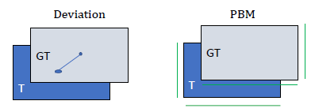{height="50%"}
