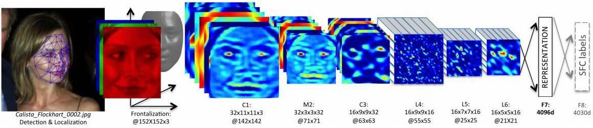

# Face Recognition

**Face recognition** is the task of identifying or verifying a person's identity based on their facial features. This kind of activity is different from **face detection**, which simply locates faces in an image without identifying them. Face recognition is a more complex problem that involves not only detecting the face but also analyzing its features to determine who the person is. FAce recognition systems are widely used in various applications, including security systems, access control, and social media tagging.

A robust face recognition system typically operates through a three-stage sequential pipeline:

1. **Detection:** The system scans the image to locate and bound the face area.
2. **Alignment:** The system detects specific facial landmarks. It then applies geometric transformations to adjust the face, ensuring it is as perfectly centered and normalized as possible. Remove the effects of pose, scale, and lighting variations to create a consistent representation of the face.
3. **Recognition:** The aligned face is processed to extract features and execute the final identity comparison.

The recognition phase is fundamentally divided into two distinct sub-tasks depending on the objective:

* **Face Verification (1:1):** The system compares the provided image of an individual with the specific identity that the individual claims to be. This acts as an authentication mechanism, effectively asking the binary question: "Same or Not Same?".
* **Face Identification (1:N):** The system compares the given individual against all other individuals stored in a database. It does not assume a prior identity claim and outputs a ranked list of the closest matches.

Historically, this task relied on handcrafted features (like Eigenfaces), but modern state-of-the-art systems leverage deep learning paradigms.

Architectures such as FaceNet and VGG Face utilize deep convolutional neural networks to learn mappings from face images directly into a compact Euclidean space. In this embedding space, the mathematical distance between vectors directly corresponds to facial similarity. This architectural leap has allowed algorithms to achieve accuracy rates of over 99.80% on standard benchmarks like Labeled Faces in the Wild (LFW), officially surpassing human performance.

## DeepFace

**DeepFace** unlike modern end-to-end systems that rely entirely on the neural network to *learn pose invariance*, DeepFace relies heavily on an explicit, robust alignment stage.

{height="50%"}

* **Detection & Localization:** The system first detects the bounding box of the face and locates six specific fiducial points (facial landmarks).
* **3D Alignment:** It employs an analytical 3D model of the face to apply a piecewise affine transformation. This *frontalization* process mathematically warps the face into a perfectly centered, forward-facing 152x152 RGB image, normalizing the input before it is fed into the network.

The aligned image is passed through a nine-layer deep neural network designed specifically to handle facial topology.

* **Standard Convolutions (C1, M2, C3):** The initial layers extract low-level features (like edges and textures) using standard 3D convolutional filters and max-pooling layers.
* **Locally Connected Layers (L4, L5, L6):** This is the most distinctive design choice in DeepFace. Instead of sharing weights across the entire spatial domain, these layers use *unshared weights*. The rationale is that different regions of an aligned face have fundamentally different local statistics—the visual features learned to identify an eye are distinct from those needed to identify a chin or a nose.
* **Fully Connected Layers (F7, F8):** The deeper layers condense the network's processing into a dense representation. The F7 layer outputs a 4096-dimensional feature vector, which serves as the ultimate, highly discriminative "face signature" for similarity comparisons.

To train the network for face verification (the 1:1 task of determining if two images belong to the same person), two primary distance evaluation modalities are utilized:

* **Siamese Networks:** Using paired images to evaluate an $L_1$-based distance function ($d(f_1, f_2) = \sum_i \alpha_i |f_1[i] - f_2[i]|$), where $\alpha_i$ are trainable parameters optimized via standard cross-entropy loss and backpropagation.
* **Weighted $\chi^2$ Distance:** Calculating the $\chi^2$ distance ($\chi^2(f_1, f_2) = \sum_i w_i (f_1[i] - f_2[i])^2 / (f_1[i] + f_2[i])$) between the 4096-dimensional vectors, where the weights $w_i$ are learned post-extraction using a linear Support Vector Machine (SVM).

## DeepID2

**DeepID2** (Deep Learning Face Representation by Joint Identification-Verification) demonstrate the factibility of learning features simultaneously through two distinct tasks, **Identification** and **Verification**, yields a much more robust and discriminative face representation than using either task alone.

The core innovation of DeepID2 lies in its joint objective function. While the network parameters are extracted via convolutional layers, $f = \text{Conv}(x, \theta_c)$, they are supervised by two complementary loss functions:

1. **Identification Loss**: The identification task classifies a face into one of $n$ large-scale identities. It enforces the network to learn identity-specific features across a broad population using a standard cross-entropy loss: $$Ident(f, t, \theta_{id}) = -\sum_{i=1}^{n} p_i \log \hat{p}_i = -\log \hat{p}_t$$ *where $t$ is the target identity, $p$ is the ground-truth distribution, and $\hat{p}$ is the predicted probability distribution.*
2. **Verification Loss**: The verification task evaluates pairs of images directly to minimize intra-class variations while maximizing inter-class distances. It optimizes the representations using a contrastive-style loss: $$verif(f_i, f_j, y_{ij}, \theta_{ve}) = \begin{cases} \frac{1}{2}\|f_i - f_j\|_2^2 & \text{if } y_{ij}=1 \\ \frac{1}{2}\max(0, m - \|f_i - f_j\|_2)^2 & \text{if } y_{ij}=-1 \end{cases}$$ *where $y_{ij} = 1$ denotes the same identity, $y_{ij} = -1$ denotes different identities, and $m$ is a predefined enforcement margin.*

On top of the extracted 160-dimensional DeepID2 layer embeddings, the system implements a **Joint Bayesian model** to handle the final face verification task.

A given face representation $x$ is statistically decomposed as:

$$x = \mu + \epsilon$$

* $\mu$ represents **interpersonal variations** (differences between distinct individuals).
* $\epsilon$ represents **intrapersonal variations** (differences within the same individual due to pose, lighting, or expression).

Both variables are assumed to be Gaussian distributed and are estimated during the training phase. Verification is then achieved by executing a **Log-Likelihood Ratio Test** to evaluate whether two representations share the same identity ($H_I$) or belong to different identities ($H_E$):

$$r(x_1, x_2) = \log\frac{P(x_1, x_2 | H_I)}{P(x_1, x_2 | H_E)} = x_1^T A x_1 + x_2^T A x_2 - 2x_1^T G x_2$$

Where the structural mapping matrices are computed as:

$$A = (S_{\mu} + S_{\epsilon})^{-1} - (F + G)$$

$$\begin{pmatrix} F+G & G \\ G & F+G \end{pmatrix} = \begin{pmatrix} S_{\mu} + S_{\epsilon} & S_{\mu} \\ S_{\mu} & S_{\mu} + S_{\epsilon} \end{pmatrix}^{-1}$$

## FaceNet

**FaceNet** propose a unified embedding model. Instead of relying on an intermediate bottleneck layer for classification, as in DeepID2, it directly optimizes the embedding itself using a Triplet Loss function.

FaceNet maps face images directly into a compact 128-dimensional Euclidean space. The deep convolutional neural network is trained such that the squared $L_2$ distance between two face embeddings directly corresponds to their similarity:

* $d^2(f(x_1), f(x_2))$ is small when $x_1$ and $x_2$ belong to the same identity.
* $d^2(f(x_1), f(x_2))$ is large when $x_1$ and $x_2$ belong to different identities.

Because the output is a standard Euclidean space, classical clustering and categorization algorithms like k-means or k-Nearest Neighbors (KNN) can be seamlessly applied for both face verification and identification.

To achieve this optimal embedding space, FaceNet relies entirely on **Triplet Loss**. A single training triplet consists of:

* **Anchor ($x_i^a$):** A baseline image of a specific identity.
* **Positive ($x_i^p$):** Another image of the *same* identity.
* **Negative ($x_i^n$):** An image of a *different* identity.

The objective is to mathematically ensure that the Anchor is closer to the Positive than it is to the Negative by at least a predefined margin $\alpha$. The network minimizes the following equation across the training set $\mathcal{T}$:

$$\sum_{i}^{N} \left[ ||f(x_i^a) - f(x_i^p)||_2^2 - ||f(x_i^a) - f(x_i^n)||_2^2 + \alpha \right]_+$$

Generating all possible triplets across a large dataset is computationally prohibitive and inefficient. Most random triplets easily satisfy the margin equation and would not contribute to the network's training, leading to slower convergence. 

To inject only useful, challenging data into the network, the **offline generation** strategy relies on the following approach:

* **Periodic Checkpoints:** Instead of dynamically mining triplets during the standard training loop, the process pauses every $n$ steps. The system then uses the most recent, up-to-date weights of the network checkpoint to evaluate embedding distances.
* **Extremum Search:** The algorithm actively looks for the most difficult examples to feed the network in the next training phase. It computes the `argmax` to find the "hardest positive" (the positive image furthest from the anchor) and the `argmin` to find the "hardest negative" (the negative image closest to the anchor).
* **Subset Constraint:** Computing `argmin` and `argmax` across an entire large-scale training set is mathematically and computationally infeasible. Consequently, this offline search must be restricted to a specific subset of the data.

The offline solution for triplet selection is designed to solve a major computational bottleneck in training FaceNet. If the system simply generated all possible combinations of Anchor, Positive, and Negative images, the vast majority of these triplets would already satisfy the margin constraint ($||f(x_i^a) - f(x_i^p)||_2^2 + \alpha < ||f(x_i^a) - f(x_i^n)||_2^2$). Processing these "easy" triplets does not contribute to the loss gradient and severely slows down training convergence.

FaceNet solves this through an **Online Generation** strategy during the training phase:

* The network processes mini-batches containing a few thousand face images, ensuring a minimal number of examples per identity are present in each batch.
* Instead of picking the absolute hardest negatives, which can cause the network to fall into bad local minima early in training, the system systematically selects **semi-hard negatives**. These are negative examples that are further away from the anchor than the positive example, but still close enough to violate the margin $\alpha$ and yield a positive loss:

$$||f(x_i^a) - f(x_i^p)||_2^2 < ||f(x_i^a) - f(x_i^n)||_2^2$$

## Open Challenges in Face Recognition

Before a face can be recognized, it must be accurately detected. This phase faces complications from:

* **Extreme Illumination:** Poor lighting, shadows, or harsh backlighting can obscure facial structures.
* **False Positives:** Background textures or non-human patterns can be mistakenly flagged as faces.
* **Demographic Bias:** Algorithmic variations or limitations related to attributes like gender can degrade detection consistency.

A major mathematical challenge is when the visual appearance of the *same* identity changes drastically due to environmental or temporal factors. These factors include:

* **Apparels and Occlusions:** Items like glasses, hats, masks, or changes in hairstyle.
* **Facial Expressions:** Drastic changes in features caused by smiling, frowning, or yelling.
* **Rotations and Pose:** Non-frontal or profile views where significant portions of the face are hidden.
* **Aging:** Structural alterations in facial anatomy over long spans of time.

Integrating and syncing diverse data streams (e.g., combining low-resolution video frames, temporal information, or infrared/thermal imagery) introduces algorithmic and computational complexity.

### Data and Learning Constraints

* **Partial Annotations:** Training models effectively when datasets contain incomplete labels or missing facial attributes.
* **Incremental Learning:** Dynamically updating a model with new faces or identities over time without triggering catastrophic forgetting of previously learned faces.