# Type of Visual Features

Parent: [[5_Visual_feature_extraction]]

## Histogram of Oriented Gradients (HOG)

The HOG descriptor is a *global feature descriptor* apply to the while image to extract _neighborhood information_ and _spatial information_ of the image, like shape, texture, and structure and compress that information from a given image into a reduced/condensed vector form called a feature vector that could describe the feature of this image.

Local shape and appearance of an object can be described by the distribution of intensity gradients. So HOG descriptor is compute after coputing the gradients of the image, generally applying Sobel kernel to get a global feature descriptor of the imag.

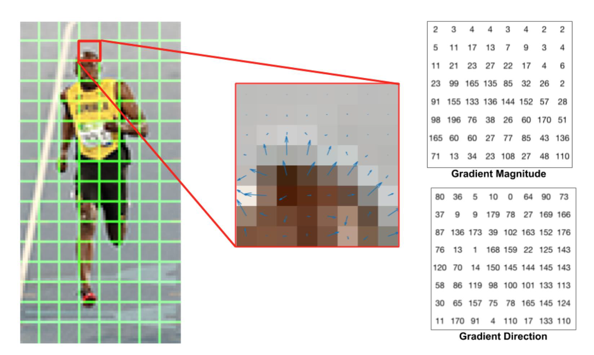{width=70% height=70%}

After, the image is divided into small non-overlappings **cells**, and then for each of them the histogram of gradients is computed.
The histogram of gradients is a vector that counts the number of gradients in each orientation bin. The orientation bins are typically defined as a set of angles (e.g., 0-180 degrees) and the gradients are quantized into these bins based on their direction.

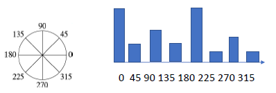{width=70% height=70%}

Magnitude is directly proportional to pixel intensity. If you double the brightness of an image, the gradient magnitudes double, which would drastically change the feature vector even though the "shape" is identical. To solve this, HOG uses** Block Normalization** usign overlapping blocks of cells to normalize the histograms. Each block typically consists of 2x2 cells, and the histograms from these cells are concatenated to form a feature vector for the block. The most common method is the **L2-norm**:

$$v_{norm} = \frac{v}{\sqrt{\|v\|_2^2 + \epsilon^2}}$$

where $\epsilon$ is a small constant to prevent division by zero. Because blocks overlap, a single cell's histogram contributes to the final descriptor multiple times, normalized relative to different neighbors.

!!!tip Dimensionality and Classification
    For a standard $64 \times 128$ detection window:
    - Cells: $8 \times 16 = 128$ cells.
    - Blocks: $7 \times 15 = 105$ blocks (using a 1-cell stride).
    - Features per block: 4 cells $\times$ 9 bins = 36 features.
    - Total Vector Length: $105 \times 36 = 3780$ elements.

At the end, computed histogram are concatenated to form a single feature vector that represents the image, and this feature vector can be used for various computer vision tasks, such as object detection, image classification, and image retrieval.

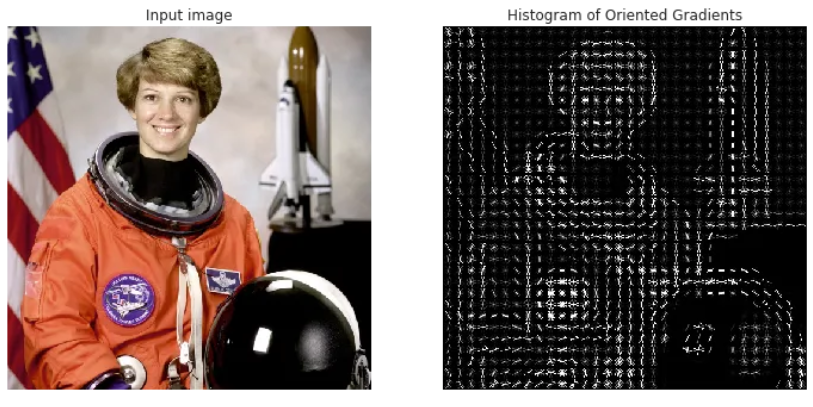{width=70% height=70%}

## Keypoint-based Features

The **keypoint-based features** are local features that are extracted from specific point of the image and represent the *interest point* in the image, such as corners, edges, or blobs. These features are typically used for tasks such as image matching, object recognition, and image retrieval.

Key points are used to identify key regions of an object that are used as the base to later match and identify it in a new image.  

An important property the keypoint-based feature must have is that they should be **invatiant** to changes in scale, rotation, and illumination.This means that the features should be able to be extracted from the same object even if it is viewed from different angles, distances, or under different lighting conditions.
Ideally, we want that they should be invatiant to all trasformations, but in practice,  they are invariant anly to brightness, contrast, and rotation, but not to scale. So, if we want to have a keypoint-based feature that is invariant to scale, we need to use a different type of feature descriptor.

To extract keypoints involves two distinct phases:

* **Detection:** Identifying the point or region of interest. Generallya are the region where the signal changes significantly in multiple directions.
* **Description:** Generating a numerical vector (a **descriptor**) that summarizes the visual information in the neighborhood around the keypoint. This vector allows the computer to "recognize" the same point in a different image.

Some algorithms for keypoint-based features are:

- **HARIS corner detector**
- **Scale-Invariant Feature Transform (SIFT)**
- **Speeded-Up Robust Features (SURF)**
- **Oriented FAST and Rotated BRIEF (ORB)**
- **PCA-SIFT**
- **GLOH (Gradient Location and Orientation Histogram)**

### HARIS corner detector

This algotithm is based on the idea that the **corners** are the main point of interest in the image, and they are that point where the gradient changes in all the directions.
The idea of corner detection is to consider a small window around each pixel in an image. We want to identify all such pixel windows that are unique.

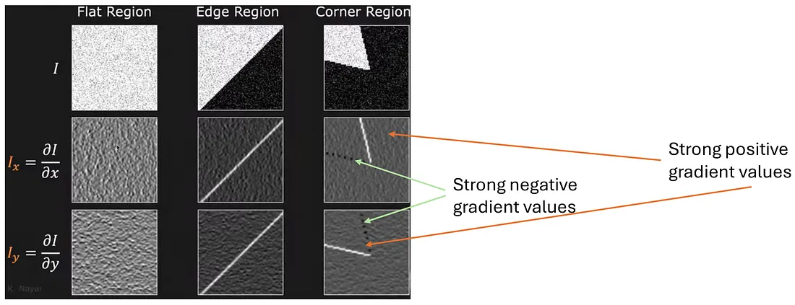

Based on this idea, **Harris corner detector** can be identify corners by looking at the change in intensity when the window is shifted in different directions, and distinguish them from edges and flat regions.
To determinate how much the luminance changes when we shift the window, we can use **Sum of Squared Differences** (**SSD**):
$$E(u,v) = \sum_{(x,y) \in W} w(x,y) [I(x+u, y+v) - I(x,y)]^2$$

where:

- $I(x, y)$ is the intensity of the pixel at position $(x, y)$.
- $w(x, y)$ is a weighting function (often a Gaussian) that gives more weight to pixels near the center of the window.
- $(u, v)$ is the shift in the x and y directions.

Shifting the image on all the possible directions and computing the change in intensity for each shift can be computationally expensive, so we can use the **First-order Taylor approximation** to approximate the change in intensity when the window is shifted:
$$I(x + u, y + v) \approx I(x, y) + I_x(x, y)u + I_y(x, y)v$$

So, the change in intensity can be rewritten as:
$$E(u, v) \approx \sum_{x, y} w(x, y) [I(x,y)+uIx+vIy−I(x,y)]^2 \\ = \sum_{x, y} w(x,y)[uI_x+vI_y]^2 \\ = \sum_{x,y} w(x,y) 
\begin{pmatrix} u & v \end{pmatrix} 
\begin{bmatrix} I_x I_x & I_x I_y \\ I_x I_y & I_y I_y \end{bmatrix} 
\begin{pmatrix} u \\ v \end{pmatrix}$$

This can be expressed in matrix form as:
$$E(u, v) \approx \begin{pmatrix} u & v \end{pmatrix} M \begin{pmatrix} u \\ v \end{pmatrix}$$

where $M$ is the second moment matrix (also known as the structure tensor) defined as:
$$M = \sum_{x, y} w(x, y) \begin{bmatrix} I_x^2 & I_x I_y \\ I_x I_y & I_y^2 \end{bmatrix}$$

From a geometric perspective, the matrix $M$ captures the intensity structure of the image around the point of interest. The eigenvalues of $M$ provide insight into the local image structure.

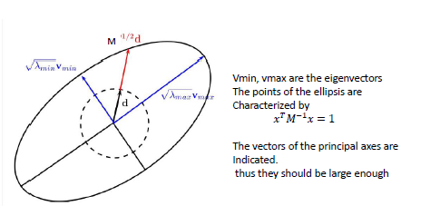{width=70% height=70%}

The eigenvalues of the matrix $M$ can be used to determine whether a point is a corner, an edge, or a flat region:
- $\lambda_1, \lambda_2$ both small $\rightarrow$ Flat region (no variation).
- $\lambda_1 \gg \lambda_2$ (or viceversa) $\rightarrow$ Edge (variation only in one direction).
- $\lambda_1, \lambda_2$ both big $\rightarrow$ Corner (variation in every direction).

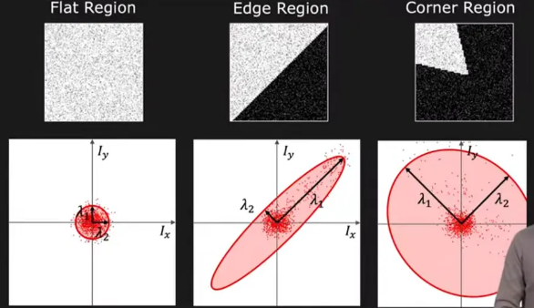{width=70% height=70%}
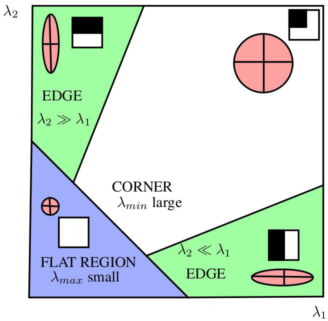{width=50% height=70%}

To finally detect the corners, we take only the local maxima of R, where R>threshold, where R is defined as:
$$R = \text{det}(M) - k \cdot (\text{trace}(M))^2 \\ =
c_{11}c_{22}-c_{12}c_{21}-k \cdot (c_{11}+c_{22})^2 \\ = \lambda_{min}\lambda_{max} -k \cdot (\lambda_{min} + \lambda_{max})^2$$

where $k$ is a constant typically set to 0.04 to 0.06. The corners are identified as the points where R is above a certain threshold and is a local maximum.

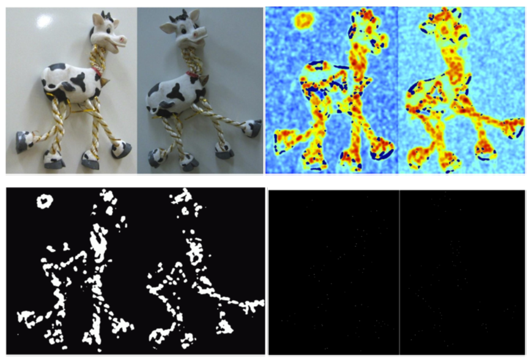{width=70% height=70%}

The Harris Corner Detector has important properties like:

1. **Intensity Shift Invariance** that means that if you add a constant brightness value to every pixel, the corner response remains unchanged. Mathematically, adding a constant brightness value $a$ to every pixel: $$\frac{\partial}{\partial x}(I + a) = \frac{\partial I}{\partial x}$$ The derivative of a constant is zero. Because the Structure Tensor $M$ is built entirely from these derivatives, the resulting corner response $R$ remains identical.
2. **Intensity Scaling (Non)-Invariance** If you multiply the intensity by a factor $a$ (changing the contrast), the derivatives are also multiplied by $a$: $$I'_x = a I_x, \quad I'_y = a I_y$$ This means the eigenvalues $\lambda_1, \lambda_2$ will be scaled. Consequently, the response $R$ will change (specifically, it scales by $a^4$ because of the determinant). Using a **fixed threshold** $\tau$, a corner that was detected in a high-contrast image might fall below the threshold in a low-contrast version of the same image. To be truly invariant, you would need to normalize the image or use an adaptive threshold.
3. **Translation Covariance** (**Equivariance**) In computer vision, **covariance** (or equivariance) means that if the input transforms, the output transforms in the same way.  If you shift the image to the left by 50 pixels, the detected corner $(x, y)$ will simply move to $(x-50, y)$. 
4. **Rotation Invariance** When an image rotates, the gradients $I_x$ and $I_y$ change, and the Structure Tensor $M$ rotates accordingly. However, the **eigenvalues** ($\lambda_1, \lambda_2$) represent the lengths of the axes of the uncertainty ellipse.  The ellipse rotates in space, but its **shape and size** (the eigenvalues) do not change. Since the Harris Response $R$ is calculated using only the determinant and trace (which are functions of the eigenvalues), $R$ remains constant regardless of the orientation.
5. **Scale Non-Invariance** This is the primary limitation of the original Harris algorithm. A "corner" is a local concept defined by the size of the window $W$. 
   * **Small Scale:** A sharp junction of two lines looks like a clear corner.
   * **Large Scale (Zoomed in):** That same "corner" now looks like a smooth curve or even a straight edge to a small sliding window.

For the descriptor, a simple solution is to flatten the image matrix putting a window around the pixel that represente dei corners, and flatten the pixel values in a vector. However, this approach is not robust to changes in scale, rotation, and illumination.

### Scale-Invariant Feature Transform (SIFT)

A way to resolve the problem of scale non-invariance of the Harris corner detector is to use the **Scale-Invariant Feature Transform (SIFT)**, which is a keypoint-based feature descriptor that is invariant to scale and rotation.

An important application of SIFT is in **image matching**. For example, if you have two images of the same scene taken from different angles or distances, SIFT can extract keypoints from both images and match them based on their descriptors. This allows you to identify corresponding points between the two images, which can be used for tasks like image stitching, 3D reconstruction, and object recognition.

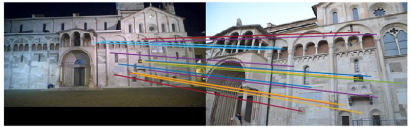{width=70% height=70%}

!!!tip SIFT Algorithm Steps
    SIFT detector operate in four main steps:
    1. **Scale-space extrema detection**
    2. **Keypoint localization**
    3. **Orientation assignment**
    4. **Keypoint descriptor generation**
    
    Where the first two steps are used to detect the keypoints, and the last two step are used to generate the descriptor for each keypoint.

The first step, **Scale-space extraema detection**, idetinfiy the keypoints that are invariant to scale by searching for local extrema in a scale-space representation of the image. This is done by convolving the image with a Gaussian kernel at different scales and then computing the Difference of Gaussians (DoG) to find potential keypoints.

This operationn construct a **Gaussian pyramid feature**, a multi-scale representation of the image, with different bluring factor to capture features at different scales. Scale-space is separated into octaves and the number of octaves and scale depends on the size of the original image. Each octave’s image size is half the previous one.

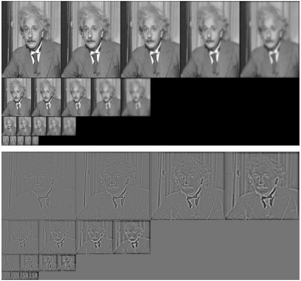{width=70% height=70%}

Within each octave, the image is convolved with Gaussian kernels at different scales, typically this is double at each octave, to create a set of blurred images. The **Difference of Gaussians** (DoG) obtained by subtract the two nearby blurred images.

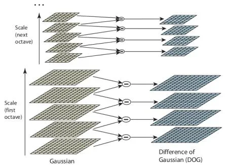{width=50% height=70%}

The reason behind the use of a pyramid is that it allows the algorithm to detect features at different scales making it invariant to scale changes.

The extrema search is performed by comparing each pixel in the DoG images to its 26 neighbors (8 in the current scale, 9 in the scale above, and 9 in the scale below). If the pixel is a local maximum or minimum, it is considered a potential keypoint. Only pixels that are local extrema in three adjacent levels are promoted as keypoints

This process generate a lot of keypoint, but many of them are not stable and are sensitive to noise. So in the second step, **Keypoint localization**, the discart the unuseful keypoints, the ones that are too close to the edge or have low contrast.
We can do this basing on th Harris corner response function, if the response is too low, the keypoint is discarded. Also, if the keypoint is located on an edge, it is also discarded because it is not stable.

To eliminate points that are sensitive to noise, SIFT rejects candidates with low contrast. Generally, a keypoint is discarded if the value of the DoG function at that point is below a certain threshold. This is because low-contrast points are more likely to be affected by noise and are less reliable for matching.
$$|D(\hat{\mathbf{x}})| < 0.03$$

Instead, edges are well-localized in only one direction, so they must be removed using the **Hessian Matrix** ($\mathbf{H}$).
$$\mathbf{H} = \begin{bmatrix} D_{xx} & D_{xy} \\ D_{xy} & D_{yy} \end{bmatrix}$$

To avoid calculating eigenvalues directly (which is computationally expensive), SIFT uses the ratio $r$ between the eigenvalues.

Let $r = \alpha/\beta$. So $\alpha = r\beta$, so:

$$\frac{\text{Tr}(\mathbf{H})^2}{\text{Det}(\mathbf{H})} = \frac{(\alpha + \beta)^2}{\alpha\beta} = \frac{(r\beta + \beta)^2}{r\beta^2} = \frac{(r + 1)^2}{r}$$

$(r+1)^2/r$ is at a minimum when the two eigenvalues are equal (a perfect corner). The final condition for discarding keypoints is:
$$\frac{\text{Tr}(\mathbf{H})^2}{\text{Det}(\mathbf{H})} < \frac{(r + 1)^2}{r}$$

As the ratio $r$ increases, the point looks more like an edge. Generally, a common threshold for $r$ is around 10.
This threshold ensures that the ratio of curvatures is below a certain limit, effectively keeping only "sharp" corners and rejecting elongated edges.

At this point, we have obtained a set of keypoints that are invariant to scale but not to the rotation. So in the third step, **Orientation assignment**, the keypoints are make rotation invariant.

For each keypoint, are taken a neighborhood aroud then, and the gradient are compute to obtain the orientation and the magnitude. Are build an orientated histogram with 36 bins,  covering 360 degree, every 10 degree.

The dominant peak in the histogram becomes the "reference" orientation for that keypoint. If there are multiple high peaks, are set a threshold, and will be create multiple keypoints at the same location with different orientations anly for the peaks that are above the threshold.

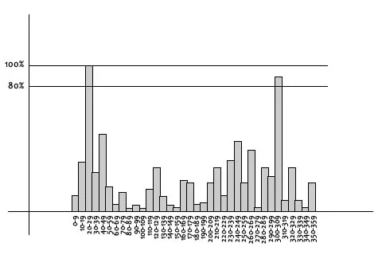{width=70% height=70%}

Now the keypoints are invariant to both scale and rotation, but they are not invariant to changes in illumination. So, in the last step, **Keypoint descriptor generation**, a descriptor is generated for each keypoint by taking a 16x16 neighborhood around the keypoint and dividing it into 4x4 subregions. 

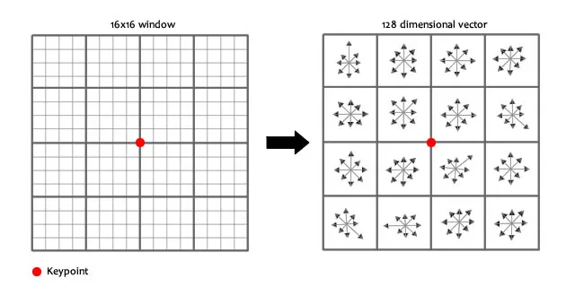{width=70% height=70%}

For each subregion, an orientation histogram with 8 bins is computed, resulting in a 128-dimensional feature vector (4x4 subregions x 8 bins per subregion = 128 dimensions).

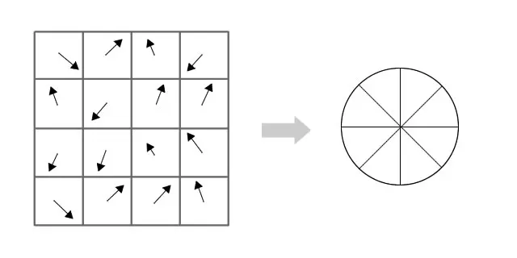{width=70% height=70%}

This feature vector introduces a few complications. We need to get rid of them before finalizing the fingerprint.

1. **Rotation dependence** The feature vector uses gradient orientations. If you rotate the image, everything changes. All gradient orientations also change. To achieve rotation independence, the keypoint’s rotation is subtracted from each orientation. Thus each gradient orientation is relative to the keypoint’s orientation.
2. **Illumination dependence** If we threshold numbers that are big, we can achieve illumination independence. So, any number (of the 128) greater than 0.2 is changed to 0.2. This resultant feature vector is normalized again. And now you have an illumination independent feature vector!

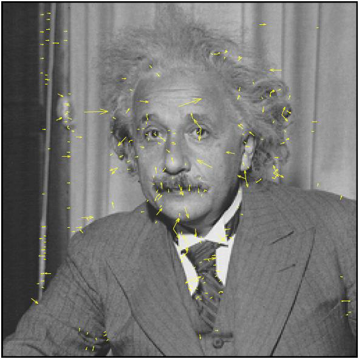{width=50% height=70%}

Its applications including object recognition, robotic mapping, image stitching, 3D modeling, gesture recognition, video tracking, wildlife individual identification, and match moving.

#### SIFT and CNN

The evolution of computer vision has moved from hand-crafted features to learned features.

The reason why SIFT and other hand-crafted features are not used anymore is that they are not robust to changes in scale, rotation, and illumination, and they are not able to capture the complex patterns in the data. On the other hand, CNNs are able to *learn features* from the data that are invariant to these changes and can capture complex patterns, making them more effective for tasks such as image classification and object detection.

An example is **Key.Net**, a CNN-based keypoint detector that learns to detect keypoints in an end-to-end manner.

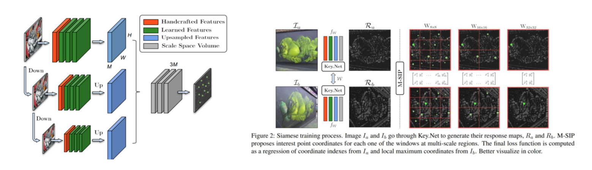{width=70% height=70%}

KeyNet doesn't try to learn everything from scratch. Instead, it uses a **fixed set of handcrafted filters** as a starting point.

* **Handcrafted Filters:** The first layer consists of traditional filters (Laplacian of Gaussian, Sobel, etc.) applied at multiple scales. These act as "soft anchors" that provide the network with proven geometric primitives.
* **Shallow CNN:** A lightweight neural network then learns how to combine the outputs of these filters. Instead of learning "what an edge is" (which math already solved), it learns **which combination of filters** makes a point stable across different images.
* **Multi-scale Processing:** It processes the image in a pyramid fashion to ensure that the detected points are robust to changes in zoom (scale invariance).

KeyNet is trained using a **Repeatability Loss**. During training, the network is shown two versions of the same scene (e.g., one rotated or blurred). It is rewarded if it detects the exact same coordinates in both images. Because it is "anchored" by handcrafted filters, it converges faster and requires less data than a "blind" CNN.

### Semantic Keypoints

While the features like Harris, SIFT, KeyNet are **geometric** keypoints—meaning they are found through mathematical properties like gradients and curvature, **Semantic Keypoints** are points that carry specific **functional or anatomical meaning**. It requires **object-level understanding**.

Semantic keypoints are almost exclusively detected using **Deep Learning**. The standard approach is **Heatmap Regression**:

1.  **Input:** An image patch or full frame.
2.  **Output:** A probability map (Heatmap) where each pixel value represents the confidence that the keypoint is located there.
3.  **Loss Function:** Usually a Mean Squared Error (MSE) between the predicted heatmap and a ground-truth Gaussian centered on the manual annotation.

## Attention-based Features

Saliency detection is a fundamental **attentional mechanism** shared by both humans and machines. Its primary purpose is to filter massive amounts of sensory data to focus limited cognitive and perceptual resources on the most pertinent information. It identifies pertinent information through a combination of **perception** (attraction to visual stimuli) and **cognition** (reasoning and conceptual construction).

Attention is not a single process but a dual-stage system:

1.  **Bottom-up (Initial):** Purely data-driven and guided by **Saliency**. It reacts to the inherent properties of the image.
2.  **Task-driven (Refined):** Purposive and goal-oriented. It is "top-down," meaning it is guided by what the observer is actually trying to accomplish.

There are two types of maps that represent these stages:
* **Saliency Map:** Computes "conspicuous" points based on **low-level visual features** (e.g., brightness, color, oriented edges, and motion). It is essentially "feature-agnostic" once the features are combined.
* **Priority Map:** A more complex, goal-directed map. It integrates the bottom-up data from the saliency map with **task-relevant information**.
* **Predictive Value:** Both maps code the probability of a specific location being the next to be **foveated** (where the eye will look next).
  
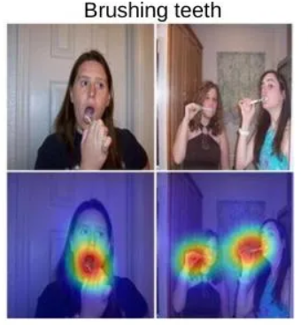{width=70% height=70%}

### Itti and Koch's Model

The model by **Itti and Koch** combines multiple low-level features to create a saliency map. The process involves two main steps:

1.  **Competition:** Individual feature maps (color, orientation, luminance, motion) compete to determine which locations are most "different" from their surroundings across multiple spatial scales.
2.  **Normalization & Combination:** These individual maps are normalized and combined into a single, global, **feature-agnostic saliency map**.

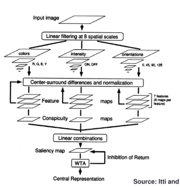

The output of these maps leads to different "states" of attention:

* **Graded Attention:** Represents the "pre-selection" phase, where multiple areas have various levels of interest.
* **Attentional Target:** The "post-selection" phase, where a specific target has been chosen.
* **Overt Attention:** The physical manifestation of attention—the specific point in visual space that is currently being **fixated** by the eyes.

### MLNet: A Multi-Level Network for Saliency Detection

The **MLNet (Multi-Level Network)**, developed by the **AImagelab** (UNIMORE), is a significant milestone in saliency detection. It was designed to bridge the gap between low-level visual features and high-level semantic meaning by integrating information from multiple layers of a Deep Convolutional Neural Network.

Traditional CNNs used for classification (like VGG or ResNet) discard spatial information as they go deeper. MLNet recognizes that saliency is determined by both:
* **Low-level features:** Edges, colors, and contrast (captured in early layers).
* **High-level features:** Semantic objects like faces, text, or tools (captured in deeper layers).

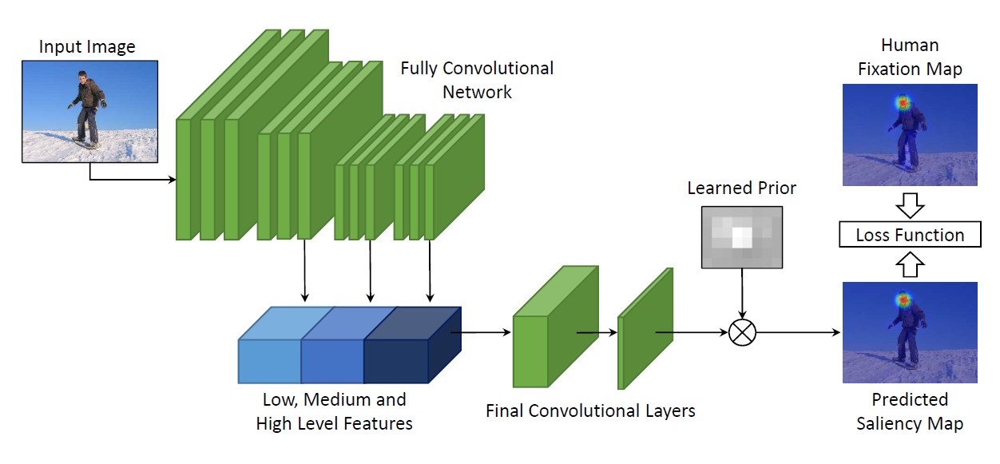{width=70% height=70%}

Instead of using only the last layer, MLNet extracts feature maps from **multiple levels** (e.g., `conv3`, `conv4`, and `conv5` of VGG-16) and combines them to create a unified representation.

The network is typically divided into three main components:

* **Feature Extraction:** A pre-trained CNN backbone.
* **Multi-Level Integration:** Feature maps from different layers are resized to a common spatial resolution and concatenated. This creates a "hypercolumn" of descriptors for each pixel.
* **Saliency Encoder/Decoder:** * A series of convolutional layers (often $1 \times 1$ or $3 \times 3$) learn how to weight these multi-level features.
    * It learns a set of **prior maps** (Gaussian priors) to model the "center bias"—the human tendency to look at the center of an image.

Training a saliency model like MLNet isn't just about simple classification. It uses a combination of metrics to ensure the predicted map matches human eye-tracking data:

* **Kullback-Leibler (KL) Divergence:** Measures the difference between the predicted probability distribution and the ground truth.
    $$KL(P \| Q) = \sum_{i} P_i \log \frac{P_i}{Q_i}$$
* **Normalized Scanpath Saliency (NSS):** Evaluates the saliency values at the actual human fixation points.
* **Correlation Coefficient (CC):** Measures the linear relationship between the predicted and ground-truth maps.
