# Recognition tasks

Parent: [[0-Computer_Vision_MOC]]

Furthermore the image classification tas which can be realized by a CNN, ViT or other architectures, is not the only task in computer vision. Other tasks include are

- **object detection** aimed at _identifying_ and _localizing_ objects in the image by drawing bounding boxes around them and assigning class labels to each box,
- **semantic segmentation** which is the task of assigning a class label to each pixel in the image, effectively segmenting the image into regions corresponding to different object classes.
- **instance segmentation** which is a more fine-grained version of semantic segmentation that not only classifies each pixel but also distinguishes between different instances of the same class (e.g., differentiating between two people in an image).

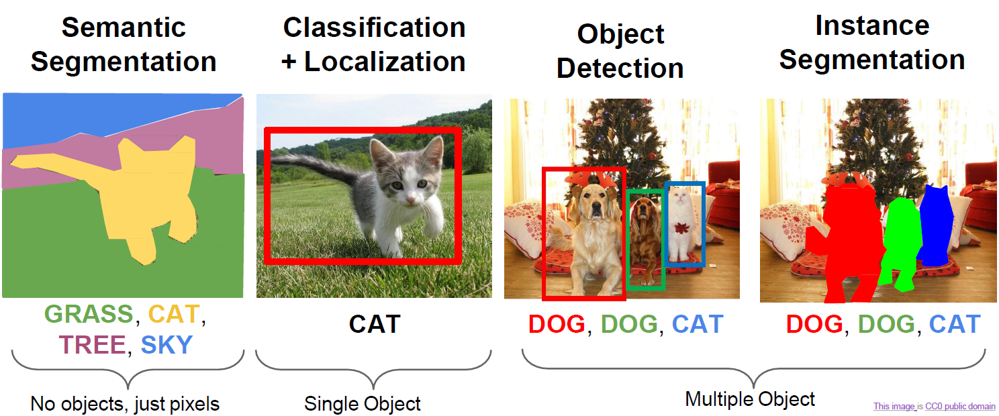{width=70% height=60%}

## Object Detection

!!!note
    Object detection identifying the presence of objects and localizing them within the image drawing a bounding box around them and assigning a class label to each box. The output of an object detection model are:
    - a **set of bounding boxes**, generally represented by the $(x, y)$ coordinates of the top-left corner and the width and height of the box,
    - a **class label** for each bounding box, so a probability distribution over the predefined set of classes,
    - a **confidence** score for each bounding box, which indicates the model's certainty about the presence of an object within that box.

Obviously, not all objects in an image will be recognized, but only those on we have trained the model to recognize. There are various type of approaches to object detection like:

1. **Region Proposal-based Detectors**: These methods first generate a set of candidate regions (proposals) that are likely to contain objects, and then classify each proposal into object categories.
2. **Single Shot Detectors (SSD)**: These methods predict bounding boxes and class probabilities directly from the input image in a single forward pass, without the need for a separate region proposal step.
3. **Detection Transformers**: These methods leverage the self-attention mechanism of Transformers to model the relationships between different regions of the image, allowing for more accurate object detection.

A very naive approach fo object detection is to use a CNN feeded with the pieces og the image to have the labels of the objects in those pieces, and then use a post-processing step to merge the pieces together and draw the bounding boxes around the objects.
However, this approach is not very efficient and does not work well in practice, because it does not take into account the spatial relationships between the different pieces of the image. Other problems of this approach are that the bounding boxes are fixed fr all type of pbjects, and that it does not work well for small objects or objects that are close to each other. Moreover, needs to repeat the process for each piece of the image, which is computationally expensive.

### Region Proposal-based Detectors

This type of detectors first generate a set of candidate **regions of interes**t (**RoI**) or **proposals** that are likely to contain objects, and then classify each proposal into object categories.

The RoI are extracted using an algorithm called **Selective Search** based on the principle of hierarchical region grouping.

!!!tip Selective Search
      1. Initially, the image is segmented into small regions based on low-level features such as color and texture. This initial segmentation creates a set of regions that may potentially correspond to various objects within the image.
      2. Then, the algorithm iteratively merge these regions based on a similarity measure. Generally they rely on a diverse set of strategies that consider different characteristics, such as color similarity, texture similarity, and the spatial relationship between regions. At each ieration of the Hierarchical Grouping Algorithm, the two most similar regions are grouped together, and new similarities are recalculated between the resulting region and its neighboring segments.
      3. This process continues until all regions have been evaluated, ensuring that the final set of proposals is both comprehensive and relevant.
    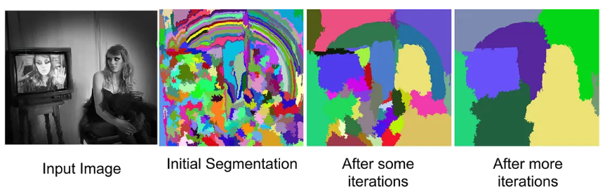{height=50%}
    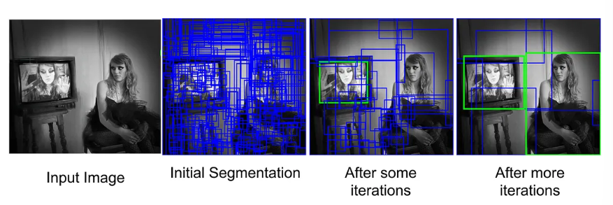{height=50%}

Selective Search is a heuristic-based method, meaning it does **not learn** from data but relies on predefined rules and strategies to generate proposals. It is designed to be fast and efficient, making it suitable for real-time applications.

#### R-CNN

The first model based on this approach is the **R-CNN** **Region-based Convolutional Neural Networks** (2014).

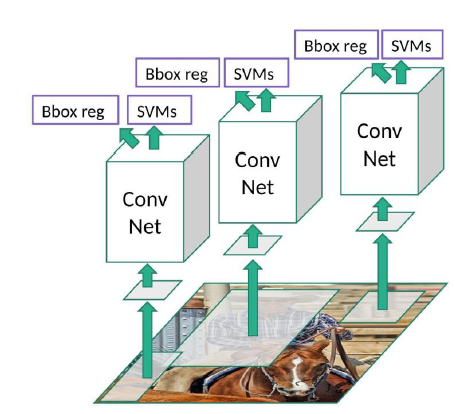{width=50% height=50%}

The algorithms of Selective Search is applied directely to the imput image to generate $\sim 2K$  RoI, that required a lot of time.
Those RoIs can not be feeded directly to CNN because they want a fixed size input. So the RoIs extracted are **wrapped** in a fixed size bounding box, but these can be resize the image and modify the aspect ration of objects, leading to a geometry distortion. 
Anoher problem of wrapping image is the not differentiability of the process, which means that the model can not learn to optimize the RoI generation process, because it is a fixed process that does not depend on the data.

After that, the wrapped RoIs are feeded to a CNN to extract features, and then a SVM is used to classify the features and assign a class label to each RoI. Finally, a bounding box regression is applied to refine the coordinates of the bounding boxes.

#### Fast R-CNN

This model is an improvement of R-CNN that try to resolve the problems of the R-CNN.

The main difference is the RoIs asre extracted from the feature map of the CNN applied to the whole image. In thsi way we resolve the problem of fixed size input, because the RoIs are extracted from the feature map, which can have a different size than the input image and to it in a single forward pass, without the need for a separate region proposal step.

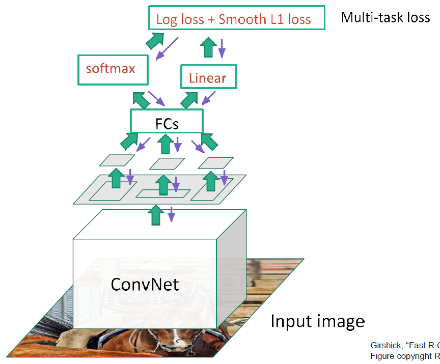{width=50% height=50%}

But the RoI before to feed it in a FC layers to classify it and to apply the bounding box regression, need to be resized to a fixed size, and this is done by a process called **RoI Pooling** that is differentiable, so we can learn to optimize the RoI generation process and have a better performance.

!!!note RoIPooling Layer
    The RoIPooling layer resize the different size RoI to a fixed size preserveing the spatial information of the features while ensuring that the output can be fed into fully connected layers for classification and bounding box regression. To do this:
        1. the proposal (**anchor**) are applied to the feature map to extract the corresponding features for each RoI, resulting in a feature map of variable size for each RoI.
        2. snap the bounding box coordinates to the nearest grid points on the feature map
        3. divide the RoI into a fixed number of bins always snapping the coordinates to the nearest grid points on the feature map, and then apply max pooling within each bin to obtain a fixed-size output for each RoI. 
    The dimension of the output of the RoIPooling layer is determined by the number of bins that shrink the $H$ and $W$ dimension, without changing the number of $C$. $H_{out}$ and $W_{out}$ are hyperparameters that can be chosen based on the desired output size for the RoI features.

Despite the improvement of Fast R-CNN, it still relies on the Selective Search algorithm to generate RoIs, which is a bottleneck in terms of speed. Furthermore, the RoI Pooling layer can introduce some quantization errors due to the snapping of coordinates to the nearest grid points, which can affect the accuracy of the model

#### Faster R-CNN

To resolve the problem of the speed of Selective Search, **Faster R-CNN** introduce a new module called **Region Proposal Network** (**RPN**) that is a fully convolutional network that share the same convolutional layers of the Fast R-CNN to generate RoIs in a single forward pass, without the need for a separate region proposal step.

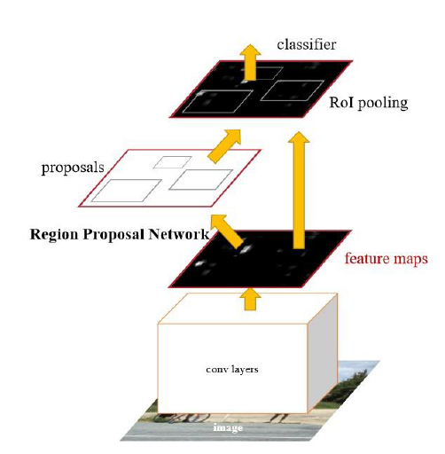{width=50% height=50%}

After the convolutional layers have generate the feature maps, this come into the RPN which generates a set of anchor boxes with different scales and aspect ratios, and for each anchor box it predicts a binary classification (object or not object) and a bounding box regression to refine the coordinates of the anchor box. The output of the RPN is a coordinate set of RoIs that are feeded to the Fast R-CNN for classification and bounding box regression. Passing the coordiantes makes the process not differentiable, so we need more loss functions to optimize the RPN and the Fast R-CNN separately.

!!!note Region Proposal Network (RPN)
    RPN is a small neural network sliding on the last feature map of the convolution layers and predicting whether there is an object or not and also predicting the bounding box of those objects. 
    This net rely on the concept of **anchor boxes**. The RPN defines a set of reference bounding boxes called anchors. Centered on each spatial position (cell) of the feature map, the algorithm places $k$ anchor boxes characterized by different scales and aspect ratios (typically $k=9$, using 3 scales and 3 aspect ratios). These serve as a fixed reference grid.
    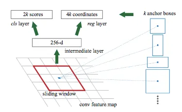{width=70% height=50%}

    The RPN operates by sliding a small convolutional network (often using a 3x3 kernel) over this feature map.
    At each sliding window location on the feature map, the RPN performs  for the $k$ predefined anchor boxes two tasks simultaneously:
    - **predicts "Objectness**": It determines whether potential objects are present within predefined bounding boxes, called anchor boxes, centered at that location. Thanks to a **Classification Layer** that generates $2k$ scores per spatial location. It performs a binary classification task for each anchor, computing the probability that the region contains a valid object versus the probability of it being empty background (BinaryCrossEntropy).
    - **refines Box Coordinates**: For anchors deemed likely to contain an object, it predicts adjustments (regressions) to the anchor's coordinates to better fit the potential object. Thanks to a **Regression Layer** that outputs $4k$ parameters per spatial location. Rather than predicting absolute coordinates, it computes four scale-invariant spatial offsets ($t_x, t_y, t_w, t_h$). These adjustments are applied to the anchor's original center coordinates ($x, y$), width ($w$), and height ($h$) to mathematically deform the box, tightly aligning the proposal with the actual ground-truth object. (MSELoss)

The output of the RPN togheter with the output of the convolutional layers are feeded to the Fast R-CNN for classification and bounding box regression. The RPN and the Fast R-CNN are trained separately, but they share the same convolutional layers, so we need to optimize them together. This is done by a process called **alternating training** that consist in first training the RPN while keeping the Fast R-CNN fixed, and then training the Fast R-CNN while keeping the RPN fixed, and repeating this process until convergence.

So there are 4 loss functions to optimize in this model:

1. The loss of the RPN for the classification task (BinaryCrossEntropy)
2. The loss of the RPN for the regression task (MSELoss)
3. The loss of the Fast R-CNN for the classification task (CrossEntropy)
4. The loss of the Fast R-CNN for the regression task (MSELoss)

#### Mask R-CNN

The main problem depends always on the RoI Pooling layer that can introduce some quantization errors due to the snapping of coordinates to the nearest grid points, which can affect the accuracy of the model.

To resolve this problem, **Mask R-CNN** introduce a new module called **RoI Align** that is a differentiable version of the RoI Pooling layer that does not introduce quantization errors.

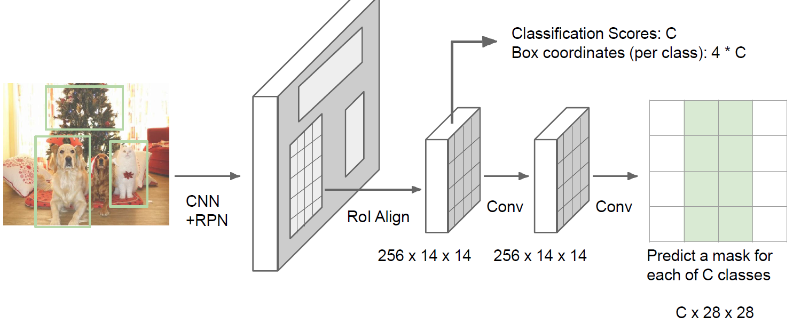{width=70% height=50%}

!!!note RoIAlign Layer
    **RoI Align** preserves the exact floating-point coordinates of the proposals. This sub-pixel accuracy is critical for dense prediction tasks that require exact spatial localization, such as instance segmentation. The operation works through the following algorithmic steps:

    1. **Continuous Projection:** The continuous coordinates of the region proposal are mapped onto the feature map without any integer rounding (i.e., coordinate divisions like $x/k$ retain their exact floating-point values).
    2. **Grid Division:** The projected RoI is divided into a fixed target grid (e.g., $H_{\text{out}} \times W_{\text{out}}$ bins), strictly maintaining the continuous floating-point boundaries for each individual bin.
    3. **Sub-pixel Sampling:** Because the bin boundaries and internal coordinates do not perfectly align with the discrete pixel grid of the feature map, RoI Align defines a set of regularly spaced sampling points within each bin (typically 4 points).
    4. **Bilinear Interpolation:** To determine the precise feature value at each floating-point sampling location, the algorithm applies **bilinear interpolation**. It calculates the exact value by taking the weighted average of the four closest discrete grid centers on the original feature map, based on their 2D spatial distance to the sampling point. For each sampling point at coordinates $(x, y)$, the interpolated feature value $f_{xy}$ is computed as:$$f_{xy} = \sum_{i,j=1}^{2} f_{i,j} \max(0, 1 - |x - x_i|) \max(0, 1 - |y - y_j|)$$ where:
         * $(x, y)$ are the continuous (floating-point) coordinates of the spatial sampling point.
         * $f_{i,j}$ represents the feature map value at the 4 adjacent discrete grid centers (the actual pixels).
         * The two $\max$ functions act as weighting filters (bilinear kernels): they assign a weight to the 4 $f_{i,j}$ values proportional to their spatial proximity along the $x$ and $y$ axes relative to the target $(x, y)$.
    5. **Feature Aggregation:** Finally, an aggregation operation (either Max Pooling or Average Pooling) is applied to the 4 interpolated sampling points within each bin to output a single value.
   
        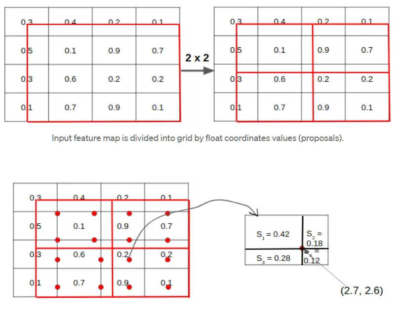{width=70% height=50%}

Together with the classification and the bounding box regression, Mask R-CNN also predict a binary mask for each RoI using a _mask pipeline_ formed by a stack of CNN layers that take as input the feature map of the RoI and output a binary mask of the same size of the RoI. The mask is trained using a binary cross-entropy loss function. This CNN layers act as upsampplig operator to create a bigger mask to have a better resolution and to have a better performance.

So in this case we have 4 loss functions to optimize:

1. classification Loss (Binary Cross-Entropy): Evaluates whether an anchor box contains a generic object (foreground) or just background.
2. RPN Regression Loss (Smooth L1 Loss): Computes the error on the bounding box coordinate offsets (Smooth L1 is used instead of MSE because it is less sensitive to outliers and prevents exploding gradients).
3. classification Loss (Categorical Cross-Entropy): Classifies the proposed region into a specific target class or filters it out as background.
4. regression Loss (Smooth L1 Loss): Applies a final, class-specific geometric refinement to the bounding box coordinates to ensure maximum spatial precision.

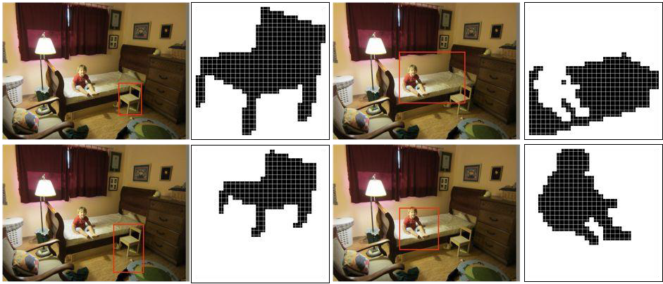{width=70% height=50%}

Mask R-CNN is a also a model instance segmentation, because it predict a binary mask for each RoI, but it can be used also for object detection by ignoring the mask prediction and using only the classification and the bounding box regression.

#### General framework of Region Proposal-based Detectors

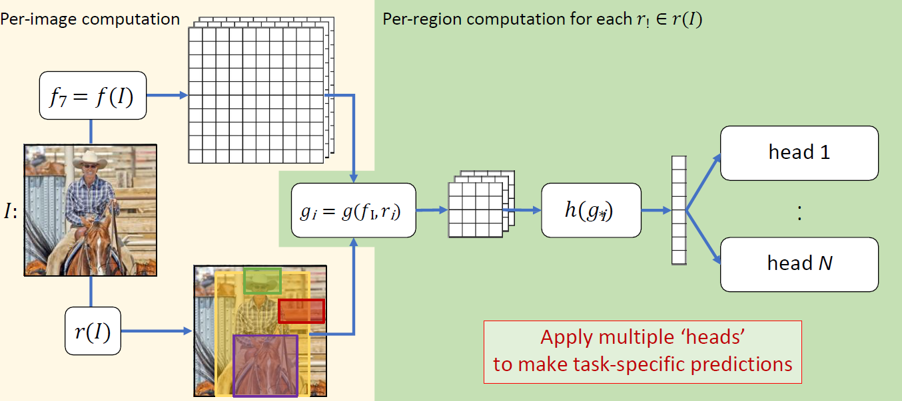{width=70% height=50%}

### Single Shot Detectors (SSD)

This type of detectors predict bounding boxes and class probabilities directly from the input image in a single forward pass, without the need for a separate region proposal step. The main idea is to divide the image into a grid and for each cell of the grid predict a fixed number of bounding boxes and class probabilities.

As an example of this type of detectors we have the **YOLO** (**You Only Look Once**) model that is a very popular model for object detection. The main idea of YOLO is to divide the image into a grid and for each cell of the grid predict a fixed number of bounding boxes and class probabilities. The output of the model is a tensor of shape $(S, S, B \times (5 + C))$ where $S$ is the size of the grid, $B$ is the number of bounding boxes predicted for each cell, $C$ is the number of classes, and $5$ is the number of parameters for each bounding box (x, y, w, h, confidence). The model is trained using a combination of localization loss (for the bounding box coordinates) and classification loss (for the class probabilities).

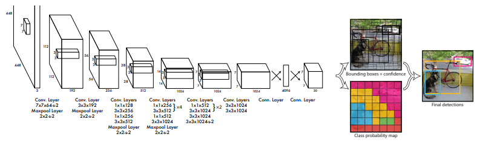{width=70% height=50%}

### Detection Transformers

This kind of approach leverage the self-attention mechanism of Transformers to model the relationships between different regions of the image, allowing for more accurate object detection. The input must be a set of image features extracted from a CNN backbone, and the output is a set of bounding boxes and class probabilities for each box. The output of the model is an unordered set of bounding boxes and class probabilities for each box. The prediction of an unordered set allows the model to predict a variable number of bounding boxes for each image, which is more flexible and can handle images with different number of objects.

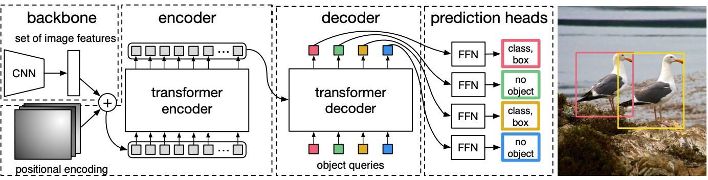{width=70% height=50%}

The main idea is to use a Transformer encoder to extract features from the image and a Transformer decoder to predict the bounding boxes and class probabilities thaks to a prediction heads. The output of the model is a set of bounding boxes and class probabilities for each box.

The particularity of this model is that the Transformer decoder takes as input a fixed number of learnable embeddings called **object queries** that are used to predict the bounding boxes and class probabilities allowing the model to see the whole image and to model the relationships between different regions of the image, which can improve the accuracy of the model.

## Instance and Semantic Segmentation

!!!note
    **Semantic segmentation** is the task of assigning a class label to each pixel in the image, segmenting the image into regions corresponding to different object classes. The output of a semantic segmentation model is a pixel-wise classification map, where each pixel is assigned a class label corresponding to the object it belongs to. This task is particularly useful for applications such as autonomous driving, medical imaging, and scene understanding. Don't differentiate between different instances of the same class, so all pixels belonging to the same class will have the same label, regardless of whether they belong to different objects or not.

    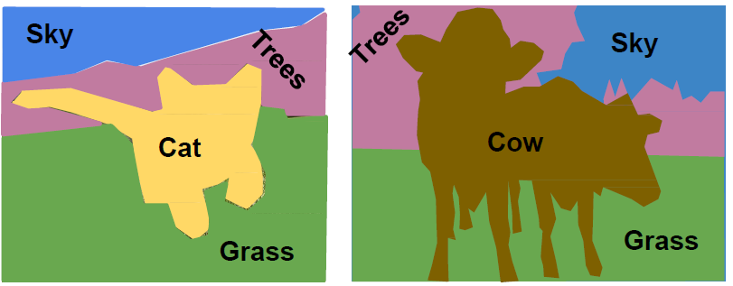{width=70% height=50%}

    **Instance segmentation** is different from semantic segmentation that not only classifies each pixel but also distinguishes between different instances of the same class. The output of an instance segmentation model is a set of binary masks, one for each instance detected in the image, along with class labels and bounding boxes for each instance. So is as combination of object detection and semantic segmentation, because it not only identifies the presence of objects and localizes them within the image, but also assigns a class label to each pixel in the image, effectively segmenting the image into regions corresponding to different object classes while distinguishing between different instances of the same class.

    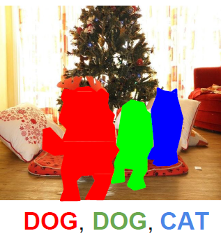{width=50% height=50%}

A basic approach to semantic segmentation is to use a CNN with a fully convolutional architecture, where the output of the model is a pixel-wise classification map. To extract the most important features of the image useful for the pixel classification, the size of input will be reduced leading to a loss of spatial information, which is crucial for the pixel-wise classification because we need to know the exact location of the objects in the image. Applying N times the convolutional layers the size will reduce and at the end applying a argmax operator to get the class label for each pixel, but this approach does not work well because of the loss of spatial information.

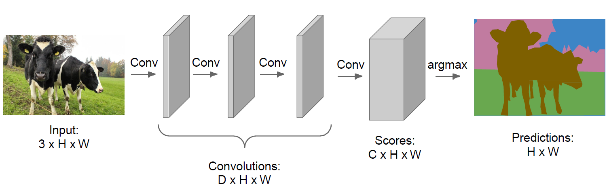{width=70% height=50%}

We could configure the convolutional layers in a way to preserve the spatial information, but this will lead to a very high computational cost because the size of the feature maps will be the same as the input image, which is not efficient expecially at initial layers where the features are not very abstract and we need to have a bigger receptive field to capture the context of the image.

A better solution is to use a **encoder-decoder architecture** where the encoder is a CNN that extract features from the image and reduce the size of the feature maps, and the decoder is a CNN that take as input the features extracted by the encoder, from latente space, and upsample them to the original size of the image to get a pixel-wise classification map. The encoder-decoder architecture allows to capture both local and global context of the image.

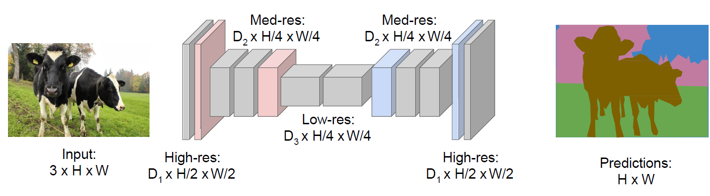{width=70% height=50%}

We know how to compute downsampling with convolutional layers, but how to do upsampling? 

A naive approach is compute the **unpooling** that is the inverse operation of pooling, but this approach does not work well because it does not learn to upsample the features, but just copy the values of the features to the new location, which can lead to a loss of information and a poor performance. One way to to this is the **Nearest Neighbor approach**, consisting in copying the value of the nearest pixel to the new location, but this approach can lead to a blocky and jagged output. Another way is the **Bed of Nails** (Zero Unpooling) consisting in inserting zeros between the values of the features, but this approach can lead to a sparse output and a poor performance.

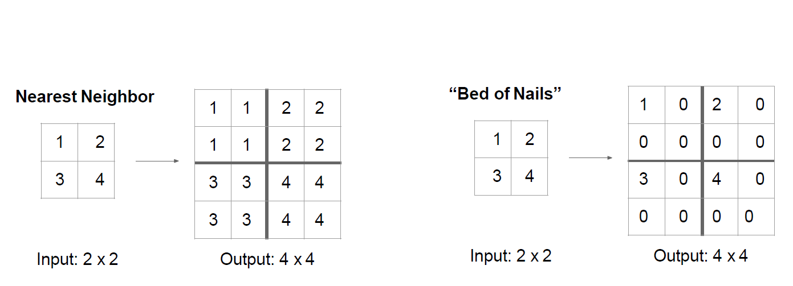{width=70% height=50%}

A better solution could be the **max-unpooling** that is the inverse operation of max pooling, where we keep track of the indices of the maximum values during the pooling operation and use them to place the values back in their original location during the unpooling operation. This approach allows to preserve the spatial information and can lead to a better performance.

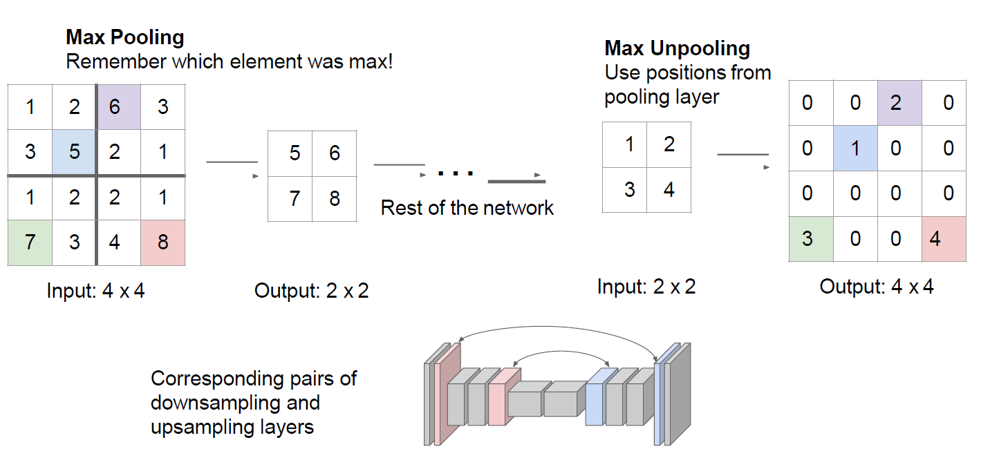{width=70% height=50%}

The problem of max-unpooling is that it does not learn to upsample the features, but just copy the values of the features to the new location, which can lead to a loss of information and a poor performance. A better solution is to use a **transposed convolution** (also called **deconvolution**) that is a learnable upsampling operation that can learn to upsample the features in a way that preserves the spatial information and can lead to a better performance. Because the kernel weights are updated via backpropagation, the network learns the optimal non-linear transformations required to reconstruct spatial dimensions for your specific dataset.

We want deal with also with the details of the image and to to this we have to preserve the spatial information during the upsampling process, so we can use **skip connections** that are connections between the encoder and the decoder that allow to preserve the spatial information and to capture the details of the image. While the encoder is reducing the size of the feature maps, it is also capturing the details of the image, so we can use these details during the upsampling process to get a better performance and to capture the details of the image.

In the paper "Fully Convolutional Networks for Semantic Segmentation" (2015) the authors propose a model called **FCN** that is a fully convolutional network that use skip connections to preserve the spatial information and to capture the details of the image. The model architecture consists of an encoder network and a decoder network. The encoder network is based on a pre-trained convolutional neural network (CNN) that has been modified to output feature maps at multiple scales. The decoder network is used to upsample these feature maps using transposed convolutions and combine them using skip connections, which helps to preserve spatial resolution and capture fine-grained details in the segmentation map.

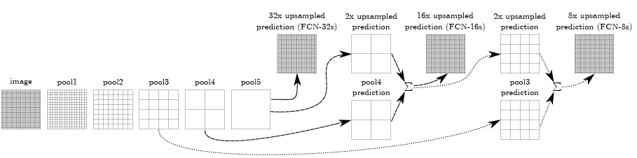

After going through conv7 as below, the output size is small, then 32× upsampling is done to make the output have the same size of input image. But it also makes the output label map rough. This is because, deep features can be obtained when going deeper, spatial location information is also lost when going deeper. That means output from shallower layers have more location information. If we combine both, we can enhance the result. So we sum details from shallower layers with the upsampled output from deeper layers. This is done by skip connections.

### SegNet

SegNet is deep fully convolutional neural network designed to address the limitations of earlier architectures by focusing on memory efficiency and computational speed during inference. It is a encoder-decoder architecture where the encoder consist of a sequence of convolutional layers, batch normalization, and ReLU activations, followed by non-overlapping $2 \times 2$ max-pooling layers with a stride of 2.

The decoder performs upsampling using **"Bed of Nails" (Zero Unpooling)** so spatial information is recovered by passing the entire, high-resolution feature maps from the encoder to the decoder via skip connections. This consumes a massive amount of memory.

SegNet bypasses this by only storing the **max-pooling indices**:

1. **Memorization:** During the max-pooling operation in the encoder, the network discards the non-maximum values but *memorizes the exact spatial coordinate (the index)* of the maximum value within each $2 \times 2$ pooling window.
2. **Sparse Upsampling:** When the corresponding layer in the decoder needs to upsample the feature map, it uses these saved indices. It takes the values from the lower-resolution map and places them exactly into those saved coordinates. The rest of the $2 \times 2$ block is saturated with zeros.
3. **Densification:** This sparse, "bed of nails" output is then passed through standard, learnable convolutional filters to fill in the zeros and produce dense feature maps.

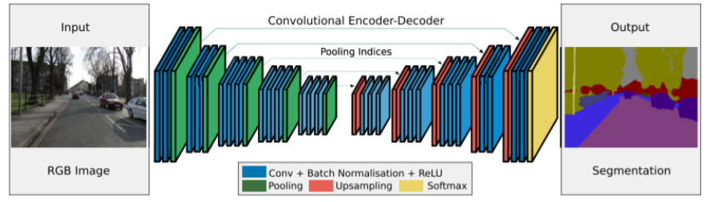{width=70% height=50%}

### U-Net

U-Net addresses the topological and resolution limitations of earlier models like FCN and SegNet, making it highly relevant for demanding tasks such as localizing arterial bleeding or delineating blood accumulation in real-time.
Unlike earlier architectures that featured a heavy encoder and a relatively lightweight or sparse decoder, U-Net is entirely symmetric.

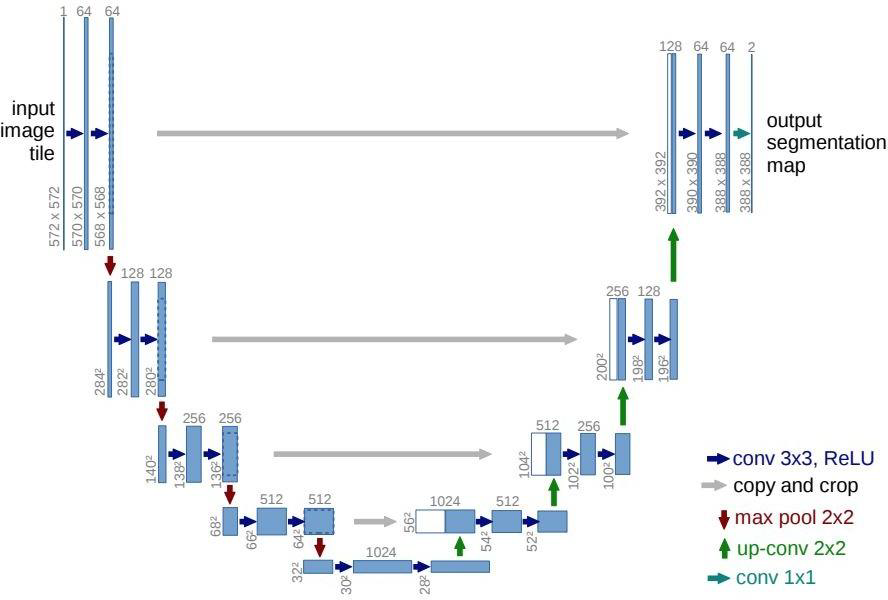{width=70% height=50%}

The left side follows the typical architecture of a convolutional network. It consists of repeated application of $3 \times 3$ unpadded convolutions, each followed by a ReLU and a $2 \times 2$ max pooling operation with stride 2 for downsampling. At each downsampling step, the number of feature channels is doubled. This path extracts deep semantic context (the "what").
The right side mirrors the encoder. Every step consists of an upsampling of the feature map (typically via $2 \times 2$ Transposed Convolutions), which halves the number of feature channels, followed by standard $3 \times 3$ convolutions to refine the upsampled output. This path recovers the spatial resolution (the "where").

The defining characteristic of U-Net is how it handles the flow of spatial information from the encoder to the decoder. U-Net passes the **entire, dense, high-resolution feature map** from the encoder and **concatenates** it with the corresponding upsampled feature map in the decoder along the channel axis.

By concatenating rather than summing, the network retains the raw, unadulterated high-frequency spatial details (edges, boundaries, micro-structures) from the early layers alongside the deep semantic context from the bottleneck. The subsequent convolutions in the decoder then learn how to optimally fuse this combined information. This design allows U-Net to achieve precise localization and accurate segmentation, even in cases where the target structures are small or have complex shapes.

### DeeplabV3
