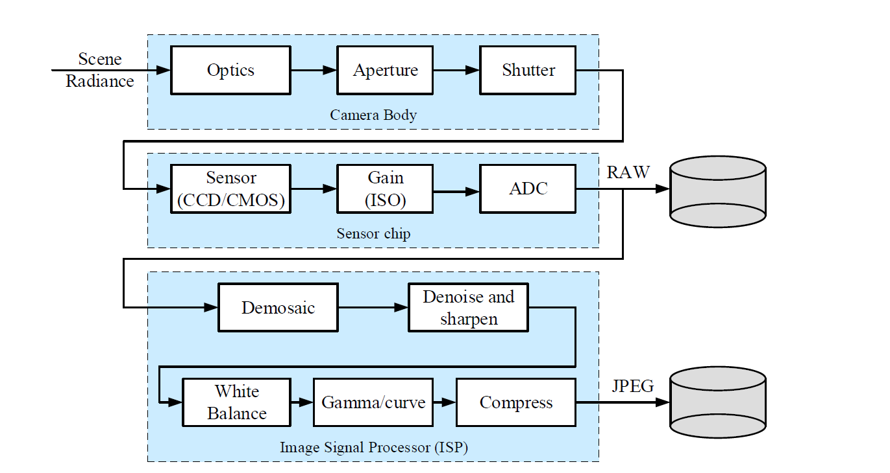
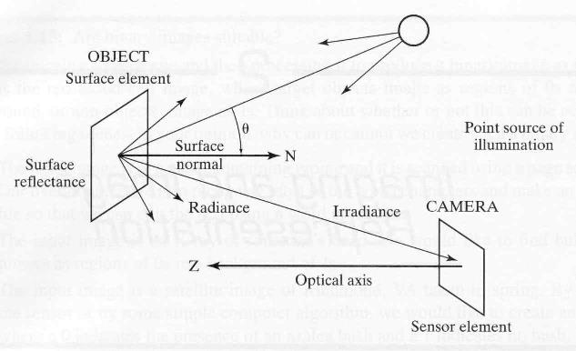
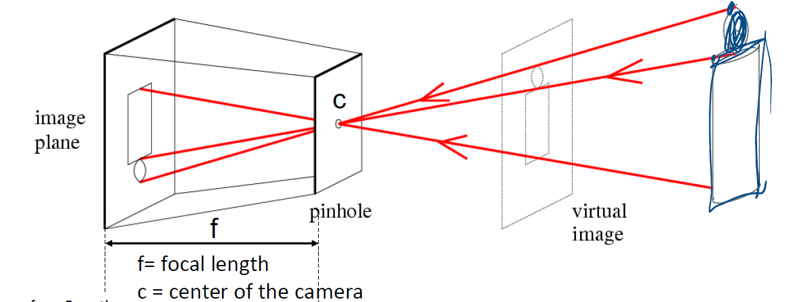
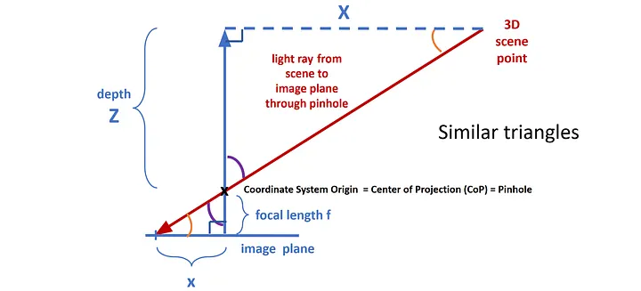
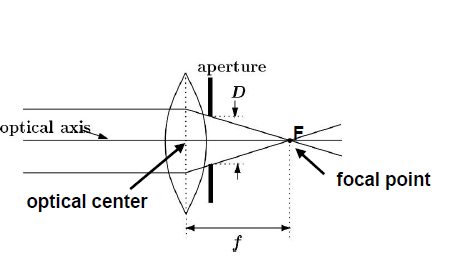
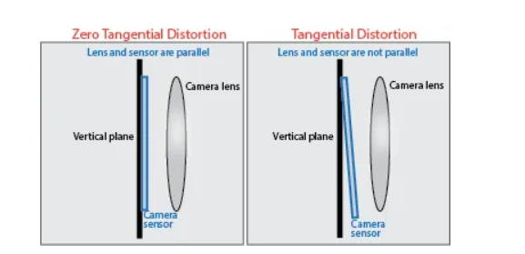
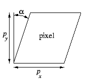
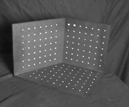
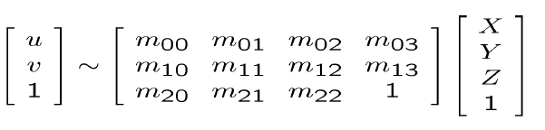

# Camera model

- Parent: [[9_3D_Geometry]]

Image is not only a matrix of data, but also a projection of the 3D world onto a 2D plane. Digital image are obtained by sensors, in this case a camera which capture physical signals and convert them into digital data. Nowadays, the acquisition happens thanks to CMOS sensors, which are made of a grid of photosensitive elements called pixels. Each pixel captures the intensity of light that hits it, and the camera processes this information to create a digital image.
The acquisition of image depends on the camera model, which describes how the 3D world is projected onto the 2D image plane, and depends on the intrinsic and extrinsic parameters of the camera. 

The **intrinsic parameters** include the focal length, the principal point, and the distortion coefficients, while the **extrinsic parameters** describe the position and orientation of the camera in the world. 

Mathematically, this process can be rappresented by the **projective trasformation**, that maps points from the 3D world to the 2D image plane. The projection can be expressed as:
$$ \begin{bmatrix} u \\ v \\ 1 \end{bmatrix} = K [R | t] \begin{bmatrix} X \\ Y \\ Z \\ 1 \end{bmatrix}$$
Where:

- $K$ is the intrinsic matrix, which contains the focal length and the principal point.
- $R$ is the rotation matrix, which describes the orientation of the camera.
- $t$ is the translation vector, which describes the position of the camera.

{width="60%" height="60%"}

The acquisition of image by camera is a physical process that start when a source of illumination emits light rays toward the object which will be reflected by the object. The reflection is formed by a **surface normal** that is the vector perpendicular to the surface at the point of reflection. The reflected rays then pass through the camera lens, along the **optical axis**, which focuses the light onto the image sensor. The lens can introduce distortions, such as radial and tangential distortion, which can affect the accuracy of the captured image. The camera sensor captures the intensity of the light at each pixel, creating a digital image. The quality of the captured image can be influenced by various factors, including the lighting conditions, the quality of the lens, and the sensor's resolution.

Every point of object emits light rays in all direction that will be captured by camera thanks to a **film plane**, the surface where the image is formed. Capturing all rays is problem because we have not a single corrispondence between pixel and rays emits by that point, so the image will be blurred.s

## Pinhole camera model

To solve this problem, we can use a **pinhole camera model**, which assumes that all rays pass through a single point called the **pinhole**. This model simplifies the projection process and allows us to establish a direct relationship between the 3D world and the 2D image plane.

{width="60%" height="60%"}

Depending on the pinhole dimensions the image can be blurred or not, if the pinhole is too small, the image will be blurred due to diffraction, while if the pinhole is too large, the image will be blurred due to multiple rays passing through it. The optimal size of the pinhole depends on the wavelength of light and the distance between the pinhole and the image plane.

One caracteristic of the pinhole camera is that the image is inverted, because the rays pass through the pinhole and are projected onto the opposite side of the film plane. This means that objects that are closer to the camera will appear larger in the image, while objects that are farther away will appear smaller. 
Instead we want the the **virtual image** to be upright.

The distance between the pinhole and the image plane is the **focal length** ($f$). The position of the pinhole is the **Center of Projection** (CoP) or optical center.

We can denote a 3D object point as $P_o = (X_o, Y_o, Z_o)$, where $Z_o$ is the depth of the scene relative to the camera. Its corresponding projection on the image plane is denoted as $p_i = (x_i, y_i, f)$.

By analyzing the similar triangles formed by the light rays intersecting the image plane and the object, we derive the following relationship:

{height="50%"}

$$\frac{x_i}{f} = \frac{X_o}{Z_o} \quad \text{and} \quad \frac{y_i}{f} = \frac{Y_o}{Z_o}$$

Isolating the image coordinates, we obtain the perspective projection equations:

$$x_i = f \frac{X_o}{Z_o} \quad \text{and} \quad y_i = f \frac{Y_o}{Z_o}$$

The coordinates of the image point $(x_i, y_i)$ are determined by the 3D coordinates of the object and inversely proportional to its depth $Z_o$. The focal length $f$ acts as a scaling factor, defining the magnification of the projection. $Z$ controls the **perspective foreshortening** effect, where objects farther from the camera appear smaller than those closer to it.

Because of the division by $Z_o$, this projection is a **non-linear transformation** in standard Euclidean space $\mathbb{R}^3 \rightarrow \mathbb{R}^2$. Furthermore, the loss of the depth parameter ($Z_o$) makes it an ill-posed problem: we cannot reconstruct the original 3D point from a single 2D image point without additional information..

To linearize this operation and represent it as a matrix multiplication, we move to **projective space** ($\mathbb{P}^n$) using homogeneous coordinates. By adding an extra dimension, we can express the projection as:

$$\begin{bmatrix} u' \\ v' \\ w \end{bmatrix} = \begin{bmatrix} f & 0 & 0 & 0 \\ 0 & f & 0 & 0 \\ 0 & 0 & 1 & 0 \end{bmatrix} \begin{bmatrix} X_o \\ Y_o \\ Z_o \\ 1 \end{bmatrix}$$

Here, $w = Z_o$. To map this back to the discrete 2D Cartesian plane (the pixel grid), we perform the **perspective divide** (dividing by the homogeneous component $w$):

$$(u', v', w) \rightarrow \left( \frac{u'}{w}, \frac{v'}{w} \right) = (x_i, y_i)$$

The key properties of this perspective representation are:

* **Scale Variation:** Objects appear smaller as their depth ($Z_o$) increases.
* **Convergence of Parallel Lines:** Unlike orthographic projection, parallel lines in the 3D world (that are not parallel to the image plane) **do not** remain parallel in the image. They converge and intersect at a specific **vanishing point** (punto di fuga).
* **Collinearity is Preserved:** Straight lines in the 3D world are guaranteed to project as straight lines in the 2D image.

A special case is the **normalized camera model**, where the focal length is set to 1 and the principal point is at the origin. So the coordinates of the image point can be expressed as:
$$x_n = \frac{X_o}{Z_o} \quad \text{and} \quad y_n = \frac{Y_o}{Z_o}$$

It applies when the object is relatively far from the camera, and its internal depth variation is very small compared to its total distance from the camera. 
If $z \gt\gt f$, and the distance of the object from the camera is much greater than the focal length, we have the **orthographic perspective**. We have that the ratio $\frac{\delta z}{z_0} << 1$ that means that the depth variation is negligible compared to the distance of the object from the camera. In this case, we can approximate the projection as:
$$x_i \approx \frac{f x_o}{z_0} \text{  and  }
y_i \approx \frac{f y_o}{z_0}$$

### Adding lens

To resolve the problem of inverted image, we can add a **lens** to the pinhole camera. 

Rays of light from the object pass through the lens in one single point, the *optical center* of the lens, at $f$ distance from pinhole, without deviate their direction and converging parallel rays that hit the lens to a single point on the image plane, creating an upright image.

Adding a **thin lens** to the pinhole camera model allows us to focus the light rays and create an upright image on the film plane. The thin lens is characterized by its focal length $f$, which determines how strongly it converges or diverges light rays. This relationship is described by the lens formula:
$$\frac{1}{f} = \frac{1}{u} + \frac{1}{v}$$
Where:
- $u$: The distance from the object to the center of the lens.
- $v$: The distance from the center of the lens to the image plane where the focused image is formed.

If an object is extremely far away ($u \rightarrow \infty$), the term $\frac{1}{u}$ becomes zero. In this specific case, $\frac{1}{f} = \frac{1}{v}$, meaning $v = f$. Therefore, the focal length $f$ is exactly equal to the distance between the lens and the image plane when focusing on infinitely distant objects.

Depending on the *aperture* of the lens, the image can be blurred. If the aperture is too large, the image will be blurred due to multiple rays passing through it, while if the aperture is too small, the image will be blurred due to diffraction. The optimal size of the aperture depends on the wavelength of light and the distance between the lens and the image plane.

The aperture controls the amount of light that enters the camera and affects the **depth of field**, which is the range of distances within a scene that appear acceptably sharp in the image. 
A wide aperture allow more rays to pass through the lens, resulting in a shallow depth of field, where only a small portion of the scene is in focus. Istead, a narrow aperture allows fewer rays to pass through, resulting in a greater depth of field, where more of the scene is in focus.

Moving the lens closer to or further from the sensor changes the geometry of the light rays that are allowed to hit it.
When the lens is placed very close to the sensor, so $f$ is small, the light rays that pass through the lens are more divergent, resulting in a wider field of view and a shallower depth of field. With a $f$ bigger, the light rays are more convergent, resulting in a narrower field of view and a deeper depth of field.
The **Field of View** (angle $\alpha$) is calculated using trigonometry based on the sensor dimension ($d$) and the focal length ($f$):$$\alpha = 2 \arctan\left(\frac{d}{2f}\right)$$Because $f$ is in the denominator, as $f$ increases, the angle $\alpha$ decreases.

#### Distortion

Adding a lens to the camera model can introduce distortions, which are deviations from the ideal pinhole camera model. There are various types of distortions, like:
- **Radial Distortion**: This type of distortion causes straight lines to appear curved in the image.
  - **Barrel Distortion**: A specific type of radial distortion where straight lines bulge outward from the center of the image, resembling the shape of a barrel.
  - **Pincushion Distortion**: Another type of radial distortion where straight lines pinch inward towards the center of the image, resembling the shape of a pincushion.
    {width="60%" height="60%"}
- **fisheye distortion**: A more extreme form of radial distortion that creates a wide-angle, hemispherical view, often resulting in a circular image with significant curvature.
- **tangential distortion**: This type of distortion occurs when the lens and the image sensor are not perfectly parallel, causing the image to appear tilted or skewed.
    {width="60%" height="60%"}

## Camera parameters

From the equation of project 3D point to 2D point we have two matrices, the intrinsic matrix $K$ and the extrinsic matrix $[R | t]$. The DOF of the intrinsic matrix is 5, while the DOF of the extrinsic matrix is 6, so in total we have 11 DOF to estimate.

Ideally a pinhole model should have as a intrinsic matrix this configuration:
$$K = \begin{bmatrix} f & 0 & 0 \\ 0 & f & 0 \\ 0 & 0 & 1 \end{bmatrix}$$
Where $f$ is the focal length of the camera. However, in practice, the intrinsic matrix can have a more complex structure due to various factors such as lens distortion, sensor characteristics, and manufacturing imperfections.

The **intrinsic matrix** $K$ contains the focal length and the principal point, and is defined as:
$$K = \begin{bmatrix} fx & s & x_0 \\ 0 & fy & y_0 \\ 0 & 0 & 1 \end{bmatrix}$$
where:
- $x_0$ and $y_0$ is the translation factor, that aling the optical axis with the center of the image, and is called the **principal point**. In an ideal camera, the principal point would be located at the center of the image sensor, but in practice, it can be slightly offset due to manufacturing imperfections or misalignment of the lens.
- $f_x$ and $f_y$ are the focal lengths in the x and y directions that resolve the problem of non-square pixels, which can cause the image to be stretched or compressed in one direction. (**pixelization**)
- and $s$, the **Skew coefficient**, (usually zero in modern sensors), which represents the angle between the x and y axes of the image sensor.  

The **Extrinsic Matrix** is a $3 \times 4$ matrix composed of a **Rotation matrix** ($R$) and a **Translation vector** ($\mathbf{t}$):

$$[R | \mathbf{t}] = \begin{bmatrix} r_{11} & r_{12} & r_{13} & t_x \\ r_{21} & r_{22} & r_{23} & t_y \\ r_{31} & r_{32} & r_{33} & t_z \end{bmatrix}$$

The **Rotation Matrix** ($R$) is a  $3 \times 3$ matrix represents the camera's orientation (Roll, Pitch, and Yaw). 
* **Properties:** It is an **orthogonal matrix**, meaning $R^T = R^{-1}$ and its determinant is $1$. 
* **Function:** It aligns the axes of the world coordinate system with the axes of the camera coordinate system.

While, **Translation Vector** ($\mathbf{t}$) is  $3 \times 1$ vector represents the position of the world origin expressed in the camera's coordinate system.
$\mathbf{t}$ is **not** the position of the camera in the world. If you want the camera's coordinates in the world ($\mathbf{C}$), you calculate it as:
    $$\mathbf{C} = -R^T \mathbf{t}$$

In many robotics and computer graphics frameworks (like OpenGL or ROS), the extrinsic matrix is often represented as a $4 \times 4$ matrix to make it a proper square transformation matrix:

$$T = \begin{bmatrix} R & \mathbf{t} \\ \mathbf{0}^T & 1 \end{bmatrix} = \begin{bmatrix} r_{11} & r_{12} & r_{13} & t_x \\ r_{21} & r_{22} & r_{23} & t_y \\ r_{31} & r_{32} & r_{33} & t_z \\ 0 & 0 & 0 & 1 \end{bmatrix}$$

This allows you to chain multiple transformations (e.g., from the robot base to the arm, then to the camera) simply by multiplying matrices.

## Camera calibration

The camera calibration is the process of estimating the intrinsic and extrinsic parameters of the camera. This is important because it allows us to understand how the camera captures the 3D world and how to correct for any **distortions** or **inaccuracies** in the captured image.

There are several methods for camera calibration, including:

1. **Chessboard Method** that consist of taking several photos of a physical grid from different angles. The algorithm detects the corners to calculate the **Intrinsic Matrix ($K$)** and lens distortion.
2. **Single Image** This method looks for **geometric cues** like parallel lines and vanishing points within a single photo.
3. **Self-Calibration** This estimates parameters by analyzing how points move in a **video sequence** (using Epipolar Geometry).
4. **Deep Learning** Neural networks are trained on thousands of images to "guess" the focal length or distortion by recognizing specific visual patterns and textures.

### Chessboard Method

The *Chessboard Method* (Zhang) uses a printed chessboard pattern to calibrate cameras by detecting a grid of black and white squares. 

1. **Image Capture**: Capture multiple images of a chessboard pattern from various angles and positions.
2. **Corner Detection**: Use an algorithm to detect the corners of each square in the captured images.
3. **Parameter Estimation**: Estimate the camera’s intrinsic and extrinsic  parameters using the detected corners.
4. **Optimization**: Refine the parameters to minimize the reprojection error — the difference between the observed and projected corner positions.

To successfully calibrate a camera, we must set up a system of equations where the number of knowns (constraints) is greater than or equal to the number of unknowns (parameters).

Let $N$ be the number of images captured, and $M$ be the number of feature points (corners) detected in each image. Assuming the skew is zero ($s=0$), we have **4** parameters to find ($f_x, f_y, c_x, c_y$). These do not change across images.
Each image has its own camera pose, consisting of 3 rotation angles and 3 translation vector components. This gives us **$6N$** parameters.
* **Total Unknowns =** $4 + 6N$

Each detected corner $M$ provides **2** coordinates in the image plane ($u$ and $v$). Across all images and points, we gather $2 \times N \times M$ independent observations.
* **Total Constraints =** $2NM$

For the system to be solvable, the constraints must equal or exceed the parameters:
$$2NM \ge 4 + 6N$$

We can solve this inequality to find the minimum number of images $N$ needed for a given number of points $M$:
$$2NM - 6N \ge 4 \\
2N(M - 3) \ge 4 \\
N \ge \frac{2}{M - 3}$$

With 1 Image with 5 Points ($N=1, M=5$):
$$1 \ge \frac{2}{5-3} \implies 1 \ge 1$$
While the degrees of freedom mathematically match, **this will not work if the calibration target is a flat chessboard** because all points are coplanar, which leads to an underconstrained system. They do not provide independent geometric information about the 3rd dimension ($Z$). A plane-to-plane projection is a Homography, which restricts the amount of information you can extract about the intrinsic matrix. 
To calibrate a camera using only a single image ($N=1$), you would need a precisely manufactured **3D calibration rig** where the points are explicitly non-coplanar.

### Single Image Calibration

{width="60%" height="60%"}

By using a target with non-coplanar points (the two orthogonal planes in the photo), you provide the algorithm with the necessary depth ($Z$) variation.

Instead of trying to calculate the Intrinsic matrix ($K$) and the Extrinsic matrix ($[R|t]$) separately, this method merge them together into a single $3 \times 4$ **Projection Matrix ($M$)**:
$$M = K[R|t]$$

The algorithm's try to find the values inside $M$ that perfectly map the known 3D world points $(X_i, Y_i, Z_i)$ to the detected 2D image pixels $(u_i, v_i)$.

A $3 \times 4$ matrix has 12 elements. However, because we are operating in homogeneous coordinates, the equation $\mathbf{x} \sim M\mathbf{X}$ is true up to a scale factor. To lock the scale, we divide the entire matrix by its bottom-right element, forcing that specific position to be **$1$**. This leaves exactly **11 independent unknowns** ($m_{00}$ through $m_{22}$), as shown in the matrix expansion on the slide.

{height="60%"}

The process transforms the projection into a system of linear equations:

1.  **Formulate the Equations:** For every single feature point (a white dot on the rig), we know its 3D physical coordinate and its 2D pixel coordinate. Expanding the matrix multiplication yields two linearly independent equations per point:
    * $u_i = \frac{m_{00}X_i + m_{01}Y_i + m_{02}Z_i + m_{03}}{m_{20}X_i + m_{21}Y_i + m_{22}Z_i + 1}$
    * $v_i = \frac{m_{10}X_i + m_{11}Y_i + m_{12}Z_i + m_{13}}{m_{20}X_i + m_{21}Y_i + m_{22}Z_i + 1}$
2.  **Minimum Points:** Since each point provides 2 equations and we have 11 unknowns, we need a minimum of **$5.5$ points** (so, 6 points in practice) arranged in a 3D volume to solve the system.
3.  **SVD Optimization:** We stack these equations into a massive matrix $A$ and solve $A\mathbf{m} = 0$ using Singular Value Decomposition (SVD), just like we discussed for the Homography matrix.
