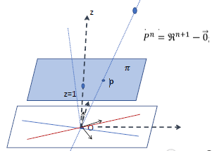
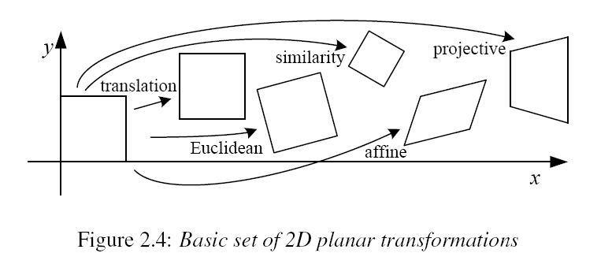
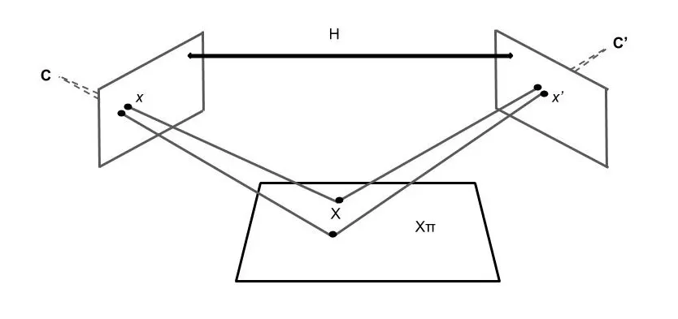
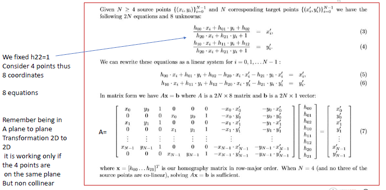
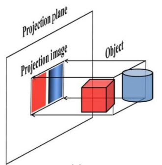
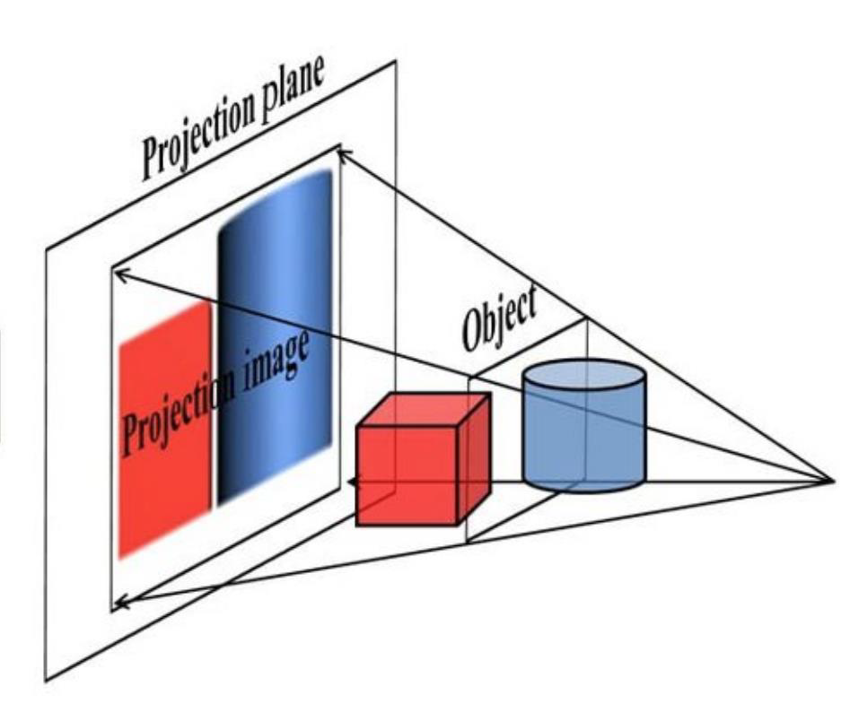

# 3D Geometry

Parent: [[0-Computer_Vision_MOC]]

Geometric primitives are the fundamental building blocks used to describe shapes in 2D and 3D space.

* **2D Primitives:** Points $(x, y)$ and lines.
* **3D Primitives:** Points $(x, y, z)$ and planes.
* **Euclidean Geometry:** Describes geometry in the Cartesian plane. 

While it serves as a mental model for human perception, it has limitations in computer vision: it cannot easily represent parallel lines intersecting at infinity or handle perspective and point-of-view transformations efficiently.

Human see objects in an euclidean space, but this for machine is not enoough to represent the world. For example, euclidean spcae can not represent all 3D primitives, such as parallel lines that intersect at infinity.

To overcome these limitations, we need to use a more general space called **projective space** that extends the Euclidean space by adding points at infinity, allowing us to represent a wider range of geometric transformations and relationships. Mathematically, the  projective space $P^n$ is defined as $\mathbb{R}^{n+1} - \vec{0}$, which means we take the $(n+1)$-dimensional real space and remove the origin (the zero vector).

Point in this space are represented using **homogeneous coordinates**.This transformation allows us to treat translations as linear operations and represent points at infinity. For example

- A 2D point $(x, y)$ is represented in the projective plane $P^2$ as a 3D vector $\tilde{x} = (\tilde{x}, \tilde{y}, \tilde{w})$.
- A 3D point $(x, y, z)$ is represented in the projective space $P^3$ as a 4D vector $\tilde{x} = (\tilde{x}, \tilde{y}, \tilde{z}, \tilde{w})$

{width="70%" height="50%"}

So, to move into projective space, we add a another dimension coordinate $w=1$, transforming the point into a (N+1)D vector:$$(x, y) \Rightarrow \begin{bmatrix} x \\ y \\ 1 \end{bmatrix}$$This specific form $[x, y, 1]^T$ is the **augmented vector**.

In the $P^N$ space, vectors are different only by a scale factor. So we can pass from homogeneous coordinates to Cartesian coordinates by dividing by the last coordinate $w$:$$\left[ \frac{x}{w}, \frac{y}{w} \right]$$ Instead, to convert from Cartesian to homogeneous coordinates, we can simply append a 1:$$\left[ x, y \right] \Rightarrow \left[ x, y, 1 \right]$$

Points where $w=0$ are "ideal points" representing directions at infinity, which cannot be expressed in standard Euclidean coordinates.

Mathematically, two vectors $\tilde{\mathbf{x}}$ and $\tilde{\mathbf{y}}$ represent the same point if there exists a non-zero scalar $\lambda$ such that:$$\tilde{\mathbf{x}} = \lambda \tilde{\mathbf{y}}$$

!!!note Example
    For example, the Euclidean point $(2, 3)$ can be represented in projective space as:
    - $[2, 3, 1]^T$ (the standard augmented vector)
    - $[4, 6, 2]^T$ (where $\lambda = 2$)
    - $[20, 30, 10]^T$ (where $\lambda = 10$)

    All these vectors are considered equivalent.

!!!warning When we mapping from Cartesian to homogeneous coordinates, we have not a one-to-one mapping, but a one-to-many mapping, because all the vectors that differ by a non-zero scalar represent the same point in projective space.

The activity of applying a transformation to an image is called **warping**. Warping can be used for various applications, such as image rectification, perspective correction, and image stitching. There are two main approaches to warping:

- **forward warping**
- **inverse warping**

The **forward warping** approach applies a spatial transformation to each pixel in the source image, mapping its value to the destination image. However, mapping between two discrete grids often creates "holes" (unassigned pixels) in the output image due to coordinate rounding operations.

A more robust solution is **inverse warping**. Instead of projecting forward, this method iterates through every pixel in the target image and applies the inverse transformation to find its corresponding location in the source image. This guarantees that every target pixel receives a value, completely eliminating holes. Because the inversely mapped coordinates typically fall on non-integer locations, interpolation techniques (such as bilinear interpolation) are used to compute the final pixel value from the surrounding source pixels.

All this operation can be apply also for 3D space, but with a $4 \times 4$ matrix instead of $3 \times 3$. Moreover, all this trasformatio can be apply together, by multiplying the corresponding matrices, to create a single transformation that combines multiple effects (e.g., rotation followed by translation and scaling). The order with which transformations are applied matters, as matrix multiplication is not commutative.

## Trasformations in Projective Space

By using homogeneous coordinates, complex geometric transformations (which are non-linear in Euclidean space) can be expressed as linear matrix-vector products: $p' = M \cdot p$.

{width="70%" height="70%"}

### Translation

The simplest transformation involving only a shift in position.

* **Matrix Representation:** $\begin{bmatrix} 1 & 0 & t_x \\ 0 & 1 & t_y \\ 0 & 0 & 1 \end{bmatrix}$
* **DOF:** 2 ($t_x, t_y$).
* **Properties (Invariants):** Orientation, lengths, angles, and area are all preserved.

### Euclidean Transformation (Rigid Body)

This transformation represents the motion of a rigid object. It consists of a rotation and a translation.

* **Degrees of Freedom (3):** 1 for rotation ($\theta$) and 2 for translation ($t_x, t_y$).
* **Matrix Representation:**
    $$H_E = \begin{bmatrix} \cos\theta & -\sin\theta & t_x \\ \sin\theta & \cos\theta & t_y \\ 0 & 0 & 1 \end{bmatrix} = \begin{bmatrix} R & t \\ 0^T & 1 \end{bmatrix}$$
    Where $R$ is a $2 \times 2$ orthonormal rotation matrix ($R R^T = I$ and $|R|=1$).
* **Invariants:** It preserves **lengths** (distances between points), **angles**, and **area**.

### Similarity Transformation

A similarity transformation adds isotropic scaling (uniform resizing) to the rigid motion.

* **Degrees of Freedom (4):** 1 rotation, 2 translation, and 1 scale factor ($s$).
* **Matrix Representation:**
    $$H_S = \begin{bmatrix} s\cos\theta & -s\sin\theta & t_x \\ s\sin\theta & s\cos\theta & t_y \\ 0 & 0 & 1 \end{bmatrix} = \begin{bmatrix} sR & t \\ 0^T & 1 \end{bmatrix}$$
* **Invariants:** It no longer preserves lengths, but it preserves **angles**, **parallelism**, and **ratios of lengths**. Shapes remain similar to the original.

### Affine Transformation

The affine transformation allows for non-isotropic scaling and shearing. It can be viewed as a linear transformation followed by a translation.

* **Degrees of Freedom (6):** All elements of the $2 \times 2$ submatrix $A$ (which accounts for rotation, non-uniform scale, and shear) plus 2 for translation.
* **Matrix Representation:**
    $$H_A = \begin{bmatrix} a_{11} & a_{12} & t_x \\ a_{21} & a_{22} & t_y \\ 0 & 0 & 1 \end{bmatrix} = \begin{bmatrix} A & t \\ 0^T & 1 \end{bmatrix}$$
* **Invariants:** It preserves **parallelism** and **ratios of parallel lengths**. However, angles and absolute lengths are lost.

### Projective Transformation (Homography)

In Euclidean, Similarity, and Affine transformations, the bottom row of the matrix is always $[0, 0, 1]$. This ensures that the homogeneous coordinate $w'$ remains $1$ after multiplication.

In a **Projective** transformation, the bottom row $[h_{31}, h_{32}, h_{33}]$ is not constrained. This means $w'$ will typically not be 1, requiring the final de-homogenization step ($x' / w', y' / w'$) to map the point back to the image plane. This division is what mathematically creates the "foreshortening" effect seen in perspective.

It represents the projection of one plane onto another from a specific point of view (perspective). Homografy, is a projective transformation that maps points from one plane to another. It is widely used in computer vision for tasks such as image stitching, perspective correction, and camera calibration.

{width="70%" height="50%"}

* **Degrees of Freedom (8):** The matrix has 9 elements, but since it operates in projective space, it is defined up to a scale factor. Thus, we normalize it (usually $h_{33} = 1$), leaving 8 independent parameters.
* **Matrix Representation:**
    $$H_P = \begin{bmatrix} h_{11} & h_{12} & h_{13} \\ h_{21} & h_{22} & h_{23} \\ h_{31} & h_{32} & h_{33} \end{bmatrix}$$
* **Invariants:** The only property strictly preserved is the **straightness of lines** (collinearity). Parallel lines in the source image will generally meet at a vanishing point in the destination.

#### How estimate a homography matrix

The homography matrix can be estimated using point correspondences between the two planes, typically through methods like Direct Linear Transformation (DLT) or RANSAC for robust estimation in the presence of outliers.

Having 8 DOF, every pairs of points can give us 2 equations, so we need at least 4 pairs of points to solve for the homography matrix. However, using more than 4 pairs can improve the robustness and accuracy of the estimation, especially in the presence of noise.

Let the four points in the first image be $\mathbf{x}_i = (u_i, v_i, 1)^T$ and their corresponding points in the second image be $\mathbf{x}'_i = (u'_i, v'_i, 1)^T$ for $i = \{1, 2, 3, 4\}$. The relationship is defined as:
$$\mathbf{x}'_i = H \mathbf{x}_i$$

Which expands to:
$$\begin{bmatrix} u'_i \\ v'_i \\ 1 \end{bmatrix} \sim \begin{bmatrix} h_{11} & h_{12} & h_{13} \\ h_{21} & h_{22} & h_{23} \\ h_{31} & h_{32} & h_{33} \end{bmatrix} \begin{bmatrix} u_i \\ v_i \\ 1 \end{bmatrix}$$

So we have a system of three equation with 8 unknowns (since $h_{33}$ is normalized to 1). So, to solve this, the first two equation can be divided by the third one, giving us:
$$\begin{cases} u'_i = \frac{h_{11} u_i + h_{12} v_i + h_{13}}{h_{31} u_i + h_{32} v_i + 1} \\ v'_i = \frac{h_{21} u_i + h_{22} v_i + h_{23}}{h_{31} u_i + h_{32} v_i + 1} \end{cases}$$

and reapeat this for all 4 points, giving us a system of 8 equations with 8 unknowns, which can be solved using linear algebra techniques (e.g., Singular Value Decomposition) to find the homography matrix $H$.

This can be written in matrix form as:
$$\begin{bmatrix} -u_1 & -v_1 & -1 & 0 & 0 & 0 & u'_1 u_1 & u'_1 v_1 \\ 0 & 0 & 0 & -u_1 & -v_1 & -1 & v'_1 u_1 & v'_1 v_1 \\ -u_2 & -v_2 & -1 & 0 & 0 & 0 & u'_2 u_2 & u'_2 v_2 \\ 0 & 0 & 0 & -u_2 & -v_2 & -1 & v'_2 u_2 & v'_2 v_2 \\ -u_3 & -v_3 & -1 & 0 & 0 & 0 & u'_3 u_3 & u'_3 v_3 \\ 0 & 0 & 0 & -u_3 & -v_3 & -1 & v'_3 u_3 & v'_3 v_3 \\ -u_4 & -v_4 & -1 & 0 & 0 & 0 & u'_4 u_4 & u'_4 v_4 \\ 0 & 0 & 0 & -u_4 & -v_4 & -1 & v'_4 u_4 & v'_4 v_4 \end{bmatrix} \begin{bmatrix} h_{11} \\ h_{12} \\ h_{13} \\ h_{21} \\ h_{22} \\ h_{23} \\ h_{31} \\ h_{32} \end{bmatrix} = \begin{bmatrix} u'_1 \\ v'_1 \\ u'_2 \\ v'_2 \\ u'_3 \\ v'_3 \\ u'_4 \\ v'_4 \end{bmatrix}$$

that in compact form can be written as $A \mathbf{h} = \mathbf{b}$, where $A$ is the matrix of coefficients, $\mathbf{h}$ is the vector of unknowns (the homography parameters), and $\mathbf{b}$ is the vector of corresponding points in the second image. Solving this system gives us the homography matrix $H$.

##### Homography estimation with more than 4 points

{height="70%"}

## 3D to 2D Transformations

Thsi process involves projecting 3D points onto a 2D image plane and can be done with two types of projection:

- **orthographic projection**
- **perspective projection**

In **orthographic projection**, the projection rays are parallel to each other and perpendicular to the image plane. It "ignores" the distance from the camera. A 3D point $P = (X, Y, Z)$ is mapped to $p = (x, y)$ by discarding the $Z$ component.

{height="40%" width="40%"}

$$\tilde{\mathbf{x}} = \begin{bmatrix} 1 & 0 & 0 & 0 \\ 0 & 1 & 0 & 0 \\ 0 & 0 & 0 & 1 \end{bmatrix} \tilde{\mathbf{p}}, \\

\mathbf{x} = [\mathbf{I}_{2 \times 2} | \mathbf{0}] \mathbf{p}$$

**Properties**

- **Preserves Parallelism**: Parallel lines in 3D remain parallel in 2D.
- **Preserves Scale**: The size of an object does not change as it moves further from the camera.
- **No Vanishing Points**: There is no sense of depth or foreshortening.
- **Loss of Depth Information**: The $Z$ coordinate is discarded, so depth information is lost and objects do not appear smaller as they move further away.

While, in the **perspective projection** the projection rays converge at a single point called the center of projection (the camera). The position of a point in the image depends on its distance $(Z)$ from the camera. The further an object is, the smaller it appears.

Parallel lines that are not parallel to the image plane appear to converge at a single point.

{height="40%" width="40%"}

$$
\tilde{\mathbf{x}} = \begin{bmatrix} 1 & 0 & 0 & 0 \\ 0 & 1 & 0 & 0 \\ 0 & 0 & 1 & 0 \end{bmatrix} \tilde{\mathbf{p}}, \\

\bar{\mathbf{x}} = \mathcal{P}_z(\mathbf{p}) = \begin{bmatrix} x/z \\ y/z \\ 1 \end{bmatrix}$$
