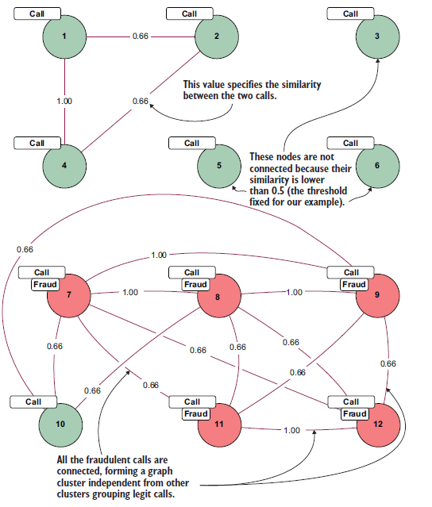
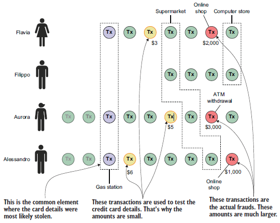
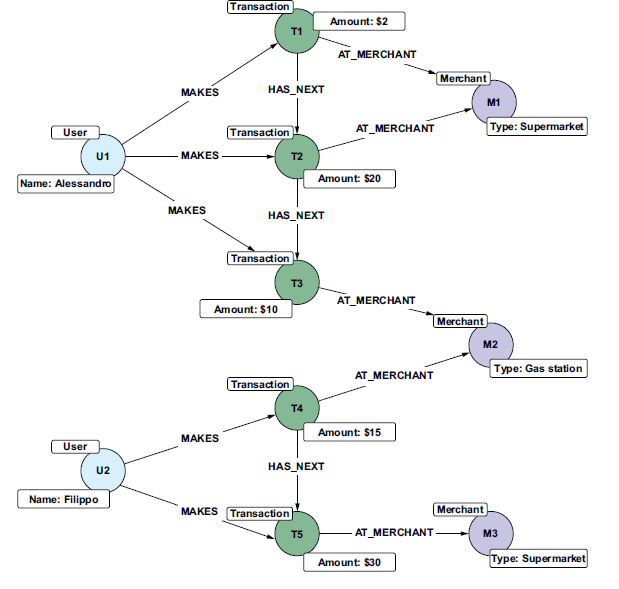
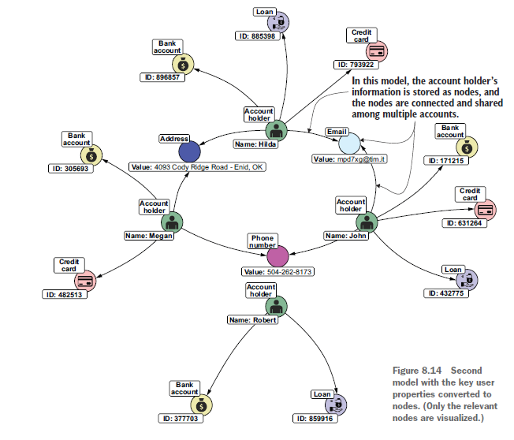
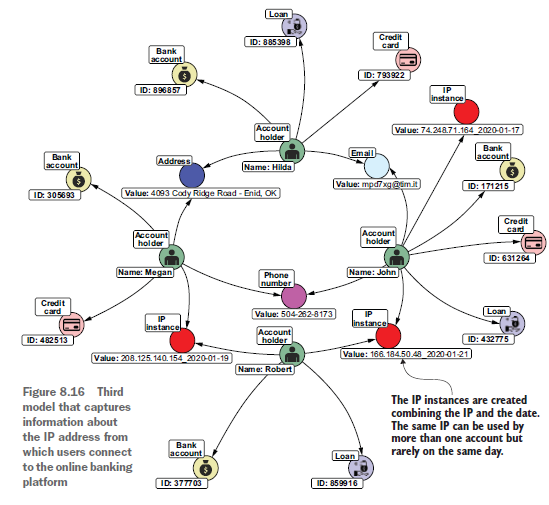

# Fraud Detection

Parent: [[0_Graph_Analytics_MOC]]

La fraud detection può essere visto com un problema di anomaly detection o rimozione degli outliers. Quindi si vanno ad individuare quei punti che differiscono in modo particolare dagli altri che hanno un comportamento simile.

La **frode**, può essere considerata come, un crimine non comune, ben considerato, in evoluzione nel tempo, organizzato con cura e impercettibilmente nascosto che appare in molti tipi e forme diverse. Questa definizione evidenzia alcune caratteristiche utili alla modellazione del problema:

* **Non comune (Sbilanciamento dei dati):** Le frodi costituiscono una porzione minima del dataset complessivo. Questo forte sbilanciamento delle classi rende complessa sia la fase di *detection* che l'addestramento dei modelli di Machine Learning basati sullo storico.
* **Pianificate e Organizzate:** Non si tratta di anomalie casuali. Le frodi sono crimini premeditati e strutturati, spesso eseguiti da team con ruoli specifici e architetture di rete complesse (come nel caso del riciclaggio di denaro).
* **Occultate:** I truffatori applicano tecniche sofisticate per mimetizzare le proprie operazioni nel rumore di fondo dei dati legittimi, rendendone il riconoscimento estremamente difficile.
* **Multiformi:** Le frodi si manifestano attraverso una vasta gamma di approcci e colpiscono innumerevoli domini economici e tipologie di business.
* **Evolutive (Natura Avversaria):** I pattern fraudolenti mutano nel tempo per eludere le nuove contromisure di sicurezza. Questo scontro continuo genera un *concept drift* nei dati, costringendo ad aggiornare o riaddestrare costantemente i modelli di rilevamento.

La lotta alle frodi può essere affrontata con diversi approcci, tra cui:

- **fraud prevention**: si cerca di prevenire la frode prima che accada, ad esempio con sistemi di autenticazione più robusti o con l'analisi dei comportamenti sospetti.
- **fraud detection**: si cerca di individuare la frode dopo che è avvenuta, ad esempio con l'analisi dei dati per identificare pattern sospetti o con l'uso di modelli di machine learning.

Uno dei modi principali di riconoscere le frodi è quello di far analizzare i dati da esperti di dominio, facendo affidamento alla loro esperienza e conoscenza per identificare i pattern sospetti. Questo approccio è molto efficace, ma risulta essere costoso, richidere molto tempo e soggetto ad errori umani. Gli esperti di dominio si basano sulla loro conoscenza per estrarre regole per riconoscere i comportamenti sospetti, ma queste regole possono essere facilmente aggirate dai truffatori, che possono adattare i loro comportamenti per evitare di essere rilevati. Questo approccio presenta diversi svantaggi:

* **Complessità e costi elevati:** I motori a regole (*rule-based engines*) sono intrinsecamente complessi e onerosi da implementare, poiché richiedono un massiccio input manuale da parte di specialisti del dominio.
* **Difficoltà di gestione:** Tale complessità strutturale rende la manutenzione e l'aggiornamento del sistema estremamente difficili nel lungo periodo.
* **Adattamento reattivo (e tardivo):** Le regole devono essere costantemente aggiornate per far fronte all'evoluzione delle tattiche dei truffatori. Non appena questi ultimi identificano i criteri logici del sistema di rilevamento, modificano il proprio comportamento per eludere i controlli.
* **Necessità di investigazione manuale:** Nella maggior parte dei casi, questi sistemi non sono autosufficienti e richiedono ulteriori analisi, verifiche e follow-up da parte di operatori umani.

Per superare questi limiti, si possono utilizzare tecniche di machine learning, che permettono di identificare pattern sospetti nei dati in modo automatico e scalabile. Queste tecniche possono essere utilizzate per costruire modelli di rilevamento delle frodi che sono in grado di adattarsi ai cambiamenti nei comportamenti dei truffatori e di identificare nuove tipologie di frodi.

I grafi possono essere utilizzati per rappresentare le relazioni tra le entità coinvolte in una frode, come ad esempio le transazioni finanziarie, i conti bancari, i dispositivi utilizzati per accedere ai servizi, ecc. In questo modo, è possibile identificare pattern sospetti e anomalie nei dati che potrebbero indicare la presenza di una frode. Ad esempio, si possono utilizzare algoritmi di community detection per identificare gruppi di entità che sono coinvolti in attività sospette, o algoritmi di link prediction per identificare relazioni nascoste tra le entità che potrebbero indicare la presenza di una frode. Inoltre, i grafi possono essere utilizzati per visualizzare i dati in modo intuitivo e facilitare l'analisi da parte degli esperti di dominio.  

## Modellazione del grafo

Una prima modellazione tramite grafo è quello di rappresentare tramite i **nodi** rappresentano le carte di credito e gli esercenti. Gli archi che collegano le entità indicano le transazioni, mentre le linee in **grassetto** evidenziano quelle fraudolente.

Questa rappresentazione rende immediatamente evidente che la carta Y è stata compromessa e che il merchant 1 mostra un comportamento sospetto, processando un numero elevato di transazioni illecite. L'ispezione visiva della topologia del grafo permette agli analisti di familiarizzare con il dominio dei dati e ricavare rapidamente insight preliminari, facilitando l'interrogazione e l'esplorazione dei dati.

Un altra possibile modellazione è quella di rappresentare tramite come un nodo ogni singola transazione, connettendo poi i nodi tra loro secondo una determinata logica. Da questa rappresentazione ogni nodo rappresenta una transazione, con le proprietà che descrivono i dettagli della transazione stessa. Gli archi tra i nodi rappresentano le relazioni tra le transazioni, ad esempio se condividono lo stesso numero di carta di credito, lo stesso indirizzo IP o lo stesso dispositivo.

Da queste si possono ricavare i vettori di caratteristiche (*feature vectors*) per ogni nodo. Ogni proprietà (corrispondente a ogni colonna della tabella originale) è stata decomposta nei suoi valori possibili, seguendo la logica utilizzata per il trattamento dei testi nella generazione di raccomandazioni basate sul contenuto (*content-based*). Per le proprietà scalari — in questo caso la durata — sono stati definiti diversi intervalli (*range*).

Questa rappresentazione vettoriale dei nodi viene impiegata per calcolare la similarità per riconoscere le transazioni sospette. Ad esempio, se una transazione condivide molte caratteristiche con altre transazioni fraudolente, potrebbe essere considerata sospetta. 

Tramite l'analisi delle reti sociali si possono anche individuare le comunità di transazioni sospette, identificando gruppi di transazioni che condividono caratteristiche simili e che potrebbero essere collegate a un'attività fraudolenta, utilizzando algoritmi di clustering sui grafi, come la **community detection**, per raggruppare le chiamate fraudolente e impiegare tale modello per classificare le nuove chiamate, valutando la loro distanza dai gruppi creati dal modello di classificazione.

{height="50%"}

## Trovare il punto di compromissione

Un primo scenario di applicazione è quello in cui gli user che posseggono le carte di credito effettuano degli acquisti e ad un certo punto i dettagli della carta di credito vengono rubati. I truffatori usano le credenziali rubate per acquistare qualcosa o per trasferire denaro tra conti. Tipicamente testano i dettagli della carta acquistando qualcosa a basso costo e poi fanno alcuni acquisti importanti prima di scomparire.

L'obiettivo di questo scenario è identificare in una sequenza di transazioni da parte di più utenti il punto in cui i dettagli della carta di credito sono stati rubati. Se consideriamo la sequenza di transazioni da parte di molti utenti, possiamo identificare comunalità—negozi o siti di e-commerce—e  cosa che con un sola transazione sarebbe più difficile da capire. Questo approccio, noto come analisi del **Common Point of Purchase (CPP)**, si basa sul presupposto che entità apparentemente non correlate condividano una dipendenza latente nel passato.

{height="50%"}

Un insieme di soggetti (nodi) interagisce con una risorsa comune (un merchant, un database o un punto fisico). All'istante $t_0$, questa interazione appare perfettamente legittima. È solo attraverso l'analisi retrospettiva di un grafo che questo nodo emerge come **hub di convergenza**: l'unico punto nello spazio delle relazioni in cui le traiettorie di n utenti, successivamente vittima di frode, si sono incrociate.

Una volta sottratte le credenziali, l'attaccante deve verificare la validità degli asset senza allertare i sistemi di monitoraggio basati su soglie di volume.

* **Caratteristica:** Transazioni di entità trascurabile, spesso eseguite presso merchant automatizzati o enti benefici.
* **Logica:** In un approccio tabulare, queste transazioni sono indistinguibili dal rumore di fondo. In un approccio a grafi, esse formano un "ponte" temporale e comportamentale tra il punto di compromissione e l'evento fraudolento finale.

La superiorità del modello a grafi in questo scenario risiede nella capacità di eseguire **attraversamenti (traversals) efficienti**. Mentre un database relazionale richiederebbe costosi e multipli `JOIN` per correlare migliaia di transazioni alla ricerca di un fornitore comune, il grafo permette di:

1. **Isolare i nodi compromessi** (target).
2. **Percorrere a ritroso gli archi** verso i merchant passati.
3. **Identificare l'intersezione dei set di vicinato**, rendendo il CPP un'evidenza topologica immediata.

Abbiamo bisogno di considerare la sequenza delle transazioni, mettendole in relazione con altri utenti per trovare il punto in cui i dettagli della carta di credito sono stati rubati. Possiamo ordinare le transazioni utilizzando le informazioni sui timestamp, ma questo approccio renderebbe difficile navigarle e trovare un pattern comune. Pertanto, il passo successivo nella modellazione è quello di aggiungere una relazione tra le transazioni per memorizzare esplicitamente l'ordine tra di esse.

```cypher
// 1. Raccogli gli utenti e le transazioni collegate
MATCH (u:User)-[:MAKES]->(tx:Transaction)

// 2. Ordina le transazioni prima per utente e poi per data crescente
WITH u, tx 
ORDER BY id(u), tx.date

// 3. Aggrega le transazioni ordinate in una lista per ciascun utente
WITH u, collect(tx) AS txList

// 4. Itera sugli indici della lista fino al penultimo elemento
UNWIND range(0, size(txList) - 2) AS i
WITH txList[i] AS currentTx, txList[i+1] AS nextTx

// 5. Crea la relazione temporale tra la transazione corrente e la successiva
MERGE (currentTx)-[:HAS_NEXT]->(nextTx)
```

{height="50%"}

In questo modo possiamo indentificare facilmente i pattern comuni tra le transazioni e inidividuare in queste chain di transazioni i negozi comuni, che potrebbero essere il punto di compromissione. Ma un'analisi superficiale di questi risultati potrebbe essere fuorviante perchè i negozi più comuni, come Amazon, appaiono costantemente nella lista, ma questo non significa necessariamente che siano coinvolti in attività fraudolente. Dobbiamo invece concentrarci sui negozi che sono **insolitamente comuni** all'interno del set di transazioni selezionate, poiché sono quelli con maggiori probabilità di essere collegati alla frode. Per identificare i negozi insolitamente comuni, consideriamo due distinti set di transazioni:

* **Il set globale (Background set):** contiene i dati di tutte le transazioni, non solo quelle degli utenti vittime di frode. Questo dataset rappresenta il nostro "rumore di fondo". Da qui estrarremo le statistiche sulle frequenze dei merchant da inserire nella nostra formula.
* **Il set delle vittime (Foreground set):** comprende le transazioni recenti effettuate da chi ha segnalato un addebito fraudolento. Questo dataset rappresenta il nostro vero target.

Con questi due set, troviamo i merchant che risultano **insolitamente comuni** (*uncommonly common*) nel dataset di foreground rispetto a quanto lo siano nel dataset di background. Questo può essere formalizzato come un rapporto tra le frequenze di un merchant nei due set:

$$ score(merchantX) = \frac{foregroundPercentage(merchantX)^2}{backgroundPercentage(merchantX)} - foregroundPercentage(merchantX) $$

Questa forma mette in luce due componenti fondamentali:

* **Il Rapporto di Probabilità (Lift):** $\frac{f(X)}{b(X)}$ misura quante volte il merchant è più frequente tra le vittime rispetto alla norma. Se questo valore è $1$, il termine tra parentesi diventa $0$, e lo score è nullo. Ciò accade per i colossi come Amazon: sono comuni, ma non *insolitamente* comuni.
* **Il Fattore di Importanza (Weighting):** Moltiplicare per $f(X)$ serve a dare più peso ai merchant che compaiono con una certa frequenza assoluta. Senza questo fattore, un piccolo negozio con una sola transazione (che però è fraudolenta) avrebbe un rapporto $\frac{f}{b}$ altissimo, generando troppi falsi positivi (rumore statistico).

Nella forma originale $\frac{f(X)^2}{b(X)}$, il quadrato su $f(X)$ ha una funzione di **penalizzazione non lineare**.

* Premia i merchant che hanno un'alta penetrazione nel set delle vittime.
* Se un merchant appare in molte frodi, il suo score cresce quadraticamente nel numeratore, assicurando che emerga chiaramente rispetto al rumore di fondo, a patto che il suo $b(X)$ (la popolarità globale) rimanga basso.

Sottrarre $f(X)$ funge da **correzione di base**.
Serve a garantire che se un merchant si comporta esattamente come la media ($f = b$), lo score sia esattamente zero. È una sorta di "centratura" statistica che elimina il bias dei merchant che sono semplicemente "molto popolari" ma innocui.

In questo modo possiamo identificare i merchant che sono insolitamente comuni tra le vittime di frode, e quindi potenzialmente collegati alla compromissione delle carte di credito. Questo approccio è particolarmente efficace per identificare i punti di compromissione in scenari in cui i truffatori testano le carte rubate con piccoli acquisti prima di effettuare transazioni più grandi. I merchant che appaiono frequentemente nei primi acquisti sospetti, ma non sono comuni nel background, diventano candidati chiave per ulteriori indagini.

## Fraud Ring

La **fraud ring** è una forma di frode altamente sofisticata e organizzata, in cui un gruppo di individui collabora per creare una rete di account e transazioni al fine di ottenere credito o fondi in modo fraudolento. Il processo si articola in fasi sequenziali studiate per eludere i controlli standard:

1. **Creazione di Account Sintetici:** Un elevato numero di account viene aperto presso un istituto finanziario. Si tratta di identità reali create appositamente per scopi fraudolenti.
2. **Fase di "Riscaldamento" (Mimicking):** Per un lungo periodo, gli account operano simulando il comportamento di clienti legittimi.
3. **Costruzione della Credibilità:** Gli account richiedono progressivamente linee di credito più elevate, rimborsandole puntualmente per scalare il rating di fiducia (credit scoring) della banca.
4. **Movimentazione Circolare:** In realtà, il capitale transita costantemente tra lo stesso set di conti, sfruttando molteplici "hop" (salti) e percorsi diversificati per mascherare la natura chiusa del network.
5. **Fase di Exit (Bust-out):** Raggiunto il limite massimo di credito ottenibile, tutti gli account richiedono simultaneamente il prelievo totale dei fondi e scompaiono.

Possiamo rivelare questa struttura durante la sua costruzione, intervenendo prima che la frode venga effettivamente eseguita e il capitale disperso. Per farlo, dobbiamo identificare i pattern di comportamento che indicano la formazione di un fraud ring, come ad esempio:

* Un numero elevato di account che richiedono credito in un breve periodo di tempo.
* Transazioni che coinvolgono un numero limitato di conti, ma con un alto volume di denaro.
* Transazioni che seguono percorsi circolari, con molti hop tra gli stessi conti.

Invece di modellare le informazioni degli utenti come properties del nodo, conviene che siano rappresententati come nodi, connessi tra loro da archi che rappresentano le relazioni tra di essi. Il motivo di questo è che ci serve identificare le informazioni che sono condivise tra gli utenti, come ad esempio l'indirizzo IP, il numero di telefono o l'indirizzo email e rappresentandole tramite nodi possiamo individuare questi pattern.

{height="50%"}

Per farlo possiamo sfruttare le componenti connesse del grafo, che rappresentano gruppi di nodi che sono tutti connessi tra loro. Se troviamo una componente connessa che contiene un numero elevato di account che richiedono credito in un breve periodo di tempo, questo potrebbe essere un indicatore di un possibile fraud ring. Inoltre, possiamo analizzare i percorsi circolari tra i conti per identificare transazioni sospette che coinvolgono molti hop tra gli stessi conti.

I truffatori più sofisticati evitano di condividere informazioni palesi come l'email o il telefono. Per catturare questi soggetti, l'approccio operativo prevede l'integrazione di dati provenienti da fonti eterogenee (es. log del web banking) per identificare pattern di comportamento sospetti. Anche se un utente non condivide dati anagrafici con il resto del ring, il fatto che si connetta dalla stessa posizione o dallo stesso dispositivo dei sospettati lo inserisce automaticamente nel cluster di indagine.

{height="50%"}

L'approccio del ring-detection è agnostico rispetto al dominio ed è efficace ovunque esista un tentativo di manipolare un sistema tramite account multipli (sybil attacks).

| Dominio | Fenomeno Rilevato | Logica del Ring |
| --- | --- | --- |
| **Finance** | Riciclaggio / Bust-out | Conti che scambiano fondi in modo circolare o condividono PII. |
| **E-commerce** | Fake Reviews | Venditori che pagano network di account per postare recensioni fittizie. |
| **Online Gaming** | Collusion | Giocatori (es. Poker) che siedono allo stesso tavolo con più account contro ignari terzi. |
| **Aste Online** | Shill Bidding | Utenti che usano account secondari per gonfiare artificialmente il prezzo di un bene. |
| **Social Media** | Account Ban Evasion | Utenti bannati che tentano di rientrare nel sistema riutilizzando tracce digitali già note. |

