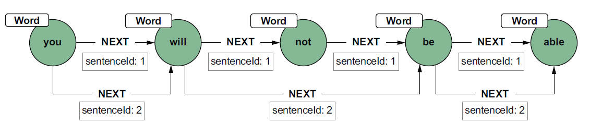
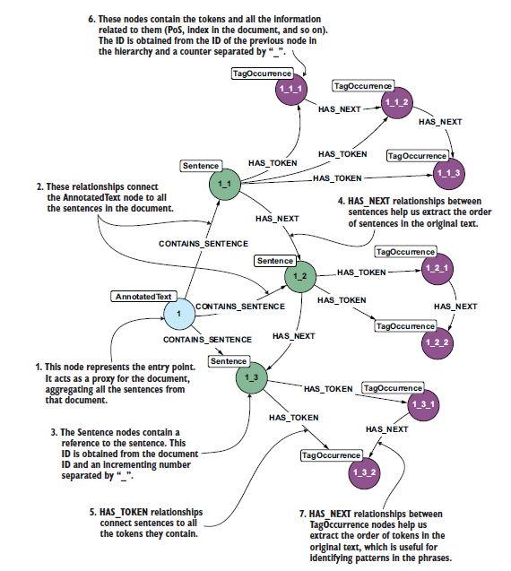
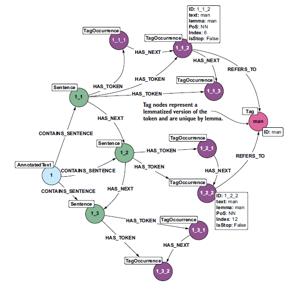
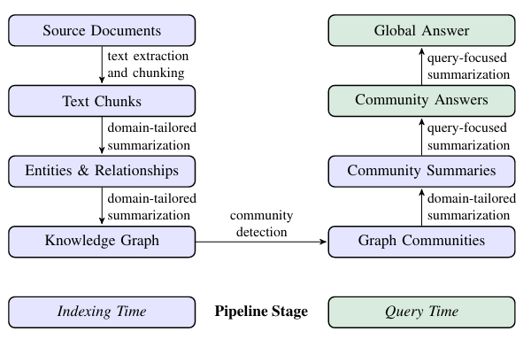
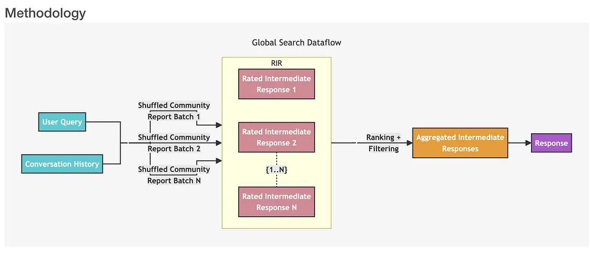
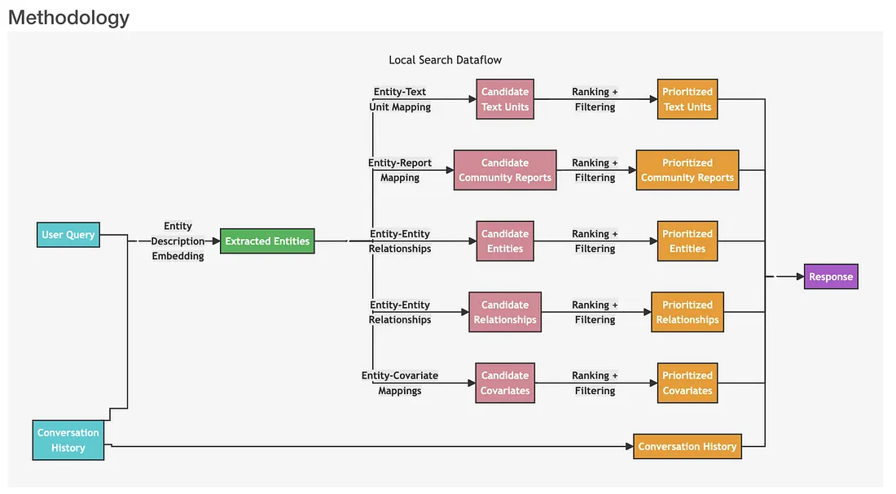

# NLP Graph

I **search engine** sono dei motori di ricerca che permetteono agli utenti di cercare dlle informazioni sulla base dei una query che l'utente scrive e fornisce una lista di document che più si avvicinano alla query. Questi documennti vengono precedentemente indicizzati per favorire la ricerca e vengono ordinati in base alla loro rilevanza sulla base della query.

Alla base di questi engines c'è del testo che deve essere processato e indicizzato. Oltre a codifiche vettoriali, embeddings è possibile utilizzare anche i grafi per rappresentare le relazioni tra parole, frasi o documenti. Un modo semplice di modellare il testo è come una seguenza di parole (nodi) che sono collegate da relazioni sintattiche o semantiche (archi). I nodi, le parole, non vengono replicate, ma replichiamo solo le relazioni per rappresentare le diverse occorrenze di una parola in un testo. 

Un altro approccio è quello di modellare anche gli archi in modo univoco e usare un arco pesato per rappresentare le volte che due parole co-occorrono. Il problema è che in questo modo perdiamo il contesto in cui le parole appaiono insieme e ad esempio per la generazione della prossima parola non ci si può basare solo sull'ultima parola, ma è necessario considerare anche le parole precedenti. Inoltre, si possono creare dei *supernodi*, parole che appaiono molto frequentemente, a seconda della lingua che modelliamo, e questo pò portare al suggerimento delle parole che appaiono più frequentemente, ma non sono necessariamente le più rilevanti. In generale queste parole, sono le *stop words* e vengono rimosse prima di costruire il grafo perché non portano informazioni rilevanti e sono molto frequenti.

Allora teniamo le relazioni duplicate, ma introduciamo negli archi un id per poter modellare la frase in cui le parole appaiono insieme.

{height="50%"}

Quando modelliamo il testo come un grafo dobbiamo tener conto che:

- le parole possono essere collegate da relazioni sintattiche o semantiche che fino ad ora non abbiamo considerato;
- che le parole non sono nella forma normalizzata
- le stop words possono essere rilevanti in alcuni contesti, ad esempio in un testo poetico, e quindi non vanno rimosse a priori
- alcune parole hanno senso solo insieme ad altre parole e quindi è necessario considerare anche le frasi come nodi del grafo
- la punteggiatura deve essere considerata come un nodo del grafo perché può influenzare il significato delle parole e delle frasi

Quindi prima di modellare il testo come un grafo è necessario fare un processo di pre-processing per normalizzare le parole (stemming, lemmatizzation), rimuovere le stop words, identificare le relazioni sintattiche e semantiche tra le parole e le frasi, identificare le POS (part of speech) e identificare le entità nominate (Named Entity Recognition) ecc, insomma tutte quelle tecniche che ci permettono di estrarre informazioni dal testo e di rappresentarle in modo strutturato.

Un modo di rappresentare il testo come grafo è

* **Nodi Frase (Sentence nodes):** Il testo principale viene suddiviso in frasi, che costituiscono elementi chiave nella maggior parte dei casi d'uso dell'analisi testuale (come la sintesi automatica e il calcolo della similitudine).
* **Nodi Occorrenza Tag (TagOccurrence nodes):** Questi nodi contengono dettagli su come il tag appare nel testo, quali la posizione iniziale e finale, il valore effettivo e il lemma (valore PoS - *Part of Speech*).
* **Relazioni HAS_NEXT:** Esistono relazioni di tipo `HAS_NEXT` tra i nodi *TagOccurrence*, le quali presentano lo stesso ambito (*scope*) descritto nella sezione 11.1. In questo modo, il nuovo schema incorpora — ed estende notevolmente — lo schema prodotto in precedenza, consentendo di risolvere gli scenari antecedenti anche attraverso l'uso di questo nuovo modello.

{height="50%"}

Questo schema può essere migliorato aggiungendo **nodi Tag** per rappresentare le versioni lemmatizzate dei token. Questi nodi sono unici; vengono memorizzati una sola volta e tutte le frasi che contengono tali tag puntano ad essi attraverso un nodo TagOccurrence. I nodi Tag semplificano la navigazione all'interno del database a grafi quando si desidera accedervi utilizzando uno o più termini chiave come punto di ingresso.

{height="50%"}

## RAG Graph

I RAG classici basati sul database vettoriali considerano i chuck isolati fra loro e nonostante aggiungengdo degli overlapp fra di essi, non riescono a captturare le relazioni che ci sono fra i chunch, non essendo in gradi di rispondere a domande complesse che richiedono di mettere insieme informazioni che si trovano in chunch diversi.

Non sono in grado di gestire *sensemaking queries*, cioè query che richiedono una comprensione globale del dataset, e non sono in grado di gestire query che richiedono di mettere insieme informazioni che si trovano in chunch diversi. Per risolvere questi problemi possiamo rappresentare i nostri testi come dei grafi.

I **GraphRAG** combianano gli LLM con i **Knowledge Graph** per catturare le relazioni strutturate e i concetti globali presenti nei dati. I GraphRAG si basano sugli stessi concetti dei RAG, quindi hanno una parte di ingestione dei dati, una parte di retrieval e una parte di generazione, ma invece di utilizzare un database vettoriale per il retrieval, utilizzano un grafo per rappresentare i dati e le relazioni tra di essi.

{height="50%"}

### Fase di Ingestione

Durante la fase di ingestione dei dati, dopo che il documenti sono stai chunckati, questi vengono passati ad un LLM istruito per estrarre le entità e le relazioni che ci sono fra le entità presenti nei chunck. Può essere anche prompted per estrarre i **claims** (**Covariates**), cioè affermazioni relative alle entità che costituiscono le proprietà delle entità. Tutte queste informazioni estratte vengono rappresentntate tramite un grafo, dove i nodi rappresentano le entità e gli archi rappresentano le relazioni tra di esse.
Una volta creato questo grafo vengono applicati degli algoritmi di *community detection* per identificare le partizioni di nodi fortemente connesse. Il paper originale usa **l'algoritmo di Leiden**, un algoritmo gerarchico che identifica le comunità in modo ricorsivo fino a quanto non si raggiunge una comunità che non può essere ulteriormente suddivisa.
L'ultimo step della fase di ingestione è quello della generazione di **Community Summaries** che sono sono utili al LLM per comprendere la struttura globale e semantica del dataset. Questi riassunti vengono inserti all'interno di un modello di sintesi della comunità (*community summary template*). I riassunti delle comunità di livello inferiore vengono utilizzati per generare i riassunti per le comunità di livello superiore nel modo seguente:

* **Comunità a livello di foglia (*Leaf-level communities*).** Viene assegnata una priorità ai riassunti degli elementi di una comunità foglia, i quali vengono poi inseriti iterativamente nella finestra di contesto dell'LLM fino al raggiungimento del limite di token. La prioritizzazione avviene come segue: per ogni arco della comunità, in ordine decrescente rispetto alla somma dei gradi del nodo sorgente e del nodo destinazione (ovvero la rilevanza complessiva), vengono aggiunte le descrizioni del nodo sorgente, del nodo destinazione, dell'arco stesso e delle relative dichiarazioni (*claims*).
* **Comunità di livello superiore (*Higher-level communities*).** Se tutti i riassunti degli elementi rientrano nel limite di token della finestra di contesto, si procede come per le comunità a livello di foglia e si sintetizzano tutti i riassunti degli elementi all'interno della comunità. In caso contrario, le sotto-comunità vengono ordinate in modo decrescente in base ai token dei riassunti degli elementi e si sostituiscono iterativamente i riassunti delle sotto-comunità (più brevi) ai riassunti degli elementi associati (più lunghi), fino a quando non rientrano nella finestra di contesto.

### Fase di Quering e Retrieval

Durante la fase di quering, il GraphRAG opera su una distinzione basata sulla natura della domanda implementando due flussi algoritmici:

- la **Global Search** progettata per rispondere a domande sistemiche, olistiche o di sintesi su intero dataset, che richiedono una comprensione globale del dataset e delle relazioni tra le comunità. La ricerca vettoriale classica fallirebbe perché l'informazione non risiede in un singolo chunk, ma è frammentata ovunque.
  1. **Selezione del Livello**: Il sistema seleziona un livello della gerarchia delle comunità (es. il Livello 1 per una panoramica generale, o livelli più bassi per maggiore dettaglio).
  2. **Fase di Map** (Parallelizzazione): I riassunti delle comunità vengono suddivisi in chunk di dimensione adeguata alla finestra di contesto. Molteplici chiamate all'LLM vengono eseguite in parallelo. Ogni istanza di LLM esamina un gruppo di riassunti e produce un output intermedio: una lista di punti chiave rilevanti per la query, associati a un punteggio di rilevanza (0-10).
  3. **Fase di Reduce** (Sintesi): I punti chiave intermedi vengono filtrati (scartando quelli con score insufficiente) e ordinati in ordine decrescente di rilevanza. Vengono quindi inseriti nel contesto di un LLM finale che redige la risposta strutturata per l'utente, garantendo una copertura globale del dataset.
   {height="50%"}
- la **Local Search** progettata per domande specifiche su entità ben definite o contesti circoscritti. Sfrutta la topologia del grafo per estendere il contesto oltre la semplice similarità semantica.
    1. **Identificazione delle Entità:** La query viene vettorizzata per trovare i nodi (entità) e i chunk di testo più simili nello spazio semantico.
    2. **Estrazione del Sotto-grafo Locale:** Una volta identificate le entità chiave (es. il nodo *Farmaco Y* e il nodo *Effetto Collaterale X*), il sistema estrae il sotto-grafo locale. Questo include:
       * I nodi adiacenti (vicini di primo grado, *1-hop neighborhood*).
       * Gli archi (relazioni) che collegano questi nodi.
       * I *claims* (dichiarazioni) e le descrizioni testuali associate a questi elementi.
       * I riassunti delle comunità a cui appartengono questi nodi.
    3. **Prioritizzazione e Linearizzazione:** Le informazioni strutturate del sotto-grafo vengono convertite in testo (linearizzate). Se superano la context window, vengono ordinate inserendo prima gli elementi con centralità o grado di nodo (*degree*) maggiore (come descritto nella prioritizzazione delle comunità foglia).
    4. **Generazione:** L'LLM riceve un contesto che unisce i chunk di testo raw estratti via embedding e la struttura logica delle relazioni del grafo, producendo una risposta mirata e altamente accurata.
    {height="50%"}

Quindi più ad alto livello, quello che succede durante la fase di quering è che il sistema segue un processo iterativo che coinvolge:

- **Elaborazione della Query (*Query Processing*):** La query in input viene analizzata e convertita in un formato idoneo per l'interrogazione del grafo.
- **Attraversamento del Grafo (*Graph Traversal*):** Il sistema esplora la struttura del grafo, seguendo le relazioni rilevanti per individuare le informazioni connesse.
- **Estrazione del Sotto-grafo (*Subgraph Retrieval*):** Invece di recuperare frammenti isolati di informazione, il sistema estrae sotto-grafi rilevanti che catturano contesti interconnessi tra loro.
- **Integrazione delle Informazioni (*Information Integration*):** I sotto-grafi estratti vengono combinati ed elaborati per costituire un contesto coerente.
- **Generazione della Risposta (*Response Generation*):** Un modello linguistico (LLM) utilizza la query e le informazioni integrate del grafo per generare la risposta finale.

### Vantaggi dei GraphRAG

Il GraphRAG offre diversi vantaggi:

- **Rappresentazione strutturata della conoscenza (*Structured knowledge representation*):** GraphRAG utilizza grafi di conoscenza strutturati, fornendo un contesto ricco che include le relazioni e le proprietà associate alle entità.
- **Capacità di interrogazione avanzate (*Enhanced Query Capabilities*):** GraphRAG supporta query più complesse in grado di sfruttare la natura interconnessa dei grafi di conoscenza. Ciò significa che gli utenti possono porre domande che richiedono la comprensione delle relazioni tra le entità.
- **Efficienza (*Efficiency*):** Le strutture a grafo possono rendere più efficienti determinati tipi di query, specialmente quelle che comportano l'attraversamento delle relazioni (*relationship traversal*).
- **Spiegabilità (*Explainability*):** GraphRAG consente di visualizzare e comprendere il percorso logico che il sistema ha seguito per giungere alla risposta. Questo è di grande aiuto in fase di debugging quando si ottengono risultati errati.
- **Multihop Reasoning:** GraphRAG è in grado di eseguire ragionamenti multi-hop, cioè di mettere insieme informazioni che si trovano in chunch diversi, grazie alla struttura a grafo che permette di collegare le informazioni tra loro.

## Knowledge Graph