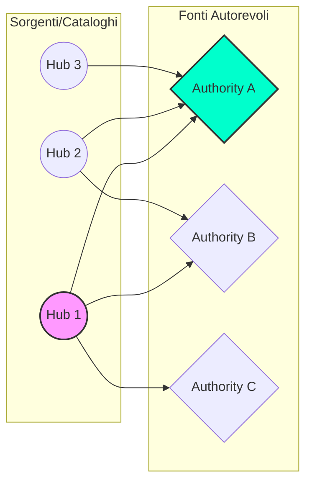

# Link analysis algorithm

Gli algoritmi di link analysis sono un insieme di tecniche utilizzate per analizzare e valutare l'importanza o la rilevanza dei nodi in un grafo, basandosi sulle connessioni tra i nodi stessi. Questi algoritmi sono ampiamente utilizzati in vari campi, tra cui il web search, la social network analysis, e la bibliometria.

## HITS (Hyperlink-Induced Topic Search)

L'algoritmo **HITS** è un algoritmo di analisi dei link che valuta le pagine web, sviluppato da Jon Kleinberg (1999). Questo algoritmo viene utilizzato per analizzare le strutture di link del web al fine di individuare e classificare le pagine web pertinenti a una specifica ricerca. 
HITS utilizza hub e autorità per definire una relazione ricorsiva tra le pagine web.

- **Hub** è una pagina che contiene molti link a pagine autorevoli. Quindi ha un alto out-degree.
- **Authority** è una pagine che viene refernziata da molti hub. Quindi ha un alto in-degree.

L'algoritmo si basa sulla definizione di due misure di score:

- **Authority Score**: misura la qualità di una pagina come fonte di informazioni. Viene calcolato sommando i punteggi degli hub che puntano alla pagina.
- **Hub Score**: misura la qualità di una pagina come aggregatore di informazioni. Viene calcolato sommando i punteggi delle autorità a cui la pagina punta.

Tra hub e authority esiste una **mutual reinforcement relationship** cioè un buon hub punta a molte buone autorità, e una buona autorità è puntata da molti buoni hub. L'algoritmo itera fino a quando i punteggi di hub e authority convergono a valori stabili.
 
Il funzionamento si basa su una query formula dall'utente, che viene inviata a un motore di ricerca. Non dipende da punti universali di hub e authority, ma è specifico per la query

Il motore restituisce un sottoinsieme delle pagine web pertinenti alla query, chiamate **roots**, fornendo due ranking una per le authority  e una per gli hub.

!!!tip Algoritmo
    Questo problema può essere modellato come un grado diretto bipartito, dove ogni nodo ha un hub score e un authority score. Quindi ogni nodo è ripetuto due volte.

    1. Definiamo il numero $k$ di itereazioni da eseguire
    2. Al tempo $t_0$ assegnamo come valori iniziali di $Hub\_score = \frac{1}{\sqrt{N}}$ e an $Authority\_score = \frac{1}{\sqrt{N}}$.
    3. Ripetere $k$ volte: 
        - **Hub update**: per ogni nodo Hub aggiorniamo l'Hubscore = $\sum_{j} A_j$ dove $A_j$ è l'Authority score di ogni nodo Authority a cui il nodo Hub punta.
        - **Authority update**: per ogni nodo Authority aggiorniamo l'Authority score = $\sum_{i} H_i$ dove $H_i$ è l'Hub score di ogni nodo Hub che punta al nodo Authority.
    4. Normalizziamo i punteggi di hub e authority dividendo per la  radice quadrata delle somme dei quadrati di tutto gli $Hub\_score $. 
        - $ \sum_{j} Hub\_score_j^2 = 1$ e $ \sum_{i} Authority\_score_i^2 = 1$.

L'algoritmo HITS può essere implementato utilizzando la matrice di adiacenza del grafo. Se definiamo $A \in \R^{N \times N}$, dove $N$ è il numero delle pagine web, come la matrice di adiacenza del grafo, e definiamo $h$ come il vettore degli hub score e $a$ come il vettore degli authority score, i punteggi di hub e authority possono essere calcolati iterativamente utilizzando le seguenti formule:

- $h_i = \sum_{i \rightarrow j} a_j = \sum_{j} A_{ij} a_j = A \cdot a = A \cdot a$
- $a_j = \sum_{i \rightarrow j} h_i = \sum_{i} A_{ij} h_i = A^T \cdot h$
- Ripetiamo fino a convergenza, normalizzando i punteggi dopo ogni iterazione. L'aggiornamento dei vettori viene calcolato:
  - $h^{(t+1)} = A \cdot a^{(t)}$
  - $a^{(t+1)} = A^T \cdot h^{(t+1)}$

Si basa sull'approccio del _power iteration method_.

**Problemi**

- **Referenziazioni Circolari**: Se ci sono cicli di link, l'algoritmo potrebbe non convergere o potrebbe convergere a valori non significativi.
- **Manipolazione dei Link**: I proprietari di siti web potrebbero creare link artificiali per aumentare i loro punteggi di hub o authority, portando a risultati distorti.

## PageRank

Il **PageRank** è l'algoritmo di link analysis ideato da Larry Page e Sergey Brin (Google, 1996-1997) per misurare l'importanza dei nodi (pagine web) analizzando la struttura degli archi (link) che li collegano.

Dal punto di vista ingegneristico, è un'applicazione diretta delle Catene di Markov su scala globale.

!!!note Il principio fondante è ricorsivo: una pagina è importante se riceve link da altre pagine importanti. Un arco dal nodo $i$ al nodo $j$ è interpretato come un "voto" di $i$ a favore di $j$.

Tuttavia, il peso di questo voto non è uniforme:

* È direttamente proporzionale all'importanza (il rank) della pagina sorgente $i$. 
* È inversamente proporzionale al grado uscente $d_i$ della pagina sorgente. Se $i$ possiede un certo punteggio di importanza e ha 4 link uscenti, distribuirà un quarto del suo rank a ciascun nodo destinazione.

Il **rank** $r_j$ della pagina $j$ èd definito come la somma dei contributi di tutte le pagine $i$ che puntano a $j$:
$$r_j = \sum_{i \rightarrow j} \frac{r_i}{d_i}$$ dove:

- $r_i$ è il rank della pagina $i$ che punta a $j$.
- $d_i$ è il numero di link uscenti dalla pagina $i$.

La somma totale dei rank di tutti i nodi deve essere esattamente pari a $1$.

Il Page Rank si basa sull'algoritmo del _random surfer_, quidi il page rank di una  pagina web è la probabilità che un utente qualsiasi, dopo aver cliccato a caso per un tempo lunghissimo finisca su quella pagina.

Quindi possimao definire $M$ come la **matrice di adiacenza stocastica per colonne** (in cui $M_{ji} = 1/d_i$ se esiste un arco da $i$ a $j$, e $0$ altrimenti), l'equazione diventa un problem di algebra lineare:
$$r = M \cdot r$$

### Il Damping Factor

Applicare l'equazione $r = M \cdot r$ al World Wide Web porta a un fallimento matematico della convergenza delle markovian chain. Per gli stessi motivo del _random surfer_, la presenza dei _dead-end_ e dei _spider trap_ impedisce l'esistenza di una distribuzione stazionaria stabile:

Per garantire l'esistenza e l'unicità della distribuzione stazionaria, consideriamo il **damping factor** (indicato con $\beta$, con valori tra $0.8$ e $0.95$) che rappresenta la probabilità che l'utente decida di cliccare su uno dei link presenti nella pagina. Il parametro di teletarsporto è dato da $1-\beta$.

A ogni iterazione iterazione di calcolo, il "navigatore casuale" ha due opzioni:

1. Con probabilità $\beta$, segue regolarmente un link uscente.
2. Con probabilità $1-\beta$, salta su una pagina estratta uniformemente a caso tra tutte quelle esistenti.

Per ogni nodo $j$, il rank è calcolato come:

$$ r_j =  \sum_{i \rightarrow j} \beta \frac{r_i}{d_i} + \frac{1-\beta}{N} $$

#### Derivazione della Forma Matriciale Ottimizzata

Partiamo dalla definizione del PageRank come autovettore principale della matrice di transizione completa $A$ (la "Google Matrix"):
$$\mathbf{r} = A \cdot \mathbf{r}$$

Ogni elemento $A_{ji}$ della matrice rappresenta la probabilità complessiva di passare dalla pagina $i$ alla pagina $j$. Questa è la somma di due componenti:
$$A_{ji} = \beta M_{ji} + \frac{1-\beta}{N}$$dove:
* $\beta M_{ji}$: Il contributo strutturale legato al seguire effettivamente un link nel grafo.
* $\frac{1-\beta}{N}$: Il contributo stocastico del teleporting casuale su una qualsiasi delle $N$ pagine.

Isoliamo il calcolo per il PageRank di un singolo nodo $r_j$, applicando la definizione di moltiplicazione matrice-vettore:
$$r_j = \sum_{i=1}^N A_{ji} \cdot r_i$$

Sostituiamo la definizione di $A_{ji}$ all'interno della sommatoria:
$$r_j = \sum_{i=1}^N \left[ \beta M_{ji} + \frac{1-\beta}{N} \right] \cdot r_i$$

Distribuiamo $r_i$ nei due termini della parentesi:
$$r_j = \sum_{i=1}^N \beta M_{ji} \cdot r_i + \sum_{i=1}^N \frac{1-\beta}{N} \cdot r_i$$

Estraiamo le costanti dalla seconda sommatoria, poiché non dipendono dall'indice $i$:
$$r_j = \beta \sum_{i=1}^N M_{ji} \cdot r_i + \frac{1-\beta}{N} \sum_{i=1}^N r_i$$

Il vettore $\mathbf{r}$ rappresenta una distribuzione di probabilità stazionaria sull'intero ecosistema web; pertanto, la somma del PageRank di tutti i nodi deve valere unitariamente:
$$\sum_{i=1}^N r_i = 1$$

Sostituendo questo assunto fondamentale, l'intero secondo termine collassa in una pura costante scalare, perdendo ogni dipendenza da $r_i$:
$$r_j = \beta \sum_{i=1}^N M_{ji} \cdot r_i + \frac{1-\beta}{N}$$

Ricompattando le equazioni dei singoli nodi nell'intero sistema vettoriale, otteniamo la forma ottimizzata:
$$\mathbf{r} = \beta M \cdot \mathbf{r} + \left[ \frac{1-\beta}{N} \right]_N$$

Dove $\left[ \frac{1-\beta}{N} \right]_N$ è un vettore colonna di lunghezza $N$ contenente elementi tutti identici e pari a $\frac{1-\beta}{N}$.

> Affinché il passaggio algebrico sia matematicamente valido, la matrice sparsa $M$ non deve avere *dead-end* (nodi pozzo senza link uscenti). Se ci fosse una colonna composta solo da zeri, la probabilità verrebbe dispersa durante le iterazioni e la condizione $\sum r_i = 1$ fallirebbe.

La matrice $A$ è una matrice **densa** (non ha zeri, perché dal teleporting ogni nodo è connesso a tutti gli altri), il che renderebbe il calcolo impossibile per miliardi di nodi.
La matrice $M$, invece, è altamente **sparsa** (la maggior parte degli elementi è zero). La formula dimostra che possiamo calcolare il PageRank facendo una moltiplicazione per una matrice sparsa (estremamente efficiente in memoria e calcolo) e semplicemente sommando un vettore costante alla fine di ogni iterazione.

> Questo garantisce che il metodo iterativo (Power Iteration) converga sempre e in modo stabile al vettore globale di ranking $r$.

### Personalized PageRank

Il PageRank produca risultati coerenti indipendentemente da chi lo esegue, questa uniformità potrebbe non corrispondere alle preferenze personalizzate dei singoli individui. Il **Personalized PageRank** (**PPR**) supera il limite della popolarità "generica". Questo approccio permette di rispondere a query tenendo conto degli interessi dell'utente o del dominio applicativo, introducendo un **bias**. Invece di considerare il teleporting come un salto casuale verso qualsiasi pagina del web, il PPR consente di personalizzare la destinazione del teleporting verso un sottoinsieme specifico di nodi, chiamati **seed nodes** $S$, che sono rilevanti per l'utente o per la query in questione.

Questo modifica la formulazione matematica della matrice di transizione. Se $\beta$ è il damping factor e $M_{ij}$ è l'elemento della matrice di adiacenza stocastica, l'equazione per i nuovi pesi $A_{ij}$ diventa:
$$A_{ij} = \beta M_{ij} + \frac{1-\beta}{|S|} \quad \text{se } i \in S \\ A_{ij} = \beta M_{ij} \quad \text{altrimenti}$$

Sostituiamo il vettore uniforme con un **vettore di personalizzazione (o di preferenza) $\mathbf{v}$**:

$$\mathbf{R} = \beta M \mathbf{R} + (1-\beta)\mathbf{v}$$

* **$\mathbf{R}$**: Il vettore colonna dei punteggi di Personalized PageRank alla convergenza.
* **$\beta$**: Il damping factor (la probabilità di seguire un link).
* **$M$**: La matrice di transizione sparsa (normalizzata per colonna).
* **$\mathbf{v}$**: Il vettore colonna di personalizzazione. Deve essere una distribuzione di probabilità valida, quindi la somma dei suoi elementi deve essere pari a $1$ ($\sum v_i = 1$).

Nel **PageRank classico**: $v_i = \frac{1}{N}$ per tutti i nodi. La matrice del teleporting è densa e uniforme.
Nel **PPR**: I valori di $\mathbf{v}$ sono sbilanciati. Se stiamo calcolando un ranking personalizzato per un utente focalizzato sullo sport, $\mathbf{v}$ avrà valori non nulli (es. $1/k$) solo in corrispondenza dei $k$ nodi "seed" identificati come siti sportivi, e $0$ in tutti gli altri.

Un caso limite del PPR si ha quando l'insieme $S$ è composto da un singolo nodo. Questa variante prende il nome di **Random Walk with Restart**.In questa configurazione, l'algoritmo smette di essere una semplice metrica di popolarità e diventa una potente misura di prossimità tra i nodi. Risponde matematicamente alla domanda: "Partendo dal nodo A, qual è la probabilità di raggiungere il nodo B?". Il ranking ordinerà i nodi per vicinanza al nodo sorgente, tenendo conto non solo dei collegamenti diretti, ma anche dei percorsi indiretti, della quantità di connessioni e dell'influenza degli hub intermedi. Su questo principio si basano molte applicazioni di raccomandazione, dove il nodo sorgente rappresenta un utente o un prodotto, e i nodi vicini rappresentano altri utenti o prodotti simili o correlati.

#### Particle Filtering Approach

Il **Particle Filtering Approach** è un metodo computazionale utilizzato per approssimare l'importanza dei nodi all'interno di un grafo simulando il movimento di "particelle" che si propagano attraverso il grafo seguendo regole stocastiche basate sui pesi degli archi. Questo approccio è particolarmente utile quando si lavora con grafi eterogenei su larga scala, dove il calcolo esatto del Personalized PageRank può essere computazionalmente proibitivo.

Ecco la scomposizione dell'algoritmo:

* **Inizializzazione:** Le particelle vengono fatte partire direttamente dai nodi di query, ovvero i nodi "sorgente" che ci interessano per la ricerca o la raccomandazione.
* **Propagazione Non-Uniforme:** A differenza di una camminata casuale standard, la diffusione delle particelle non è uniforme. Nei grafi eterogenei (dove gli archi rappresentano relazioni diverse), tipi diversi di archi possiedono livelli di importanza differenti. Il movimento delle particelle segue rigorosamente l'importanza semantica assegnata a questi link. Affinché il modello sia stocasticamente valido, i pesi degli archi uscenti da ogni singolo nodo devono sempre sommare a 1.
* **Dissipazione:** Viene introdotto un fattore di decadimento (dissipazione) per evitare che le particelle esplorino l'intero grafo all'infinito. Questo meccanismo garantisce che le particelle si "assestino" e convergano sui nodi strutturalmente più rilevanti attorno al punto di partenza.