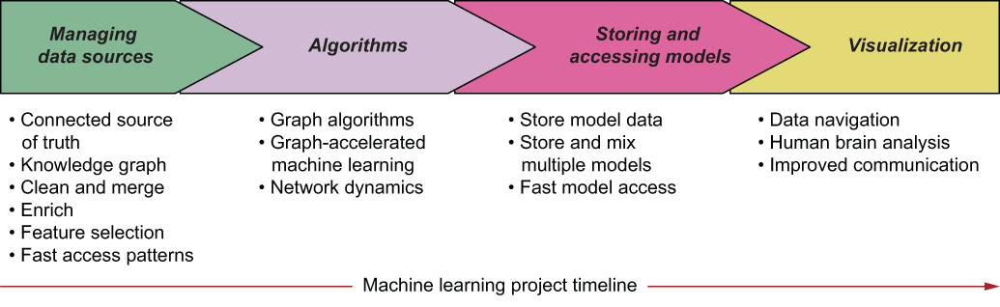
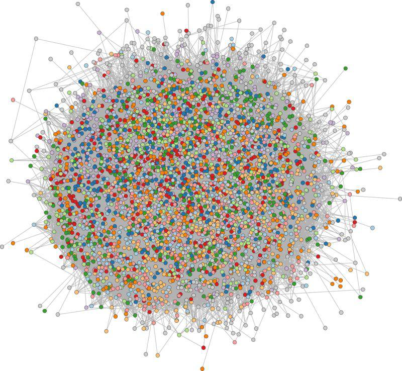
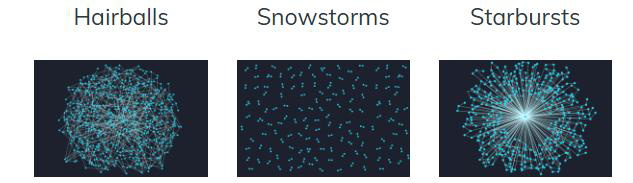

# Graph Analytics: Approccio Operativo

Per un progetto di Machine Learning, è fondamentale gestire efficacemente i dati in tutte le fasi del ciclo di vita del progetto.

{width="80%"}

## Gestione delle sorgenti dati

In questa fase iniziale, i dati vengono raccolti da una o più sorgenti e organizzati in un **Knowledge Graph**. La trasformazione dalla forma originale dei dati a un grafo può essere effettuata attraverso molteplici tecniche, classificabili in due gruppi:

* **Graph modeling:** i dati vengono convertiti in una rappresentazione a grafo mediante un pattern di modellazione. L'informazione rimane la stessa, cambia solo il formato, oppure i dati vengono aggregati per renderli più adatti a essere inseriti nel processo di apprendimento.
* **Graph construction:** viene creato un nuovo grafo a partire dai dati disponibili. Il grafo risultante contiene una quantità di informazioni superiore rispetto alla forma iniziale.

Per poter costruire un grafo a partire dai dati, è necessario seguire una serie di passaggi:s

1) **Identificare le sorgenti dati** disponibili per l'addestramento degli algoritmi (corrisponde alla seconda fase di un progetto di machine learning nel ciclo CRISP-DM, dopo la definizione degli obiettivi).
2) **Analizzare i dati disponibili** e valutarne il contenuto in termini di qualità e quantità.
3) **Progettare il data model a grafo**. In base ai requisiti analitici specifici:
   * Identificare le informazioni significative da estrarre dalle sorgenti dati.
   * Progettare uno specifico modello a grafo, considerando i dati disponibili, i pattern di accesso e l'estensibilità.
4) **Definire il flusso di dati** (noto come processo ETL – *Extract, Transform, Load*).
5) **Importare i dati nel grafo** – avviare il processo ETL. [Le fasi 3, 4 e 5 sono iterative fino al raggiungimento del modello e del processo ETL ottimali].
6) **Eseguire i task post-importazione** – attività di pre-elaborazione (*preprocessing*):
   * **Pulizia dei dati (Data cleaning):** gestione di dati incompleti o errati.
   * **Arricchimento dei dati (Data enrichment):** estensione delle sorgenti dati esistenti con fonti di conoscenza esterne o con informazioni estratte dai dati stessi.
   * **Fusione dei dati (Data merging):** quando i dati provengono da più sorgenti, gli elementi correlati nel dataset possono essere uniti in un unico elemento o collegati tramite nuove relazioni.

La *graph construction* porta alla creazione di un **grafo di co-occorrenza (co-occurrence graph)** che è una rappresentazione matematica della frequenza con cui due o più entità compaiono insieme all'interno di un determinato contesto o unità spaziale/temporale. Spesso è un grafo pesato dove il peso dell'arco indica quante volte quella specifica coppia di entità è apparsa insieme.

## Algoritmi

Una volta che i dati sono organizzati come "conoscenza" nel grafo, entrano in gioco gli algoritmi. Una distinzione importante è quella tra:

- **Algoritmi basati su grafi:** operano direttamente sulla struttura del grafo, sfruttando le connessioni tra i nodi per estrarre insight o effettuare previsioni.
- **Algoritmi non basati su grafi:** algoritmi tradizionali di machine learning che possono essere applicati a dati organizzati in forma tabellare, ma che possono beneficiare di una fase preliminare di estrazione di feature basata su grafi per migliorare le prestazioni o la qualità delle previsioni.

I vantaggi dell'approccio basato su grafi includono:

- **Machine Learning accelerato da grafi:** l'estrazione di feature basata su grafi è un esempio di come queste strutture possano velocizzare o migliorare la qualità di un sistema di apprendimento. I grafi supportano le fasi di filtraggio, pulizia, arricchimento e fusione dei dati prima o durante l'addestramento.
- **Dinamica delle reti:** la consapevolezza del contesto circostante e delle forze correlate che agiscono sulle reti permette non solo di comprenderne le dinamiche, ma anche di sfruttarle per aumentare l'accuratezza delle previsioni.
- **Modelli misti (Mixing models):** modelli multipli possono coesistere all'interno dello stesso grafo, beneficiando di pattern di accesso flessibili e rapidi, a condizione che possano essere integrati durante la fase di predizione. Questa caratteristica migliora l'accuratezza finale; inoltre, lo stesso modello può talvolta essere utilizzato con modalità differenti.
- **Accesso rapido ai modelli:** l'operatività in tempo reale richiede previsioni istantanee, il che implica un modello accessibile con la minima latenza possibile. I grafi forniscono i pattern strutturali ideali per rispondere a queste esigenze.

## Archiviazione e accesso ai modelli

La terza fase del workflow riguarda la distribuzione delle previsioni agli utenti finali. L'output della fase di apprendimento è un modello che racchiude i risultati del processo di inferenza e permette di generare previsioni su istanze mai viste in precedenza. Il modello deve essere archiviato in una memoria permanente o in RAM, in modo da essere accessibile ogni volta che è richiesta una nuova predizione.

La velocità di accesso al modello influisce direttamente sulle performance di predizione. Questo aspetto temporale è fondamentale per decretare il successo di un progetto di machine learning: se l'accuratezza del modello risultante è elevata, ma il tempo richiesto per la predizione è eccessivo, il sistema non sarà in grado di assolvere correttamente al proprio compito.

## Visualizzazione

I grafi possiedono un elevato potere comunicativo e possono mostrare contemporaneamente molteplici tipologie di informazioni in un modo che il cervello umano riesce a comprendere facilmente.

Le funzionalità di visualizzazione dei dati basate su grafi includono:

* **Navigazione dei dati:** le reti sono utili per visualizzare i dati evidenziando le connessioni tra gli elementi. Possono essere utilizzate sia come ausilio per supportare gli utenti nella corretta navigazione dei dati, sia come potenti strumenti di investigazione.
* **Analisi "Human-brain":** visualizzare i dati sotto forma di grafo libera il potenziale del machine learning combinandolo con le capacità del cervello umano, permettendo un'elaborazione dei dati e un riconoscimento dei pattern efficiente, avanzato e sofisticato.
* **Comunicazione migliorata:** i grafi — in particolare i *property graph* — sono "whiteboard friendly", il che significa che la loro rappresentazione concettuale su una lavagna corrisponde esattamente al modo in cui sono archiviati nel database. Questa caratteristica riduce il divario tra i tecnicismi di un modello complesso e il modo in cui esso viene comunicato agli esperti di dominio o agli stakeholder.

Un problema che si può incontrare è che i grafi eccessivamente densi diventano impossibili da visualizzare, diventando una "**hairball**", una massa di nodi e archi che si intrecciano e rendono la navigazione tramite grafo impossibile.

**Problemi di visualizzazione**

* Occlusione: I nodi centrali sono completamente coperti dagli archi.
* Edge Crossing: L'elevato numero di incroci impedisce di seguire un cammino da un nodo all'altro.
* Perdita di insight: Non è possibile identificare comunità o nodi influenti poiché tutto appare come una massa uniforme di "peli".

{width="70%"}

Invece, se abbiamo dei grafi scarsamente popolati, la visualizzazione potrebbe non essere in grado di comunicare efficacemente le informazioni, poiché i pattern potrebbero non essere evidenti o potrebbero essere difficili da identificare. Ciò porta alle visualizzazioni "**snowstorms**", che sono grafo che hanno un numero elevanto di componenti connesse, ma con pochi nodi e archi, risultando in una rappresentazione visiva che sembra una tempesta di neve, dove i nodi e gli archi sono sparsi e difficili da distinguere. Un'altra tipologia di grafo è quella dei "**starbursts**", grafi in cui ci sono pochi nodi hub con un numero elevato di connessioni, creando una rappresentazione visiva che ricorda un'esplosione di stelle, dove i nodi hub sono al centro e le connessioni si irradiano verso l'esterno.

{width="70%"}

Il sistema cognitivo umano, non in grado di gestire efficacemente grafi eccessivamente densi o scarsamente popolati, è in grado di identificare pattern e insight solo quando i grafi sono moderatamente popolati, con un numero equilibrato di nodi e archi che permetta una visualizzazione chiara e comprensibile. In questi casi, la visualizzazione del grafo può essere uno strumento potente per comunicare informazioni complesse in modo intuitivo e immediato.

Modi per migliorare la visualizzazione dei grafi:

- **Filtraggio:** rimuovere nodi o archi non rilevanti per ridurre la complessità del grafo.
- **Aggregazione:** raggruppare nodi o archi simili per semplificare la visualizzazione.
- **Metriche di centralità:** evidenziare i nodi più influenti o importanti per facilitare l'identificazione di pattern significativi.
- **Esplorazione interattiva:** consentire agli utenti di esplorare il grafo in modo dinamico, ad esempio zoomando o filtrando in tempo reale, per scoprire insight nascosti.