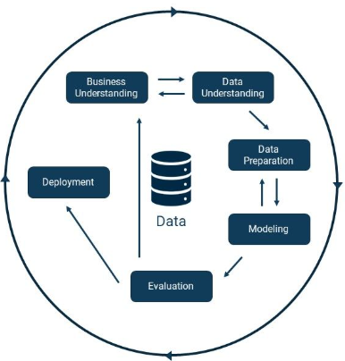
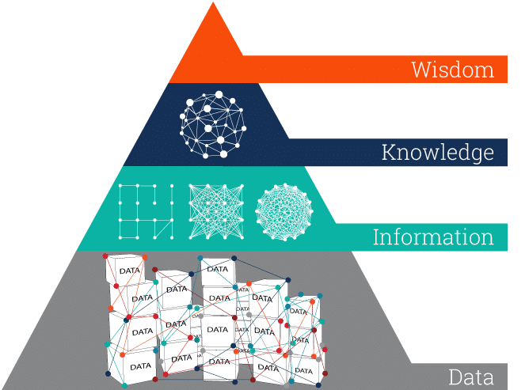
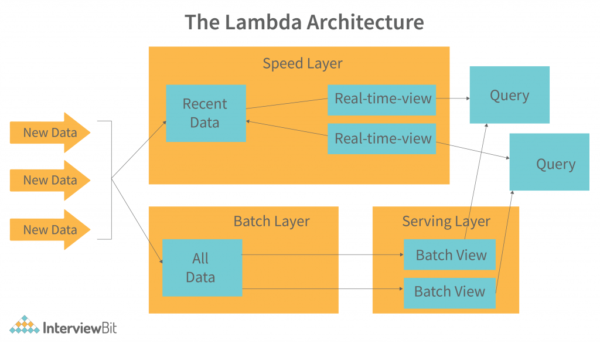
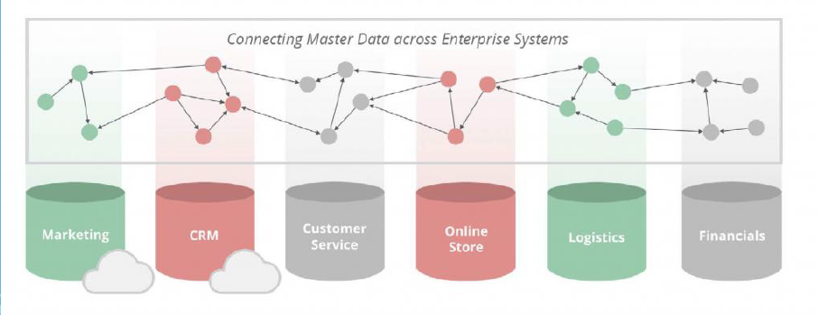

# Graph Machine Learning

I grafi permettendo di unire molteplici sorgenti in un unico **dataset connesso** cosa che con i dati tabellari risulta difficile fare perchè hanno schema diversi anche per la stessa rapprentazione e si deve trovare un modo per poter intergrare. Con i grafi invece è possibile integrare più fonti di dati, anche con schemi diversi, in un unico dataset connesso, grazie alla natura *schemaless* dei grafi, è molto semplice aggiungere dati esterni o integrare nuove informazioni senza dover ricostruire l'intero database. Inoltre, i grafi offrono percorsi di accesso multipli e performanti, riducendo i tempi di lettura rispetto ai classici filtri riga/colonna delle tabelle.

I grafi risultano essere vantaggio anche nelle predizione, ottenendone di migliori, utilizzando le relazioni rispetto ad altri formati dove le relazioni fra loro non sono messe direttamente in evidenza. Il ML tradizionale spesso assume che i dati siano indipendenti e identicamente distribuiti (IID), i grafi sfruttano concetti come l'**omofilia**  o l'equivalenza strutturale.

!!!note Omofilia
    L'**omofilia** indica la tendenza dei nodi a stabilire legami con altri nodi che possiedono caratteristiche o attributi simili.

La modellazione delle relazioni offrono un contesto informativo che i dati isolati non possono fornire. Capire l'omofilia permette di prevedere come si evolverà la rete o come si diffonderanno certi pattern al suo interno
Non tutti i grafi sono omofili. Esiste il concetto opposto, l'**eterofilia**, dove i nodi tendono a connettersi a vicini che sono esplicitamente diversi da loro.

Tutto questo si traduce nella modellazione dei dati come **Knowledge Graph** che rappresentano uno strumento per la gestione dei dati all'interno del ciclo di vita di un progetto di Machine Learning.

!!!note Un Knowledge Graph è una struttura dati omogenea e "machine-ready" (pronta per l'elaborazione automatica) progettata per rappresentare l'intera conoscenza di un dominio. A differenza delle tabelle tradizionali, organizza le informazioni come una rete di entità interconnesse da relazioni ricche.

### Task Supervised

1. **Predizioni a Livello di Nodo (Node-level)**: Questa categoria si focalizza sulle proprietà delle singole entità all'interno del sistema.
   - **Node Classification**: L'obiettivo è assegnare un'etichetta discreta a un nodo. Il modello non analizza il nodo isolatamente, ma sfrutta il "messaggio" dei vicini (neighborhood aggregation).
     Esempio: Classificare un utente in una rete sociale come "bot" o "utente reale".
   - **Node Regression**: Si predice un valore numerico continuo associato a un nodo.
     Esempio: Stimare il potenziale valore di acquisto (Life Time Value) di un cliente in base alla sua posizione nella rete di influenza.
2. **Predizioni a Livello di Arco (Link Prediction)**: Questa tipologia mira a inferire l'esistenza di connessioni mancanti o future tra coppie di nodi. È il "cuore pulsante" dei motori di raccomandazione, capace di suggerire connessioni che l'utente non sapeva nemmeno di desiderare (fino a quando non le ha acquistate).
   Applicazione: Suggerimento di amicizie nei social media, previsione di interazioni proteina-proteina in ambito farmaceutico o identificazione di transazioni nascoste nel riciclaggio di denaro.
3. **Predizioni a Livello di Grafo (Graph-level)**: In questo caso, l'input è l'intera struttura topologica e l'output è una proprietà globale del sistema.
   - **Graph Classification**: Si assegna una categoria all'intero grafo. Esempio: In bioinformatica, analizzare una molecola (rappresentata come grafo di atomi e legami) per classificarla come "solubile" o "insolubile".
   - **Graph Regression**: Si predice un valore continuo per l'intero sistema. Esempio: Stimare l'energia di legame di un nuovo composto chimico.

### Task UnSupervised

1. **Representation Learning** Ridurre la dimensionalità mantenendo i segnali importanti è un tema centrale per le applicazioni GML. Il *representation learning* sui grafi lo fa esplicitamente generando feature a bassa dimensionalità dalle strutture del grafo, solitamente per utilizzarle in fasi successive di analisi esplorativa dei dati (EDA) e ML. Invece di passare al modello una gigantesca e sparsa matrice di adiacenza, creiamo dei **Graph Embeddings**. L'obiettivo è mappare ogni nodo (o l'intero grafo) in uno spazio vettoriale continuo dove la vicinanza geometrica riflette la vicinanza strutturale o semantica nel grafo originale.

2. **Community Detection** Si tratta di una tecnica di clustering per identificare gruppi di nodi densamente interconnessi all'interno di un grafo. Ha varie applicazioni pratiche nel rilevamento di anomalie, frodi, analisi investigativa, reti sociali e biologia. A differenza del clustering tradizionale che guarda solo agli attributi (es. "tutti i nodi rossi"), qui guardiamo alla **topologia**. Una comunità è un set di nodi che parlano molto tra loro e poco con il resto del mondo.

3. **Similarity** In GML si riferisce alla ricerca e alla misurazione di coppie di nodi simili. È applicabile a molti casi d'uso, tra cui raccomandazione, risoluzione delle entità e rilevamento di frodi e anomalie. Le tecniche comuni includono algoritmi di similarità dei nodi, predizione topologica dei link e K-Nearest-Neighbor (KNN).La similarità nei grafi può essere di due tipi:
    - **Strutturale:** Due nodi sono simili se hanno "vicini" simili (omofilia)
    - **Attributiva:** Due nodi sono simili perché hanno caratteristiche simili.

4. **Centrality & Pathfinding** Gruppo queste tecniche insieme poiché tendono a essere meno associate a task di ML puro e più a misure analitiche.

## CRISP-DM

Il modello **CRISP-DM** (**CRoss Industry Standard Process for Data Mining**) descrive il ciclo di vita di un progetto di data mining attraverso sei fasi. Tuttavia, queste fasi non devono necessariamente essere seguite in modo rigido o lineare, poiché è possibile tornare ai passaggi precedenti per rivedere e migliorare le decisioni prese, qualora non si rivelassero efficaci.
Si tratta di un processo iterativo e continuo: una volta completato un progetto, si avvia un nuovo ciclo di data mining con l'obiettivo di perfezionare i risultati ottenuti e migliorare le strategie adottate.

{height="50%"}

1. **Business understanding** comprensione degli obiettivi e dei requisiti del progetto da una prospettiva aziendale, quindi sulla conversione di questa conoscenza in una definizione del problema di data mining e in un piano preliminare progettato per raggiungere gli obiettivi
2. **Data Understanding** raccolta di dati e prosegue con attività volte a familiarizzare con i dati, identificare problemi di qualità dei dati, scoprire le prime intuizioni sui dati o rilevare sottoinsiemi interessanti per formulare ipotesi su informazioni nascoste. 
3. **Data preparation** attività per costruire il set di dati dai dati grezzi iniziali. È probabile che le attività di preparazione dei dati vengano eseguite più volte e non in un ordine prescritto. Le attività includono la selezione di tabelle, record e attributi, nonché la trasformazione e la pulizia dei dati per gli strumenti di modellazione. 
4. **Modelling** applicate varie tecniche di modellazione e i loro parametri vengono calibrati su valori ottimali. Pertanto, è spesso necessario tornare alla fase di preparazione dei dati. 
5. **Evaluation** prima di procedere all'implementazione finale del modello, è importante valutare più il modello e rivedere i passaggi eseguiti per costruirlo per essere certi che raggiunga correttamente gli obiettivi aziendali. Un obiettivo chiave è determinare se ci sono importanti problemi aziendali che non sono stati sufficientemente considerati. Alla fine di questa fase, si dovrebbe prendere una decisione sull'uso dei risultati del data mining.
6. **Deployment** La creazione del modello non è la fine del progetto. Anche se lo scopo del modello è quello di aumentare la conoscenza dei dati, la conoscenza acquisita dovrà essere organizzata e presentata in modo che il cliente possa utilizzarla.

## Data Management

La **Piramide DIKW** (Data, Information, Knowledge, Wisdom) descrive il percorso di comprensione che trasforma elementi grezzi in decisioni strategiche.

{width="70%" height="50%"}

1. **Data** I dati rappresentano l'elemento grezzo che non hanno alcun significato intrinseco se non accompagante da altri dati di contesto. I dati da soli non forniscono alcuna informazione utile fino a quando non vengono organizzati e analizzati per estrarre significato.

2. **Information** L'informazione è il risultato dell'organizzazione e dell'elaborazione dei dati in un formato che ha significato e può essere interpretato. L'informazione è più utile dei dati grezzi perché fornisce contesto e consente di comprendere le relazioni tra i dati, ma da sola non è sufficiente per prendere decisioni informate.

3. **Knowledge** La conoscenza è il risultato dell'analisi e dell'interpretazione dell'informazione. Rappresenta la comprensione profonda di un argomento o di un dominio specifico, consentendo di fare previsioni, prendere decisioni e risolvere problemi in modo efficace. La conoscenza è più preziosa dell'informazione perché consente di applicare ciò che si è appreso a situazioni nuove e complesse.

4. **Wisdom** La saggezza rappresenta la capacità di prendere decisioni basate sulla conoscenza. La saggezza implica non solo la comprensione profonda di un argomento, ma anche la capacità di applicare quella conoscenza in modo etico, responsabile e con una visione a lungo termine. La saggezza è più preziosa della conoscenza perché consente di navigare in situazioni complesse e di prendere decisioni che considerano le conseguenze a lungo termine.

### BigData e GML

Con l'avvento dei BigData è necessario un modo per poter gestire una grande quantità di dati che vengono prodotto anche in modo continuativo ed interrotto. Inoltre serve è necessario elaborare i nuovi dati che arrivano e combinarli con i dati già elaborati in passato.

!!!quote Recap 4V dei BigData
    1. **Volume**: Si riferisce alla quantità massiccia di dati generati, che spesso supera la capacità di archiviazione di una singola macchina.
    2. **Velocity**: Riguarda la rapidità con cui i dati vengono generati e devono essere elaborati, spesso in tempo reale (es. sistemi antifrode o guida autonoma).
    3. **Variety**: Indica l'eterogeneità delle sorgenti e dei formati (strutturati, non strutturati o semistrutturati).
    4. **Veracity**: Si riferisce alla qualità, attendibilità e precisione del dato, che richiede processi di pulizia per eliminare rumore e falsi segnali.

L'**architettura Lambda** (Nathan Marz e James Warren) è un'architettura di elaborazione dati progettata per gestire attività di elaborazione dati sia in batch che in tempo reale siluppata per superare i limiti dei tradizionali sistemi di elaborazione batch e di elaborazione di flussi di dati in tempo reale. L'architettura prende il nome dalla lettera greca lambda (λ), a indicare la sua duplice natura di gestione sia dei dati in batch che in tempo reale. L'architettura Lambda è un'architettura di elaborazione dati indipendente dalla tecnologia, progettata per gestire enormi quantità di dati sfruttando sia i metodi di elaborazione batch che quelli di elaborazione in streaming.

Le componenti principali di questa architettura sono:

- **Ingestion Layer**: raccoglie i dati provenienti da diverse fonti e li instrada verso le componenti successive.
- **Batch Layer**: gestisce i dati storici e produce viste batch elaborate con latenze più elevate ma accurate.
- **Serving Layer**: indicizza e rende disponibili i dati elaborati dal batch layer per rispondere rapidamente alle query.
- **Speed Layer**: elabora i dati in real-time per fornire risultati a bassa latenza compensando la latenza del batch layer.

{height="50%"}

**Flusso dei dati**

1. **Ingestione dei dati** I dati vengono raccolti continuamente tramite un layer di ingestion. Questo componente è responsabile di aggregare, pre-filtrare e instradare i dati verso le pipeline di elaborazione.
2. **Elaborazione storica** I dati vengono accumulati in un data lake o storage distribuito per un’elaborazione batch periodica. Qui, grandi volumi di dati storici vengono processati e si eseguono calcoli complessi, addestrano o aggiornano modelli predittivi, e generano viste aggregate o riepilogative. Questa elaborazione ha latenza elevata ma produce risultati completi e accurati.
3. **Fornitura dati** I risultati dell’elaborazione batch vengono indicizzati e resi disponibili attraverso un sistema di query a bassa latenza, un database NoSQL ottimizzato per letture rapide. In questo modo, le applicazioni possono interrogare dati storici aggiornati con efficienza.
4. **Elaborazione real-time** Parallelamente, i dati in arrivo vengono processati in streaming per generare rapidamente informazioni aggiornate. Questo layer compensa la latenza del batch layer fornendo aggiornamenti incrementali e risultati parziali quasi in tempo reale, a costo di una minore completezza rispetto al batch.
5. **Combinazione dei risultati** Il sistema finale combina i dati elaborati dal batch layer e dal speed layer, ottenendo un bilanciamento tra accuratezza e tempestività. Le applicazioni accedono a una visione unificata che integra la precisione dei dati storici con la freschezza delle informazioni real-time.

Vantaggi dell'uso della architettura Lambda:

1. **Scalabilità**: è in grado di gestire grandi volumi di dati e di scalare orizzontalmente man mano che i volumi di dati aumentano.
2. **Tolleranza ai guasti**: Lambda Architecture è progettata per la tolleranza ai guasti, garantendo che l'elaborazione dei dati continui anche in presenza di malfunzionamenti.
3. **Flessibilità**: si adatta a una varietà di framework di elaborazione dati, consentendo alle organizzazioni di scegliere gli strumenti più adatti ai loro casi d'uso specifici.

L'uso dei grafi all'interno di questa architettura offre benefici tecnici che i database tradizionali non possono eguagliare:

- **Index-free Adjacency**: Nei database a grafo nativi, ogni nodo mantiene riferimenti diretti ai vicini. Questo permette un costo di attraversamento costante $O(1)$ per ogni arco, rendendo le query indipendenti dalla dimensione totale del dataset ($n$) e dipendenti solo dal numero di salti ($m$).
- **Flessibilità e Varietà**: La natura *schemaless* dei grafi permette di integrare facilmente sorgenti eterogenee e di far evolvere il modello senza impatti distruttivi sulla struttura esistente. Il grafo funge da **Master Data Management** (**MDM**), ovvero un'unica fonte di verità connessa che pulisce e unifica dati da fonti diverse
- **Viste Materializzate**: Le viste (sia batch che real-time) possono essere modellate come grafi, permettendo analisi come il clustering o il pathfinding.

### Graph e Master Data Management (MDM)

L'integrazione dei grafi nel **Master Data Management (MDM)** trasforma la gestione dei dati aziendali da una serie di silos isolati a una rete interconnessa di conoscenze. A differenza dei metodi classici, il grafo funge da **fonte di conoscenza primaria** per dati unificati ed estesi.

Mentre l'MDM tradizionale si concentra sulla creazione di una "Golden Record" statica in tabelle, l'approccio a grafi abilita la gestione delle relazioni complesse e la scoperta di pattern nascosti. La sfida non è memorizzare l'attributo, ma gestire le sue **interconnessioni**.
Negli RDBMS, navigare gerarchie profonde o relazioni molti-a-molti richiede JOIN costose. I grafi utilizzano la *index-free adjacency*, rendendo l'attraversamento delle relazioni (traversals) estremamente veloce, indipendentemente dalla dimensione del dataset.
Gli schemi MDM cambiano spesso. I grafi (Property Graphs o RDF) sono intrinsecamente *schema-less* o *schema-flexible*, permettendo di aggiungere nuovi tipi di entità o relazioni senza migrazioni dolorose della struttura dati.

{width="70%" height="50%"}

La modellazione tramite grafo permette di creare un'unica fonte di verità connessa fra tutte le fonti di dati, facilitando la pulizia, l'unificazione e l'arricchimento dei dati. Inoltre, facilita la gestione dei cambiamenti, monitorando l'evoluzione delle strutture organizzative, delle fusioni aziendali e delle regole di business nel tempo. Infine, permette di integrare rapidamente nuove sorgenti di dati o supplementare i dati esistenti con fonti esterne.

**Master Data Management (MDM)** e **Data Warehouse (DWH)** sono pilastri della gestione dei dati, ma operano su livelli logici e funzionali diversi. L'MDM definisce l'**identità** (chi è il cliente?), mentre il DWH analizza il **comportamento** (cosa ha comprato il cliente?).

L'MDM si occupa di entità lente a cambiare (*Slowly Changing Dimensions*), come clienti, prodotti o asset. Il suo compito è risolvere i conflitti: se il sistema CRM dice che abiti a Modena e il sistema di fatturazione dice che abiti a Bologna, l'MDM decide qual è il dato corretto. Il DWH, invece, è "ingordo" di transazioni. Non gli interessa correggere l'anagrafica nel sistema sorgente, ma aggregare milioni di vendite per calcolare il fatturato del Q1 2026.

In un'architettura enterprise moderna, l'MDM è spesso il **fornitore di dimensioni** per il Data Warehouse. 
Senza un MDM, il tuo DWH produrrebbe report inaccurati: potresti vedere due clienti diversi "Mario Rossi" semplicemente perché scritti in modo differente, falsando l'analisi del Customer Lifetime Value. L'MDM garantisce che, quando il DWH interroga la dimensione "Cliente", riceva un ID univoco e pulito.

L'adozione di un modello a grafo offre benefici prestazionali e funzionali superiori ai modelli relazionali:

- **Flessibilità ed Estensibilità**: È possibile modificare facilmente i dati catturati per includere nuovi attributi o oggetti senza stravolgere il modello.
- **Capacità di Ricerca**: Ogni nodo, relazione e proprietà costituisce un punto d'ingresso per le query, rendendo la ricerca estremamente potente.
- **Indicizzazione Naturale**: I database a grafo sono indicizzati nativamente per relazioni e nodi, garantendo un accesso ai dati molto più rapido rispetto ai database relazionali.
- **Qualità del Dato**: La struttura semplifica le operazioni di merge e pulizia, rimuovendo inconsistenze e duplicazioni.

### Graph Data Management

La **Graph Data Management** riguarda l'insieme delle tecnologie e delle pratiche necessarie per manipolare, archiviare e accedere ai dati reali all'interno del ciclo di vita di un progetto di Machine Learning. Si articola in tre fasi principali:

1. **Modeling** A differenza dei modelli relazionali rigidi, i grafi offrono una natura **"schemaless"**, il che significa che lo stesso aspetto della realtà può essere mappato in molteplici modi.
2. **Storage** Questa fase riguarda la persistenza dei dati, l'uso della memoria e del caching. In un sistema di gestione dei dati a grafo, è fondamentale scegliere un database che supporti efficientemente le operazioni di lettura e scrittura sui grafi. La scelta del database può essere influenzata da diversi fattori, tra cui la complessità del grafo, la frequenza delle query e la necessità di scalabilità. Quindi bisogna scegliere tra database **nativi** e **non-nativi**
3. **Processing** Riguarda i framework, i linguaggi di query e gli algoritmi utilizzati per analizzare i grafi. L'elaborazione può essere classificata in base al **dinamismo del grafo**:
   - **Statico**: Il grafo non cambia o viene considerata solo un'istantanea.
   - **Dinamico**: Il grafo cambia nel tempo e tali cambiamenti sono oggetto di interesse.
   - **Streaming**: Il grafo cambia ad alta velocità, rendendo impossibile vederlo interamente in un unico momento.
   - **Evolving**: Grafi con cambiamenti ignoti che richiedono una continua "riscoperta".

### Scaling: Sharding e Replication

Nei database NoSQL, le principali tecniche di scalabilità sono lo **sharding** (partizionamento orizzontale) e la **replicazione**.La scalabilità è una sfida cruciale nei database a grafo, poiché la natura connessa dei dati rende difficile partizionare il grafo senza compromettere le prestazioni.

Lo **sharding** consiste nel frammentare il dataset e distribuire i sottoinsiemi su server diversi (shard). Il problema è la gestione delle connessione fra le varie partizioni del grafo. Se due nodi connessi finiscono su shard fisicamente separati, attraversare quell'arco durante una query richiederà un passaggio dati sulla rete (*network hop*). Questo fenomeno, noto come **cross-shard traversal**, degrada le performance in modo drastico. Se, per evitare questo problema, cerchiamo di raggruppare tutti i nodi altamente connessi su un unico server, finiamo per sovraccaricarlo, rendendo lo sharding completamente sbilanciato e inutile.

Poiché lo sharding automatico è inefficace sui grafi altamente interconnessi, si adottano tre strategie principali:

1. **Application-level Sharding:** La logica di partizionamento viene gestita direttamente a livello applicativo sfruttando la conoscenza del dominio. Ad esempio, possiamo separare il grafo geograficamente (uno shard per l'Europa, uno per gli USA). Funziona perfettamente se i sottografi sono naturalmente isolati, come nel caso delle reti cellulari (CTN) dove ogni utente ha il proprio grafo indipendente.
2. **Aumento della RAM (Vertical Scaling):** La soluzione più brutale, ma performante, è espandere la memoria della macchina finché l'intero grafo non ci sta dentro.
3. **Cache Sharding:** Invece di dividere il database fisico, si mantiene l'intero dataset su ogni nodo, ma si instrada un certo tipo di query sempre verso lo stesso server. Questo garantisce che la porzione di grafo necessaria sia già caricata nella memoria veloce (*warm cache*), massimizzando la velocità di risposta.

Quando il grafo è una rete densa in cui tutti i nodi possono teoricamente connettersi a tutti gli altri (come in un sistema di *Fraud Detection*), lo sharding diventa impraticabile. In questi casi, la strada principale è la **replicazione** che  consiste nel mantenere copie identiche dell'intero database su macchine separate.

Il compromesso della replicazione è la **sincronizzazione**. Dato che le scritture devono propagarsi dal Master alle repliche, ci sarà sempre un minimo ritardo (**latenza di replicazione**) prima che tutti i nodi mostrino lo stesso stato. Mantenere le diverse copie sincronizzate richiede la definizione di un protocollo di replicazione. La decisione architetturale fondamentale in questa fase riguarda **dove** vengono eseguiti inizialmente gli aggiornamenti sul database.

Le tecniche si dividono in due macro-categorie:

1. **Protocolli Centralizzati**
2. **Protocolli Distribuiti**

Per i **protocolli centralizzati**, il Master è l'unico punto di scrittura. Tutte le modifiche al grafo devono passare attraverso di esso, garantendo una forte consistenza dei dati.

- **Scalabilità in Lettura:** Aggiungendo nodi di replica, puoi gestire un numero quasi illimitato di query simultanee, rendendo il sistema perfetto per l'analisi e la visualizzazione.
- **Alta Disponibilità (Fault Tolerance):** Eliminando i *single point of failure*, se un nodo si guasta, le query vengono semplicemente reindirizzate agli altri.
- **Latenza ridotta:** Le repliche possono essere distribuite geograficamente per essere fisicamente più vicine ai sistemi che le interrogano.

A livello di design, si possono configurare in due modi:

- **Single Master:** Esiste un'unica copia master che gestisce tutti gli elementi di dato dell'intero sistema.
- **Primary Copy:** Si designa una singola copia master per ogni specifico elemento di dato (o set di dati), distribuendo il carico delle scritture su nodi diversi in base al dominio.

Questa è la configurazione più diffusa nei sistemi a grafo. Tutte le operazioni di scrittura vengono effettuate esclusivamente sul Master, che è la fonte autorevole per il dato. Anche se una Replica accetta delle scritture, l'operazione deve comunque transitare dal Master per essere eseguita. Le operazioni di lettura, al contrario, possono essere servite indifferentemente dal Master o dalle Repliche. Le modifiche registrate dal Master vengono poi propagate alle Repliche in background. Il tempo necessario per questa propagazione genera un ritardo, noto come latenza di replicazione.

Mentre per i **protocolli distribuiti**, il sistema consente di effettuare aggiornamenti su qualsiasi replica disponibile. Questo massimizza la disponibilità del sistema in fase di scrittura, ma introduce l'enorme complessità di dover gestire e risolvere i conflitti quando lo stesso dato viene modificato simultaneamente su due nodi diversi.
