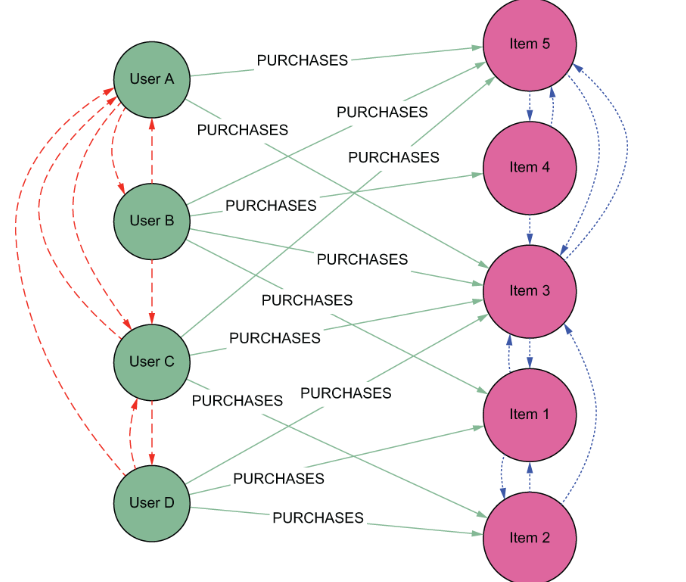

# Collaborative Filtering (CF) --- Codice di Esempio

## User-Based Collaborative Filtering

Faccimo la proiezione del grafo, includendo solo i nodi `User` e le relazioni `INTERACTED` con la proprietà `rating`. In questi modo otteniami un grafo che rappresenta gli utenti simili, cioè gli utenti che hanno interagito con gli stessi item.

```cypher
CALL gds.graph.project(
  'cf-graph',
  'User',
  {
    INTERACTED: {
      type: 'INTERACTED',
      properties: 'rating'
    }
  }
)
```

Calcoliamo la similarità tra gli utenti utilizzando l'algoritmo `similarity.cosine` e memorizziamo nel grafo tramite una relazione `SIMILAR_TO` tra gli user. In questo modo craiamo il **knn-user graph**.

```cypher
CALL gds.nodeSimilarity.stream('cf-graph')
YIELD node1, node2, similarity
MERGE (gds.util.asNode(node1))-[:SIMILAR {similarity: similarity}]->(gds.util.asNode(node2))
```

oppure

```cypher
CALL gds.nodeSimilarity.write('cf-graph', {
  writeRelationshipType: 'SIMILAR',
  writeProperty: 'similarity'
})
```

Fatto questo posso usare queste informazioni per potere fornire raccomandazioni sulla base degli utenti simili, che hannoo acquistato item simili. Durante la raccomandazione scartiamo gli item che l'utente ha già comprato e ordiniamo gli item in base della similarità degli item con cui hanno iteragito utenti simili che li hanno acquistati.



```cypher
MATCH (u:User {id: 'user-id'})-[:INTERACTED]->(i:Item)
MATCH (u)-[sim:SIMILAR]->(similar:User)-[:INTERACTED]->(rec:Item)
WHERE NOT (u)-[:INTERACTED]->(rec)
RETURN rec, sim.similarity
ORDER BY sim.similarity DESC
```

## Item-Based Collaborative Filtering

La stessa logica la applichiami per l'item-based collaborative filtering, ma questa volta proiettiamo un grafo che include solo i nodi `Item` e le relazioni `INTERACTED` con la proprietà `rating`. In questo modo otteniami un grafo che rappresenta gli item simili, cioè gli item che sono stati interagiti dagli stessi utenti.

```cypher
// calcolo della proiezione del grafo, includendo solo i nodi Item e le relazioni INTERACTED con la proprietà rating

CALL gds,graph.project(
  'cf-graph',
  'Item',
  {
    INTERACTED: {
      type: 'INTERACTED',
      properties: 'rating'
    }
  }
)

// calcolo della similarità tra gli item utilizzando l'algoritmo similarity.cosine e memorizzando nel grafo tramite una relazione SIMILAR_TO tra gli item

CALL gds.nodeSimilarity.stream('cf-graph')
YIELD node1, node2, similarity
MERGE (gds.util.asNode(node1))-[:SIMILAR {similarity: similarity}]->(gds.util.asNode(node2))

// raccomandazione basata sugli item simili, scartando gli item che l'utente ha già acquistato e ordinando gli item in base della similarità degli item con cui hanno iteragito utenti simili che li hanno acquistati

MATCH (u:User {id: 'user-id'})-[:INTERACTED]->(i:Item)
MATCH (i)-[sim:SIMILAR]->(similar:Item)<-[:INTERACTED]-(similarUser:User)-[:INTERACTED]->(rec:Item)
WHERE NOT (u)-[:INTERACTED]->(rec)
RETURN rec, sim.similarity
ORDER BY sim.similarity DESC
```

## approccio con gli embeddings

Dopo la proiezione del grafo (user o item che sia), una rappresentazione migliore della similarità tra i nodi è data dagli embeddings, che rappresentano i nodi in uno spazio vettoriale. 

```cypher
CALL gds.fastRP.write('cf-graph', {
  embeddingDimension: 128,
  writeProperty: 'embedding'
})
```

In questo modo ogni nodo avrà una proprietà `embedding` che rappresenta il suo embedding. Per calcolare la similarità tra i nodi, possiamo utilizzare la similarità coseno tra gli embeddings.

```cypher
CALL gds.knn.write('cf-graph', {
  nodeProperties: ['embedding'],
  writeRelationshipType: 'SIMILAR',
  writeProperty: 'score',
  topK: 10,
  similarityCutoff: 0.7
})
```

Per le raccomandazioni si possono usare le stesse query di prima.

## Cold Start Problem - Transitive Method

```cypher
// Definiamo i parametri
:params {targetUserId: 'User_A', alpha: 0.5, maxDepth: 3}

MATCH p = (u:User {id: $targetUserId})-[:PURCHASED*1..3]-(item:Item)
WHERE NOT (u)-[:PURCHASED]->(item)
// Filtriamo per lunghezze dispari (natura bipartita: U->I=1, U->I->U->I=3)
WITH item, nodes(p) AS ns, length(p) AS len
WHERE len % 2 <> 0
// Calcoliamo lo score pesato
WITH item, sum($alpha ^ len) AS totalScore
RETURN item.name AS Recommendation, totalScore
ORDER BY totalScore DESC
LIMIT 10
```