# Recommendation System

Un **sistema di raccomandazione** è uno strumento progettato per recuperare da un ampio insieme di opzioni (come cataloghi di film, prodotti e-commerce, ecc.) degli articoli a cui un utente potrebbe essere interessato. L'obiettivo è prevedere la probabilità che un utente interagisca con un determinato prodotto in futuro, fornendo consigli personalizzati e accurati basati sulle sue preferenze o caratteristiche.

I motivi per cui i sistemi di raccomandazione sono diventati così diffusi e importanti sono molteplici:

- **Aumentare il numero di articoli venduti:** offrire qualsiasi tipologia di raccomandazione.
- **Vendere una maggiore varietà di articoli:** permettere all'utente di selezionare prodotti che potrebbero essere difficili da individuare senza una raccomandazione precisa.
- **Aumentare la soddisfazione dell'utente:** se l'utente ritiene le raccomandazioni interessanti e pertinenti, trarrà maggiore beneficio e piacere dall'utilizzo del sistema.
- **Aumentare la fedeltà dell'utente:** le applicazioni orientate al cliente valorizzano la fidelizzazione riconoscendo gli utenti ricorrenti e trattandoli come visitatori di riguardo. Il tracciamento degli utenti abituali è un requisito comune per i sistemi di raccomandazione, poiché gli algoritmi utilizzano le informazioni acquisite durante le interazioni precedenti.
- **Ottenere una migliore comprensione dei desideri dell'utente:** il sistema di raccomandazione crea un modello delle preferenze dell'utente, le quali vengono raccolte in modo esplicito o previste dal sistema stesso.

I principali **tipi di sistemi di raccomandazione** sono:

- **Collaborative Filtering**
- **Content-Based Filtering**
- **Hybrid Filtering:** Combina le informazioni e le metodologie degli approcci collaborativi e di quelli basati sul contenuto.
- **Sistemi basati su Reti Neurali Grafiche (GNN):** Rappresentano un approccio all'avanguardia in grado di operare su strutture di dati a grafo, catturando relazioni complesse tra utenti e prodotti (ad esempio, organizzandoli come un "grafo bipartito"). Le GNN offrono l'enorme vantaggio di poter combinare sia feedback espliciti (come i rating) sia impliciti (come la cronologia di navigazione e d'acquisto). Inoltre, possono persino integrare fattori contestuali come l'ora del giorno e la posizione geografica per personalizzare le raccomandazioni in modo dinamico.
- **Sistemi basati su Grafi di Conoscenza e LLM:** Utilizzando l'incorporamento del grafo di conoscenza (Knowledge Graph Embedding), i sistemi possono sfruttare reti di nozioni già esistenti sulla correlazione tra vari elementi per generare raccomandazioni anche quando scarseggiano i dati diretti degli utenti. Recenti framework di avanguardia (come il sistema CORONA) introducono nel processo anche i **Large Language Models (LLM)**: questi modelli usano la loro logica per fare ragionamenti sulle preferenze e sugli intenti degli utenti per raffinare i candidati prima dell'intervento predittivo finale del modello a grafo.

Gli **approcci puramente collaborativi** utilizzano come input una matrice di interazioni utente-item (visualizzazioni, acquisti passati, valutazioni, ecc.) per generare i seguenti tipi di output:

* **Una predizione (numerica):** indica la probabilità che l'utente corrente gradisca o meno un determinato item (il cosiddetto *relevance score*).
* **Una lista ordinata dei "top $n$" item:** un elenco di prodotti raccomandati per l'utente, basato sul valore predetto e ordinato dal più probabile al meno probabile.

I sistemi di raccomandazione si basano sulla **User-Item Interaction Matrix** che rappresenta formalmente l'insieme delle preferenze di $n$ utenti verso $m$ item. La matrice $R \in \mathbb{R}^{n \times m}$ è organizzata come segue:

- **Righe ($u$):** Ogni riga rappresenta un utente unico.
- **Colonne ($i$):** Ogni colonna rappresenta un item (prodotto, film, canzone).
- **Valori ($r_{ui}$):** Il contenuto della cella indica l'interazione tra l'utente $u$ e l'item $i$. I valori $r_{ui}$ possono essere di due tipi principali:
  - **Explicit Feedback:** L'utente dichiara apertamente il suo gradimento;
  - **Implicit Feedback:** Il sistema deduce l'interesse dal comportamento (es. click, acquisti, tempo di visualizzazione). In genere è una matrice binaria:
      $$r_{ui} = \begin{cases} 1 & \text{se esiste un'interazione} \\ 0 & \text{altrimenti} \end{cases}$$

La rilevanza è misurata da una funzione di utilità $f$, stimata sulla base del feedback dell'utente. Questa funzione può essere impiegata per calcolare i punteggi di rilevanza per tutti quegli elementi per i quali non sono inizialmente disponibili informazioni (i cosiddetti *missing values* della matrice).

Una volta predetti i punteggi di rilevanza per tutti gli item non ancora visti (o non acquistati), è possibile procedere al loro ordinamento (*ranking*) e mostrare i **top $n$** elementi all'utente, finalizzando così il processo di raccomandazione.

## Content-Based Recommender Systems

Il **Content-Based Filtering** analizza le caratteristiche e gli attributi degli oggetti stessi, come le descrizioni di un prodotto, le parole chiave della trama di un film o il suo regista, e suggerisce articoli simili a quelli per cui l'utente ha già mostrato interesse. È molto efficace per i nuovi utenti poiché non necessita di uno storico comportamentale, ma il suo limite è la dipendenza dalla disponibilità e dalla qualità delle descrizioni degli articoli.
Si basa anche sulla rappresentazione dei profili utente, che descrivono le preferenze e gli interessi di un individuo. Questi profili possono essere costruiti utilizzando dati espliciti (come valutazioni o preferenze dichiarate) o dati impliciti (come cronologia di navigazione o acquisti passati). Il sistema confronta quindi il profilo dell'utente con le caratteristiche degli articoli per generare raccomandazioni personalizzate.

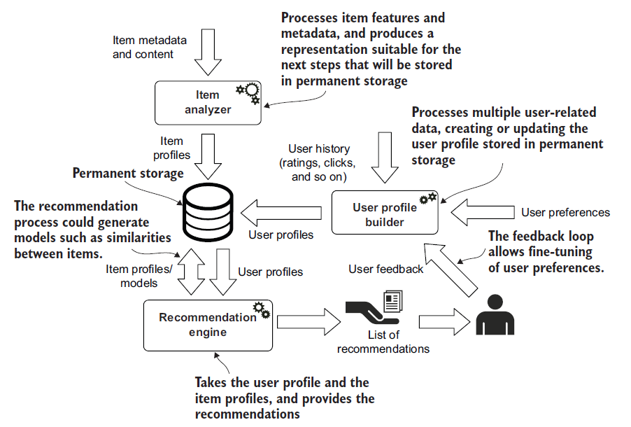{width="70%" height="70%"}

Il processo di raccomandazione si articola in tre componenti principali:

1. **Item Analyzer** Lo scopo principale di questo componente è analizzare gli *item*, estrarre o identificare le *feature* rilevanti e rappresentarle in una forma idonea alle fasi successive. Riceve in input il contenuto dell'elemento e i metadati da diverse fonti, convertendoli in un **modello dell'item**. In questo caso si generano dei **modelli a grafo** di vario tipo, utilizzati per alimentare l'intero processo di raccomandazione.
2. **User Profile Builder** Questo processo raccoglie i dati rappresentativi delle preferenze dell'utente e ne inferisce il profilo. Il set di informazioni può includere:
    - **Feedback esplicito:** preferenze fornite direttamente dall'utente sui propri interessi.
    - **Feedback implicito:** osservazione e memorizzazione del comportamento dell'utente.Il risultato è un grafo che rappresenta l'interesse dell'utente verso un *item*, una sua caratteristica o entrambi. Poiché entrambi i processi restituiscono modelli a grafo, i loro output possono essere combinati in un unico **modello a grafo connesso** e di facile accesso, che fungerà da input per la fase successiva.
3. **Recommendation Engine** Questo modulo sfrutta i profili utente e le rappresentazioni degli elementi per suggerire contenuti rilevanti, facendo combaciare gli interessi dell'utente con le caratteristiche degli *item*. In questa fase, viene costruito un **modello di predizione** per generare un punteggio di rilevanza per ogni elemento e per ogni utente; tale punteggio viene poi utilizzato per classificare e ordinare (*ranking*) gli elementi da suggerire. Alcuni algoritmi pre-calcolano valori rilevanti, come la similarità tra gli *item*, per velocizzare la fase di predizione. Questi nuovi valori vengono poi salvati nel grafo, arricchendolo con ulteriori dati inferiti dai profili.

### Rappresentazione dei profili utente e degli item

Le **feature** sono le caratteristiche che descrivono un *item* e che possono essere utilizzate per confrontarlo con altri.

Dalle feature testuali è difficile estrarre informazioni utili, se non facendo affidamento sul techine di NLP. Un modo più semplice è quello di utlizzare le parole chiavi per descrivere un item. Quindi creeremo un grafo in cui i nodi rapprensentano l'item e che hanno come property le parole chiave che lo descrivono. 

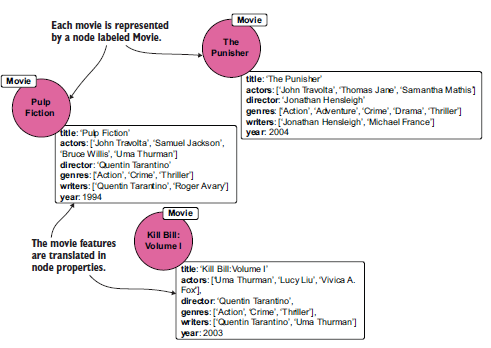{width="70%" height="70%"}

Questa modellazione è semplice ma ha problemi di *data duplication*, perché se un item ha molte parole chiave, queste vengono duplicate per ogni item che le condivide; è difficile da estendere, perché se vogliamo aggiungere nuove parole chiave, dobbiamo modificare tutti i nodi item che le condividono; è difficile da mantenere, perché se una parola chiave cambia, dobbiamo modificare tutti i nodi item che la condividono.

Una rappresentazione migliore è quelle di descrivere le feature ricorrenti come nodi e di modellare le relazioni tra item e feature con degli archi.
Un vantaggio di questa rappresentazione è quella di usare **label multiple** per lo stesso nodo. QUesto perchè si vuuole che ogni persona sia rappresentata in modo univoco, indipendentemente dal ruolo ricoperto con cui partecipa.

!!!tip Per questa ragione, si preferisce l'istruzione MERGE rispetto a CREATE e si utilizza un'etichetta comune per tutti i soggetti. Il modello a grafi assegna un'etichetta specifica per ogni ruolo ricoperto dalla persona.

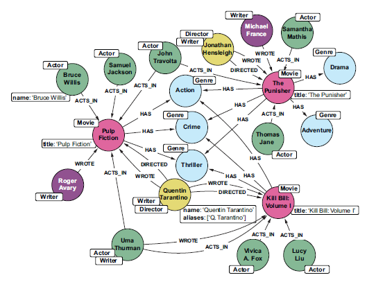{width="70%" height="70%"}

Il nuovo modello a grafi ottimizza la gestione dei dati attraverso quattro vantaggi chiave:

* **Zero duplicazioni:** Ogni entità è un nodo unico, cambiano solo le relazioni, non i dati. Questo permette anche di gestire facilmente diversi alias per lo stesso soggetto.
* **Integrità del dato:** Poiché l'informazione è centralizzata e non replicata tra mille proprietà, identificare e correggere refusi o errori diventa immediato.
* **Scalabilità fluida:** Puoi arricchire il modello creando gerarchie in modo naturale, migliorando la pulizia delle query.
* **Accesso multidirezionale:** Non sei più vincolato a cercare partendo da un oggetto specifico; ogni nodo o relazione è un potenziale punto di ingresso, rendendo la navigazione del database estremamente flessibile.

Modellati gli item bisogna modellare i profili utente in modo che vengono messe in evidenza le loro preferenze. Possiamo collezionare le preferenze in modo implicito o esplicito, ma in entrambi i casi, il risultato è un grafo che rappresenta l'interesse dell'utente verso un *item*, una sua caratteristica o entrambi. Poiché entrambi i processi restituiscono modelli a grafo, i loro output possono essere combinati in un unico **modello a grafo connesso** e di facile accesso, che fungerà da input per la generazione delle raccomandazioni.

Nel modo implicito, le preferenze vengono inferite dalle interazioni dell'utente con gli item, mentre, nel modo esplicito, l'utente fornisce direttamente le sue preferenze attraverso feedback o valutazioni. 

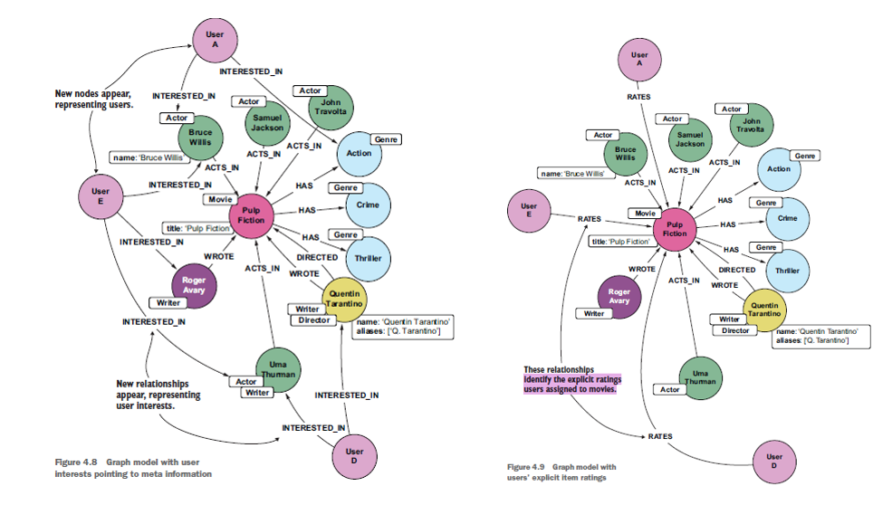{width="70%" height="70%"}

Da questi feedback espliciti è possibile fare inferenza sulle preferenze degli utenti e modellare poi nel grafo le relazioni di interesse, in modo chel'utente sia collegato direttamente alle feature che gli interessano,facilitando la generazione di raccomandazioni personalizzate.

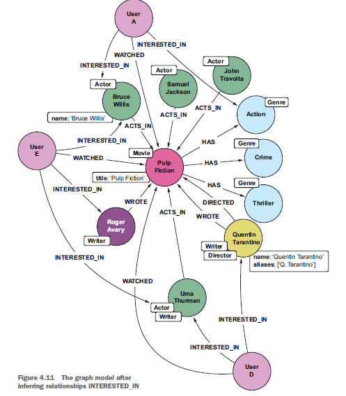{width="70%" height="70%"}

### Generazione di raccomandazioni

Il processo per la generazione di raccomandazioni consiste nel confrontare gli attributi del profilo dell'utente target (in cui sono modellati interessi e preferenze) con gli attributi degli elementi (*item*), al fine di individuare quelli simili a ciò che l'utente ha apprezzato in passato. Il risultato è un **punteggio di rilevanza** che predice il livello di interesse dell'utente per tali elementi.

Durante la fase di raccomandazione, un sistema **CBRS** utilizza i profili utente per far corrispondere gli utenti agli elementi che hanno maggiore probabilità di essere di loro interesse. A seconda delle informazioni disponibili e dei modelli definiti sia per gli utenti che per gli *item*, possono essere impiegati diversi algoritmi o tecniche.

#### Primo approccio per fornire raccomandazioni: Feature Overlap

Il primo approccio nell'andare ad indicare  esplicitamente nel grafo gli interessi degli utenti, oppure viene inferito dalle interazioni utente-item. Questo approccio è applicabile quando:

- **Gli item sono rappresentati da un elenco di feature** correlate agli stessi, come tag, parole chiave, generi e attori.
- **I profili utente sono rappresentati collegando gli utenti alle feature** di loro interesse. Queste connessioni sono descritte in forma binaria: *mi piace* (nel grafo, rappresentato da un **arco** tra l'utente e la feature) e *non mi piace/sconosciuto* (rappresentato dall'assenza di un arco). Quando non sono disponibili informazioni esplicite, gli interessi possono essere inferiti da altre fonti (esplicite o implicite), tramite una query sul grafo.

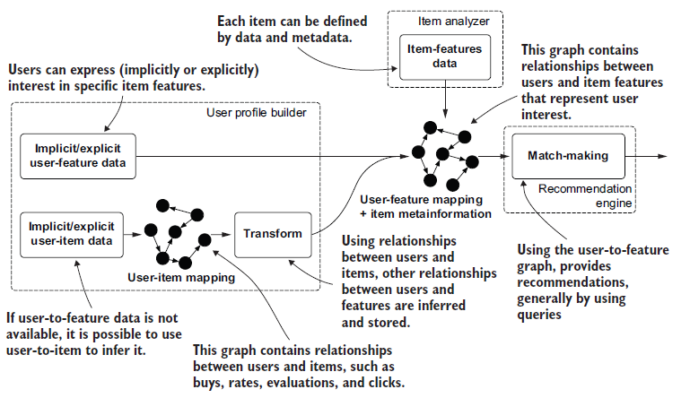{height="50%"}

In questo caso, avendo il grafo, una semplice query è sufficiente per fornire le raccomandazioni. I dati contengono già informazioni sufficienti e la struttura del grafo aiuta a calcolare il punteggio e a restituire l'elenco ordinato all'utente senza la necessità di pre-costruire alcun modello; di fatto, **il modello di descrizione e quello di predizione si sovrappongono**.

Questo approccio puramente basato su grafi è semplice, e presenta vantaggi come:

- **Produce buoni risultati:** La qualità delle raccomandazioni è piuttosto elevata, considerando lo sforzo limitato richiesto da questo metodo.
- **È semplice:** Non richiede calcoli onerosi o codice complesso per leggere e pre-elaborare i dati prima di fornire le raccomandazioni. Se i dati sono modellati correttamente nel grafo, è possibile eseguire le query e rispondere agli utenti in **tempo reale**.
- **È estensibile:** Il grafo può contenere altre informazioni utili per raffinare i risultati in base ad altre fonti di dati o informazioni contestuali. Le query possono essere facilmente modificate per tenere conto di nuovi aspetti.

#### Secondo approccio per fornire raccomandazioni: Feature Similarity

Alcuni problemi di questo primo approciio è che l'interesse dell'utente per una determinata *feature* di un *item* è rappresentato da un valore booleano, che non attribuisce alcun **peso** specifico alla relazione. Inoltre, il conteggio delle feature sovrapposte (*overlapping*) tra profili utente e *item* non è sufficiente. È necessaria una funzione che calcoli la similarità o i tratti comuni tra gli interessi dell'utente e gli elementi del sistema.

Invece di limitarsi a contare le *feature* in comune, un metodo più efficace per individuare *item* interessanti per un utente specifico consiste nel misurare la **similarità** tra il profilo utente e le caratteristiche dell'elemento: minore è la distanza (ovvero, maggiore è la vicinanza), migliore sarà il suggerimento.

Una può essere la **similarità del coseno** (*cosine similarity*), che misura l'angolo tra due vettori in uno spazio multidimensionale. Il risultato è un valore compreso tra -1 e 1, dove 1 indica una perfetta similarità, 0 indica nessuna similarità e -1 indica una completa dissimilarità.
$$\text{sim}(A, B) = \frac{A \cdot B}{\|A\| \|B\|}$$

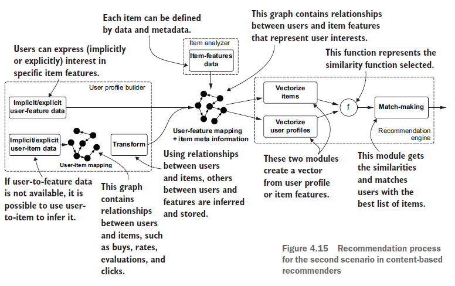{height="50%"}

Questa richiede che ogni *item* e ogni profilo utente siano proiettati in un **modello di spazio vettoriale** comune (**VSM**, *Vector Space Model*) ciò implica che ogni elemento debba essere rappresentato da un vettore a dimensione fissa.

##### Rappresentazione degli item

La rappresentazione più comune è quella di utilizzare un **vettore binario** in cui ogni dimensione rappresenta una *feature* specifica, e il valore è 1 se l'item o il profilo utente possiede quella *feature*, altrimenti è 0.

!!!tip Creazione dei vettori binari con Cypher
    In Cypher, per la creazione dei vettori binari, si può utilizzare la funzione `apoc.coll.contains` per verificare se un nodo contiene tutte le *feature* di interesse, restituendo un vettore binario che rappresenta la presenza o l'assenza di ciascuna *feature*.
    ```cypher
    // 1. Definiamo il "vocabolario" globale di feature
    MATCH (f)
    WHERE "Genre" IN labels(f) OR "Director" IN labels(f)
    WITH collect(f) AS globalFeatures
    ORDER BY id(f)

    // 2. Identifichiamo il film e le sue specifiche relazioni
    MATCH (m:Movie) WHERE m.title STARTS WITH "Pulp Fiction"
    OPTIONAL MATCH (m)-[:DIRECTED|HAS]-(mf)
    WITH globalFeatures, collect(mf) AS movieFeatures

    // 3. Generiamo il vettore binario usando APOC
    RETURN [f IN globalFeatures | 
        CASE WHEN apoc.coll.contains(movieFeatures, f) THEN 1 ELSE 0 END
    ] AS binaryVector
    ```

    Oppure se volessimo farlo noi stessi, potremmo utilizzare una combinazione di `CASE` e `COLLECT` per costruire manualmente il vettore binario in base alle *feature* presenti nel grafo.

    ```cypher
    MATCH (feature)
    WHERE "Genre" in labels(feature) OR "Director" in labels(feature)
    WITH feature
    ORDER BY id(feature)
    MATCH (movie:Movie)
    WHERE movie.title STARTS WITH "Pulp Fiction"
    OPTIONAL MATCH (movie)-[r:DIRECTED|HAS]-(feature)
    RETURN CASE WHEN r IS null THEN 0 ELSE 1 END as Value,
    CASE WHEN feature.genre IS null THEN feature.name ELSE feature.genre END as Feature
    ```

Per ridurre il numero di calcoli, dobbiamo considerare che nella matrice user-item, non tutti gli elementi sono rilevanti per ogni utente. Ci sono prodotti che l'utente non prendere mai insieme e quindi la similarità risulta essere zero, senza effettuare il calcolo. Per questo motivo, è necessario filtrare gli *item* da confrontare con il profilo utente, limitando il calcolo della similarità solo a quelli che condividono almeno una *feature* in comune. In questo modo, si riduce drasticamente il numero di confronti necessari, migliorando l'efficienza del processo di raccomandazione.

Un problema della rappresntazione vettoriale binaria è che due items diversi potrebbero avere la stessa rappresentazione vettoriale, ma avere caratteristiche diverse. Allora, possiamo aggiunge al vettore una **feature numerica** che rappresenta una qualche caratteristica dell'item, come ad esempio il numero di recensioni positive ricevute, o il numero di volte che è stato acquistato. Questa viene pesata per un **fattore di scaling $\alpha$**  che impedisce che questa feature numerica domini  la similarità.

!!!note Aiuta il calcolo della Cosine Similarity a discriminare tra item semanticamente molto simili o identici, spingendo più in alto nel ranking quello che statisticamente ha un gradimento superiore.

##### Rappresentazione dei profili utente

Dobbiamo rappresentare i profili utente nello stesso spazio vettoriale in cui sono rappresentati gli item, in modo da poter calcolare la similarità tra i due, quindi li dobbiamo rappresentare come vettori, le cui componenti devono essere le stesse di quelle degli items e avere lo stesso ordine.

Lo spazio vettoriale ha le feature come dimensioni, quindi dobbiamo trasformare la matrice user-item in una user-feature, in cui ogni riga rappresenta un utente e ogni colonna rappresenta una feature, includendo l’aggregazione tramite conteggio delle occorrenze di ciascuna feature nella lista degli item già apprezzati dall’utente. Questa opzione funziona bene per valori booleani; un’altra opzione è calcolare i valori medi per feature numeriche.
La matrice user-item conterrà anche una nuova colonna che rappresenta il numero totale per quegli item.

Poi nel grafo andremo a materializzare la relazione di interesse tra l'utente e le feature, con un peso che rappresenta il grado di interesse dell'utente per quella feature. In questo modo, quando calcoliamo la similarità tra il profilo utente e un item, possiamo tenere conto di quanto l'utente è interessato a ciascuna feature, migliorando la precisione delle raccomandazioni.

Tuttavia, i numeri nella tabella potrebbero portare a calcoli errati delle similarità tra il vettore del profilo utente e il vettore dell’item. Devono essere normalizzati per rappresentare meglio il reale interesse di un utente verso una specifica feature. Se un utente ha visto 50 film e solo 5 sono drammi, ad esempio, potremmo concludere che quell’utente è meno interessato a questo genere rispetto a un utente che ha visto 3 drammi su un totale di 10 film, anche se il primo utente ha visto un numero assoluto maggiore di film di quel tipo.

!!!tip Non si consiglia di memorizzare i risultati del processo di normalizzazione come pesi nel grafo, perché questi risultati dipendono dal numero totale di film visti dall’utente. Memorizzare tali valori richiederebbe di ricalcolare ogni peso ogni volta che l’utente guarda un nuovo film. Se memorizziamo solo i conteggi come pesi, quando un utente guarda un nuovo film, solo le feature coinvolte devono essere aggiornate

Nel caso esplicito, queste informazioni sui pesi possono essere raccolte chiedendo all’utente di assegnare valutazioni a un insieme di possibili feature degli item. I valori associati possono essere memorizzati come proprietà sugli archi tra utenti e feature.

##### Generazione di raccomandazioni tramite similarità

Avendo le rappresentazioni vettoriali di item e profili utente, possiamo calcolare la similarità tra i due per generare raccomandazioni. Tuttavia, questo approccio presenta alcune limitazioni:

- **Non è scalabile:** Se abbiamo milioni di utenti e milioni di item, il numero di confronti necessari per calcolare la similarità tra ogni utente e ogni item diventa proibitivo.
- **Non è flessibile:** Se vogliamo aggiungere nuove feature o modificare quelle esistenti, dobbiamo ricalcolare tutte le rappresentazioni vettoriali e le similarità, il che può essere molto dispendioso in termini di tempo e risorse.
- **Non è accurato:** La similarità calcolata tra il profilo utente e l’item potrebbe non riflettere realmente le preferenze dell’utente, soprattutto se le feature utilizzate non sono sufficientemente rappresentative o se l’utente ha interessi molto specifici che non sono catturati dalle feature.

#### Terzo approccio per fornire raccomandazioni: Similarità tra item

Il terzo approccio che consideriamo per le raccomandazioni basate sul contenuto (CBRS) è quello di calcolare la similarità rilevanti tra gli item e si basa sull'assunto fondamentale di raccomandare item simili a quelli che l'utente ha già apprezzato in passato. In questo caso, si modellano le preferenze degli utenti collegandoli direttamente agli item, senza passare per le *feature* che li descrivono.

Questo approccio si rende necessario quando i metadati scarseggiano, sono limitati o irrilevanti, rendendo impossibile estrarre l'interesse dell'utente per specifiche feature. Ovviamente per fare ciò è necessaria una descrizione del contenuto dell'item, altrimenti non è possibile calcolare la similarità tra item.
Anche quando i metadati sono ampiamente disponibili, questo terzo approccio (noto come tecnica di *similarity-based retrieval*) supera nettamente il precedente in termini di accuratezza. È un metodo fondamentale per diversi motivi:

- Utilizza diverse rappresentazioni degli item per il calcolo delle similarità.
- Le similarità sono estremamente facili da memorizzare nel grafo sotto forma di relazioni tra gli item. Questo è un caso d'uso perfetto per la modellazione a grafo: navigare le relazioni di similarità permette di generare raccomandazioni in modo estremamente rapido.
- È abbastanza flessibile e generale da poter essere applicato in innumerevoli scenari, indipendentemente dal tipo di dato disponibile per i singoli item.

!!!warning La differenza rispetto al *collaborative filtering* è che qui le similarità tra gli item vengono calcolate utilizzando **esclusivamente** i dati relativi agli item stessi. Le interazioni utente-item entrano in gioco solamente nella fase finale di raccomandazione.

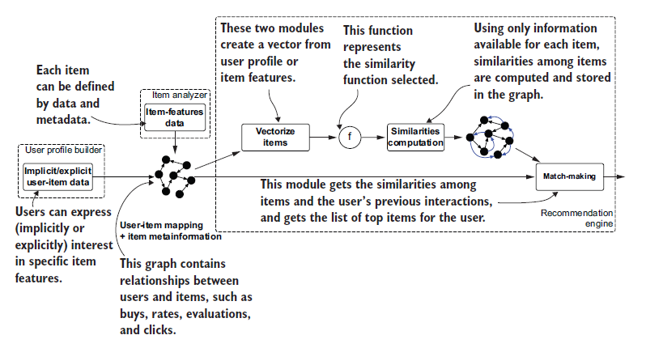{height="50%"}

Le tre componenti fondamentali sono:

1. **Profilo Utente (User profile):** È rappresentato modellando le interazioni storiche dell'utente (es. *valutato*, *comprato*, *guardato*). Nel grafo, queste sono semplici relazioni (archi) tra il nodo utente e i nodi item.
2. **Rappresentazione dell'Item:** Per calcolare le similarità tra gli item, dobbiamo rappresentarli in modo quantificabile. Il "come" dipende strettamente dalla funzione matematica scelta per la misurazione.
3. **Funzione di Similarità:** È l'operatore che, date due rappresentazioni, restituisce un punteggio di similarità.

!!!warning Qui il modello descrittivo dei dati non coincide con quello predittivo, rendendo necessario uno step di pre-computazione.

Una metrica tipica, adatta per caratteristiche multivalore, è il **Coefficiente di Dice** per cui ogni item $I_i$ è descritto da un set di feature. Il coefficiente misura la similarità calcolando l'intersezione delle feature moltiplicata per due, divisa per la somma totale delle feature presenti nei due item, come:

$$Dice(I_i, I_j) = \frac{2 \times |features(I_i) \cap features(I_j)|}{|features(I_i)| + |features(I_j)|}$$

Una volta calcolate, le similarità possono essere re-iniettate e salvate direttamente nel grafo. Dal punto di vista architetturale, non è necessario memorizzare gli archi tra *tutte* le possibili coppie di nodi. Generalmente, si imposta una soglia minima di similarità o si definisce un parametro $k$, conservando solo i $k$ item più simili. Questi metodi sono detti **k-Nearest Neighbor (k-NN)** e consentono di mantenere un grafo più snello e facilmente navigabile, evitando di sovraccaricare il sistema con relazioni poco significative.

!!!note k-NN Graph
    Gli **k-nearest neighbor graph** (o network), modellano i $k$ vicini più rilevanti creando un arco orientato da $v_i$ a $v_j$ se $v_j$ rientra tra i $k$ elementi più simili a $v_i$, non è garantito che valga il viceversa (il nodo $v_j$ potrebbe avere un set di vicini completamente diverso e con score più alti). Una volta identificati i top-$k$ nodi, si collegano con una relazione che ha il valore di similarità memorizzato come proprietà dell'arco stesso. Questo grafo viene poi interrogato durante la fase di predizione.
    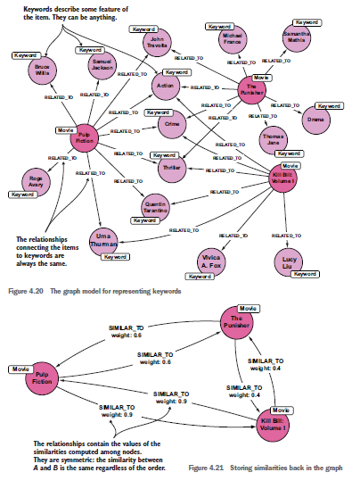{width="60%" height="60%"}

!!!tip Il coefficiente di Dice è rapido, ma la qualità delle raccomandazioni è scarsa, usa pochissime informazioni. Un metodo migliore consiste nell'usare la **Cosine Similarity**. Gli item vengono vettorializzati esattamente come nel secondo approccio, ma la differenza sostanziale è che, anziché calcolare il coseno tra il profilo utente e l'item, lo si calcola per ogni singola coppia di item, salvando poi le top-$k$ corrispondenze nel grafo.

Il passo successivo consiste nel generare le raccomandazioni sfruttando la rete k-NN e le preferenze implicite o esplicite dell'utente verso gli item. L'obiettivo finale del task è predire quali elementi non ancora visti, comprati o cliccati potrebbero suscitare l'interesse dell'utente.

Questo può essere implementato in diversi modi:

1. **Meccanismo di Voting**: la predizione dell'interesse per un item non ancora visto $d$ da parte di un utente $u$ si basa su un meccanismo a votazione. Si analizzano i $k$ item più simili all'item $d$. Ognuno di questi item simili "esprime" un voto per $d$ se l'utente $u$ lo ha precedentemente guardato o valutato. Se, per esempio, l'utente ha apprezzato 4 dei $k=5$ item più simili a $d$, il sistema deduce che la probabilità che l'utente apprezzi anche $d$ sia elevata.
2. **Somma delle Similarità**: più accurato del primo, e si basa sulla stima dell'interesse di un utente per un determinato item calcolando la somma di tutte le similarità tra l'item *target* e il set di item con cui l'utente ha già interagito in passato. $$score(u, d) = \sum_{i \in Items(u)} sim(d, i)$$ dove:
   - $Items(u)$ è l'insieme degli item con cui l'utente $u$ ha interagito (ad esempio, quelli che ha guardato, valutato positivamente o acquistato).

- [[9_1_CBRS_code.md]]

## Collaborative Filtering

Un **approccio content-based** è attuabile solo se è possibile attingere a informazioni dettagliate sugli utenti (attributi del profilo, preferenze) e sugli item (proprietà intrinseche). Al contrario, se è disponibile solo il **feedback implicito**, è necessario ricorrere a un approccio di **collaborative filtering** che  analizza il comportamento passato degli utenti  per consigliare prodotti che sono stati apprezzati da altri individui con gusti simili. Il difetto principale di questo sistema è la difficoltà nell'effettuare raccomandazioni per i nuovi utenti (o item) che non hanno ancora uno storico (**cold-start**).

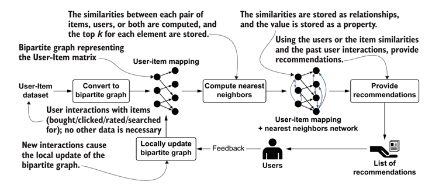{width="70%" height="70%"}

Gli svantaggi sono:

- **sparsità dei dati**: la matrice di interazione è spesso molto sparsa, con la maggior parte degli utenti che interagisce solo con una piccola frazione del catalogo, rendendo difficile trovare utenti o prodotti simili.
- **scalabilità**: con milioni di utenti e prodotti, il numero di interazioni è enorme, rendendo difficile calcolare le similarità in tempo reale.
- **bias di popolarità**: i sistemi tendono a raccomandare principalmente i prodotti più popolari, trascurando quelli di nicchia che potrebbero essere più adatti a specifici utenti.
- **mancanza di spiegabilità** e **sensibilità al rumore**: difficoltà di valutare e pesare le review fornite dall'utente, di cui alcune possono essere false, scritte apposta d qualcuno per danneggiare il prodotto anche se non lo ha mai acquistato. Lo stesso può farlo pre favorire un prodotto, scrivendo recensioni positive anche se non lo ha mai acquistato.

Abbiamo due tipi di approcci per il collaborative filtering:

- **memory-based** dove le raccomandazioni sono generate guardando ai loro vicini basandosi sulle preferenze passate. Sono quini basati su misure di similarità calcolare tra utenti o tra item.
- **model-based** dove le raccomandazioni vengono tratte come task di rpedizioni, e quindi ci si basa su algoritmi di ML/DL per costruire un modello predittivo che possa generalizzare le preferenze degli utenti e fare previsioni su nuovi dati.

### Memory-based Collaborative Filtering

Analizziamo il modello **memory-based** che si basa su varie fasi:

1. creazione del grafo bipartito e proiezione
2. costruzione della nearest neighbors network
3. processo di raccomandazione
4. valutazione del sistema di raccomandazione

#### Creazione del grafo bipartito e proiezione

Il processo inizia convertendo i dati di valutazione in una matrice di utilità, dove le righe rappresentano l'elenco degli utenti e le colonne l'elenco degli elementi. Il dataset viene modellato come un **grafo bipartito** $G = (U \cup I, E)$ dove l'insieme dei vertici è diviso in due classi disgiunte:

- **Nodi Utente ($U$):** Rappresentano i consumatori.
- **Nodi Item ($V$):** Rappresentano i prodotti (es. libri, film).

Le **interazioni** (acquisti, "like", visualizzazioni) sono modellate come **archi (edges)** che collegano esclusivamente nodi di tipo $U$ a nodi di tipo $V$. È possibile arricchire questa rappresentazione assegnando dei **pesi** agli archi per indicare l'intensità dell'interazione (ad esempio, il rating assegnato o la frequenza di acquisto). A differenza dei metodi lineari, il grafo permette di catturare la **connettività di ordine superiore (high-order connectivity)**. Se l'utente $A$ ha acquistato l'item $1$, e l'utente $B$ ha acquistato lo stesso item, esiste un cammino di lunghezza 3 ($A \to 1 \to B \to 2$) che suggerisce che l'utente $A$ potrebbe essere interessato all'item $2$, anche se non vi è interazione diretta.

Per semplificare l'analisi e focalizzarsi sulle relazioni interne a una singola categoria, il grafo bipartito viene proiettato in due sottografi distinti:

- **Proiezione Utente (U-mode):** Collega due utenti se hanno interagito con almeno un item in comune. Utile per identificare segmenti di clientela simili.
- **Proiezione Item (V-mode):** Collega due prodotti se sono stati scelti dallo stesso utente. 

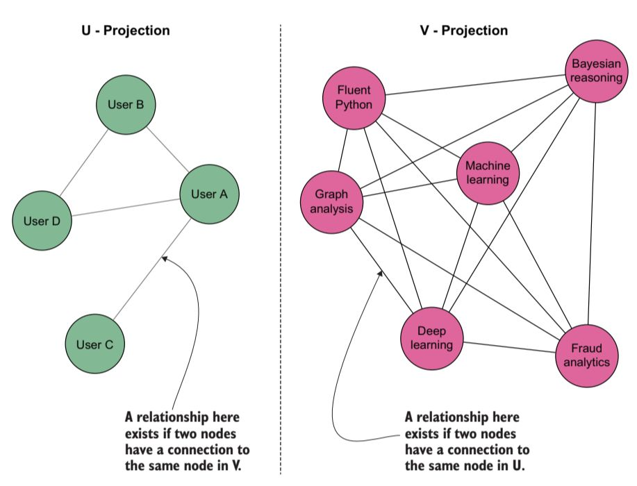{width="70%" height="70%"}

Poiché la proiezione semplice perde informazioni (non dice *quanti* utenti hanno acquistato entrambi gli oggetti), si passa alla **proiezione ponderata**, trasformando la proiezione in una **rete di co-occorrenza**. Il peso dell'arco tra due item $v_1$ e $v_2$ rappresenta il numero di utenti comuni (co-occorrenze). Questo permette di mantenere la "potenza" informativa del grafo bipartito originale pur lavorando su una dimensione ridotta.

Una volta ottenute le proiezioni, si applicano algoritmi di **Graph Clustering** per:

* **Individuare Cluster di Prodotti:** Gruppi di item spesso acquistati insieme.
* **Segmentazione del Mercato:** Identificare gruppi di utenti con gusti omogenei.
* **Visualizzazione:** Rilevare pattern complessi che rimarrebbero nascosti in una semplice matrice Utente-Item.

L'approccio ideale prevede la creazione di sistemi isolati per ogni tipo di interazione (es. un grafo per i "click", uno per i "purchase") da integrare successivamente in un **sistema ibrido**. Questo permette di pesare diversamente i segnali "deboli" (visualizzazioni) rispetto a quelli "forti" (acquisti) prima del calcolo finale della raccomandazione.

#### Costruzione della Nearest Neighbors Network

Il passo successivo nel processo di raccomandazione consiste nel calcolare le somiglianze tra gli elementi (utenti, articoli o entrambi) e nel costruire la **rete dei vicini più prossimi (Nearest Neighbors)**.

Esistono due approcci principali per la raccomandazione **memory-based** nel collaborative filtering:

- **Item-based:** Le somiglianze sono calcolate tra gli articoli in base agli utenti che vi hanno interagito (rating, acquisti, click).
- **User-based:** Le somiglianze sono calcolate tra gli utenti in base alla lista di articoli con cui hanno interagito.

A differenza dell'approccio *content-based*, nei metodi basati sul vicinato le informazioni utilizzate derivano **esclusivamente dalle interazioni** disponibili nel dataset Utente-Item. Ogni elemento è identificato solo da un ID (un nodo senza proprietà descrittive). Il vantaggio è che il modello può essere creato senza conoscere i dettagli di prodotti o utenti.

La procedura segue tre step fondamentali:

1. **Selezione della funzione di somiglianza:** Identificare una metrica (es. **Coseno di Somiglianza**) per calcolare le distanze tra elementi omogenei nel grafo.
2. **Rappresentazione Vettoriale:** Rappresentare ogni elemento in un formato adatto alla funzione scelta (Vector Space Model - VSM).
3. **Calcolo e Memorizzazione:** Eseguire il calcolo e memorizzare i valori di somiglianza direttamente nel grafo.

Il grafo offre la flessibilità di estrarre vettori per entrambi gli approcci tramite semplici query, ma l'efficienza computazionale dipende dalla natura del vettore:

1. **Vettori Densi (Dense Vectors)** tipici del *content-based*, dove il numero di feature (attori, generi, tag) è limitato (es. 10.000-20.000). Hanno un numero relativamente alto di valori diversi da zero rispetto alla loro dimensione.
2. **Vettori Sparsi (Sparse Vectors)** tipici dell'e-commerce con milioni di prodotti e utenti. Anche l'utente più attivo acquisterà solo una frazione infinitesimale del catalogo. La stragrande maggioranza dei valori è pari a zero.

Quindi posssiamo passare dalla rapresentazione della matrice Utente-Item a una rappresentazione vettoriale per ogni elemento (utente o prodotto) e calcolare la somiglianza tra di essi. Ad esempio, nel caso di un sistema basato su user, ogni user è rappresentato da un vettore che indica quali prodotti ha acquistato o valutato positivamente. La somiglianza tra due prodotti può essere calcolata utilizzando il coseno dell'angolo tra i loro vettori, che misura quanto sono simili in termini di utenti che li hanno scelti.

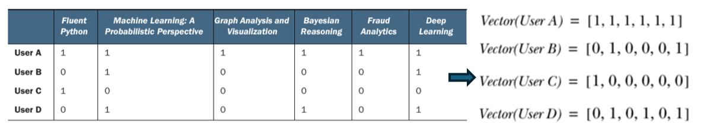{width="70%" height="70%"}

Stesso ragionamento vale per un sistema basato su item, dove ogni prodotto è rappresentato da un vettore che indica quali utenti lo hanno acquistato o valutato positivamente. La somiglianza tra due utenti può essere calcolata utilizzando il coseno dell'angolo tra i loro vettori, che misura quanto sono simili in termini di prodotti che hanno scelto.

È possibile rappresentare un **vettore sparso** in diversi modi per ottimizzare la memoria e semplificare la manipolazione dei dati. In Java, molti di questi metodi sono disponibili in **Apache Mahout**, un framework di algebra lineare distribuita per applicazioni di machine learning scalabili.

Per il calcolo della somiglianza, una rappresentazione ottimizzata prevede l'uso di un singolo array di `float` o `double` strutturato in modo compatto per ridurre l'occupazione di memoria nei nodi del grafo.

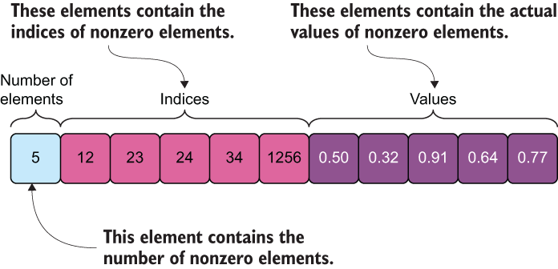{width="70%" height="70%"}

* **Elemento 0:** Contiene il numero $N$ di valori non nulli presenti nel vettore originale.
* **Da 1 a $N$:** Contiene gli **indici** delle posizioni dei valori non nulli.
* **Da $N+1$ alla fine:** Contiene i **valori** effettivi corrispondenti a quegli indici.

Questo formato permette di memorizzare vettori lunghi e complessi come proprietà dei nodi con un impiego minimo di risorse, un vantaggio critico quando si processano dataset di grandi dimensioni.

Una volta estratti i vettori (per utenti o articoli), il processo per costruire la rete dei **vicini più prossimi (k-Nearest Neighbors)** segue quattro step iterativi:

1. **Calcolo della Somiglianza:** Si calcolano le somiglianze tra tutti gli elementi in modo omogeneo (utente con utente, articolo con articolo).
2. **Ordinamento:** Le somiglianze ottenute vengono ordinate in modo decrescente.
3. **Filtraggio (Top-k):** Si mantengono solo i primi $k$ elementi più simili (dove $k$ è un parametro predefinito) oppure si applica una **soglia minima (threshold)** di somiglianza.
4. **Persistenza nel Grafo:** I top $k$ elementi simili vengono memorizzati nel database come **nuove relazioni** tra i nodi.

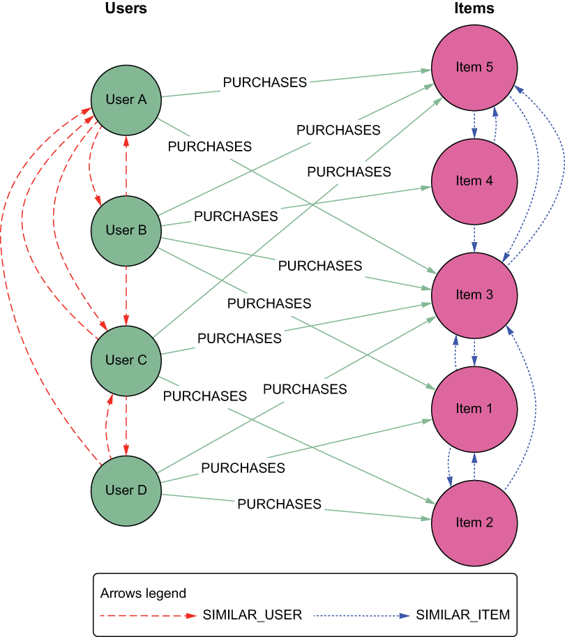{width="70%" height="70%"}

Si possono identificare all'interno della stessa struttura tre **sottografi** altamente rilevanti, filtrando semplicemente nodi e archi:

* **Il Grafo Bipartito Originale:** Composto dai nodi Utente ($U$) e Item ($I$), collegati esclusivamente dalle relazioni di interazione (es. `ACQUISTO`).
* **La Rete $k$-NN degli Utenti:** Un sottografo che include solo i nodi $U$ e le relazioni di `SIMILARITY`. Rappresenta la rete dei vicini più prossimi per gli utenti.
* **La Rete $k$-NN degli Item:** Un sottografo che include solo i nodi $I$ e le relazioni di `SIMILARITY`. Rappresenta la rete dei vicini più prossimi per i prodotti.
  
Questo processo non si limita a preparare i dati per la raccomandazione finale, ma "distilla" nuova conoscenza dal grafo bipartito originale e la memorizza in una forma che serve a molteplici scopi analitici:

1. **Clustering degli Item:** Applicando algoritmi di clustering (come il *community detection*) sulla rete $k$-NN degli articoli, è possibile identificare gruppi di prodotti che tendono a essere acquistati insieme o film guardati dallo stesso target di utenza.
2. **Segmentazione degli Utenti:** Gli stessi algoritmi, applicati alla rete $k$-NN degli utenti, permettono di definire segmenti di clientela con gusti omogenei.
3. **Ricerca di Prodotti Simili:** La rete $k$-NN degli item è di per sé un asset prezioso. Se un utente visualizza un prodotto specifico, il sistema può interrogare il grafo e restituire istantaneamente una lista di articoli correlati seguendo la relazione di `SIMILARITY`. Grazie alla struttura a grafi, questa operazione è estremamente performante.

#### Processo di raccomandazione

L'ultima fase del processo di raccomandazione consiste nel fornire una lista di suggerimenti all'utente nel momento in cui questa risulta necessaria o di valore. L'output del processo produce due tipologie di dati:

* **Punteggi di Rilevanza (Relevance Scores):** Predizioni numeriche che indicano il grado di gradimento (quanto un utente potrebbe apprezzare o meno un determinato articolo).
* **Raccomandazioni (Top-N List):** Una lista di $N$ articoli suggeriti. Questa lista non deve contenere articoli che l'utente ha già acquistato, a meno che non si tratti di prodotti a consumo ricorrente.

##### Approccio User-based

Nell'approccio **User-based**, dato un utente attivo, il grafo bipartito delle interazioni e la rete dei vicini più prossimi, il sistema calcola una predizione per ogni prodotto $p$ che l'utente non ha ancora visto. La predizione si basa sui feedback (rating) forniti dai "peer users" (gli utenti nella rete $k$-NN dell'utente attuale). Il presupposto di questo metodo è che:

1. Se due utenti hanno avuto gusti simili in passato, li avranno anche in futuro.
2. Le preferenze degli utenti rimangono stabili e coerenti nel tempo.

Quando le interazioni hanno un peso (es. voti da 1 a 5), la formula per predire il rating che l'utente $a$ assegnerebbe all'articolo $p$ è generalmente una media pesata basata sulla somiglianza dei vicini:

$$\hat{r}_{a,p} = \frac{\sum_{b \in KNN(a)} \text{sim}(a, b) }{\sum_{b \in KNN(a)} \text{sim}(a, b)} \cdot r_{b,p}$$

dove: 

- $KNN(a)$ rappresenta i $k$ vicini più prossimi dell'utente $a$,
- $r_{b,p}$ è il rating assegnato dal vicino $b$ al prodotto $p$ (pari a 0 se il vicino non ha interagito con l'articolo).

In molti casi non abbiamo un rating ma un valore binario (0 o 1). Una delle formule più efficaci e diffuse per questo scenario è:

$$\text{score}(a, p) = \frac{\sum_{b \in KNN(a)} r_{b,p}}{|KNN(a)|}$$

In questo caso, $r_{b,p}$ è 1 se il vicino $b$ ha acquistato il prodotto $p$, e 0 altrimenti. La somma indica quanti dei vicini più prossimi hanno acquistato l'articolo, normalizzata per il numero totale di vicini ($|KNN(a)|$).

!!!tip Una volta costruita la rete $k$-NN nel tuo database a grafi, il calcolo della raccomandazione diventa un'operazione di aggregazione locale sui vicini del nodo utente. È un sistema estremamente scalabile se la rete dei vicini viene aggiornata in modo intelligente (magari in batch) mentre le query di raccomandazione avvengono in tempo reale.

##### Approccio Item-based

I siti di e-commerce su larga scala utilizzano tecniche diverse. Le raccomandazioni **item-based** sono tra queste, poiché consentono il calcolo dei suggerimenti in tempo reale anche per matrici di rating molto grandi.

L'idea principale degli algoritmi item-based è calcolare le previsioni utilizzando la **somiglianza tra gli articoli**, non tra gli utenti.

Immaginiamo di voler prevedere il rating dell'utente Alessandro per l'**Item 5**:

1. **Confronto dei Vettori:** Si confrontano i vettori dei rating degli altri articoli per trovare quelli simili all'Item 5.
2. **Identificazione dei Simili:** Se i rating dell'Item 5 sono simili a quelli dell'Item 1 e dell'Item 4, questi diventano i nostri punti di riferimento.
3. **Calcolo della Previsione:** L'algoritmo analizza i rating che Alessandro ha già dato a questi articoli simili (es. 5 per l'Item 1 e 4 per l'Item 4). La previsione per l'Item 5 sarà una **media pesata** di questi valori, probabilmente attestandosi tra 4 e 5.

Dobbiamo distinguere, come in precedenza, tra rating espliciti e valori booleani (interazioni implicite).

Se il dataset contiene valori di rating (es. 1-5), la formula per prevedere il rating del prodotto $p$ per l'utente $a$ è:

$$\hat{r}_{a,p} = \frac{\sum_{q \in \text{ratedItem}(a)} (\text{sim}(q, p) \cdot r_{a,q} \cdot |KNN(q) \cap \{p\}|)}{\sum_{q \in \text{ratedItem}(a)} \text{sim}(q, p)}$$

dove:

- $q \in \text{ratedItem}(a)$: Considera tutti i prodotti già valutati dall'utente $a$.
- $\text{sim}(q, p)$: La somiglianza tra l'articolo $q$ e l'articolo target $p$.
- $|KNN(q) \cap \{p\}|$: È un termine di controllo; vale **1** se $p$ è tra i vicini più prossimi di $q$, altrimenti **0**. Questo permette di limitare il calcolo solo ai vicini più rilevanti.
- **Denominatore:** Normalizza il valore affinché non superi il rating massimo consentito.

In assenza di rating, cerchiamo un punteggio di interesse generico (score). Una formula efficace è:

$$\text{score}(a, p) = \sum_{q \in \text{purchasedItem}(a)} \text{sim}(q, p) \cdot |KNN(q) \cap \{p\}|$$

In questo caso, il calcolo è più semplice poiché non abbiamo rating da pesare. Il risultato indica quanto l'articolo $p$ sia "vicino" agli acquisti passati dell'utente $a$.

Dal punto di vista dell'ingegneria del software, l'approccio **item-based** è spesso preferito perché le relazioni tra gli articoli sono molto più stabili rispetto alle preferenze degli utenti, che possono variare repentinamente. Questo consente di calcolare la matrice di somiglianza item-item **offline** e di utilizzarla per query fulminee **online**.

### Model-based Collaborative Filtering

Il **Model-based Collaborative Filtering (CF)**  addestra un modello predittivo per stimare i rating mancanti.L'idea centrale è che le preferenze degli utenti possano essere spiegate da un numero ridotto di **fattori latenti**. Invece di operare su matrici enormi e sparse, il sistema proietta utenti e item in uno spazio vettoriale di dimensione $k$.

I modelli model-based sono molto più robusti rispetto alla scarsità dei dati (*data sparsity*). Mentre i metodi memory-based faticano a trovare "vicini" quando ci sono pochi rating, i modelli estraggono pattern globali dal dataset, riuscendo a generalizzare meglio anche per coppie utente-item mai viste.

Una volta trainati, i modelli model-based sono estremamente efficienti in fase di inferenza. La raccomandazione per un utente specifico si riduce a un semplice prodotto scalare tra il vettore latente dell'utente e quello dell'item, consentendo risposte in tempo reale anche su dataset di grandi dimensioni.

### Problema del Cold-Start

Il problema del **Cold Start** si verifica specificamente quando **un nuovo utente entra nel sistema** oppure **un nuovo prodotto (item) viene aggiunto al catalogo** disponibile. Basandosi esclusivamente sulle interazioni passate, i sistemi di raccomandazione non hanno alcun dato su cui basare le loro previsioni, quindi non possono fornire delle raccomandazioni.

Un modo per risolvere questo problema è quello di chiedere all'utente di fornire alcune informazioni riguardanti i suii interessi. Queste informazioni possono essere utilizzate per costruire un profilo iniziale dell'utente e fornire raccomandazioni basate su questo profilo. In questo modo è possibile trovare utenni simili e raccomandare prodotti i questi utenti simili a lui.

Un altro approccio è quello di usare un **sistema ibrido** che combina il collaborative filtering con il content-based filtering. In questo modo, anche se non ci sono interazioni passate, è possibile utilizzare le caratteristiche del prodotto per fornire raccomandazioni basate sui gusti dell'utente.

Un'altro sistema è quello che si basa sul **metodo transitivo** che esplorare le iterazioni passate di altri utenti per trovare prodotti simili a quelli che l'utente ha già apprezzato.

Questo metodo si basa sempre sulla rappresentazione bipartita del grafo, ma la differnza sta nel fatto che l'associazione è calcolata fra gli item e gli utenti, quindi è determinata dal *path* che collega un utente a un item, passando per altri utenti e altri item. 
Ad esempio, se un utente $A$ ha acquistato un prodotto $P_1$, e un altro utente $B$ ha acquistato sia $P_1$ che $P_2$, allora possiamo dedurre che l'utente $A$ potrebbe essere interessato anche a $P_2$, anche se non ha ancora interagito con esso. In questo caso, il percorso sarebbe: $A \to P_1 \to B \to P_2$.

Allora più unique path esistono tra un utente e un item, e più forte è l'associazione tra i due. Tuttavia, è importante considerare anche la lunghezza del percorso: percorsi più brevi tendono a indicare associazioni più forti, mentre percorsi più lunghi potrebbero essere meno significativi. Inoltre, è possibile assegnare pesi ai percorsi in base alla frequenza o alla forza delle interazioni lungo il percorso, migliorando ulteriormente la precisione delle raccomandazioni.

Anche in questo caso si definisce uno score di similarità che è calcolato per le coppie utente-item, e si basa sui percorsi che li collegano. Lo score è definito come: $$score(user, item) = \sum_{path \in Paths(user, item, M)} \alpha^{length(p)}$$ dove:

- $M$ è la lunghezza massima del percorso considerato (per evitare di includere percorsi troppo lunghi e poco significativi). Convience che sia un numero dispari a causa della natura bipartita del grafo.
- $\alpha$ è un fattore di attenuazione (0 < $\alpha$ < 1) che penalizza i percorsi più lunghi, riducendo il loro contributo allo score complessivo.
- $\alpha^{length(p)}$ assegna un peso decrescente ai percorsi più lunghi, riflettendo l'idea che le associazioni più dirette (percorsi più brevi) sono generalmente più significative per la raccomandazione.

- [[9_2_CF_code.md]]
