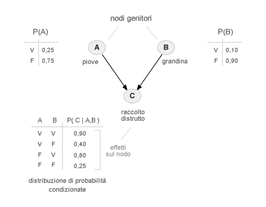
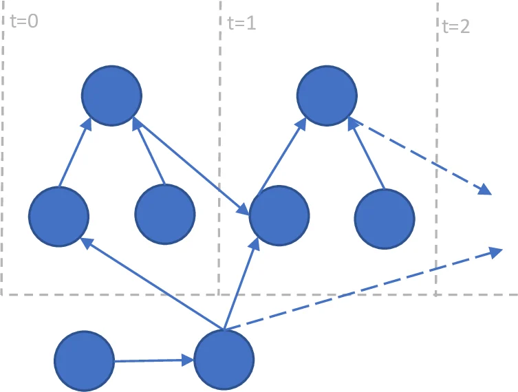
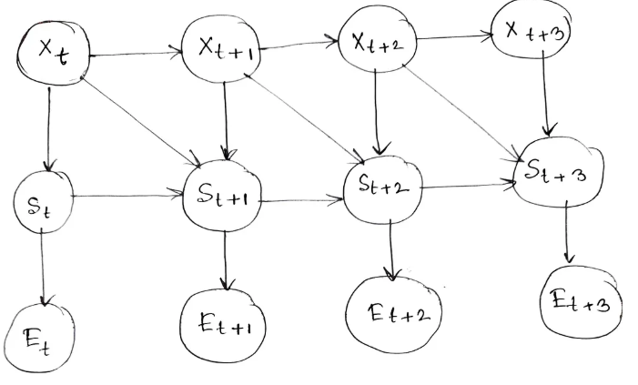

# Reti Bayesiane

Le **reti bayesiane** sono uno strumento probabilistico che rappresenta un insieme di variabili e le loro condizioni tramite un DAG (Directed Acyclic Graph). Gli archi diretti fra i nodi rappresentano le probabilità condizionate tra le variabili, indicando anche le relazioni causa ed effetto.

Ogni rete bayesiana può essere rappresenta da una C**onditional Probability Tables** (**CPTs**), che specificano le probabilità condizionate per ogni nodo dato i suoi genitori.

Le reti bayesiane sono ampiamente utilizzate in vari campi, tra cui:

- **Medicina**: per la diagnosi e il trattamento delle malattie.
- **Intelligenza Artificiale**: per il ragionamento e la presa di decisioni.
- **Finanza**: per la valutazione del rischio e la previsione dei mercati.
- **Sicurezza Informatica**: per la rilevazione di intrusioni e la gestione delle minacce.

Le Reti Bayesiane modellano dipendenze causali o logiche (non necessariamente temporali) tramite la fattorizzazione della distribuzione di probabilità congiunta:$$P(X_1, \dots, X_n) = \prod_{i=1}^{n} P(X_i \mid \text{Parents}(X_i))$$

L'uso dei grafi facilita due compiti principali:

- **Inferenza**: Calcolare la distribuzione a posteriori di un set di variabili date alcune osservazioni (evidenza). Algoritmi come il Belief Propagation operano direttamente sulla struttura del grafo.
- **Parameter Learning**: Stimare le tabelle di probabilità condizionata (CPT) data la struttura.
    - Structure Learning: Determinare il grafo stesso dai dati (spesso un problema NP-hard risolto con approcci constraint-based o score-based).

## Dynamic Bayesian Networks (DBNs)

Le **Dynamic Bayesian Networks** (**DBN**) sono un estensione delle reti bayesiane che modellano come le variabili e le loro relazioni evolvono nel tempo. Ogni "slice" del DBN rappresenta un istante temporale, e gli archi tra slice rappresentano le dipendenze temporali.

{width="70%"}
{width="70%"}

Una DBN è definita tramite una coppia $(B_1, B_{\rightarrow})$:

* **$B_1$ (Modello Iniziale):** Una rete bayesiana che definisce la distribuzione a priori degli stati all'istante $t=1$.
* **$B_{\rightarrow}$ (Modello di Transizione):** Un **2-slice Temporal Bayesian Network (2-TBN)** che definisce la probabilità di transizione $P(X_t \mid X_{t-1})$ per ogni $t$.

In pratica, si assume che la struttura del grafo si ripeta identica per ogni "time slice", con archi che collegano i nodi dello stesso istante (relazioni intra-slice) e archi che collegano nodi da $t-1$ a $t$ (relazioni inter-slice).

Per rendere il calcolo computazionalmente trattabile, le DBN solitamente adottano due semplificazioni:

1. **Processo di Markov (I ordine):** Il futuro è indipendente dal passato dato il presente.
    $$P(X_t \mid X_1, \dots, X_{t-1}) = P(X_t \mid X_{t-1})$$
2. **Stazionarietà:** Le probabilità di transizione non cambiano nel tempo. Il grafo $B_{\rightarrow}$ è lo stesso per ogni $t$.

## Contextual Markov chain

La **Contextual Markov Chain (CMC)** rappresenta un'evoluzione delle catene di Markov tradizionali, progettata per superare il limite della "memoria fissa". Mentre in una catena di Markov di ordine $k$ la transizione dipende sempre dagli ultimi $k$ stati, nella CMC la dipendenza dipende dal **contesto specifico** in cui si trova il sistema. In una CMC, un **contesto** è una sequenza di stati passati che determina univocamente la distribuzione di probabilità dello stato successivo. 
La particolarità è che non tutti i contesti hanno la stessa lunghezza:

* In alcune situazioni, basta conoscere lo stato immediatamente precedente ($t-1$) per predire il futuro.
* In altre, è necessario risalire molto più indietro nel tempo ($t-n$).

Matematicamente, definiamo una funzione di contesto $c(s_{1:t})$ che mappa una storia di stati in un contesto specifico $\tau$, tale che:
$$P(s_{t+1} \mid s_1, \dots, s_t) = P(s_{t+1} \mid c(s_{1:t}))$$

Le CMC sono spesso implementate tramite **Context Tree Maximizing (CTM)** o strutture ad albero simili.

* Le foglie dell'albero rappresentano i contesti possibili.
* Ogni nodo memorizza le statistiche di transizione.
* Se l'aggiunta di uno stato passato alla sequenza non cambia significativamente la distribuzione di probabilità del passo successivo, l'albero viene "potato" (pruning), mantenendo il modello parsimonioso.

Questo approccio evita l'esplosione esponenziale dei parametri tipica delle catene di Markov di ordine superiore ($k$-order MC), dove il numero di stati cresce come $N^k$.

Se guardiamo alle CMC nell'ottica dei grafi e delle **Dynamic Bayesian Networks (DBN)**, possiamo vederle come una forma di **indipendenza condizionale locale**:
* In una DBN standard, la struttura del grafo è fissa per ogni time slice.
* In una CMC, la struttura delle dipendenze (gli archi che arrivano al nodo $X_t$) può "attivarsi" o "disattivarsi" a seconda dei valori assunti dai nodi nei passi precedenti.
