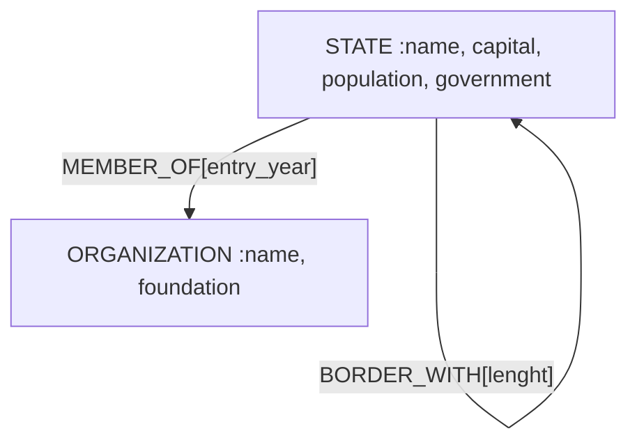
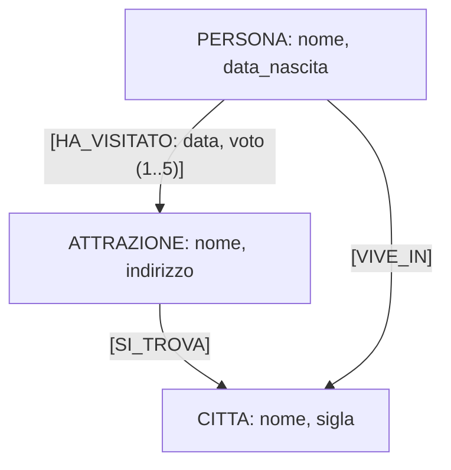
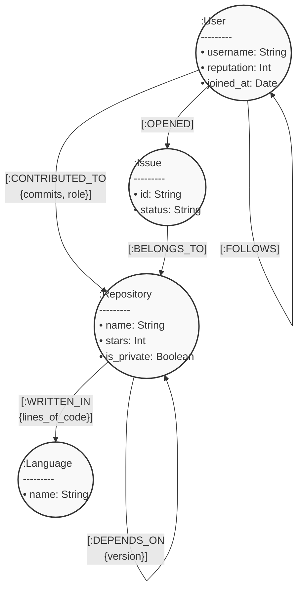
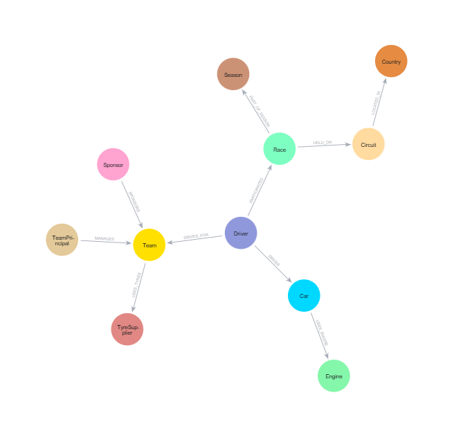
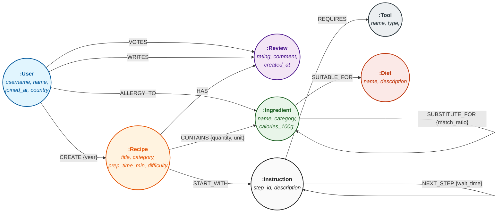

# Stati Nazionali

Viene fornito un grafo (file:  statinazionali.groovy) che rappresenta gli stati nazionali, i confini, e le organizzazioni sovrannazionali.

Nel grafo sono presenti due tipologie di vertici con relative proprietà:

- STATE con properties: name (nome dello stato nazionale), capital, population (millioni di abitanti) e government (tipologia di governo: ‘republic’ o ‘monarchy’);
- ORGANIZATION con properties: name and foundation (anno di fondazione)

Sono presenti tre tipologie di edges con relative properties:

- BORDERS_WITH che collega due stati tra loro confinanti, con property: lenght (lunghezza confine);
- MEMBER_OF che collega uno stato con l’organizzazione di cui è membro, con property: entry_year (anno di entrata nell’organizzazione);
- SAME_LANGUAGE_AS che collega due stati aventi la stessa lingua ufficiale, con property: language



## QUERY - a

1. Riportare il nome dei tre stati con popolazione più alta. Mostrare nome dello stato e popolazione.

    ```cypher
    MATCH (s:STATE)
    RETURN s.name, s.population
    ORDER BY s.population DESC
    LIMIT 3;
    ```

2. Riportare i nomi degli stati che sono entrati nell’unione europea nel 1958

   ```cypher
   MATCH (s:State)-[:MEMBER_OF{year: '1958}]-(:ORGANIZATION{name:'Unione Europea})
   RETURN s.name;
   ```

3. Trovare stati che sono confinanti con uno stato che è confinante con l’Austria

    ```cypher
   MATCH (s:State)-[:BORDER_WITH*2]-(:State{name:'Austria})
   RETURN s.name;
   ```

4. Trovare gli stati confinanti con l’Italia e per ognuno stampare nome del paese e popolazione

   ```cypher
   MATCH (s:State)-[:BORDER_WITH*]-(:State{name:'Austria})
   RETURN s.name, s.population;
   ```

5. Calcolare la media ( .mean()) della popolazione degli stati che fanno parte della Schengen_area

   ```cypher
   MATCH (s:State)-[:MEMBER_OF]->(:Organization {name: 'Schengen_area'})
    RETURN avg(s.population) AS people_mean
   ```

## QUERY -  b

1. Riportare il nome degli stati ordinati per numero di nazioni confinanti

    ```cypher
    MATCH (s:State)-[Border_WITH*0..20]->(confinanti:State)
    WITH s, COUNT(confinanti) AS numero_stati_confinanti
    RETURN s.name, numero_stati_confinanti
    ```

2. Riportare i nomi degli stati che sono entrati nella Nato (NATO) dopo il 2000

   ```cypher
    MATCH (s:State)-[r:MEMBER_OF]->(o:Organization)
    WHERE r.entry_year > 2000 AND o.name = 'NATO'
    RETURN s.name;
   ```

3. Riportare per ogni organizzazione il numero di stati che ne fanno parte

    ```cypher
    MATCH (o:Organization)<-[:MEMBER_OF]-(member_state:State)
    WITH o, COUNT(member_state) AS numeber_of_member_state
    RETURN o.name, numeber_of_member_state
    ```

4. Trovare gli stati che hanno la stessa lingua ufficiale del Canada e mostrarli come lista

   ```cypher
   MATCH (s:State)-[r:SAME_LANGUAGE]->(canad:State{name: 'Canada'})
   WHERE r.language = canada.language
   RETURN collect(s) AS stati_stessa_lingua
   ```

5. Calcolare il valore massimo ( .max()) della popolazione degli stati che fanno parte della Eurozone

   ```cypher
    MATCH (s:State)-[:MEMBER_OF]->(:Organization {name: 'Eurozone'})
    RETURN s.name, s.population
    ORDER BY s.population DESC
    LIMIT 1
   ```

## QUERY -  c

1. Inserire un nuovo stato (che non esiste già) e riportare almeno 2 relazioni con stati confinanti e 1 con organizzazione

   ```cypher
   // 1. Esegui il binding dei nodi preesistenti (stati confinanti e organizzazione)
    MATCH (c:State {name: 'China'})
    MATCH (f:State {name: 'Finland'})
    MATCH (o:Organization {name: 'BRICS'}) // Sostituisci con l'organizzazione presente nel tuo db, es. 'UN'

    // 2. Assicurati che il nuovo stato venga creato una sola volta (Idempotenza)
    MERGE (r:State {name: 'Russia'})

    // 3. Genera le relazioni direzionali (topologiche e di appartenenza)
    MERGE (r)-[:BORDERS_WITH]->(c)
    MERGE (r)-[:BORDERS_WITH]->(f)
    MERGE (r)-[:MEMBER_OF]->(o)
    ```

   
2. Riportare tutti gli stati che sono nella Schengen_area
   
   ```cypher
   MATCH (s:State)-[:MEMBER_OF]->(:Organization{name: 'Schengen_area})
   RETURN s.name
   ```   

4. Scrivere una query ricorsiva a piacere

    ```cypher
    MATCH p=(s:State)-[:SAME_LANGUAGE*1..5]-(s1:State)
    RETURN p
    ```

5. Calcolare il totale della popolazione della Eurozone

    ```cypher
    MATCH (s:State)-[:MEMBER_OF]->(:Organization{name: 'Eurozone})
    RETURN SUM(s.polulation) AS tot_pop_eurozone
    ```

# Attrazioni nazionali

Viene fornito un grafo (file:  attrazioni.groovy) che rappresenta le attrazioni disponibili in regione
Nel grafo sono presenti tre tipologie di vertici con relative proprietà:

- citta, che ha come property 'nome' e 'sigla'
- attrazione, che ha come property 'nome' e 'indirizzo' di dove è collocata
- persona, che ha come property 'nome' e 'data_di_nascita'
E due tipi di Edge:

- si_trova, collega un'attrazione a una città (attrazione -> città). Non ha property.
- ha_visitato, collega una persona a un'attrazione(persona -> attrazione). Ha come 	property 'data', che indica la data in cui una persona ha visitato quell'attrazione, e 	'voto' che rappresenta la votazione da 1 a 5 fornita dalla persona per quell'attrazione
- vive_in, collega una persona alla città in cui vive (persona -> citta). Non ha 	property.



## QUERY - a

1. Riportare il numero di persone che hanno visitato il museo ferrari

    ```cypher
    MATCH (p:Persona)-[:HA_VISITATO]->[a:Attrazione{nome: 'Museo ferrari'}]
    RETURN COUNT(p) AS numero_persone_visitanti
    ```

2. Riportare i nomi delle persone che hanno visitato Bologna

    ```cypher
    MATCH (p:Persona)-[:HA_VISITATO]-(:Attrazione)-[:SI_TROVA]->(:Citta{nome: 'Bologna'})
    RETURN p.nome
    ```

3. Riportare il numero di persone che hanno visitato una delle attrazioni a Modena nel mese di Marzo

    ```cypher
    MATCH (p:Persona)-[r:HA_VISITATO]-(:Attrazione)-[:SI_TROVA]->(:Citta{nome: 'Bologna'})
    WHERE r.data > 01/03 AND  r.data > 31/03
    RETURN COUNT(p) AS persone_tot_marzo
    ```

4.	Elencare le attrazioni visitate da Francesca

    ```cypher
     MATCH (:Persona)-[:HA_VISITATO]-(:Attrazione)-[:SI_TROVA]->(:Citta{nome: 'Bologna'})
    RETURN a.nome
    ```

5.	Selezionare l’attrazione con il punteggio più alto a Bologna

    ```cypher
    MATCH MATCH (:Persona)-[r:HA_VISITATO]-(:Attrazione)-[:SI_TROVA]->(:Citta{nome: 'Bologna'})
    RETURN MAX(r.voto)
    ```


## QUERY - b

1.	Inserire una nuova persona (che non esiste già) e riportare almeno 2 visite ad attrazioni

    ```cypher
    MERGE (new:Persona{nome: ...})

    MERGE (new)-[]
    ```

2.	Riportare tutte le persone che hanno visitato palazzo_ducale a Modena

    ```cypher
    
    ```

3.	Riportare per ogni attrazione di Bologna il numero di persone che l’hanno visitata

    ```cypher
    
    ```

4.	Scrivere una query ricorsiva a piacere

    ```cypher
    
    ```

5.	Calcolare il totale delle attrazioni che hanno avuto almeno una visita per Modena 

    ```cypher
    
    ```

## QUERY - c

1.	Visualizzare lo schema del grafo

    ```cypher
    MATCH (n)->[r]->(n1) return n, r, n1 

    apoc.meta.graph()
    ```

2.	Riportare i dati delle persone che hanno visitato una attrazione a Bologna

    ```cypher
    
    ```

3.	Riportare il numero di persone che hanno visitato una delle attrazioni a Modena nel mese di Marzo

    ```cypher
    
    ```

4.	Selezionare l’attrazione con il punteggio più alto a Parma

    ```cypher
    
    ```

5.	Per ogni attrazione riportare il numero di visitatori suddiviso per ciascun mese

    ```cypher
    
    ```

# Esercizio Gemini - Github



1. Trova la top 3 dei linguaggi di programmazione in base al volume totale di codice (somma di lines_of_code) scritto in repository pubblici, considerando esclusivamente le repository che hanno ricevuto contributi (almeno un CONTRIBUTED_TO) da utenti con una reputation superiore a 500. Restituisci il nome del linguaggio e il volume totale.

```cypher
MATCH (u:User)-[:CONTRIBUTED_TO]->(r:Repository)-[w:WRITTEN_IN]->(l:Language)
WHERE u.reputation > 500 AND r.is_private = false
WITH l.name AS language_name, SUM(w.lines_of_code) AS total_volume
ORDER BY total_volume DESC
LIMIT 3
RETURN language_name, total_volume

```

2. Trova tutte le repository che dipendono transitivamente (indirettamente) dalla repository chiamata "neo4j-core", fino a una profondità massima di 5 salti (DEPENDS_ON). Per ogni repository trovata, restituisci il suo nome e la lunghezza del path più corto che la collega a "neo4j-core".

```cypher
MATCH p = shortestpath((repo:Repository)-[r:DEPENDS_ON*..5]-(neo4j-core:Repository{name: 'neo4j-core'}))
WHERE repo <> neo4j-core
RETURN repo.name, length(p) AS path_length

```

3. Identifica i "cartelli di mutuo supporto": trova tutti i gruppi di 3 utenti distinti (A, B, C) tali per cui A segue B, B segue C, e C segue A. Inoltre, verifica che tutti e tre gli utenti abbiano contribuito (nodo REPOSITORY in comune) alla medesima repository. Restituisci i nomi dei tre utenti e il nome della repository condivisa, evitando permutazioni duplicate nella risposta (es. restituire A-B-C e B-C-A).

```cypher
MATCH (a)-[:FOLLOW]-(b)->[:FOLLOW]-(c)-[:FOLLOW]->(a)
WHERE id(a) < id(b) AND id(b) < id(c)

MATCH (a)-[:CONTRIBUTED_TO]->(repo:Repository), (b)-[:CONTRIBUTED_TO]->(repo), (c)-[:CONTRIBUTED_TO]->(repo)

RETURN a.username, b.username, c.username, repo.name

```

4. Per ogni repository che ha almeno 3 issue in stato "OPEN", calcola un "indice di diversità dei contributori". Questo indice è definito come il numero di linguaggi di programmazione differenti utilizzati in altre repository a cui i contributori della repository attuale hanno lavorato. Restituisci il nome della repository e la lista (non la stringa, ma il costrutto lista di Cypher) dei linguaggi unici trovati.

```cypher
MATCH (i:Issue {status: "OPEN"})-[:BELONGS_TO]->(repo:Repository)
WITH repo, COUNT(i) AS open_issues
WHERE open_issues >= 3
MATCH (repo)<-[:CONTRIBUTED_TO]-(u:User)-[:CONTRIBUTED_TO]->(other_repo:Repository)-[:WRITTEN_IN]->(l:Language)
WHERE other_repo <> repo
WITH repo.name AS repository_name, collect(DISTINCT l.name) AS diversity_index
RETURN repository_name, diversity_index
```

5. Trova tutti gli utenti "criticoni": coloro che hanno aperto una o più issue in una repository a cui non hanno mai contribuito, ma in cui seguono (FOLLOWS) almeno un utente che è invece un contributore diretto di tale repository. Restituisci l'username dell'utente e il nome della repository.

```cypher
MATCH (u:User)-[:OPENED]->(i:Issue{status: 'OPEN'})-[:BELONGS_TO]->(repo:Repository)
WHERE NOT (u)-[:CONTRIBUTED_TO]->(repo)
MATCH (u)-[:FOLLOWS]->(following:User)->[:CONTRIBUTED_TO*..1]->(repo)
RETURN DISTINCT u.username, following.username, repo.name
```

6. Identifica la dinamica del "mentoring": trova tutti gli utenti che seguono almeno 3 persone, ma con un vincolo stringente. Utilizzando una funzione di predicato sulle liste (come `all()`), assicurati che *tutti* gli utenti seguiti da un determinato utente abbiano una `reputation` strettamente maggiore della sua. Restituisci l'username dell'utente "allievo" e la lista degli username dei suoi "mentori".

```cypher
MATCH (u:User)-[:FOLLOWS]->(mentor:User)
WITH u, collect(mentor) AS mentors
WHERE size(mentors) >= 3 AND ALL(mentor IN node(mentors) WHERE u.reputation< mentors.reputation)
RETURN u.username, [m IN mentors | m.username] AS mentor_usernames
```

> List Comprehension:  [variabile IN lista | estrazione]

1. Trova gli specialisti assoluti. Cerca gli utenti che hanno contribuito (`CONTRIBUTED_TO`) ad almeno 3 repository differenti, ma in cui l'insieme di tutti i linguaggi utilizzati (`WRITTEN_IN`) in *tutte* quelle repository si riduce a un unico e solo linguaggio di programmazione (es. lavorano solo e unicamente su progetti puramente Python). Restituisci l'username e il nome dell'unico linguaggio trovato.

```cypher
MATCH (u:User)-[:CONTRIBUTED_TO]->(repo:Repository)-[:WRITTEN_IN]->(lang:Language)
WITH u, count(DISTINCT repo) AS num_repos, collect(DISTINCT lang.name) AS unique_languages
WHERE num_repos >= 3 AND size(unique_languages) = 1
RETURN u.username, unique_languages[0] AS pure_language
```

1. Trova i percorsi di dipendenza (`DEPENDS_ON`) che collegano la repository "frontend-app" alla repository "core-db", fino a una profondità massima di 6 salti. Tuttavia, il percorso è considerato valido *solo e soltanto se* nessuna delle repository intermedie attraversate è marcata come privata (`is_private = true`). Restituisci la lista dei nomi delle repository che compongono i percorsi validi.

```cypher
MATCH p=(repo:Repository{name: 'frontend-app'})-[:DEPENDS_ON*1..6]->(end:Repository{name: 'core-db'})
WHERE ALL(rii IN nodes(p) WHERE rii.is_private=false)
RETURN [rii IN nodes(p)| rii.name]
```

9. Calcola il "peso dell'influenza" dei maintainer. Trova tutti gli utenti che hanno il ruolo di "Maintainer" (proprietà `role` sull'arco `CONTRIBUTED_TO`) in repository pubbliche che hanno più di 10.000 `stars`. Per ogni maintainer, calcola un punteggio dato dalla somma dei `commits` moltiplicata per le `stars` della rispettiva repository. Restituisci l'username e il punteggio totale, ordinato in modo decrescente.

```cypher
MATCH (u:User)-[c:CONTRIBUTED_TO{role: 'Maintainer'}]->(repo:Repository{is_private: 'false'})
WHERE repo.stars > 10000
WITH u, SUM(c.commits*repo.stars)AS tot_commit
RETURN u.username, tot_commit*repo.stars AS score
ORDER BY score DESC
```

# Formula 1



1. Elenco piloti con squadra e nazionalità
Restituisce per ogni pilota il nome, la nazionalità e il nome del team per cui corre.

```cypher
MATCH (driver:Driver)-[:DRIVES_FOR]-(team:Team)
RETURN driver.name, driver.nationality, team.name
```

2. Circuiti con paese di appartenenza
Mostra per ogni circuito il nome e il paese in cui si trova.

```cypher
MATCH (c:Circuit)-[:LOCATED_IN]->(country:Country)
RETURN c.name, country.name
```

3. Motore utilizzato da ogni auto
Per ogni modello di auto, indica il motore montato.

```cypher
MATCH (car:Car)-[:USES_ENGINE]->(eng:Engine)
RETURN DISTINCT car.model, eng.name
```

4. Numero di gare disputate per pilota
Conta quante gare ha corso ciascun pilota.
Nota: se si volessero escludere i ritiri, come si modifica la query?

```cypher
MATCH (driver:Driver)-[:PARTICIPATED]->(race:Race)
//WHERE r.position <> 'DNF'
WITH driver, COUNT(race) as num_race
RETURN driver.name, num_race
```

5. Sponsor e team sponsorizzati
Elenca gli sponsor e i team che supportano.

```cypher
MATCH (sponsor:Sponsor)-[:SPONSORS]->(team:Team)
WITH sponsor, collect(team.name) as list_sponsorship
RETURN sponsor.name, list_sponsorship
```

6. Conta il numero di vittorie (posizione 1) per ciascun pilota e ordina decrescente.

```cypher
MATCH (driver:Driver)-[r:PARTICIPATED]->(race:Race)
WHERE r.position=1
WITH driver, COUNT(race) as num_race
RETURN driver.name, num_race
ORDER BY num_race DESC
```

7. Raggruppa le vittorie per team e mostra solo quelli con più di 2 vittorie.

```cypher
MATCH (driver:Driver)-[r:PARTICIPATED]->(race:Race)
WHERE r.position=1
MATCH (driver)-[:DRIVES_FOR]->(team:Team)
WITH team, COUNT(race) as num_race
WHERE num_race>2
RETURN team.name,num_race
ORDER BY num_race DESC
```

8. Per ogni team, restituisce le coppie di piloti che ne fanno parte.

```cypher
MATCH (driver1:Driver)-[:DRIVES_FOR]->(team:Team), (driver2:Driver)-[:DRIVES_FOR]->(team)
//WITH team, collect((driver1, driver2)) AS coppie
WHERE elementId(driver1)< elementId(driver2)
RETURN team.name, driver1.name, driver2.name
```

9. Mostra le gare che si svolgono in Italia, con circuito e 
anno.

```cypher
MATCH (sea:Season)<-[:PART_OF_SEASON]-(race:Race)-[:HELD_ON]->(:Circuit)-[:LOCATED_IN]->(country:Country)
WHERE country.name='Italy'
RETURN race.name, sea.year
```

10. Restituisce circuito, paese, stagione e una lista dei risultati (pilota + posizione) per una gara specifica.

```cypher
MATCH (country:Country)<-[:LOCATED_IN]-(circuit:Circuit)<-[:HELD_ON]-(race:Race{name: "Chinese GP"})-[:PART_OF_SEASON]->(sea:Season)
MATCH (driver:Driver)-[r:PARTICIPATED]->(race)

// Ordiniamo i record prima di aggregarli
WITH race, country, sea, driver, r
ORDER BY r.position ASC

// Ora la collect manterrà l'ordine definito sopra
RETURN race.name, country.name, sea.year, 
       collect({pilota: driver.name, posizione: r.position}) AS lista_risultati
```

11.  Trova il pilota che ha vinto più gare nel 2024.

```cypher
MATCH (d:Driver)-[:PARTICIPATED{position: 1}]->(r:Race)-[:PART_OF_SEASON]->(sea:Season{year: 2024})
WITH d.name AS pilota, count(r) AS vittorie

WITH collect({nome: pilota, n: vittorie}) AS risultati, max(vittorie) AS maxVittorie

UNWIND risultati AS r
WITH r WHERE r.n = maxVittorie
RETURN r.nome AS Pilota, r.n AS Vittorie
```

12.  Calcola numero di vittorie e media posizione per ogni pilota, considerando solo le gare concluse (posizione numerica).

```cypher
MATCH (d:Driver)-[r:PARTICIPATED]->(race:Race)
WHERE r.position <> "DNF"
//WITH d, COUNT(race) as numero_vittorie, avg(r.position) as avg_posizione
RETURN d.name, COUNT(race) as numero_vittorie, avg(r.position) as avg_posizione
```

13. Raccoglie in un'unica riga: team principal, piloti, auto, motori, sponsor, pneumatici, risultati.

```cypher
MATCH (t:Team)
OPTIONAL MATCH (ts:TyreSupplier)<-[:USES_TYRES]-(t)
OPTIONAL MATCH (sponsor:Sponsor)-[:SPONSORS]->(t)
OPTIONAL MATCH (driver:Driver)-[:DRIVES_FOR]->(t)
OPTIONAL MATCH (driver)-[r:PARTICIPATED]->(race:Race)
OPTIONAL MATCH (man:TeamPrincipal)-[:MANAGES]->(t)

// STEP 1: Aggreghiamo i dati. 
// Qui 't' (il team) fa da chiave di raggruppamento implicita.
WITH t, 
     collect(DISTINCT sponsor.name) AS sponsors, 
     collect(DISTINCT {pilota: driver.name, posizione: r.position}) AS drivers_results,
     collect(DISTINCT man.name) AS team_managers,
     collect(DISTINCT ts.name) AS tyre_suppliers

// STEP 2: Ora che abbiamo i valori aggregati, costruiamo l'oggetto finale
RETURN {
  team_name: t.name,
  sponsors: sponsors,
  drivers: drivers_results,
  managers: team_managers,
  tyres: tyre_suppliers
} AS SchedaTeam
```

14. Percorso più breve tra due piloti
Trova il cammino minimo (in numero di relazioni) tra Max Verstappen e Oscar Piastri.

```cypher
MATCH p = shortestPath((:Driver{name: 'Max Verstappen'})-[*]-(:Driver{name: 'Oscar Piastri'}))
RETURN p
```

15. Team che usano motori Mercedes
Identifica i team i cui piloti guidano auto con motore Mercedes AMG.

```cypher
MATCH (team:Team)<-[:DRIVES_FOR]-(d:Driver)-[:DRIVES]-(:Car)-[:USES_ENGINE]->(eng:Engine{name: 'Mercedes AMG'})
RETURN DISTINCT  team.name
```

16. Vincitori per nazionalità
Raggruppa le vittorie per nazionalità del pilota.

```cypher
MATCH (driver:Driver)-[r:PARTICIPATED{position: 1}]->(race:Race)
RETURN driver.nationality, COUNT(race) as n_vittorie
ORDER BY n_vittorie ASC
```

17. Diametro del grafo (massima distanza tra due gare)
Calcola la lunghezza massima dei percorsi più brevi tra coppie di gare.

```cypher
MATCH (r1:Race), (r2:Race)
WHERE elementId(r1) < elementId(r2)
MATCH p = allShortestPaths((r1)-[*]-(r2))
WITH length(p) AS lunghezzaPercorso
RETURN max(lunghezzaPercorso) AS DiametroDelGrafo
```

# Social



1. Restituire le ricette ordinate per tempo di preparazione.

   ```cypher
   MATCH (r:Recipe)
   RETURN r.title, r.difficulty, r.prep_time_min
   ORDER BY r.prep_time_min ASC;
   ```

2. Estrarre gli ingredienti necessari per il Risotto. 

   ```cypher
   MATCH (r:Recipe {title: 'Risotto alla Milanese'})-[c:CONTAINS]->(i:Ingredient)
   RETURN i.name, c.quantity, c.unit;
   ```

3. Identificare tutti gli ingredienti marcati come potenzialmente allergenici.

   ```cypher
   MATCH (i:Ingredient {is_allergen: true})
   RETURN i.name, i.category;
   ```

4. Listare gli utenti alle ricette che hanno creato.

   ```cypher
   MATCH (u:User)-[c:CREATE]->(r:Recipe)
   RETURN u.username, r.title, c.year;
   ```

5. Calcolare la media dei voti ricevuti.

    ```cypher
   MATCH (r:Recipe)-[:HAS]->(rv:Review)
   RETURN r.title, avg(rv.rating) AS average_rating, count(rv) AS total_reviews
   ORDER BY average_rating DESC;
   ```

6. Trova se un utente è esposto a un allergene in una specifica ricetta.

   ```cypher
   MATCH (u:User)-[:ALLERGY_TO]->(i:Ingredient)<-[:CONTAINS]-(r:Recipe)
   RETURN u.username, r.title, collect(i.name) AS allergeni_esposti;
   ```

7. Contare il numero totale di step previsti per ogni ricetta.

   ```cypher
   MATCH (r:Recipe)-[:START_WITH]->(:Instruction)-[:NEXT_STEP*0..]->(steps:Instruction)
   RETURN r.title, count(DISTINCT steps) AS numero_operazioni;
   ```

8. Estraerre la lista univoca degli utensili richiesti da una ricetta.

   ```cypher
   MATCH (r:Recipe)-[:START_WITH|NEXT_STEP*0..]->(s:Instruction)-[:REQUIRES]->(t:Tool)
   RETURN r.title, collect(DISTINCT t.name) AS utensili_necessari;
   ```

9. Identificare gli ingredienti più utilizzati nel dataset.

    ```cypher
    MATCH (i:Ingredient)<-[:CONTAINS]-(r:Recipe)
    RETURN i.name, count(r) AS degree
    ORDER BY degree DESC LIMIT 5;
    ```

10. Calcolare le calorie derivanti dagli ingredienti misurati in grammi per ciascuna ricetta.

    ```cypher
    MATCH (r:Recipe)-[c:CONTAINS]->(i:Ingredient)
    WHERE c.unit = 'g'
    RETURN r.title, sum((c.quantity * i.calories_100g) / 100.0) AS calorie_totali_solidi;
    ```

11. Suggerire ingredienti alternativi con relativo indice di confidenza (match ratio).

    ```cypher
    MATCH (i:Ingredient)-[r:SUBSTITUTE_FOR]->(alternatives:Ingredient)
    RETURN i.name, [alternatives.name, r.match_ratio]
    ```

12. Restituire solo le ricette che *non* contengono ingredienti a cui l'utente Pierre è allergico.

    ```cypher
    MATCH (u:User {username: 'pierre_paris'}), (r:Recipe)
    WHERE NOT (r)-[:CONTAINS]->(i:Ingredient)<-[:ALLERGY_TO]-(u)
    RETURN r.title AS ricette_sicure;
    ```

    o

    ```cypher
    MATCH (u:User {username: 'pierre_paris'}), (r:Recipe)
    WHERE NOT EXISTS {
    (r)-[:CONTAINS]->(:Ingredient)<-[:ALLERGY_TO]-(u)
    }
    RETURN r.title AS ricette_sicure;
    ```

13. Raggruppa le recensioni per livello di difficoltà della ricetta e calcola la media dei voti per ciascun gruppo, ordinando i risultati in modo decrescente.

    ```cypher
    MATCH (r:Recipe)-[:HAS]->(rv:Review)
    RETURN r.difficulty, avg(rv.rating) AS avg_rating, count(rv) AS sample_size
    ORDER BY avg_rating DESC;
    ```

14. Trova il tempo di attesa passivo massimo all'interno delle procedure.

    ```cypher
    MATCH (s1:Instruction)-[n:NEXT_STEP]->(s2:Instruction)
    RETURN s1.step_id AS step_precedente, s2.step_id AS step_successivo, n.wait_time AS latenza_minuti
    ORDER BY latenza_minuti DESC;
    ```

15. Calcolare la densità di allergeni all'interno di ogni ricetta per stabilire una metrica di rischio intrinseco.

    ```cypher
    MATCH (r:Recipe)-[:CONTAINS]->(i:Ingredient)
    WITH r, count(i) AS total_ingredients, sum(CASE WHEN i.is_allergen THEN 1 ELSE 0 END) AS allergen_count
    RETURN r.title, (allergen_count * 1.0 / total_ingredients) AS densita_allergeni
    ORDER BY densita_allergeni DESC;
    ```

16. Trova coppiere di utenti che hanno valutato positivamente (rating $\geq$ 4) le stesse ricette.

    ```cypher
    MATCH (u1:User)-[:WRITES]->(rv1:Review)<-[:HAS]-(r:Recipe)-[:HAS]->(rv2:Review)<-[:WRITES]-(u2:User)
    WHERE elementId(u1) < elementId(u2) AND rv1.rating >= 4 AND rv2.rating >= 4
    RETURN u1.username, u2.username, count(r) AS ricette_in_comune
    ORDER BY ricette_in_comune DESC;
    ```

17. Una ricetta può essere considerata strettamente vegana se e solo se *tutti* i suoi ingredienti hanno una relazione esplicita verso la dieta vegana.

    ```cypher
    MATCH (r:Recipe)-[:CONTAINS]->(i:Ingredient)
    WITH r, collect(i) AS ingredients
    WHERE ALL(ing IN ingredients WHERE EXISTS((ing)-[:SUITABLE_FOR]->(:Diet {name: 'Vegan'})))
    RETURN r.title AS StrictlyVeganRecipe;
    ```

18. Identifica potenziali frodi nel sistema di rating, ovvero utenti che hanno scritto recensioni per le ricette che loro stessi hanno creato.

    ```cypher
    MATCH (u:User)-[:CREATE]->(r:Recipe)-[:HAS]->(rv:Review)<-[:WRITES]-(u)
    RETURN u.username AS suspected_user, r.title AS recipe, rv.rating AS self_rating, rv.comment AS comment;
    ```

19. Calcolare il tempo totale stimato di una ricetta sommando il tempo di preparazione base ai tempi di attesa specifici tra i vari passaggi della pipeline di istruzioni.

    ```cypher
    MATCH path = (r:Recipe)-[:START_WITH]->(first:Instruction)-[:NEXT_STEP*]->(last:Instruction)
    UNWIND relationships(path) AS rel
    WITH r, sum(rel.wait_time) AS total_wait_time
    RETURN r.title, r.prep_time_min AS active_time, total_wait_time AS passive_time, (r.prep_time_min + total_wait_time) AS estimated_total_time
    ORDER BY estimated_total_time DESC;
    ```


# RoboVision Ops


## 1. Il Contesto: "RoboVision Ops"
Immagina di dover gestire l'infrastruttura dati di un sistema di assistenza chirurgica. Il sistema monitora quali **Chirurghi** utilizzano quali **Strumenti Robotici** durante specifiche **Fasi** di un intervento. Fondamentale è il tracciamento dei **Modelli AI** (come la tua U-Net o Swin-Unet) che analizzano il flusso video in tempo reale, segnalando eventuali **Emorragie**.

### Requisiti del Dominio:
* Un **Intervento** è composto da più **Fasi** temporali.
* Ogni fase è monitorata da una specifica istanza di un **Modello AI**.
* Il modello produce delle **Analisi** (Inferenze) che hanno metriche di latenza (FPS) e confidenza.
* Gli **Strumenti** sono fisicamente manovrati dai chirurghi

```mermaid
graph LR
    %% Definizione Classi per Styling Professionale
    classDef Chirurgo;
    classDef Intervento;
    classDef Fasi;
    classDef StrumentoRobotico;
    classDef ModelloAI;
    classDef Analisi;

    %% Nodi con Proprietà Incolonnate
    Chirurgo((":Chirurgo<br/>---------<br/>• nome: String<br/>• specializzazione: String")):::Chirurgo
    Intervento((":Intervento<br/>---------<br/>• id: String<br/>• data: Date<br/>• type: string")):::Intervento
    Fasi((":Fasi<br/>---------<br/>• nome: String<br/>• durata_min: Int")):::Fasi
    StrumentoRobotico((":StrumentoRobotico<br/>---------<br/>• nome: String<br/>• modello: String")):::StrumentoRobotico
    ModelloAI((":ModelloAI<br/>---------<br/>• nome: String<br/>• version: String")):::ModelloAI
    Analisi((":Analisi<br/>---------<br/>• tipo: String<br/>• risultato: String")):::Analisi

    %% Relazioni con Proprietà (Edges)
    Intervento -- "COMPOSED_OF {duration_min}" --> Fasi
    Fasi -- "REQUIRES" --> StrumentoRobotico
    Fasi -- "UTILIZES" --> ModelloAI
    ModelloAI -- "PERFORMS_ANALYSIS" --> Analisi
    Chirurgo -- "PERFORMS" --> Intervento
    Chirurgo -- "MANEUVER" --> StrumentoRobotico
```

## 3. Esercitazioni di Modellazione e Query

### Task 1: Schema e Vincoli (Dati Strutturali)
Il sistema deve garantire l'integrità dei dati.
* Crea un **indice** sulla proprietà `name` dei chirurghi per velocizzare la ricerca.
* Imponi un **vincolo di unicità** sull'ID degli strumenti (`INS_XX`).

```cypher
CREATE INDEX FOR (c:Chirurgo) on c.name
CREATE INDEX FOR (st:StrumentoRobotico) on sr.id
```

### Task 2: Espansione del Modello (Creazione)
Durante la fase di "Dissection" (`P2`), è stata attivata la pipeline di tracking dell'emorragia.
* Crea un nuovo nodo `Inference` che rappresenta un evento di rilevamento.
* Collega il modello `Swin-Surgical` a questa inferenza con una relazione `GENERATED`.
* Collega l'inferenza alla fase `P2` con una relazione `OCCURRED_IN`.
* Aggiungi all'inferenza le proprietà: `latency_ms: 28` e `confidence: 0.94`.

```cypher
CREATE (inf:ANALISI{risultato: 'Rilevamento'})

MERGE (inf)<-[PERFORMS_ANALYSIS]-(ma:ModelloAI{name: 'Swin-Surgical'})
MERGE (inf)-[:OCCURRED_IN]->(:FASE{name: 'P2'})
```

### Task 3: Aggiornamento e Ottimizzazione (Proprietà)
Abbiamo ottimizzato il modello `HemoSeg-Unet` usando TensorRT.
* Trova il nodo del modello e aggiungi/aggiorna la proprietà `optimization: "TensorRT"`.
* Imposta un nuovo attributo `target_fps: 30` a tutti i modelli che hanno una versione superiore alla 1.0.

```cypher
MATCH (m:AIModel {name: "HemoSeg-Unet"})
SET m.optimization = "TensorRT"
RETURN m

MATCH (m:AIModel)
WHERE toFloat(m.version) > 1.0
SET m.target_fps = 30
RETURN m.name, m.version, m.target_fps
```

### Task 4: Analisi delle Performance (Query di Interrogazione)
Scrivi una query per estrarre il seguente report:
* Trova il nome del chirurgo, il tipo di intervento e il nome del modello AI utilizzato, ma solo per gli interventi dove la latenza dell'inferenza è stata inferiore a 30ms.

```cypher
MATCH (c:Chirurgo)-[:PERFORMS]->(i:Intervento),
(c)-[:]
```

### Task 5: Pathfinding (Complessità)
Supponiamo che un chirurgo (`S01`) abbia segnalato un ritardo nel feedback visivo.
* Scrivi una query che partendo dal chirurgo trovi tutti i modelli AI "collegati" a lui attraverso la catena: `Surgeon -> Procedure -> Phase -> Inference -> AIModel`.
* Calcola la media della latenza di questi modelli.

```cypher
```