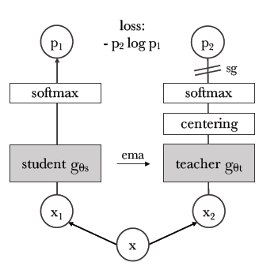
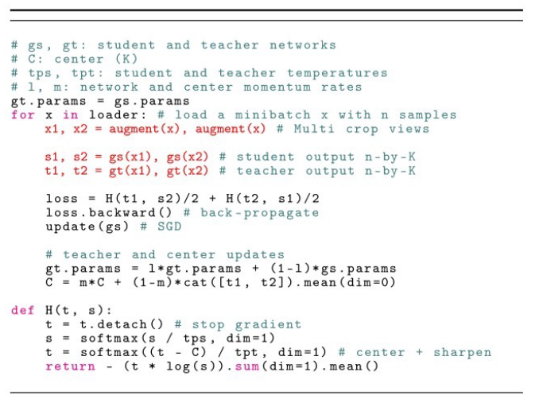
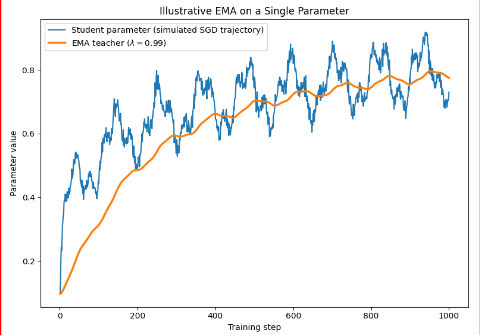
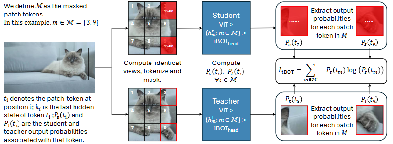
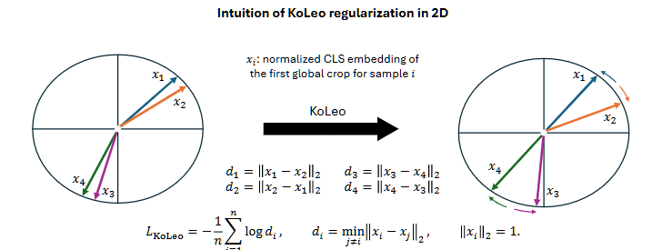
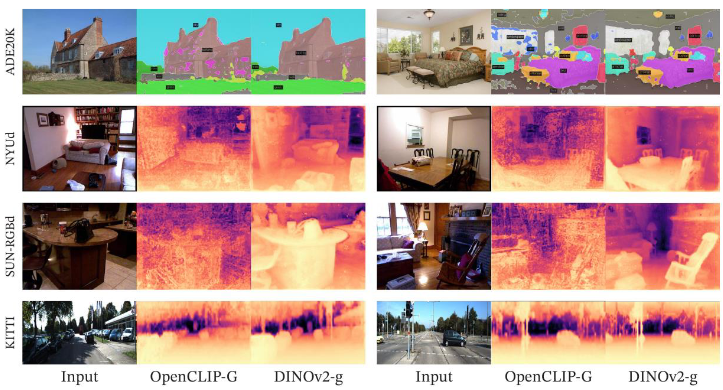
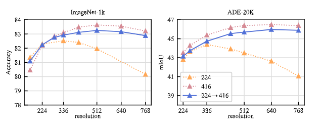

# Self Supervised Learning

!!!note Definition
    **Self Supervised Learning** (**SSL**) is a deep learning paradigm that not depends from labeled dataset to compute a task. Generally, the computing of task happen after learning the most important feature vector computing a **pretext task**. This kind of task is a supervised task (e.g rotation, colorization, jigsaw puzzle, etc.) that is used to learn a feature vector that can be used for a downstream task (e.g. classification, object detection, etc.).

The main problem of extracting feature vector using pretext task is that this kind of task are not able to extract most significant feature.

## Non Contrastive Nets

A way to extract better feature is use **non contrastive siamese network** that not need of negative samples to compute a feature vector. This kind of approach have the problem of **representeation collapse** caused by not having negative samples that push away the representation of different images.

To avoid this problem, it is possible to use **stop gradient** or **predictor** to avoid the collapse.

Generally this kind of nets are formed by two branches that are train together and are based on teacher-student paradigm.

### DINO

A type of net is **DINO** (**DIstillation with NO labels**) that adapt the concept of knowledge distllation to a fully SSL.

{height=50% width=50%}

{height=50% width=50%}

Image befor to be feeded into the nets is **preprocess** appling multiple trasformation. Given an image we generate a set of V different views with different spatial scales **cropping** it in:

- _Global crops_: large crops containing most of the image and its global context.
- _Local crops_: smaller crops covering only a portion of the image.
DINO assumes that different views of the same image should produce similar representations.

Student and Teacher can be whatever we want, for image, for example can be a **ViT** that divided crops in fixed-size patches. Student take as input both global and local crops, while Teacher take only the global crops.
The reason of this is that the teacher drives the training of student that have to produce a more cohernce representeation resprecting that of the teacher. In thsi way the student to align local features with global context, facilitating _“local-to-global” consistency learning_.

After computing the loss (CE), only the Student is update via gradiant descent, while the teacher is applied a _stopgrad_ operation.
The outputs of the Student and Teacher are passed through projection heads.

The objective of train is minimizing the CE Loss:

$$min_{\theta_s} \sum \sum H(P_t(x), P_s(x'))$$

Updating the weight of teacher is done using a _exponential moving average_. $$\theta_t = \lambda \theta_t + (1- \lambda)\theta_s$$where $\lambda$ is the **momentum coefficient**.

Using EMA create a useful asymmetry between student and teacher and makes the teacher a temporal ensemble / low-pass filter of past student parameters, providing smoother and more stable targets than the rapidly changing student.

This makes the Teacher a slowly evolving, more stable version of the Student. The Student is trained to match the Teacher's representations, while the Teacher provides stable targets that evolve gradually during training.

{height=50% width=50%}

A study demostrate that start from a freeze an randomly inizialized target network student learn better feature from the teacher. This is based on _BOYL_ observation that motivate the **bootstrapping**:

- **Cross-View Prediction**: Because the initial Teacher outputs random but image-dependent targets, the Student cannot simply memorize view-specific details. It is forced to learn features that remain consistent across different augmentations and crops.
- **Stabilization**: The EMA update creates a useful asymmetry. It turns the Teacher into a temporal ensemble (a low-pass filter) of past Student parameters. This provides smoother, slowly evolving targets that prevent the Student from getting stuck in local minima.

Even though the Teacher's weights are random, they are fixed for a given forward pass. This means the random projection is deterministic. This deterministic randomness prevents the Student from cheating or collapsing.

The problem of cross-view prediction framework is taht the representatio of an augmented view of an image shoude be predictive of the representatio of another augmented view of the same image and mapping the problem directly in the representation space can lead to _collapse representation_.

To avoid this collapse DINO use mechanism of
    - **centering** that resolve the problem of _one-dimensional collapse_ in which teacher consider important always the same dimension. Thr new center is at each epochs and the subtracted to the logit before appling the softmax. This is done to maintain only ther most significant information discarded the less meaning full. If the centering is to aggressive teacher produce uniform distribution.
    - **sharpening** resolver the _problem of uniform distribution_ that make distribution more sharp. This is done using a temperature parameter $\tau_t$ generaly less that $\tau_s$ that is used to compute the softmax of the output of the teacher: $$g_t''(x) = \frac{exp(g_t'(x - C)/\tau)}{\sum_{i=1}^{B} exp(g_t'(x_i)/\tau)}$$.

The Teacher output is centered and sharpened using a temperature parameter:

$$
p_t(x) =
\operatorname{softmax}
\left(
\frac{g_t(x)-C}{\tau_t}
\right)
$$

where $C$ is the running center of the Teacher output and $\tau_t$ is the Teacher temperature.

The Student output is computed as:

$$
p_s(x) =
\operatorname{softmax}
\left(
\frac{g_s(x)}{\tau_s}
\right).
$$

### iBOT: image BERT pre-training with Online Tokenizer

The goal of iBOT is force the network to learn meaningful patch-level representations, useful to solve dense tasks such as image segmentation, through an explicit loss on masked patches.

Teacher and Student have the sam architecture but theri weights are update like happen in DINO.

The first step is to compute identical augmented views tokenize both for studend and teacher and masked patches only for the student view.

The student receives the patch sequence with a learnable [MASK] token replacing the embeddings of the masked patches. While the teacher do not have the mask token.

The goal of student is to output the same probability distribution of the Teacher using the information of the other patches for each patch ($i\in M)$. To predict $P_t(t_m)$  the student must exploit the surrounding visible patch tokens through self-attention. Therefore, iBOT explicitly encourages the ViT to learn contextual relationships between different regions of the image.

iBOT loss consider only the hidden state extracted from ViT and filter on the masked hidden states and their corrispective non masked ones from the teacher, that are passed throught iBOT head to have probabilty distribution. Then, the _patch-level objective_ is minimize the cross-entropy between the teacher and student distributions:

$$-\frac{1}{|M|}
\sum_{i\in M}
\sum_k
p_t^{(i)}(k)
\log p_s^{(i)}(k)$$

{height=50% width=50%}

iBOT is therefore a form of masked image modeling, but it is fundamentally different from pixel reconstruction methods. The student is not asked to reconstruct the RGB values of the masked patch. Instead, it predicts the semantic representation generated by the teacher for that patch.

The teacher can consequently be interpreted as an online tokenizer. No pre-computed discrete tokenizer or fixed codebook is required. Instead, the teacher dynamically generates a semantic target distribution for each patch during training.

In addition to the patch-level objective, iBOT also applies a self-distillation objective to the global ([CLS]) token:

$$-\sum_k
p_t^{CLS}(k)
\log p_s^{CLS}(k)$$

The overall objective can therefore be expressed as:

$$\mathcal{L}_{CLS}
+
\lambda\mathcal{L}_{patch}.
$$

The patch-level objective is particularly relevant for dense tasks because it encourages the ViT to maintain meaningful and semantically informative representations at the individual patch level, rather than only learning a representation optimized for global image classification.

### DINOv2

DINOv2 is a scaled and improved version of DINO with the aims a model that extratct more dense feature by combining DINO with _iBOT_ learnig without labels. DINO explicitly optimizes image-level consistency through the _[CLS]_ representation;  iBOT  adds  an  explicit  learning  objective  directly  on patch tokens.

DINO and iBOT use two independent MLP projection heads so the loss is a combiantion of

- **Image-level loss**:  $\mathcal{L}_{DINO} = - \sum p_tlogp_s$
- **Patch-level objective**: $\mathcal{{L}_{iBOT} = - \sim p_{ti}logp_{si}$

Centering mechanism is replace with **Sinkhorn-Knopp centering** that is runnig for 3 iteration. For student softmax normalization is apply.

**KoLeo regularization** is used to to force learning a more uniform space.

This regularization tecnique is apply to [CLS] embeddings, not on logits, of the first global crops across the smample in batches.$$L_{KoLeo} = - \frac{1}{n} \sum_{i=1}^n log d_i \\ where \\ d_i = min_{j \neq i } \lVert x_i - x_j \rVert_2 \\ \lVert x_i \rVert_2 = 1$$

{height=50% width=50%}

So for each first global crops [CLS] embedding find its NN in batch using a euclidean distance ad minimize di loss. This means that if distance is small more far will push away, leading a more uniform space and promoting the diversity of frature that will be more discriminative.

Was empirical demostrate that DINOv2 learn such a good feature vectore that simply used with a linear problem produce feature adapt to sematic segmentation and depth estimation ableing to capture more spatially coherent and better aligned with object boundaries and scene geometry.

Furthermore, is powerful in differnt domain DINOv2 is robust this means that learn a very robust and significative feature.

Increasing the image resolution is particularly important for **pixel-level downstream tasks**, such as semantic segmentation and object detection, because small objects and fine-grained structures can disappear when images are processed at low resolutions.

However, training the entire model at high resolution is computationally expensive and requires substantially more memory. DINOv2 therefore uses a more efficient strategy: during most of the pretraining process, images are processed at a lower resolution, while the image resolution is increased to 518 × 518 pixels during a short final stage of training.

This allows the model to learn features that are better suited to pixel-level tasks without paying the computational cost of high-resolution training throughout the entire pretraining process.

Model is trained with three resolution strategy:

- $224 \times 224$
- $416 \times 416$
- trained mostly at $224\times224$, then at $416\times416$ for a short final stage.

This is done for two different dataset and show different accurancy curves.

DINOv2 therefore uses a short high-resolution training stage at the end of pretraining. This strategy achieves performance close to full high-resolution training while substantially reducing the computational cost. The resolution used during pretraining affects how well the learned features transfer to dense downstream tasks, even when the resulting frozen features are evaluated at different resolutions.
