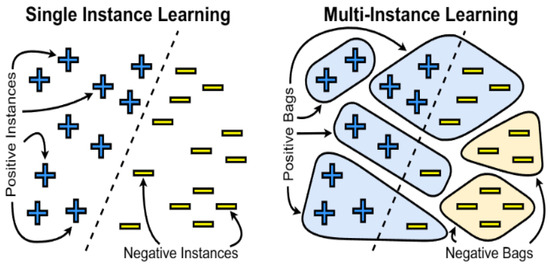
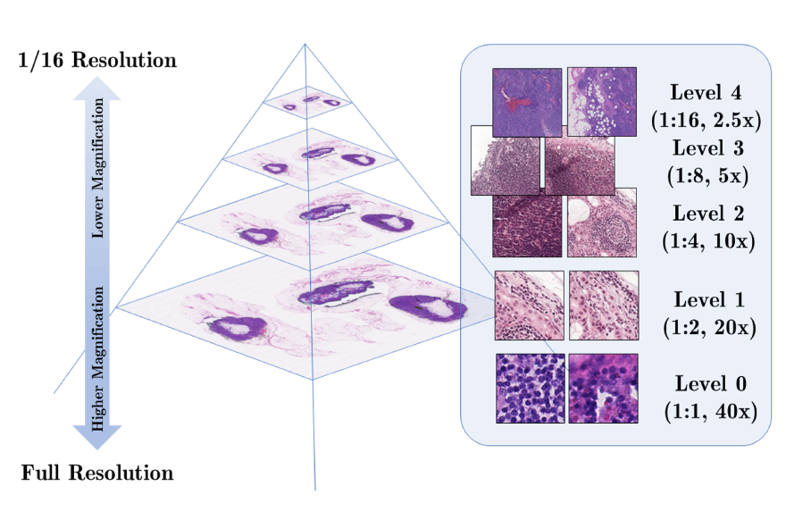
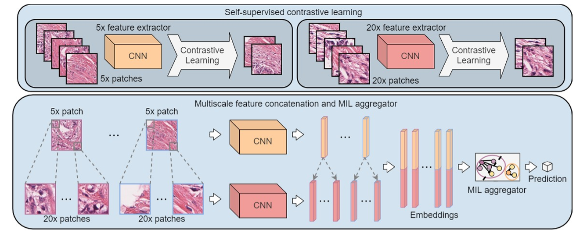
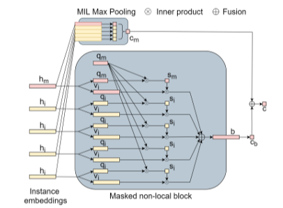
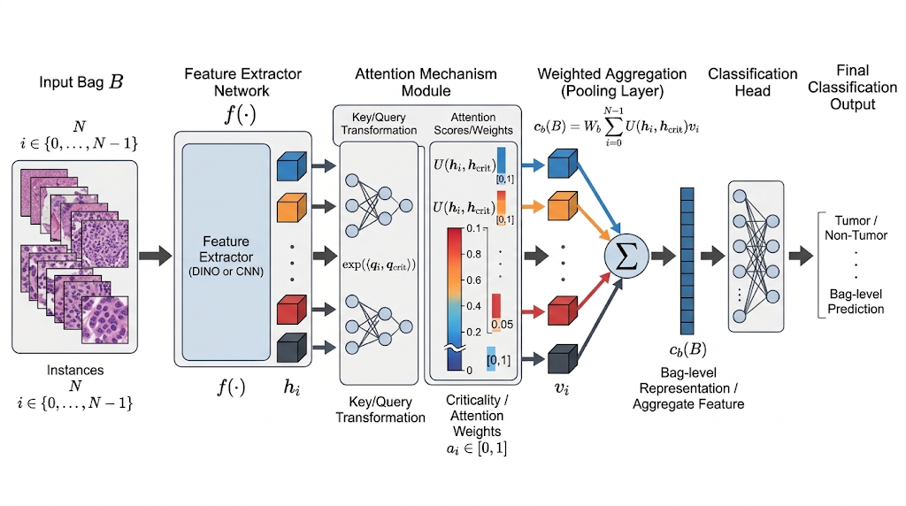
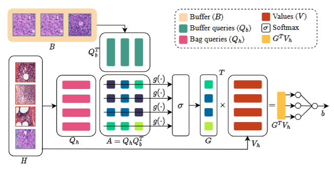
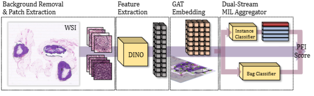
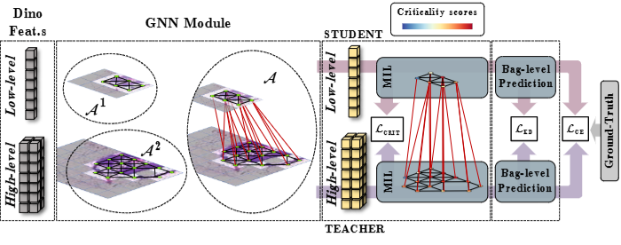

# Multi instance Learning

!!!note Definition
    **Multi instance Learning** is a form of weakly supervised learning where training instances are arranged in sets, called bags. Labels are provided for entire bags rather than for the individual instances contained in them.

The key assumption is:

- **Positive Bag**: Contains at least one positive instance.
- **Negative Bag**: Contains only negative instances.

Multiple Instance Learning is useful when labeling individual instances is difficult or impractical, can handle, also, cases where the data’s granularity is too fine for direct labeling or where the relationship between instances within a bag is important for classification.

The fact of assigning one label for the instance in the same can lead to wrongly label some instance. Positive instances may be found in negative bags. This happen because the label descrive the main content of an image

{height=50% width=50%}

The aim of MiL is to create an _embeddig space_ in which we can separete positive and negative instance even if the belong to the same bag

MiL treat the instance inside a bag as indipendent but in reality this is not true: the presence of an instance make more probable the presente of the other ones. In this case instances **co-occur** in bag when they share a semantic relation.

## MIL formulation

Given a **bag**: $$B = \{x_1, x_2, ..., x_n\}$$

MIL predicts the label of the bag by applying two transformations: $$c(B) = g(f(x_1), ..., f(x_n))$$

- **$f$**: transformation applied to each instance.
- **$g$**: aggregation function applied to the transformed instances.
- $g$ must be **permutation-invariant**, meaning that the order of the instances inside the bag does not affect the final prediction.

There are two main MIL approaches depending on the choice of $f$ and $g$:

1. **Instance-based approach**: In the **instance-based approach**, $f$ is an **instance classifier**. Each instance is directly assigned a score indicating how likely it is to be positive: $$ x_i \xrightarrow{f} s_i$$ The scores of all instances are then aggregated by a **pooling operator** $g$: $$c(B) = g(s_1, ..., s_n)$$

2. **Embedding-based approach**: In the embedding-based approach, $f$ is not an instance classifier. Instead, it is a feature extractor that maps each instance into an embedding: $$ h_i = f(x_i) $$ The embeddings are then aggregated into a bag-level embedding: $$ H_B = g(h_1, ..., h_n) $$Finally, the bag embedding is used to predict the bag label: $$c(B)=classifier(H_B)$$ A simple aggregation could be mean pooling.
More sophisticated aggregation methods include attention-based aggregation.

## Histology

{height=50% width=50%}

A better way is use **whole slide scanning** that divided the image in lot of patches from with are extracted the feature vectors. Because of WSIs have very high resolutions (e.g. 40,000 × 40,000.) and usually lack localized annotations the use of a classic CNN is not powerful enough to recognize disease.

### Dual-stream multiple instance learning: DSMIL

{height=50% width=50%}

A solution to address this problem is treat that as a MIL problem.

DSMIL is an aggregator formed by two streams apply after the preprocess and SSL net to project image to embeddign space.

Patches are before extracted from each magnification of the WSIs are used for _self-supervised contrastive learning_ separately. The trained feature extractors are used to compute embeddings of patches. Embeddings of different scales of a WSI are concatenated to form feature pyramids to train the MIL aggregator.

Given a feature extractor $f$,
each instance $_xi$ can be projected into an embedding
$$h_i = f(x_i) ∈ R^{L\times1}$$DSMIL combines multiscale embeddings using a _pyramidal strategy_, and thus ensures the local constraints of the attentions for patches in a WSI.

The **max-pooling block** stream apply the standar _MaxPooling_ to extract the highest scored instance, referred to as **critical instance**. The first stream uses an instance classifier on each instance embedding, followed by max-pooling on the scores.

$$c_m(B) = g_m(f(x_i),...,f(x_n)) = max{W_0h_0,...,W_0h_{N−1} }$$

where $W_0$ is a weight vector. The max-pooling stream determines the instance with the highest score (critical instance). Max-pooling is a permutation-invariant operation, thus, this stream satisfies equation 2.

The problem is that max pooling that can lead to a shift of the decision boundary for classification. This because the decion is taken considering the bag with the higher score. The model can increase the score of a spurious or actually negative instance to correctly classify a positive bag, without being penalized for misclassifying the remaining instances.

So, the second stream, the **masked Non-Local Operation** aggregate the instance embeddings into a unified bag embedding, which is subsequently scored by a bag classifier.

Having identified the critical instance and its corresponding embedding $\mathbf{h}_m \in \mathbb{R}^{D \times 1}$ in the first stream, each instance embedding $\mathbf{h}_i$ (including $\mathbf{h}_m$) is projected into two lower-dimensional vectors: a **query** vector $\mathbf{q}_i \in \mathbb{R}^{L \times 1}$ and an **information** (or value) vector $\mathbf{v}_i \in \mathbb{R}^{L \times 1}$, given respectively by:

$$\mathbf{q}_i = \mathbf{W}_q \mathbf{h}_i, \quad \mathbf{v}_i = \mathbf{W}_v \mathbf{h}_i, \quad i = 0, \dots, N-1 \quad$$

where $\mathbf{W}_q \in \mathbb{R}^{L \times D}$ and $\mathbf{W}_v \in \mathbb{R}^{L \times D}$ are learnable weight matrices.

Rather than computing an expensive $N \times N$ all-to-all self-attention matrix (which scales quadratically as $\mathcal{O}(N^2)$ and becomes intractable when $N > 10,000$), DSMIL anchors the attention mechanism strictly to the **critical instance** $\mathbf{h}_m$.

A distance measurement $U$ is defined to quantify the similarity between an arbitrary instance $\mathbf{h}_i$ and the critical instance $\mathbf{h}_m$ via a normalized inner product of their query vectors:

$$U(\mathbf{h}_i, \mathbf{h}_m) = \frac{\exp\left(\langle \mathbf{q}_i, \mathbf{q}_m \rangle\right)}{\sum_{k=0}^{N-1} \exp\left(\langle \mathbf{q}_k, \mathbf{q}_m \rangle\right)} \quad $$

This operation is similar to self-attention. It differs because the query-key matching is performed only between the critical node and the other nodes (including the critical node itself). Moreover, instead of matching each query with additional key vectors like self-attention, the query is matched with other queries and no key vector is learned.

The dot product measures the similarity between two queries, resulting in larger values for more similar instances. Therefore, instances more similar to the critical instance will have greater attention weights.

The final bag-level representation $\mathbf{b} \in \mathbb{R}^{L \times 1}$ is computed as the weighted sum of the information vectors $\mathbf{v}_i$, weighted by their similarity to the critical instance:

$$\mathbf{b} = \sum_{i=0}^{N-1} U(\mathbf{h}_i, \mathbf{h}_m) \mathbf{v}_i \quad $$

Because the critical instance satisfies $\langle \mathbf{q}_m, \mathbf{q}_m \rangle$ (yielding a large positive inner product), its own information vector $\mathbf{v}_m$ retains high weight in the final bag representation, preventing its signal from being diluted by thousands of negative instances.

Finally, DSMIL combines the output of the first stream instance score with the output of the second stream using a simple average:

$$C(B) = \frac{1}{2} \left( \mathbf{W}_0 \mathbf{h}_m + \mathbf{W}_b \mathbf{b} \right) = \frac{1}{2} \left( \max_{i} \{\mathbf{W}_0 \mathbf{h}_i\} + \mathbf{W}_b \sum_{i=0}^{N-1} U(\mathbf{h}_i, \mathbf{h}_m) \mathbf{v}_i \right) \quad$$

where $\mathbf{W}_0 \in \mathbb{R}^{1 \times D}$ and $\mathbf{W}_b \in \mathbb{R}^{1 \times L}$ are the classification heads for the instance and bag streams, respectively. This joint loss formulation stabilizes training while reduces computation to $\mathcal{O}(N)$ complexity.

### AB-MIL

**Attention-based Multiple Instance Learning** (**AB-MIL**) formulates the classification of a WSI by treating the image as a "bag" of unannotated patches ("instances") and learning to dynamically weigh their individual diagnostic relevance.

The WSI is tiled into $N$ individual patches. A deep learning backbone (such as a CNN or a Vision Transformer like DINO) processes each patch $x_i$ to extract a dense, low-dimensional feature embedding $h_i$.

{height=50%}

ABMIL introduce a specialized neural network module, a two-layer Multi-Layer Perceptron, evaluates each embedding $h_i$ to determine its importance.

The raw scores are normalized using a softmax function to produce attention weights $a_i$, ensuring that $\sum_{i=1}^N a_i = 1$. This trainable mechanism replaces naive, non-parametric aggregation methods like max-pooling or mean-pooling, which either lose information or amplify noise.

The individual patch embeddings are compressed into a single, global bag-level representation $z$ by computing their attention-weighted sum:

$$z = \sum_{i=1}^N a_k h_k$$

where:

$$a_k = \frac{\exp\{w^\top \tanh(V h_k^\top)\}}{\sum_{j=1}^K \exp\{w^\top \tanh(V h_j^\top)\}}$$

$a_k$ provides each embedding, $h_k$, with context about its role in contributing to the bag label. If operating under the standard MIL assumption described above, a positive instance will correspond to a higher value of $a_k$.

$w \in \mathbb{R}^{L \times 1}$ and $V \in \mathbb{R}^{L \times M}$ are learnable weight matrices. The hyperbolic tangent ($\tanh$) allows for proper gradient flow by including both positive and negative values.  

This mathematical bottleneck forces the network to mathematically prioritize highly informative patches (e.g., malignant cells) while suppressing the signal from irrelevant regions (e.g., background glass or healthy stroma).

To overcome the limitation that $\tanh$ is approximately linear for values near zero (which restricts the expressiveness of the learned relations), the authors introduce an element-wise gating mechanism (*Gated attention mechanism*):

$$a_k = \frac{\exp\{w^\top (\tanh(V h_k^\top) \odot \text{sigm}(U h_k^\top))\}}{\sum_{j=1}^K \exp\{w^\top (\tanh(V h_j^\top) \odot \text{sigm}(U h_j^\top))\}}$$

where $U \in \mathbb{R}^{L \times M}$ is an additional parameter matrix, $\odot$ represents element-wise multiplication, and $\text{sigm}$ is the sigmoid non-linearity. This learnable non-linearity removes the restrictive linearity of the $\tanh$ function. 

The aggregated feature vector $z$ is passed through a final fully connected classification head to produce the overall slide-level prediction (e.g., the probability of malignancy).

A defining engineering advantage of this architecture is its inherent interpretability. By mapping the attention weights $a_i$ back to their original spatial coordinates in the gigapixel WSI, you can generate heatmaps that highlight the precise morphological structures responsible for the model's decision, bridging the gap between deep learning abstraction and clinical explainability.

### BUFFERMIL

Generally, the positve instance represent a small percentage of dataset and this can cause the overfitting of the model misclassify positive instances. Another problems is the _covariate shift_, occurs when the distirbuion of instance within positive and negative basg differ between train and test data. This difference can force the model to focus on instances that are not actually related to the correct label.

> We have a distribution shift when the training and the test set are not independent and identically distributed.

Working wit the attention mechanis can be problematic because is only the most critical instace to drive the attention of all the other.

{height=50%}

To resolve the lass imbalance and covariate shift problem **Buffer-MIL** propose the use of a buffer to keep track of the most important instance seen during all the training process.

This bufferis updated at run-time by selecting the top-k most critical instances of each
positive slide in the training set. A patch-level classifier $clspatch(·)$ is used to find the index of the most critical patch as:

$$crit = argmax(cls_{patch}(f(x))) = argmax{W_pf (x0), ..., W_pf (xn)}$$

where $W_p$ is a weight vector.

Then, thanks to the attention mechanism, model aggregate instance embeddings into a single bag embedding. This is computed by a linear projection of each embeddigns into a _query_ and _value_. ($q_i = W_qh_i, v_i = W_vh_i$)

The query relative to the most critical instance, $q_crit$, is obtained and
compared to all other queries $q_i$ (including itself) using a distance measure $U$ defined as:
$U(h_i, h_{\text{crit}}) = \frac{\exp(\langle q_i, q_{\text{crit}} \rangle)}{\sum_{k=0}^{N-1} \exp(\langle q_k, q_{\text{crit}} \rangle)}$$

Finally, the bag score is given by:

$$c_b(B) = W_b \sum_{i=0}^{N-1} U(h_i, h_{\text{crit}}) v_i$$

The bag score is used to to select all the positive bags and extract the top-k instances within each of them. The ranking is given by the score U (hi, hcrit). The buffer is build by training the aforementioned model; at the end of the process it contains the most critical instances of each bag, providing a more stable criticality representation.

Given the current bag $H = {h_1, ..., h_i, ..., h_N }$, composed of $N$ instances, and
the buffer $B = {b_1, ..., b_i, ..., b_M }$, composed of $M$ critical instances belonging
from different slides, a new bag embedding can be computed. First, the weight matrix % trained in the previously described steps is used to perform a linear projection of all the instances hi and all the instances within the buffer $b_i$, obtaining qhi and qbi respectively.

After the attention is computed combined the projection:

$$A = Q_hQ_b^T$$

where:

- $Q_h \in \mathcal{M}^(N \times K)$ is the matrix of the projected queries of the current bag instances.
- $Q_b \in \mathcal{M}^(M \times K)$ is the matrix of the projected queries of the buffer instances.

As only a single attention score is required for each of the bag instances $h_i$, an aggregation function $g(\cdot)$ on each row of $A$ must be used to obtain a new matrix $G \in \mathbb{R}^{N \times 1}$ as:

$$G_i = g(\{A_{i,j} : \forall j \in [1, M]\})$$

All the instances $h_i$ are also projected into values $v_{h_i}$ of size $L$ using the $W_v$ weight matrix of the previous step, obtaining $V_h \in \mathbb{R}^{N \times L}$. Finally, the bag embedding is computed as:

$$b = W_b G^T V_h \tag{7}$$

with $W_b \in \mathbb{R}^{1 \times L}$ representing the weight matrix that computes the final bag embedding.

### GDSMIL

!!!note Biology context
    **High-Grade Serous Ovarian Cancer** (**HGSOC**) is a form of ovarian cancer characterized by multiple treatment recurrences with variable response to platinumbased chemothereapy.
    
    The prediction of **Platinum-Free Interval** (**PFI**), defined as the time interval between the end of chemotherapy and disease recurrence, is determinant for treatment planning and is usually performed by analyzing the histological tissue digitalized in Whole-Slide Images (WSIs).

    **NeoAdjuvant ChemoTherapy** (**NACT**) is a treatment strategy that aims to reduce the tumor size before surgery, making it easier to remove the tumor and improve patient outcomes. This is reccomended for patients with **Primary Debulking Surgery** (**PDS**) a surgery that aims to remove as much of the tumor as possible in one operation, but it can be challenging for patients with advanced-stage ovarian cancer. In these cases, NACT is often preferred to shrink the tumor before surgery.

NACT causes strong variable changes and heterogeneity in tumor morphology and composition, making the prediction of PFI from WSI extremely challenging.

AB-MIL approaches do not exploit any spatial dependency between instances, which may be crucial in some application. A better solution is to use the Graph Attention Network (GAT) to model the spatial relationships between instances before MIL aggregation, introducing
a local context into each instance.

{height=50% width=50%}

Embeddings are obtain from a self-supervised extractor (like DINO). These contains important local information inside the patch and to capture also the micro and macro interaction between instances a GNN with GAT is used.

At the end a DS-MIL aggregator is used to have a PFI score.

### DAS-MIL

Pixel-level annotation of gigapixel WSIs is highly expensive and time-consuming in clinical practice. While Multi-Instance Learning (MIL) addresses this by treating the WSI as a "bag" of unannotated patches (instances), most current multi-scale MIL approaches simply flatten the representation by concatenating feature vectors. This naive flattening completely ignores the natural spatial and hierarchical structure of pyramidal WSIs.

{height=50% width=50%}

To resolve this problem DAS-MIL propose after the extraction of feature with a self-supervised extractor (DINO, again :|), to create a more contextualized feature a **pyramidal Graph Neural Network** framework combined with (**self**) **Knowledge
Distillation** is implemented.

Each node of GNN represent an individual WSI patch seen at different scales and connected to its 8 neighbours (8-connectivity) in the euclidean space and between scales following the relation “part of”.

New contextualized patch representations, obtaind from GNN, are then fed to the AB-MIL module which produces bag-level scores $y_1^{BAG}, y_1^{BAG} \in \mathcal{R}^{1 \times C}$
where C equals the number of classes.

module provides additional importance scores $z_1 \in R^{N1}$ and $z_2 ∈ R^{N2}$, which quantifies the importance of each original patch to the overall prediction.

To align _bag-level score_  and a _patch-level_ one a KD module is used, because the higher resolutions generally yield better classification performance.

Aligns the bag-level predictions between the two scales using the Kullback-Leibler (KL) divergence. It utilizes a temperature scalar $\tau$ to let secondary information emerge from the teaching signal:

$$\mathcal{L}_{KD} = \tau^{2} KL \left( \text{softmax}\left(\frac{y_{1}^{BAG}}{\tau}\right) \Bigg\vert{}\Bigg\vert{} \text{softmax}\left(\frac{y_{2}^{BAG}}{\tau}\right) \right)$$

A second align term regards the instance scores.
Minimizes the Euclidean distance between the low-resolution criticality grid map ($z_{1}$) and its subsampled counterpart from the high-resolution branch to ensure consistency in instance-level scoring:

$$\mathcal{L}_{CRIT} = \vert{}\vert{}z_{1} - \text{GraphPooling}(z_{2})\vert{}\vert{}_{2}^{2}$$

> It considers the relation “part of” between scales and then averages the child nodes, hence allowing the comparison at the instance level.

The overall optimization objective in DAS-MIL is a mixture of supervised classification loss and self-knowledge distillation constraints. The total loss function is formulated as:

$$\min (1-\lambda)\mathcal{L}_{CE}(y_{2}^{BAG}) + \mathcal{L}_{CE}(y_{1}^{BAG}) + \lambda\mathcal{L}_{KD} + \beta\mathcal{L}_{CRIT}$$

It is composed of three distinct terms:

* **Cross-Entropy Loss ($\mathcal{L}_{CE}$):** Computes the conditional likelihood against the ground truth labels $y$ for the bag-level predictions of both the higher resolution ($y_{2}^{BAG}$) and the lower resolution ($y_{1}^{BAG}$).

* **Knowledge Distillation Loss ($\mathcal{L}_{KD}$)**

* **Criticality Consistency Loss ($\mathcal{L}_{CRIT}$):** 

The hyperparameters $\lambda$ and $\beta$ control the trade-off between the supervised teaching signals provided by the labels and the consistency regularization provided by the higher resolution.