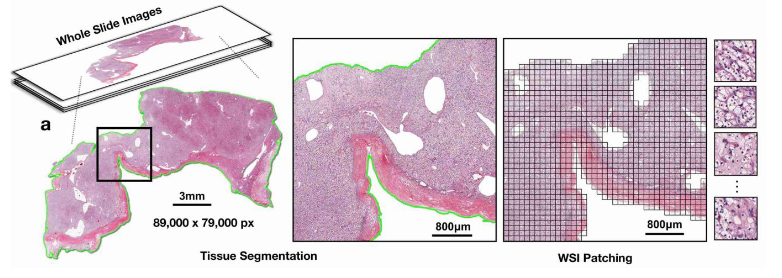
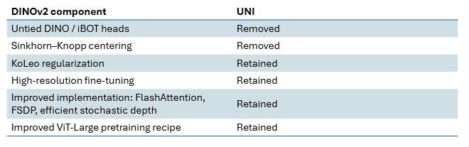
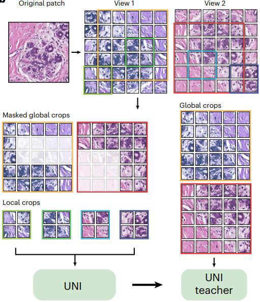
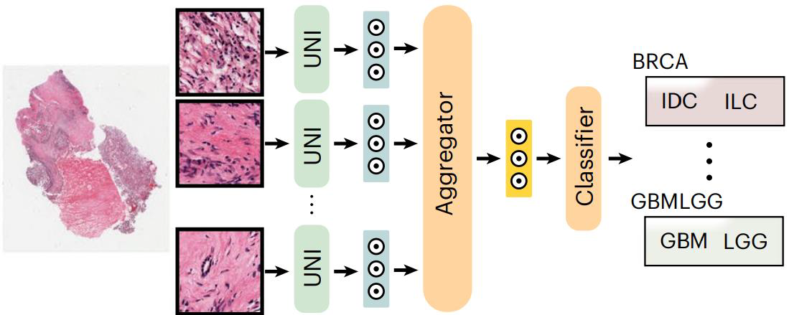
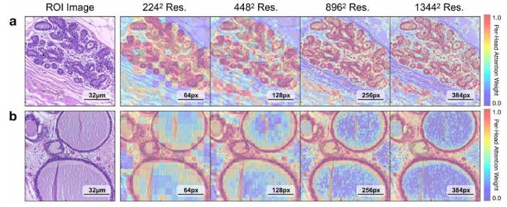
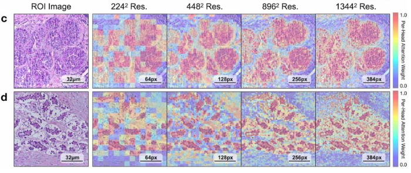
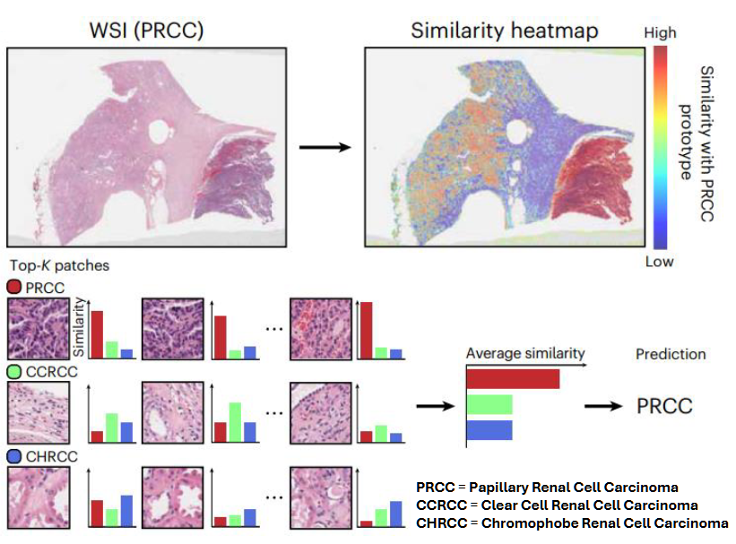

# UNI

Uni is a self-supervised pathology foundation mdoel with the objective to learn trasferable representation from many computational pathology tasks based on SSL DINOv2. the reason is to reduce the task dependes on task-specific labelled dataset.

!!!note Terminology

    H&E means Hematoxylin and Eosin, the most common staining method in histopathology.

    - Hematoxylin stains cell nuclei mainly blue/purple.
    - Eosin stains cytoplasm and extracellular proteins mainly pink/red.
    
    This staining creates contrast between different tissue components, making cellular and tissue morphology easier to distinguish under a microscope. In Hematoxylin and Eosin images:

      - Purple = nuclei/cell-rich regions
      - Pink = cytoplasm/stroma
      - White = lumina, adipose vacuoles, or empty/background areas
      - Red = often blood / strongly eosin-stained material

    So, an H&E whole-slide image is a digitized pathology slide stained with hematoxylin and eosin to make tissue structures easier to distinguish.

    In computational  pathology, a patch/tile is an image region cropped from a whole-slide image (WSI). This will be the input of ViT and divided in further patches/tokens. This latter are the **patholgy patches**.

The objective war to pre-train an visual encoder on pathological tissue to be use in different downstrem tasks without train a task-specific model from scratch.

## Dataset: Mass-100k

This dataset collect diverse histopathology image and contains:

- 100,000 diagnostic WSIs
- 100 million image patches
- 20 major tissue types

The WSIs are first processed to identify tissue regions and remove background and then divided in 800 non-overlappign tiles/WSI. To have very fine grained detail of the image a 256x256 x20 magnification is applied. At the end, extract 512x512 for high resolution FT.

{height=50%}

UNI uses self-supervised learning, meaning that the model can learn useful visual representations without requiring a human-provided class label for every training image and to this rely on DINOv2 architecture.

{height=50%}

Once UNI has been pre-trained, the encoder can be used for several different downstream tasks.

{height=50% width=50%}

## Downstream tasks

The first applyed is the _patch-level classification_ that classify a single ROI patch into a diagnostic or tissue category.
Each patch of WSI is pass throught UNI to extreact feature ([CLS]). Then is apply a liner probling or KNN probling, to perfrom the classifiation of patch without retarin the UNI encoder because it has already learn a meaningful representation during pre-training.

The second performed is the _patch-level segmentation_ that use _segmentation module_ to convert feature extracted from UNI ViT into a dense segmentation map. The entire network is fine-tuned end-to-end for the segmentation task.
his demonstrates that the features learned by UNI contain not only global semantic information but also useful local spatial information. Having segmnation network allow to recognise more fast the important region.

The third performed is the _patch retrieval_ allowing retrieve similar images that are similar to UNI representation space.  This is done

- encode the query image patch with UNI.
- encode the database image patches with UNI.
- compare their feature vectors using a distance metric.
- rank database images from most similar to least similar

UNI can retrieve visually/semantically similar tissue regions. This is useful for evaluating whether the embedding space is meaningful.

The fourth is _Patch-Level Prototyping/Few-shot Classification_. Starting from the embedding space, if we have few example of each class we can create a **prototype class**. $$p_i = \frac{1}{N} \sum_{j=1}^{N} z_j$$

We use this prototype to classify new image without rely on a label. Important for small or rare-disease datasets, where only a limited number of annotated samples may be available.

The prototype method needs a similarity/distance measure between embeddings. Euclidean distance and cosine similarity are equivalent only under certain normalization conditions, e.g. when embeddings are L2-normalized. So minimizing Euclidean distance is equivalent to maximizing cosine similarity.

The Last one is the _Slide-Level Classification_ where the input is the WSI, not patches.The task consist of predicting a diagnosis or category for the entire WSI.

{height=50%}

However, the WSI is too large to directly feed into UNI. So, WSI are before preprocessed using a MIL technique (like CLAM or similar) that convert each tile in an instance and UNI prodice an embedding for each go them. An aggregator (AMBIL Attention-Based Multiple Instance Learning) combine them into a slide-level representation and then is fed to a classifier.

## Results

{height=50%}
{height=50%}

Each square is the token processed by ViT. Increasing thre resolution we have more grain fine details. Circular elements (a) are secretari units that procude milk. Circular element with with part are lumina. In (a) there is not tumor.

In (b) we have the same "cellule" but are benign, The ViT focus more on the border of this cell
In \(c) instead there is a in situ (carcinoma) an ViT is able to focus on the anormal proliferation of ...
In (d) there is a invasive carcinoma itis spread everywhere (?). Tumor is not localizate in a certain region.

Few-shot performance: UNI is very strong even if it has only one prototype. This beacsua is able to extract very good features from the backbone respect to other model that have need a very lot data.

{height=50% width=50%}

**Prototypical few-shot slide classification**: Predict  the  class  of  the  whole  WSI using only a few labeled examples.

- Build one representative prototype for each class from labeled patches.
- For each prototype, compute the similarity between the prototype and all the WSI patches
- For each prototype, select the top-𝐾 most similar patches and average their similarities.
- Predict the class with the highest average similarity.
- The heatmap shows where patches similar to a chosen class prototype are located in the WSI
