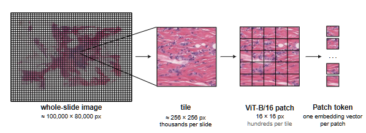
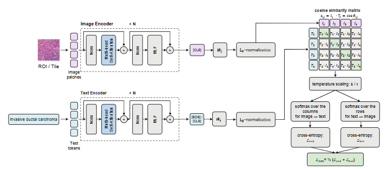
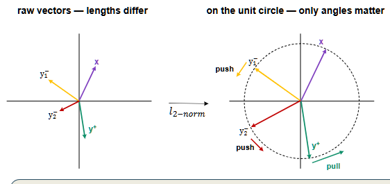
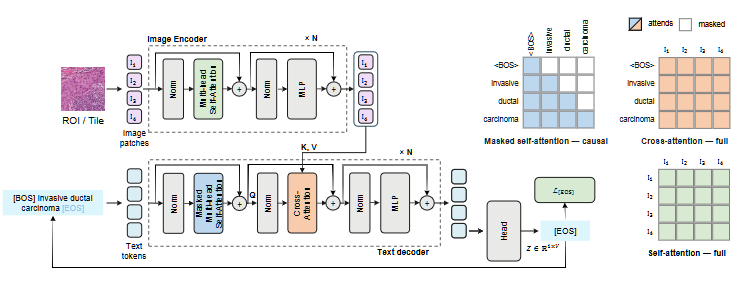
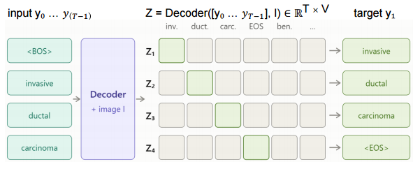
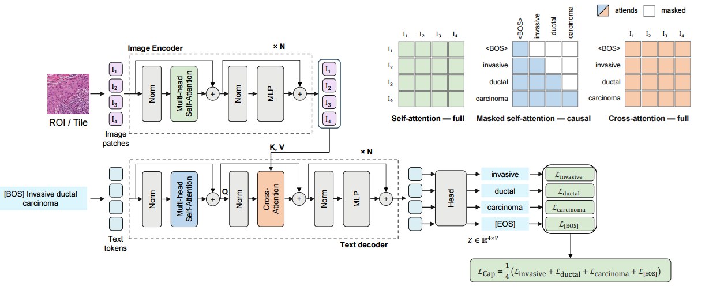
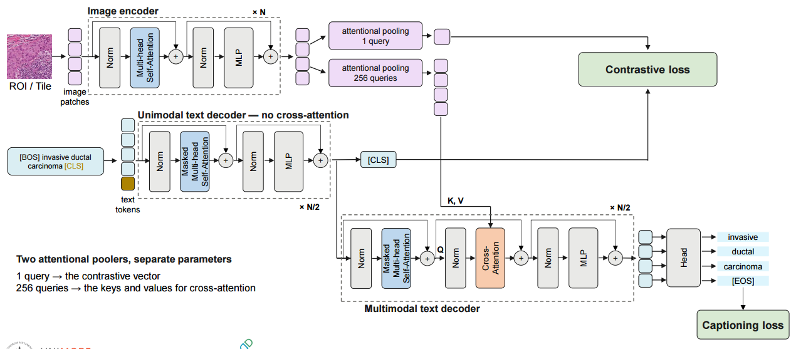
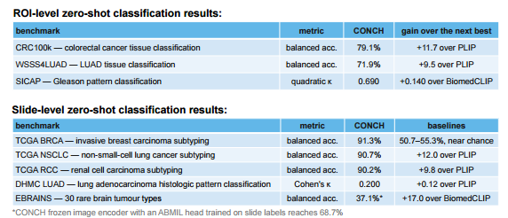
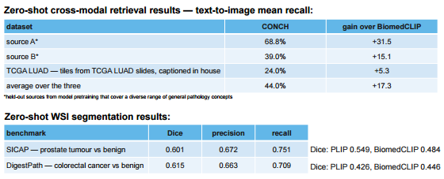

# Visual-Language models

Before foundation model for each problem a model are built but the main problem are the lack of data and good annaotation. Foundation mdoel resolve this problem train model on a very large dataset taht are able to generalize.

Another problem is  that pathology is practiced in language; other than image the are combiend with writter report of pathologist, diagnoses ecc. Foundation mdoel resolve also this problem because are train with image and their corrispondent text description.

Vision-only model are not powerful enough to cpture all the information, hidden pattern in a histologic image because a lot of information are hidden also in the written knowledge that descrivbe the diagnoses, the nuclear structure and so on.

**Vision-language model** can resolve this kind of problem.

!!!note Definition
    A **vision-language model** (**VL**) is a multimodel ai system that are able to understand and process vaious type of input, like texts, images, videos. Generally are built combine an LLM to a vision encoder to give the LLM the ability to see.

In computational pathology, VL models were limited by the scale of the available image–caption data, so performance remained limited, and their broader capabilities had not been extensively evaluated.

There are two common paradigms for vision–language **pretraining/pretext task**:

- **dual-encoder/contrastive learning**: that learn a common latent space where similar samples are close to each other while dissimilar ones are far apart.
- **image-conditioned text generation**: that learn starting from an image as visual context to generete a **text description** for the image

!!!note Terminology

    

    WSI: very high resolution image
    tile: crop from WSI
    patch: input of ViT
    ROI: iamge cropped by someone, we don't have the original image

## Dual-Encoder/Constrastive Learning

This paradigm are built using an image encoder and text encoder that are trained jointly to project text-image pairs in a common latent space in a way to pull together the $N$ matching image–caption pairs and  push apart the $N^2 − N$ non-matching pairs.

Generally the text encoder is a stack of casual or full self-attention, while image encoder is a stack of full self-attentim and both generate an embeddig per text/patch token. For the text this embedding is the [EOS] or [CLS] token, depending on the modality; while image embedding is the [CLS] embeddign that represent the image.

This emebedding can have differnent dimensionality so a $L_2$ normalizzation layer is added to resixe the embedding and making it comparable for the comuting od similarity. From a geometrical point of view, after the $L_2$ normalizzation vector have same lenght, so also the angle between vector matters.

Thank to the contrastive objective the embeddign space, during the training process, is reorganized to push together matching pairs and push apart non-matching pairs. After $L_2$ normalizzation, computing the cosine similarity ([-1;1]) correspond to dot product between vectors and this is why

- Increasing cosine similarity means reducing the angle between matching embeddings;
- Decreasing cosine similarity means increasing the angle with non-matching embeddings

The similarity is computed by rows and by columns and before compute the loss similarity are scaled with temperature $\tau$ and softmax is apply over the rows and colums to have probability. CE Loss are formed by two terms:

- image-to-text contrastive loss is:
  $$\mathcal{L}_{I\rightarrow T}=
    -\frac{1}{N}
    \sum_{i=1}^{N}
    \log
    \frac{
    \exp(z_{ii})
    }{
    \sum_{j=1}^{N}\exp(z_{ij})
    }
    $$

- and text-to-image loss is:

    $$
    \mathcal{L}_{T\rightarrow I}
    =
    -\frac{1}{N}
    \sum_{i=1}^{N}
    \log
    \frac{
    \exp(z_{ii})
    }{
    \sum_{j=1}^{N}\exp(z_{ji})
    }
    $$

The final CLIP loss is the symmetric average:

$$

\mathcal{L}
=
\frac{1}{2}
\left(
\mathcal{L}_{I\rightarrow T}
+
\mathcal{L}_{T\rightarrow I}
\right)

$$

The diagonal elements $z_{ii}$ correspond to the **correct image–text pairs** (positive pairs), while the off-diagonal elements correspond to **negative pairs**.

The key idea is that CLIP learns whatever visual detail is necessary to distinguish the correct image–text pair from the negative pairs in the current training batch. It is not producing a detailed representation for every pixel or every anatomical structure to find the correct matches.

So the granularity of the learned representation depends partly on the diversity and difficulty of the negative examples.

Therefore, the visual representation only needs enough detail to discriminate the positive pair from the negatives in the batch. If the batch contains different organs, coarse anatomical features may be sufficient; if it contains visually similar samples from the same organ, finer morphological features are required. Because this kind of model is an alignment model rather than a generative model, it can measure image–text compatibility but cannot generate a textual description of an image.

## Encoder-Decoder Captioning

Also this kind of paradigm is based on a encoder-decoder nets with the objective learn the corresponding caption of image.

The text decoder consists of casual self-attention and cross-attention layers which integrate textual and visual information. The encoder is autotegressive (e.g. BERT) so it produce one next work for previous input. New prediction is append to the input and use to predict next token.

The training process start inputted to the text encodere the [BOS] token and predict the first token. Casual self-attention consiste to mask future token in a way to predict the new token only considering the past and the current ones. This is done adding to attention score a causal mask $M$:

$$
M_{ij} =
\begin{cases}
0 & j \leq i \\
-\infty & j > i
\end{cases}
$$

in this way future tokens receive zero attention after the softmax.

The output dimension is $h_t \in \mathbb{R}^{1 \times d}$ that is passed througth a liner projection layer to map each logit to every tokenin the vocabular  $V$. 

$$
P(y_t=v \mid y_{<t}, I)
=
\frac{\exp(z_{t,v})}
{\sum_{u \in V}\exp(z_{t,u})}
$$

The model is trained to maximize the probability of the correct next token at every position.

The autoregressive probability of the complete sequence is:

$$
P(y_{1:T}\mid I)
=
\prod_{t=1}^{T}
P(y_t \mid y_{<t}, I)
$$

Therefore, the training loss is the negative log-likelihood:

$$
\mathcal{L}_{gen}
=
-\sum_{t=1}^{T}
\log P(y_t \mid y_{<t}, I)
$$

or, equivalently, the average cross-entropy loss:

$$
\mathcal{L}_{gen}
=
-\frac{1}{T}
\sum_{t=1}^{T}
\log P(y_t \mid y_{<t}, I)
$$

The loss is backpropagated through the text decoder and, depending on the architecture, through the visual encoder as well.

One advantage is that training process can be parallelizable posible because during training, the complete target sequence is already available.

All sequence in inputted i the decoder, so it get a matrix. The decoder receives the sequence shifted by one position. Even though all tokens are provided to the decoder simultaneously, the causal self-attention mask prevents position $t$ from seeing future tokens.
After softmax, each row (matrix dim: $T \times |V|$), represent a probabiliy distribution over the entire
vocabulary for the **next token at that position**

The loss is the average cross-entropy over all $T$ predictions

At inference time, the target sequence is **not known**, model generate token by token. The next token is selected as the token with the highest probability. This new token is appended to the input and the process repeats to predict the next token.

One problem of this configuration is the lack of shared feature space

## CoCa

**CoCa** (**Contrastive Vision-Language Pretraining with Captioning**) retrain an image–text encoder–decoder model jointly with a contrastive loss and a captioning loss in a single forward, combining the capabilities of both paradigms.

The problem is contrastive branch needs a unimodal text encoder, while the captioning branch needs a text decoder with cross-attention layers.

**Solution**: slip text decoder in two parts

- remove the cross-attention from the first half of the layers of the text decoder and add a learnable [CLS] token at the **end of the input sequence** due to casual masking → a _unimodal_ text representation for the contrastive loss.
- The second half retains cross-attention → a _multimodal_ decoder that generates the caption, as required by the captioning branch. Therefore, these layers receive:

  - the text representation from the first half
  - the image representation through cross-attention

**Attentional pooling** is a learnable query need due to the fact that contrastive and captiong require differente representation. Hence two attentional poolers:

- 1 query for the contrastive loss
- 256 queries for the captioning loss

The attention mechanism therefore learns which visual regions are
important for producing the representation.

The important advantage is that the two objectives can be computed
**within the same forward pass**. The final training objective combines the two losses:

$$
\mathcal{L}
=
\mathcal{L}_{contrastive}
+
\lambda\mathcal{L}_{caption}
$$

Caption generation requires **more detailed information** about the
image. The decoder needs to capture fine-grained visual information to generate the correct sequence of words.

## CONCH

CONH is CoCa pretrained on histopathology  image–caption pairs

- Image encoder: self-supervised pretraining with iBOT
- Text decoder: pretraining on pathology-related text
- Then joint vision–language pretraining: contrastive + captioning losses

thsi allow to extract more informative feature and the jointly is used to alig the feature vector to patholy fiels

### Dataset

CONCH was trained on a large-scale collection of histopathology image–caption pairs, specifically designed to learn the relationship between visual pathology and pathology-related language

The image–text pairs were collected mainly from:

- **PMC-Path** — built from the **PubMed Central Open Access** subset, the NIH archive of biomedical literature that hosts articles under a reuse licence.
   - Images: micrographs already cropped by an author, not tiles from a WSI — so their magnification is not standardized. They come as panels: several sub-images under a single caption.
   - Captions: a single caption covers all the sub-images, detailing the entity shown, the morphological pattern, the stage, clinical history, outcome, and molecular results.
- **Educational pathology** resources n-house educational material, never released and never described in detail. Image–caption pairs already cleanly paired: one image, one caption, no panels to split.

#### Data preprocess

The initial collection contained approximately 1.79M image-text pairs
After filtering and quality control, the final multimodal pretraining dataset contained approximately 1.17M image-text pairs

1. Filter only histology images. This removes irrelevant visual content such as graph, diagram and so on
2. A language model is trained on synthetic examples, built by concatenating single-panel captions whose correct split is
known by construction. It is then applied to split image captions into sub-captions.
3. A CLIP model, trained on the EDU pairs where the pairing is
already clean, matches each sub-image to its sub-caption.
4. Removing non-human histology

The dataset includes different types of histopathology images, including H&E, immunohistochemistry (IHC), and special stains, covering a broad range of tissues and pathological conditions.

These pairs are used to jointly optimize the two objectives of CoCa

Contrastive learning — align image and text representations. Thus, the dataset provides both visual pathology knowledge and pathology language knowledge while the paired image–caption data teaches CONCH how to connect the two modalities.

### Task

#### ROI-level Zero-Shot Classification

* **Prompt Formulation:** Each class is represented by a text prompt (e.g., *"an image of {}"*), typically authored by a domain expert like a pathologist.
* **Encoding:** The image and the text prompts are processed by their respective encoders to generate embeddings $i$ and $t_j$.
* **Normalization:** Both embeddings are $L_2$-normalized.
* **Similarity Computation:** A cosine similarity score is calculated between the image embedding and each class prompt embedding.
* **Classification:** The image is assigned to the class that maximizes this similarity:

$$y = \underset{j \in \{1,\dots,C\}}{\text{argmax}} (i \cdot t_j)$$

#### Slide-level Zero-Shot Classification

* **Tile Extraction & Encoding:** Tiles are extracted from the Whole Slide Image (WSI) and embedded independently. Let $z_n$ be the normalized embedding of tile $n$, and $t_c$ be the normalized text embedding of class $c$.
* **Scoring:** The similarity score $s_{n,c}$ for each tile-class pair is computed as:

$$s_{n,c} = z_n \cdot t_c$$

* **Top-K Pooling:** For each class $c$, the algorithm selects the $K$ tiles with the highest similarity scores (denoted as $\text{TopK}_c$) and averages them to obtain the final slide-level score $s_c$:

$$s_c = \frac{1}{K} \sum_{n \in \text{TopK}_c} s_{n,c} = \frac{1}{K} \sum_{n \in \text{TopK}_c} (z_n \cdot t_c)$$

---

* **CONCH significantly outperforms medical vision-language baselines (PLIP, BiomedCLIP) in both ROI and slide-level zero-shot classification**.

* **At the ROI level, it delivers substantial performance gains**, including a +11.7% increase in balanced accuracy for colorectal cancer classification compared to PLIP.

* **At the slide level, it achieves over 90% balanced accuracy across multiple TCGA benchmarks**, completely bypassing the near-chance performance of baselines on complex tasks like BRCA subtyping.

* **The extracted tile-level embeddings are highly discriminative**: coupling the frozen CONCH encoder with a trained ABMIL head boosts accuracy on difficult 30-class benchmarks (e.g., EBRAINS) from 37.1% to 68.7%.

---

#### Zero-Shot Cross-Modal Retrieval

Retrieval can be performed bidirectionally:

1. **Text-to-Image:** Given a text query, retrieve the most similar images from a candidate pool.
2. **Image-to-Text:** Given an image query, retrieve the most similar text descriptions from a candidate pool.

* **Pipeline:**
* The query and all candidate items are mapped to the same latent space using their corresponding encoders.
* The resulting vectors undergo $L_2$-normalization.
* Cosine similarity is computed between the query embedding and each candidate embedding.
* Candidates are finally ranked in descending order based on their similarity scores.

#### Zero-Shot WSI Segmentation

* **Tile Classification:** Tiles are extracted from the WSI with a 75% overlap and classified using the ROI-level approach described above.
* **Spatial Projection & Smoothing:** The predicted class scores for each tile are projected back to their original spatial locations. In overlapping regions, class scores are averaged to produce smoother decision boundaries.
* **Map Generation:** The final segmentation map is generated by assigning each pixel to the class with the highest aggregated score.
* **Key Advantage:** This pipeline requires zero task-specific training; the segmentation emerges purely from tile-level classification and spatial re-assembly.

---

* **CONCH demonstrates significantly superior performance in zero-shot cross-modal (text-to-image) retrieval**, achieving an average mean recall of 44.0% across three datasets and outperforming BiomedCLIP by 17.3 percentage points.

* **Its generalization capability is especially evident on "held-out" sources** (unseen during pre-training), where CONCH achieves improvement margins over BiomedCLIP of up to +31.5 points.

* **In zero-shot WSI segmentation, CONCH consistently outperforms PLIP and BiomedCLIP models**, demonstrating greater spatial reliability without any task-specific training.

* **In complex diagnostic segmentation tasks (SICAP and DigestPath)**, the model distinguishes tumor from benign tissue with Dice scores exceeding 0.601, significantly pulling ahead of baselines that stall between 0.426 and 0.549.****

---

### Limitation

1. pretrain data are limited compared to general datset use for foundation model
2. difficult prevent containiation because of usni large dataset
3. Robustness was not fully tested — the model was not evaluated across different staining protocols, scanners, or tissue preparation procedures.
4. Top-K pooling assumes mutually exclusive classes — it works best when each region is expected to belong to only one class. It is less suitable, for example, for Gleason grading, where multiple patterns can coexist in the same slide -> assign a single label is nont correctly. same for tumore identificatio even if one tile contain tumor cell
5. Nothing below the region level — fine-grained visual concepts at the cellular or subcellular scale were not studied and remain outside the scope of the model. nuclear pattern ecc remain outside this work
6. Zero-shot performance is still weak on rare and complex diseases — on EBRAINS, zero-shot performance is low, while adding supervised training substantially improves the results. 
