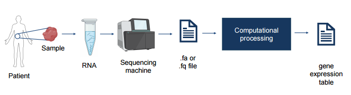
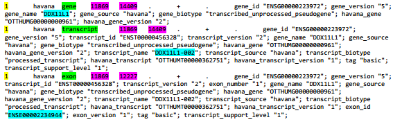
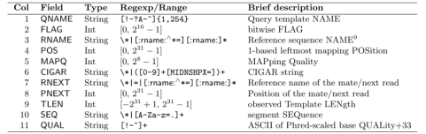
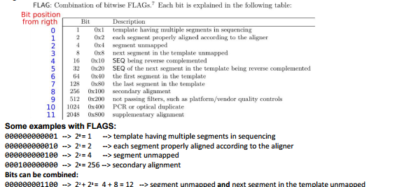
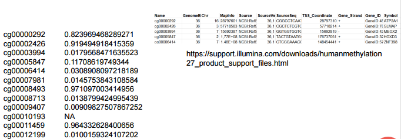
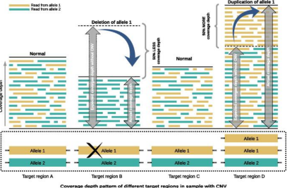
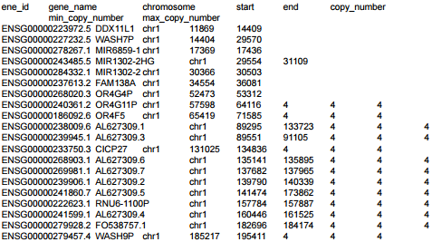

# Molecular data

Molecular data extracted from a tissue sample is divided into two main structural categories, depending on the target starting molecule (RNA or DNA):

* **RNA-derived data:**
  * **Gene Expression (mRNA expression):** This quantifies messenger RNA transcript levels to measure the actual transcription activity of genes. These are the exact numerical vectors generated through the alignment pipeline (FASTA/FASTQ $\rightarrow$ SAM/BAM $\rightarrow$ read count vector) that we analyzed previously.

* **DNA-derived data:**
  * **Methylation:** This falls under the field of epigenetics. It tracks the presence of a methyl group covalently bound to a cytosine (usually in CpG dinucleotides). If this modification is located in the promoter region, it physically inhibits the transcription of the target gene. Computationally, this data is normalized and expressed using a continuous metric called the *Beta value*.
  * **Copy Number Alterations (CNA):** These measure macroscopic structural variations in the genome related to the number of copies of a gene. Normally, an individual inherits two alleles for each genomic locus (forming homozygous or heterozygous genotypes). CNA analyses rely on studying the coverage depth in sequencing data: a drop (e.g., -50%) or a spike (+50%) in coverage compared to a normal baseline indicates the deletion or duplication of an allele, respectively.

## Gene Expression data

Gene expression analysis measures the activity of genes by analyzing the RNA extracted from a biological sample.
The process involves:

1. **Sample collection**: A biological sample is obtained from a patient.
2. **RNA extraction**: RNA is extracted from the sample.
3. *RNA sequencing*: A sequencing machine produces digital files containing nucleotide sequences.
4. **Computational processing**: The sequencing data is processed to obtain a gene expression table.

{height=50% width=50%}

Sequencing produces a very large amount of data, with files that can reach 15^30 GB per sample. A **gene expression table** represents the expression levels of genes across different biological samples.

- Rows: Genes (approximately 60,000 annotated human genes, including around 20, 00 protein-coding genes).
- Columns: Biological samples, often obtained from different patients.
- Values: The expression level of gene in sample $j$, represented as $z_{ij}$.

Each column represents a sample vector, containing the expression levels of all analyzed genes for that sample. These vectors can be used to classify patients based on their gene expression profiles.

### First generation sequencing

First-generation sequencing, mainly based on the **Sanger method**, allows DNA fragments to be sequenced individually. In Sanger sequencing, a DNA molecule is first amplified or cloned and then sequenced through the controlled incorporation of dideoxynucleotides (ddNTPs), which terminate DNA synthesis when incorporated.

The resulting DNA fragments are separated according to their length, allowing the nucleotide sequence to be reconstructed.

Sanger sequencing provides highly accurate and relatively long reads, typically up to around 800–1000 bases under favorable conditions. However, it generally processes a limited number of DNA fragments at a time, making it relatively expensive and inefficient for sequencing entire genomes or very large numbers of samples.

### Second generation sequencing

Second-generation sequencing, commonly referred to as **Next-Generation Sequencing** (**NGS**), is based on the massively parallel sequencing of many DNA fragments simultaneously.  The DNA is first fragmented into a large number of relatively short fragments. Sequencing adapters are then attached to the fragments, allowing them to interact with the sequencing platform.

The fragments are subsequently amplified and/or clonally amplified on the sequencing surface, depending on the technology. This generates many copies of the same DNA fragment, producing a sufficiently strong signal for the sequencing instrument to detect the nucleotides incorporated during sequencing.

The sequencing process generates millions to billions of short DNA sequences called *reads*. Unlike Sanger sequencing, where the sequence of an individual DNA fragment is directly obtained, NGS produces a large collection of reads that must be computationally analyzed. For a reference-based analysis, each read is aligned to a reference genome to determine its most likely genomic position.

**DNA Fragment Amplification** - During second-generation sequencing, DNA fragments are amplified to produce manycopies of the same sequence.  Amplification allows the sequencing instrument to measure the signal generated by a population of identical DNA molecules.

Having multiple copies makes it easier for the sequencing machine to detect the nucleotide sequence reliably and helps reduce the impact of sequencing errors. This improves the accuracy of the sequencing process.

### Reference Genoma

The **Reference Genoma** is a standardized digital database representing the "canonical" nucleotide a specific species. It is not the DNA of a single individual, but a computational mosaic assembled and continuously validated by the scientific community from multiple donors.

### Sequencing File format

#### .fa file

Each record is formed by:

- **header**: >read_id_N
- **sequence**: one or more rows contains nucleotide sequence

```text
>read_id_0 
GGTATGCTTCTGGGGCGGCAGTCGATAGGGCTAGACTCAGGTCCCGTGGC 
>read_id_1 
CACTGTGGCCCTCTTGGGGGGTGTCCACACGCCGCCCGTCGGCCCCCTCC 
>read_id_2 
GTTCTGTGGGTACCTCGCGGTTATGGTGTCGGGGGTATCCAAGGCACCCC
```

#### .fastq file

Similar to FASTA file, but with mapping quality information for each base. Both the sequence letter and quality score are each encoded with a single ASCII character. The FASTQ format provides a strictly structured 4-line block:

- **The Identifier**: Begins with @ (instead of >). It contains highly granular hardware metadata generated by the sequencer. For example, the string HWI-ST1362:33:D1J0JACXX:6:1101:1687:2354 encodes the instrument ID, the run number, the flowcell ID, and the exact physical (x, y) coordinates of the DNA cluster on the optical plate.

- **The Sequence**: The string of nucleotides read by the machine.

- **The Separator**: Always begins with +. Historically, it was used to repeat the identifier from line 1. Today, for storage optimization, it is often left empty after the + (or includes repetitions, as in your example).

- **The Quality Scores** (**Phred Score**): This is the fundamental line for biological data engineering. It is an ASCII string that has the exact same length as the nucleotide sequence (e.g., 101 characters).

```text
@ERX288614.1 HWI-ST1362:33:D1J0JACXX:6:1101:1687:2354 length=101 
TTTTTCTAGACGGCAGGTCAGGTCCACCACTGACACGTTGGCAGTGGGGACACGGAAGGCCATGCCA 
+ERX288614.1 HWI-ST1362:33:D1J0JACXX:6:1101:1687:2354 length=101 
<<BFFFF0BBF<0FFFFIBB0BFBF7BF0<<BFB0BFBF<<<0BFBB7BBFFFFFFFFBBB<77<B<
@ERX288614.2 HWI-ST1362:33:D1J0JACXX:6:1101:1519:2446 length=101 
CCCTATTCTGCTAGCTTGGGTTTAGTTCTTCTTTTTGTAGGTCCTTTAAAGTGTATAGTTAGGTGAC
+ERX288614.2 HWI-ST1362:33:D1J0JACXX:6:1101:1519:2446 length=101 
BBBFFFFFFBFFFFFFFFFIFFIBFFFFIIFFFFFFF<BFF7BFIII<<'BFFBBFFIBF<BB'0<F
```

#### Alignment to the Reference Genome

Reconstructing a genome from scratch (de novo sequencing) is time-consuming. Instead, researchers use the existing human reference genome as a template.
Alignment compares each read with the reference to identify its chromosome and genomic position.
The process must consider:

- **Mismatches**: Differences between the read and the reference.
- **Gaps**: Insertions or deletions represented during alignment.
- **Sequencing errors**: Incorrectly identified nucleotides.
- **Multiple matches:** A read may align to different genomic positions.

```text
>chr1
NNNNNNNNNNNNNNNNNNNGGTATGCTTCTGGGGCGGCAGTCGATAGGGCTAGAC
TCAGGTCCCGTGGCCATATTAGCATACTCATCATCATGCAGCATACTCATCGACC
CGCGCGCATATAGCGCGATATAGCGCGATATCGCGATATAGCGCACACGTATATT 
>chr2
NNNNNNNNNNNNCTTGGGGGGTGTCCACACGCCGCCCGTCGGCCCCCTCCCTTAC
ACATATTACACACACCACACATATATATACACCCATTTATATACACACACACACA
>chr3
NNNCTGTGGGTACCTCGCGGTTATGGTGTCGGGGGTATCCAAGGCACCCCTTTAA
TTACCATTTATATATATATTACACCCATATATATATTATATACCACNNNNNNNNN

N -> unknown/ambiguous nucleotide
```

The human reference genome is stored in a FASTA file, usually divided by chromosome. The human reference genomecontains approximately 3 billion base pairs, and its FASTA file can occupy several gigabytes.

#### .gtf file

The human `.gtf` **(Gene Transfer Format**) file contain what those sequences represent and where they are located. Genome positions in GTF files are in 1-based coordinate system.

The structural and functional aspects of a GTF file:

* **Purpose:** It is a tab-delimited text file, based on the General Feature Format (GFF), that provides the exact annotations needed to know which biological feature—such as a gene, transcript, exon, or coding sequence (CDS)—is present at a specific genomic position.
* **Coordinate System:** It utilizes a 1-based coordinate system to map features.
* **Data Structure:** Each row represents a specific feature and is strictly divided into columns. Based on the provided examples, a row typically includes:
* **Chromosome:** The sequence name (e.g., `1` or `chr10`) where the feature is located.
* **Source:** The database or program that generated the annotation (e.g., `havana`).
* **Feature Type:** Specifies whether the mapped region is a `gene`, `transcript`, or `exon`.
* **Start and End Coordinates:** The precise numerical boundaries of the feature on the chromosome (e.g., `11869` to `14409`).
* **Strand:** Indicated by a `+` (forward strand) or `-` (reverse strand).
* **Attributes:** A highly detailed, semicolon-separated list of tags providing specific identifiers, such as `gene_id "ENSG00000223972"`, `transcript_id`, and `gene_biotype`.



#### SAM file format

Computationally, the GTF file is fundamental for quantifying sequencing data. To generate a gene expression vector, algorithms cross-reference the `.SAM` alignment file against the boundaries defined in the `.gtf` file to count exactly how many reads successfully map to each specific gene.

```text
@SQ SN:10 LN:133797422
@SQ SN:18 LN:80373285
@PG ID:bwa PN:bwa VN:0.7.17-r1188 CL:bwa mem 
/home/marta/Documents/BIOINFORMATICS/BioInfoCourse/LAB_alignment/tools/bwa_index/bwa_index
mate_1.fq mate_2.fq
ERX288614.1 99 10 55667614 39 12S79M1I9M = 55667850 3
18 TTTTTCTAGACGGCAGGTCAGGTCCACCACTGACACGTTGGCAGTGGGGACACGGAAGGCCATGCCAGTGAGCTTCCCGTTCAGCTCAGG
GATGACCTTGC <<BFFFF0BBF<0FFFFIBB0BFBF7BF0<<BFB0BFBF<<<0BFBB7BBFFFFFFFFBBB<77<B<<<<BBBBBBBBBBBBBB
B<<BBB<BBBBBB<BBB NM:i:9 MD:Z:15G7G0T5G2A1A5A24A21 MC:Z:19S82M AS:i:41 XS:i:51 
XA:Z:10,+15093507,101M,10;
ERX288614.1 147 10 55667850 39 19S82M = 55667614 -
318 AGTCCTTCCACGATACCAAAGTTGTCATGGATGTCCTTGGCCAGGGGTGCTAAGCAGTTGGTGGTGCAGGAGGCATTGCTGATGATCTTG
AGGCTGTTGTC B<<<BB<<<<<B<B<B<<<B<B<BBBB<<<<77'<7<BBBBBBBBBBBBB<B<BBBB<BBBBB<'0'<BB700<<<BBB0<7BB
B0<BB0<<<BB<B<<<< NM:i:4 MD:Z:14A39T8C0A17 MC:Z:12S79M1I9M AS:i:62XS:i:53 XA:Z:10,-
91667278,15S83M3S,6;
```

{height=50% width=50%}

{height=50% width=50%}

#### BAM file format

#### VCF format

## Methylation data

**DNA methylation** is an epigenetic mechanism known to affect gene expression without altering the underlying DNA sequence. In the most common form of DNA methylation, a methyl group is covalently attached to the 5-carbon of cytosine, generating 5-methylcytosine (5mC). This modification occurs predominantly at CpG sites, where a cytosine is followed by a guanine.

```text

5' — C — G — 3' -> CpG site

DNA sequence
      ↓
... C G ... C G ... C G ...
      ↓
DNA methylation
      ↓
... 5mC G ... 5mC G ... 5mC G ...
```

From a systems perspective, the presence of methyl groups in a promoter region acts as an inhibitory signal that blocks the transcription of the target gene.

To acquire this biological signal and transform it into processable data, two main technologies are used:

* **Methylation arrays:** These use specific antibodies to target and bind to methylated regions.
* **Bisulfite Sequencing:** The DNA is treated with sodium bisulfite, which deaminates unmethylated cytosines into uracils while methylated cytosines remain intact. After alignment against the reference, algorithms evaluate these specific mismatches to determine the methylated and unmethylated regions.

At the feature engineering level, for array-based methylation data, this quantification consists in a standardized metric called the **Beta value** ($\beta$). The applied formula is:
$\beta_i = \frac{\max(y_{i,methy}, 0)}{\max(y_{i,unmethy}, 0) + \max(y_{i,methy}, 0) + \alpha}$.

where (\alpha) is a small offset used to stabilize the estimate when signal intensities are low. A value of (\beta) close to 0 indicates a predominantly unmethylated locus, whereas a value close to 1 indicates a predominantly methylated locus.

This operation maps the raw signals into a continuous value, making it excellent for populating tensors in machine learning frameworks. In the resulting tabular datasets, each record defines a specific **CpG locus** (e.g., `cg00000292`), accompanied by its exact genomic coordinates, the associated target gene (e.g., `ATP2A1`), and the calculated Beta value.

By organizing these data points into dense matrices ($X \in \mathbb{R}^{N_{CpG}\times N_{samples}}$), you can apply unsupervised hierarchical clustering techniques to identify specific patterns. This high-throughput approach can clearly differentiate, for example, the DNA methylation profiles of normal colonic mucosa samples from those of colorectal tumors.

{height=50% width=50%}

### Copy Number Alterations data (CNA)

An allele is one of two or more versions of DNA sequence (a single base or a segment of bases) at a given genomic location. An individual inherits two alleles, one from each parent, for any given genomic location where such variation exists. If the two alleles are the same, the individual is homozygous for that allele. If the alleles are different, the individual is heterozygous. "Allele" is the word that we use to describe the alternative form or versions of a gene. People inherit one allele for each autosomal gene from each parent, and we tend to lump the alleles into categories. Typically, we call them either normal or wild-type alleles, or abnormal, or mutant alleles.

Normally, a human somatic cell  contain 46 chromosomes, organized into 23 pairs and has two copies of most genomic regions omne inherited from each parent. This structure is called **diploid**.

**Copy Number Alterations** (**CNAs**) are genomic alterations in which the number of copies of a particular DNA region differs from the normal diploid state. They are an important type of somatic genomic alteration, particularly in cancer, where gains and losses of genomic material can contribute to tumor development and progression.

Unlike a point mutation, where perhaps one nucleotide changes a CNA can affect a large portion of the genome. The main types are:

- **Amplification**: More copies than expected are present.
- **Deletion**: Fewer copies than expected are present.

These alterations can affect gene expression by increasing or decreasing the amount of genetic material available. Copy number can be estimated using DNA or RNA sequencing data.

{height=50% width=50%}

Several factors must be considered when interpreting copy number alterations:

- **Germline alterations**: If an alteration is found in both healthy and tumor cells, it may be inherited or present throughout the individual rather than caused by the tumor.
- **Sex chromosomes**: Their expected copy number depends on the individual's chromosome composition.
- **Tumor purity**: A tumor sample may contain both cancer cells and healthy cells, which can influence the measured copy number.

{height=50% width=50%}
