# Molecular Biology and Bioinformatics

> TODO:
> - Rna types

## DNA

**Deoxyribonucleic acid** (**DNA**) is a macro-molecula polymer composed of two _polynucleotide_ (biopolymer) chains hat coil around each other to form a double helix. The polymer carries genetic instructions for the development, functioning, growth and reproduction of all known organisms and many viruses.

!!! Biological Glossary
    Nucleotide is formed by three components:
        1. nitrogenous bases
        2. sugar
        3. phosphate
    
    This are different by **nucleoside** formed by sugar + bases

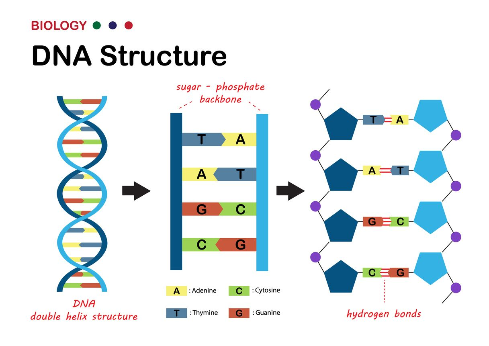{height=50% width=50%}

The strands is made from alternating phosphate and sugar residues, in particular,
sugar is **2-desossiribosio** which is a pentose(five-carbon) sugar.

!!!note Why deossiribosio?
    Come from **ribosio**, sugar present in RNA.

    Ribosio RNA: C2′ → OH

    Ribosio DNA: C2′ → H => deoxy = lack of oxygen

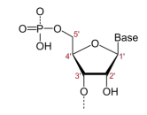{height=50% width=50%}

The sugars are joined together by phosphate groups that form **phosphodiester bonds** between the _third_ and _fifth_ carbon atoms of adjacent sugar rings.

```text
5′ — Sugar — Phosphate — Sugar — Phosphate — Sugar — 3′
       |                     |                    |
      Base                  Base                 Base
```

Because the sugar-phosphate bonds are asymmetric, a DNA strand has a defined direction. The two ends are:

- 5′ end → typically has a terminal **phosphate group**
- 3′ end → has a terminal **hydroxyl** (-OH) **group**

Therefore, a DNA strand is conventionally written: 5′ → 3′. In the DNA double helix, the two strands run in opposite directions. This property is called **antiparallel orientation**.

```text
5′ — A — T — G — C — 3′
     |   |   |   |
3′ — T — A — C — G — 5′
```

The nitrogenous bases (A, T, C, G) are attached to the sugars and project away from the backbone. They contain, thanks to their _sequence_, the genetic information

| Base | Symbol | Type | DNA | RNA | Complementary Base |
|---|---|---|---|---|---|
| **Adenine** | **A** | Purine | ✓ | ✓ | T in DNA / U in RNA |
| **Guanine** | **G** | Purine | ✓ | ✓ | C |
| **Cytosine** | **C** | Pyrimidine | ✓ | ✓ | G |
| **Thymine** | **T** | Pyrimidine | ✓ | ✗ | A |
| **Uracil** | **U** | Pyrimidine | ✗ | ✓ | A |

Complementary bases are held together by **hydrogen bounds**

- A-T create 2 hydrogen bounds
- C-G create 3 hydrogen bounds -> bigger termical stability

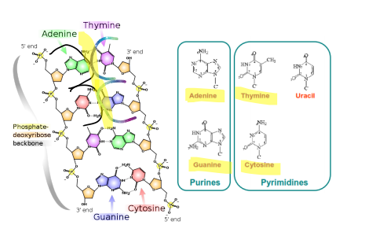{height=50% width=50%}

## RNA

**Ribonucleic acid** (**RNA**) is a polymeric molecule  that is essential for most biological functions, either by performing the function itself (non-coding RNA) or by forming a template for the production of proteins (messenger RNA)

Each RNA nucleotide contains:

1. a ribose (sugar)
2. a phosphate group
3. a nitrogenous base

The complementary bases are:

| Base | Symbol | Type | Structure | Complementary Base |  Hydrogen bonds |
|---|---|---|---|---|---|
| **Adenine** | **A** | Purine | 2 rings | **U** | 2 |
| **Uracil** | **U** | Pyrimidine | 1 ring | **A** | 2 |
| **Cytosine** | **C** | Pyrimidine | 1 ring | **G** | 3 |
| **Guanine** | **G** | Purine | 2 rings | **C** | 3 |

RNA is formed by one strand. The bases od same strand can couple each others. like DNA, RNA have a direction. Nucleotides are linked via phosphodiester bonds between the 3′-OH of one sugar and the 5′-phosphate of the next nucleotide.

```text
5′ — Ribosio — Fosfato — Ribosio — Fosfato — 3′
       |                     |
       A                     U
```

RNA is also synthesized in the direction 5′ → 3′

### Types of RNA

| Type of RNA | Full name | Main function |
|---|---|---|
| **mRNA** | **Messenger RNA** | Carries genetic information from DNA to the ribosome for protein synthesis. |
| **tRNA** | **Transfer RNA** | Brings specific amino acids to the ribosome during translation. |
| **rRNA** | **Ribosomal RNA** | Forms the structural and catalytic core of the ribosome, where proteins are synthesized. |

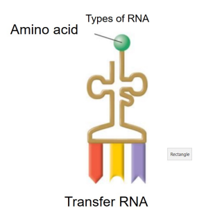{height=50% width=50%}

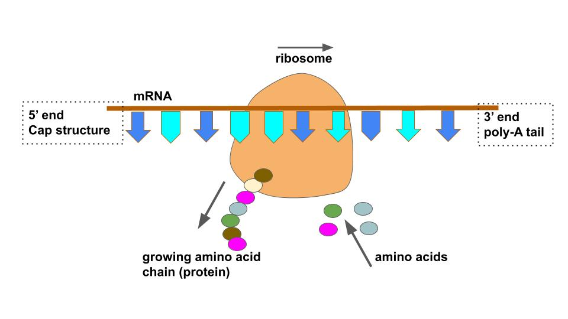{height=50% width=50%}

!!!note Molecular Glossary
    The **ribosome** is the cellular structure that synthesis proteins. They are made up of proteins and rRNA. It takes the sequence present into mRNA and use it to understand which amino acides to use and in which order.
    
    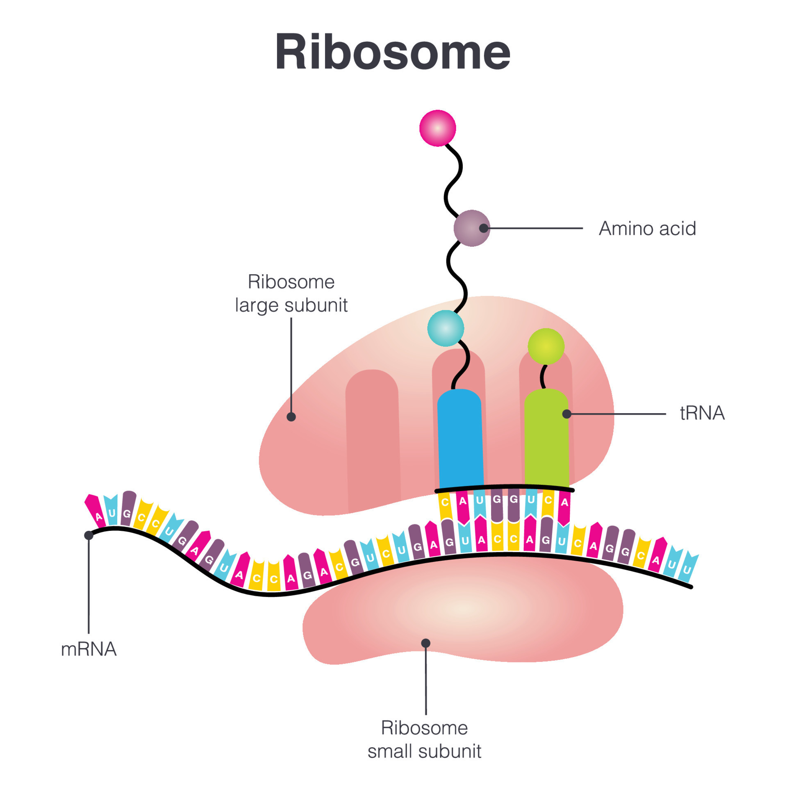{height=50% width=50%}

## Central dogma molecular biology principle

DNA is not a casual sequence, it contains regions called **genes** that contain informations to produce a certain **functional product**, usually a proteine, but also a functional RNA.

!!!note Central dogma
    According to the **central dogma molecular biology principle** the sequential flow of genentic information is _monodirectional_.

    ```text
    DNA → RNA → Protein
    ```

    Cells can be able to:

    - _copy_ information from DNA and passes this to the next generation- Thsi process is called **DNA synthesis** (**replication**)
    - _transfer_ the information from the DNA where it is stored into RNA which can be transported and interpreted. This is the **RNA synthesis** (**transcription**). 
    - _interpretate_ to build proteins.  This is the **translation** which represents a change in the language from the nucleotide letters in the RNA to the amino acid letters in the protein.

### Replication

The replcation is the process of copy DNA with the aim to maintain and trasfer the genetic information to childre celles. Cell before to replicate, copy his DNA and trasfer it to the childen. during thre replication, two strands are separeted and use as template to build the new one. The result are two DNA moleculas. Each new molecula have:

- a strand of original DNA
- a synthesis strand

This is possible thanks to the complementary bases. So DNA have the information and also the mechanism to repicate it.

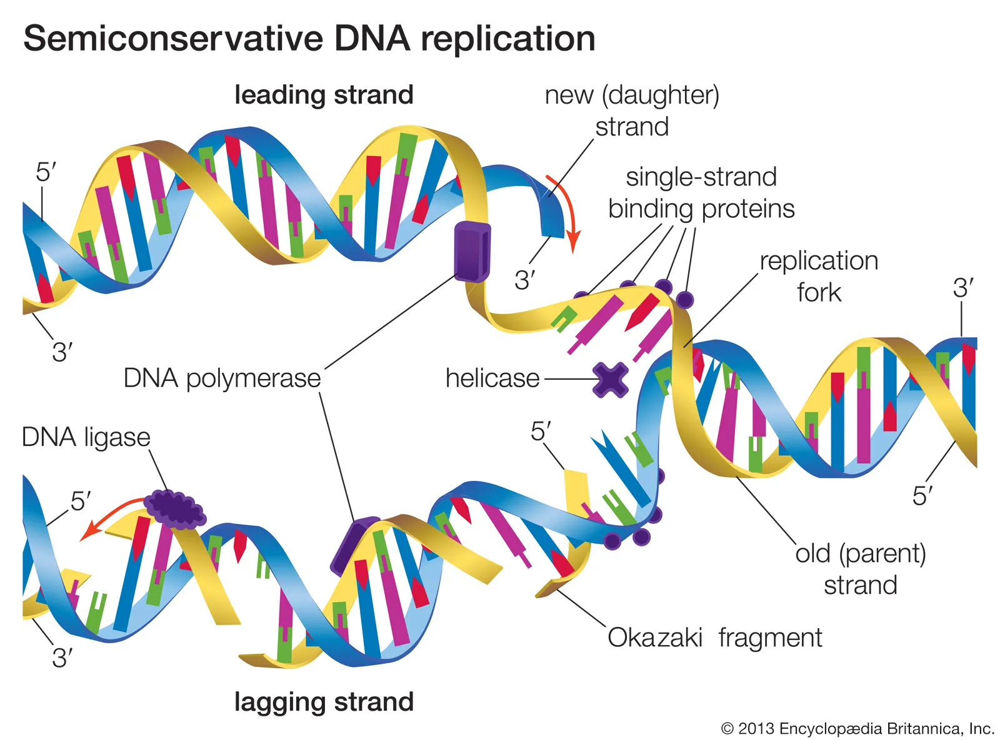{height=50% width=50%}

### Trascription

The trascription use a specific gene of DNA as tempalte to produce a RNA molecula. DNA and RNA have both an alphabet of nucleotides.

Exist different types of RNA, but the most important for this process is the **messenger RNA** (**mRNA**) responsible to transfer the information from DNA to ribosomes.

It occurs in three main steps:

1. Initiation
2. Elongation
3. Termination

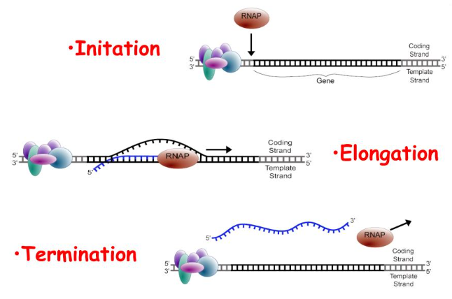{height=50% width=50%}

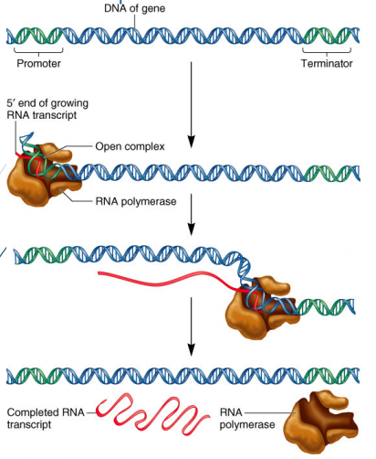{height=50% width=50%}

The process start (**initiation**) from **promoter**, a specific DNA sequence located near the beginning of the gene. Promoter recruite a  **RNA polymerase** (enzyme) that opens the DNA and read the DNA strands.

!!!note Molecular Glossary
    Enzyme is a protein which allow/semplify a chimical reaction.

In the **elongation** step RNA polymerase start buildin the RNA molecule using one of DNA straands as template. The template is like a **mold**: RNA polymerase reads the DNA bases and adds the corresponding RNA nucleotides.

```text
DNA template:
3′ — T A C G G A — 5′

RNA:
5′ — A U G C C U — 3′
```

RNA polymerase:

- reads the DNA template: 3′ → 5′
- synthesizes RNA: 5′ → 3′

RNA polymerase continues moving along the DNA until it reaches a termination signal (**Termination**). After readinf the stop signal, RNA polymerase leaves the DNA and DNA strands come back together.

#### Eukaryotic Gene Structure

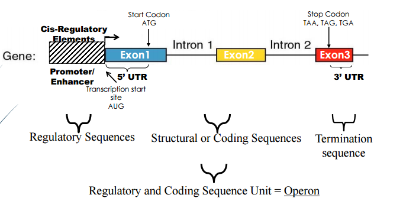{height=50% width=50%}

The gene (region of DNA) is the **Eukaryotic Gene** that have diffente functionality.

Gene can be divided in different subregions:

1. **Regulatory regions** which control when, where and how much gene are expresses. some of this are:
   
   - **enhancers** which is a region that can increare the trascription of a gene
   - **silencers**, instead, can reduce the trascription
   - others
  
2. **Promoter** is a region site near the start of the gene and is responsible of starting the trascription. the promoter is recognizable by:
   
   - **transcription factors**
   - **RNA polymerase**
  After there is **Transcription Start Site** (**TSS**) point in which the transcription starts and is indicated with +1; the upstream sequence are indicated with negative coordinates, while the downstrem sequence are indicated with positive coordinates.

3. **5′ UTR (Untranslated Region)** that are transcripted and in which RNA is present but is not translate in amino acids.
4. **Exons** is a sequence that remains in the mature RNA after **splicing**
    Not every part of an exon is necessarily coding.
5. **Introns** re sequences that are transcribed into the initial RNA but are removed during RNA **splicing**.

    ```text
    pre-mRNA: EXON ─ INTRON ─ EXON ─ INTRON ─ EXON
                            |
                        RNA Processing
                            |
                            V
    mature mRNA: EXON ───────── EXON ───────── EXON
    ``` 

    The **Coding Sequence** (**CDS**) is the part of the mature mRNA that contains the information used to produce the protein.

    It begins with a _start codon_, usually with ATG and ends at a _stop codon_ like TAA, TAG, TGA.

6. **3′ UTR**, is located after the coding sequence. Like 5' UTR.
7. **Polyadenylation signal/site**, helps direct processing of the pre-mRNA. After cleavage, a poly(A) tail is added to the 3′ end of the RNA. After cleavage, a poly(A) tail is added to the 3′ end of the RNA.

**Eukaryotic gene expression: Example of Central Dogma of Molecular Biology**

```text
DNA -> **Transcription** -> pre-mRNA -> __RNA processing __-> mature mRNA -> **Translation** -> Protein
                                        |_ splicing
```

##### Splicing

Process by which the exons of the RNA produced by transcription of a gene are reconnected in multiple ways during RNA splicing. The resulting different mRNAs may be translated into different protein isoforms; thus, a single gene may code for multiple proteins.

It greatly increases the diversity of proteins that can be encoded by the genome; in humans, over 80% of genes are alternatively spliced.
There are numerous modes of alternative splicing observed. The most common is **exon skipping**. In this mode, a particular exon may be included in mRNAs under some conditions or in particular tissues, and omitted from the mRNA in others

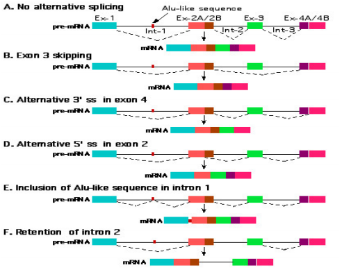{height=50% width=50%}

1. **Normal cis-splicing** a single pre-mRNA molecule is processed.

    ```text
    Pre-mRNA:

    Exon 1 — Intron — Exon 2 — Intron — Exon 3
                ↓ splicing
    Mature mRNA:

    Exon 1 — Exon 2 — Exon 3
     ```

2. **Trans-splicing** exons originating from different RNA molecules are joined together.

    ```text

    RNA transcript 1:
    Exon A — Intron — Exon B

    RNA transcript 2:
    Exon C — Intron — Exon D

                  ↓ trans-splicing

    Chimeric RNA:
    Exon A — Exon D
    ```


### Translation

Translation is the process with which the information contains into mRNA are used to build protein.

In DNA and RNA, we have a language based on _nucleotides_, while in proteins, we have a language based on _amino acids_. Translation represents a change in the language.

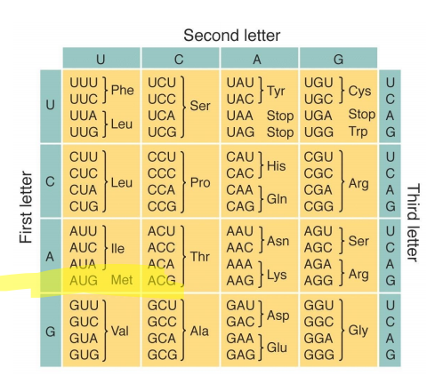{height=50% width=50%}

Proteins are a sequence of amino acids. mRNA transport a sequence that is read,by rRNA, in groups of three nucleotides, called **codons**.

```text
AUG | GCU | AAA | UGC
 ↑      ↑     ↑     ↑
codon  codon codon codon
```

!!!note Why rRNA read 3 nucleotide?
    Exist 20 amino acids => $4^3 = 64$ combiantion

    with some codons serving as start/stop signals, and multiple codons capable of encoding the same amino acid.

    This leads to the **degeneracy of the genetic code**.

### Sequencing

Sequencing means determining the exact order of nucleotides in a DNA (or RNA) molecule.

## Proteins

**Proteins** are large biomolecules and macromolecules that comprise one or more long chains of amino acid residues. 

Main functions of proteins:

- **Enzymatic function**: Proteins can act as enzymes, catalyzing almost every biochemical reaction in cells. They accelerate reactions without being consumed.
- **Structural function**: Proteins provide structure and mechanical support to cells and tissues. Examples include collagen in connective tissue and keratin in hair and skin.
- **Regulatory function**: Proteins regulate important cellular processes such as:
  - gene expression
  - DNA replication
  - RNA processing and post-transcriptional regulation
  - protein synthesis
  - cell signaling
- **Transport and carrier function**: Proteins transport ions and small molecules across or within cells. For example, membrane transporters and channels control the movement of substances across cell membranes.
- **Immune function**: Proteins are fundamental to the immune response. Antibodies, produced by B cells, recognize foreign molecules and help target pathogens for destruction. Other proteins, such as cytokines, allow immune cells to communicate and regulate the intensity of the immune response.
- **Cell division**: Proteins control and participate in mitosis and meiosis, ensuring that genetic material is correctly distributed to daughter cells.
- **DNA and tissue repair**: Specialized proteins detect and repair DNA damage, while other proteins participate in the repair and regeneration of damaged tissues.

**Amino acids** are the building blocks of proteins. Each codon corresponds to a specific amino acid or to a stop signal during the translation. Translation normally begins with the start codon AUG, which codes for the **amino acid methionine** (Met).

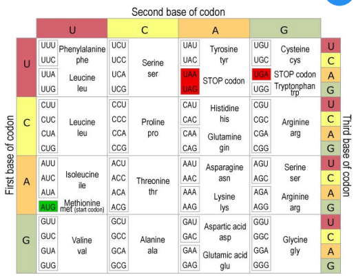{height=50% width=50%}

### Point mutation

A **point mutation** is a mutation involving a change in a single nucleotide of DNA (or RNA). It can result from a base substitution, and in some contexts small insertions or deletions are also considered single-nucleotide mutations. Because mRNA is read in codons of three nucleotides, a change in one nucleotide can affect the resulting protein in different ways. There are various type of mutation like:

- silent mutation
- missense mutation
- nonsense mutation
- framshift or In frame mutation

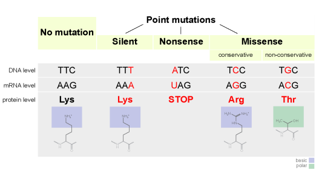{height=50% width=50%}

#### Silent mutation

A **silent mutation** changes a nucleotide, but the codon still codes for the same amino acid.

```text
Original:  UUU → Phenylalanine
Mutated:   UUC → Phenylalanine
```

The nucleotide changed, but the amino acid did not. Usually no effect on the protein sequence.
This is possible because the genetic code is degenerate, meaning that different codons can code for the same amino acid.

#### Missense mutation

A **missense mutation** changes a nucleotide so that the codon now codes for a different amino acid.

```text
Original:  GAG → Glutamic acid
Mutated:   GUG → Valine
```

The resulting protein has an altered amino acid sequence. The effect can be:

- very small,
- significant,
- or even cause loss of protein function,
depending on which amino acid is changed and where it is located in the protein.

#### Nonsense mutation

A **nonsense mutation** changes a codon into a STOP codon.

```text
Original:  UAC → Tyrosine: Amino acid — Amino acid — Amino acid — Amino acid
Mutated:   UAG → STOP: Amino acid — Amino acid — STOP
```

Translation stops too early, producing a shorter protein. The protein is often non-functional because it is incomplete.

#### Framshift mutation

A **frameshift mutation** occurs when nucleotides are inserted or deleted and the number of inserted/deleted nucleotides is not a multiple of 3.

```text
AUG | GCU | AAA | CGG | ...
AUG | CUA | AAC | GG...
```

The reading frame shifts, so every codon after the mutation can change. This can have a very severe effect on the protein.

### Protein folding

**Protein folding** is the process by which a newly synthesized polypeptide chain folds into its specific three-dimensional shape.

A protein is synthesized as a linear chain of amino acids, but to become functional it must fold into a specific three-dimensional shape. Protein structure is usually described at four level. A protein's shape determines its function. If a protein folds incorrectly, it may lose its function or even become harmful.

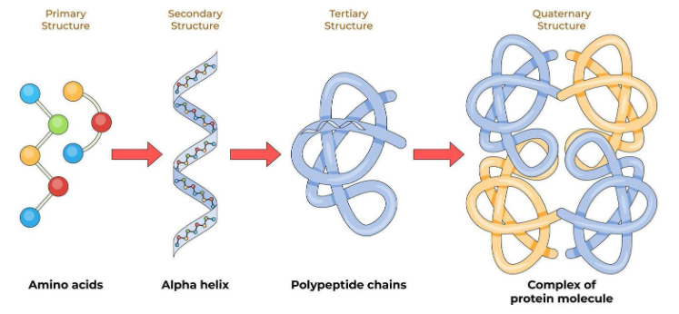{height=50% width=50%}

The **primary structure** is simply the order of amino acids connected by **peptide bonds** creating the **polypeptide chain**. The sequence of amino acids determines the information needed for the protein to fold.

```text
Ala → Gly → Val → Lys → Leu → ...
```

The **secondary structure** is a local folding means that describes the shape of small regions of the chain, not the entire protein.small portion of chain are folded in regular patterns. The two main secondary structures are:

- **$\alpha$-helix**: A section of the chain coils into a helix, similar to a spring. ~~~~~~~ → α-helix
- **$\beta$-sheet**: Sections of the chain become extended and arrange next to each other, forming a sheet. ═══════ → β-sheet

These structures are mainly stabilized by hydrogen bonds between atoms of the peptide backbone.The important word is local: secondary structure describes the shape of small regions of the chain, not the entire protein.

**Tertiary structure** take the α-helices, β-sheets, and other parts of the chain fold together to form the overall 3D structure of one polypeptide. The folding is driven by interactions between the side chains (R groups) of the amino acids. Important interactions include:

- Hydrophobic interactions
- Hydrogen bonds
- Ionic interactions
- Van der Waals interactions
- Disulfide bonds

This 3D shape is extremely important because it determines the protein's function.

The **Quaternary structure** combine more than one polypeptide chain to create a protein. Not every protein has a quaternary structure. Each individual chain can have its own tertiary structure, but the chains can then come together to form one functional protein complex.

Example: Hemoglobin

- it contains 4 polypeptide subunits
- the four subunits associate to form the functional hemoglobin protein

## Mutation

A _mutation_ is a change in the genetic material.

### Structural effect

> How much DNA is affected?

1. **Small-scale mutations**: These affect a small number of nucleotides, sometimes just one.   Examples:
    - Point mutation → one nucleotide is changed.
    - Insertion → one or more nucleotides are added.
    - Deletion → one or more nucleotides are removed.
    - Duplication → a DNA segment is copied, producing an additional copy.
2. **Large-scale mutations**: These involve large DNA segments or entire chromosomes.
    Examples:
    - Gene duplication → an entire gene or genomic region is duplicated.
    - Chromosomal translocation → a segment of one chromosome moves to another chromosome.
    - Chromosomal inversion → a segment is removed, reversed, and reinserted.
    - Interstitial deletion → an internal segment of a chromosome is lost.

### Functional effect

> What happened to the function of the gene product?

1. **Loss-of-function mutation**: The mutation causes the gene product to have reduced or completely absent function. If the gene product has no function at all, the allele is called a null allele. A complete loss-of-function mutation is also called an amorphic mutation. These mutations are often recessive, because one normal copy of the gene can sometimes produce enough functional protein to maintain the phenotype.
2. **Gain-of-function mutation**: Here the mutation gives the gene product a new or abnormal function. These mutations are usually dominant, because the abnormal activity can affect the phenotype even when a normal allele is also present. These mutations are usually dominant, because the abnormal activity can affect the phenotype even when a normal allele is also present.

### Effect on fitness

> Does the mutation make the organism more or less successful at surviving and reproducing?

1. **Harmful**: They reduce fitness or impair normal biological function.
2. **Beneficial**: They provide an advantage under particular environmental conditions.
3. **Neutral**: Although your slide doesn't explicitly mention this category, mutations can also have little or no effect on fitness.

## Fusion genes and chimeric transcripts

A **fusion gene** is created when DNA sequences that originally belonged to two different genes become joined together. This can happen because of chromosomal rearrangements such as:

- translocations
- interstitial deletions
- inversions

The resulting fusion gene can be transcribed into a **fusion RNA**, also called a **chimeric RNA**. If this RNA is translated, it can produce a fusion protein containing portions derived from two different original proteins. The resulting RNA came from the Trans-splicing.

This is particularly important in cancer, because some fusion genes produce abnormal proteins that promote uncontrolled cell growth. Such fusion genes can therefore act as oncogenes.

!!!note Patholgy notes
    In pathological situations, the resulting fusion transcript may contain more than just the expected exons.

    For example, an abnormal RNA can retain:

    - intronic sequences
    - UTRs (untranslated regions)
    - other normally non-coding regions

## Gene fusion mechanisms

A gene fusion occurs when parts of two previously separate genes become joined, creating a new fusion gene. This can happen through several types of chromosomal rearrangements.

1. **Chromosomal translocation** consist in trasferring a pice of one chromosome in another one. If the breakpoints occur inside the two genes, their portions can become physically joined. The fusion gene can become a fusion mRNA and a potentially fusion protein. This is a particularly important mechanism in cancer.
2. **Interstitial deletion** consist in an internal deletion segment of as chromosome. If the deleted region lies between parts of two genes, the remaining portions can become directly connected, creating a fusion gene.
3. **Chromosomal inversion** consist in cutting out, reversing, and reinserting of a segment of a chromosome. If the inversion breakpoints occur within genes, the rearrangement can join portions of two genes in a new configuration, potentially producing a fusion gene.

A **breakpoint** is the exact position in the DNA where a chromosome breaks and is then joined to another DNA segment. The breakpoint tells us exactly which portions of the two genes are retained in the fusion. Breakpoint is different from **fusion junction** the resulting boundary in the fused DNA/RNA between the two contributing sequences.

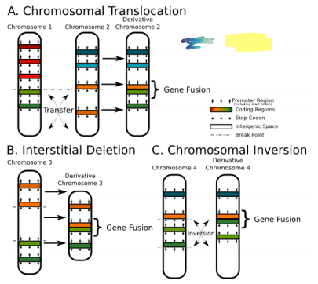{height=50% width=50%}

## Computational Issues

Analyzineg RNA ins computation expensive especially when alternative splicing e chimeric/fusion transcripts are present.

When RNA is sequenced we obtain small sequence called **reads**. The problem is understand from which point of genoma come from each read.

Generally: DNA → gene → RNA → protein
but with

- alternative splicing -> same gene can produe differti mRNA.
- chimerism -> RNA can have sequence coming from two differnte gene.
- fusion breakpoints are often not-canonical, i.e. genes can be broken inside exons, keeping subsequences of them and loosing the others. Moreover, the genes involved in the fusion can be, often, located in different chromosomes and thus far away from each others

**Mapping** try to align each read on the correct position of genoma but two problems can arise:

1. **mismatch**: read is align on a position that not correspond to its original position => false interpretation
2. **multiple matching**: read is compatible with more than one regionof genoma.

Other problem arise from the not knowledge of splicing or fusion point. These points are often unknown and must be identified directly from the sequencing data. Moreover, fusion breakpoints can occur inside exons, causing only parts of genes to be retained in the final transcript. This makes the reconstruction and correct mapping of fusion transcripts particularly challenging.

Once computational tools have identified possible gene fusions, we need to reconstruct, characterize, and prioritize them.

1. **Reconstruction of the fusion sequence** in which we need to determine the actual sequence produced by the fusion.

    ```text
    Gene A:  Exon 1 — Exon 2 — Exon 3
                            \
                                → Fusion
                            /
    Gene B:             Exon 4 — Exon 5

    Fusion: Exon 1 — Exon 2 — Exon 4 — Exon 5
    ```

    The goal is to reconstruct the **fusion transcript/sequence**, especially if the fusion detection tool only reports something like:

    > Gene A ↔ Gene B

    and does not provide the complete resulting sequence.
2. **Characterization of the genes involved**. Once we know which genes are fused, we need to understand **which portions of each gene are involved**.


    ```text
    Gene A                         Gene B
    5'                            3'
    ↓                              ↓

    Promoter — Exon 1 — Exon 2 | Exon 3 — Exon 4
                            ↑
                            breakpoint
    ```

    We may want to determine:

    - Which gene contributes the **promoter/5′ region**?
    - Which gene contributes the **3′ region**?
    - Which exons are retained?
    - Where exactly is the **fusion breakpoint**?
    - Is the resulting sequence likely to produce a functional protein?
    - Which functional domains are retained or lost?

    This is important because **not every detected fusion has the same biological significance**.

3. **Prioritization of fusion candidates**. Fusion detection tools can produce **many candidate fusions**.

    The problem then becomes:

    > **Which detected fusions are actually important or biologically meaningful?**

    This is where computational models can help **rank/prioritize** the candidates.
    
    - Traditional Machine Learning models use engineered features to assign a score or probability to candidate fusions. Examples
        - **Pegasus**
        - **Oncofuse**
        - **FuGePrior**

        They may consider features such as:
      - gene characteristics
      - breakpoint information
      - expression levels
      - genomic context
      - known biological annotations
   - More recent approaches use **Deep Learning (DL)** to learn complex patterns directly from the available data. Examples:

     - **DEEPrior**
     - Deep Learning approaches for **data integration**

   - **Multimodal approaches** involving LLMs. For example, information about a fusion could come from:
     - genomic sequence
     - RNA-seq data
     - gene expression
     - protein information
     - functional annotations
     - biomedical literature

    Instead of analyzing each source independently, a multimodal system attempts to integrate them.
