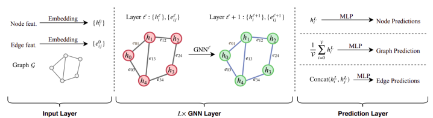
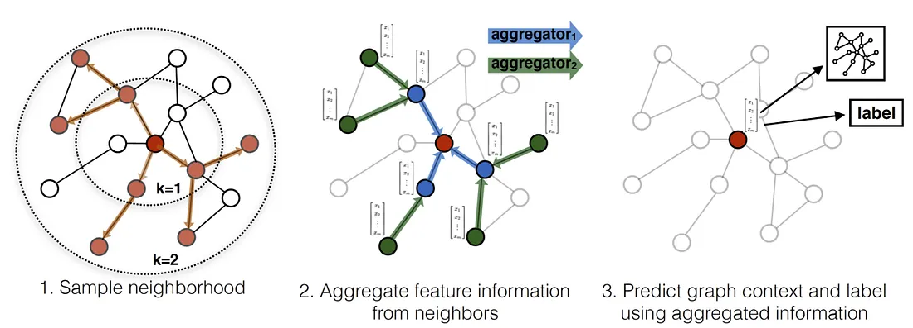
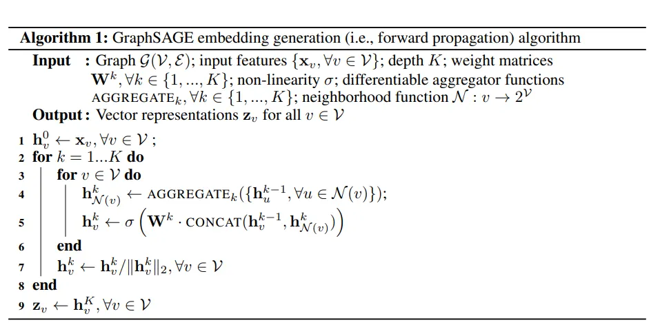
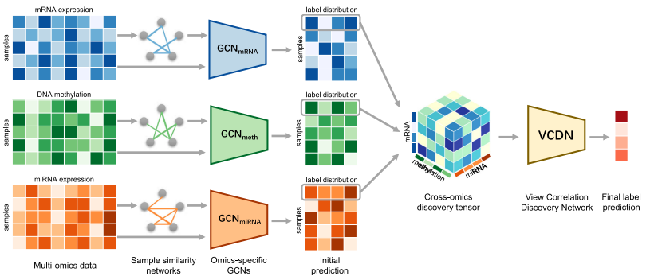

# Graph Neural Networks

Graphs from a mathematical point of view are a discrete structure formed by a set of Edge $E$ and a set of Node $V$ --> $G = (E, V)$

Graph are useful in scenario where data have a relationship each other like social network, raccomandation system etc. Graph can model relatioship between entity more naturally connecting the entity (node) with edge making the relation more visible.

We have to consider that graph network have not regular structure and can have different shape, dimension, topological structure. Furthermore graphs not have a starting node, each node can be a starting point to analyze the reality.

Graph structure can be the input of ML/DL model allowing the model to exploit not only the features of individual nodes but also the relationships between them.

**Tasks** When operate with graphs, we can distinguish different typer of prediction:

- **Node-level prediction**: the model predicts a property or class for each individual node. This task can be done with two different settings:
  - **Trasductive setting** where only a subset of nodes is labelled. So the task is to label the remaining nodes levaraging on the connection and the pattern of labelled nodes
  - **Inductive setting** where node are all labelled. So model have the task to learn the pattern to generalize over unseen example.
- **Edge-level prediction**: the model predicts a property of an edge or whether an edge should exist between two nodes. This is also known as link prediction. 
- **Graph-level prediction**: the model produces a prediction for the entire graph.

**Representation** Graphs can be represented in different ways. For example.

- **adjacency matrix** that   represents the connections between nodes using a matrix \(A\). For a graph with \(N\) nodes:

    \[
    A \in \mathbb{R}^{N \times N}
    \]

    Each element \(A_{ij}\) indicates whether there is an edge between node \(i\) and node \(j\).

    For an unweighted graph:

    \[
    A_{ij} =
    \begin{cases}
    1 & \text{if an edge exists between } i \text{ and } j\\
    0 & \text{otherwise}
    \end{cases}
    \]

    For a weighted graph, \(A_{ij}\) can contain the **weight of the edge**.

    **Advantages:**

    - Easy and fast to check whether two nodes are connected.
    - Convenient for mathematical operations and matrix-based GNN implementations.

    **Disadvantages:**

    - Requires \(O(N^2)\) memory.
    - Inefficient for **sparse graphs**, where most nodes are not connected.

- **adjacency list** that  represents each node together with the nodes directly connected to it.

    **Advantages:**
    - More memory-efficient for sparse graphs.
    - Makes it easy to access the neighbours of a node.
    - Particularly suitable for **message-passing operations in GNNs**.

    **Disadvantages:**
    - Checking whether two arbitrary nodes are connected can be slower than with an adjacency matrix.

**Properties** Graphs have some properties that can be exploit when we build a Ml/DL model. One of them is the **permutation invariance** , that is the equivalence of **shift invariance** in CNN. This is a conseguence that graph is a non structured data model, and this mean that changing the order of node, the graph structure doesn't change. Consequently, prediction should remain the same regardless of the ordering of the nodes.

## GNN

**Graph Neural Networks (GNNs)** are neural networks specifically designed to operate on graph-structured data to exploit the permutation invariance property of graph.

{height=50% width=50%}

The main idea is that the representation of a node should depend not only on its own features, but also on the features of its **neighbouring nodes**. This operation is the **message parsing**. This mechanism consist on updating the feature node representation with the feature node of the first-order neighbours. The process consist in two steps:

- **aggregation** in which a $node_{i}$ receive from its first order neighbours their node representation;
- **combination** in which all the representation received are combined to update the actual representation of $node_{i}$

For example, if each node has an initial feature vector \(h_v\), a GNN can update this representation by aggregating information from its neighbours:

\[
h_v^{(l+1)}
=
\text{UPDATE}
\left(
h_v^{(l)},
\text{AGGREGATE}
\left(
\{h_u^{(l)}:u\in\mathcal{N}(v)\}
\right)
\right)
\]

where:

- \(h_v^{(l)}\) is the representation of node \(v\) at layer \(l\);
- \(\mathcal{N}(v)\) is the set of neighbours of \(v\);
- **AGGREGATE** collects information from neighbouring nodes;
- **UPDATE** combines this information with the current representation of the node.

This is done simultanealy for all node in the graph.

### Graph Convolutional Network

An implementation of message parsing is the **Graph Convolutional Layer** which perform convolution operation, similar with image, but on the graph considering it particular structure. So a **Graph Convolutional Network** is a stack of _GCL_.

A GCN layer compute the trasformation:

\[
H^{(l+1)}
=
\sigma
\left(
\hat{D}^{-\frac12}
\hat{A}
\hat{D}^{-\frac12}
H^{(l)}
W^{(l)}
\right)
\]

where:

- \(H^{(l)}\) = node representations at layer \(l\)
- \(A\) = adjacency matrix
- \(\hat A = A + I\) = adjacency matrix with self-loops
- \(\hat D\) = degree matrix of \(\hat A\)
- \(W^{(l)}\) = learnable weights
- \(\sigma\) = activation function
Conceptually, you can think of it as:

### GAT

GCN aggregate feature nodes weighting in a fixed way. SO evry neighbour have the same importance in aggregation.

To have a better representation, based also on the importance, we can add an attention mechamism allowing model to learn which feature are more important and weighting differently from the less important one.

**GAT** (**Graph attention network**) implement the attention mechanism like that of trasformer.

For a node $i$ and one of its neighbors $j$:

1. Transform the node features:
    $$h_i' = W h_i$$
2. Compute an attention score between $i$ and $j$:
   $$
   e_{ij} = \text{LeakyReLU}\left(a^T[Wh_i \Vert Wh_j]\right)
   $$

    where:
    - $W$ is a learnable weight matrix;
    - $a$ is a learnable attention vector;
    - $\Vert$ denotes concatenation.

3. Normalize the scores across the neighbors using softmax:

    $$
    \alpha_{ij}
    =
    \frac{\exp(e_{ij})}
    {\sum_{k\in\mathcal N_i}\exp(e_{ik})}
    $$

The resulting \(\alpha_{ij}\) represents how much attention node \(i\) pays to neighbor \(j\).
4. Aggregate the neighbors:

  $$ h_i^{new}
   =
   \sigma\left(
   \sum_{j\in\mathcal N_i}
   \alpha_{ij}Wh_j
   \right)$$

#### Multi-head attention

GAT commonly uses multi-head attention, where several independent attention mechanisms are learned:

$$h_i^{new}
=
\Big\Vert_{k=1}^{K}
\sigma
\left(
\sum_{j\in\mathcal N_i}
\alpha_{ij}^{(k)}W^{(k)}h_j
\right)$$

This allows the model to capture different types of relationships between neighboring nodes.

#### GATv2

**GATv2** is an improved version of **GAT** that makes the attention mechanism **more expressive and dynamic**. The main limitation of original GAT is that its attention mechanism can be **static**: the relative importance between two neighbors is determined in a way that limits how flexibly it can depend on the query node.

GATv2 instead uses:

$$
e_{ij}
=
a^T
\text{LeakyReLU}
\left(
W[h_i\Vert h_j]
\right)$$

More precisely, the important architectural change is that **the linear transformation is applied to the concatenated pair before the attention vector is applied**, rather than separately projecting the nodes first and then combining them.

GATv2 can learn attention coefficients that depend **more flexibly on both the target node \(i\) and the neighbor \(j\)**.

### GraphSAGE

**Graph SAGE** (**SAmple and aggreGatE**) is a general inductive framework that leverages node feature information to efficiently generate node embeddings for previously unseen data. Unlike traditional methods that learn a separate embedding for each node, GraphSAGE learns a function that generates node embeddings by sampling and aggregating features from a node’s local neighborhood. This allows the algorithm to generalize to previously unseen nodes and graphs.

This problm is more difficult than trasductive one because generalizing to unseen nodes requires “aligning” newly observed subgraphs to the node embeddings that the algorithm has already optimized on. Generally, most existing approaches to generating node embeddings are inherently transductive. The majority of these approaches directly optimize the embeddings for each node using _matrix-factorization-based objectives_, and do not naturally generalize to unseen data, since they make predictions on nodes in a single, fixed graph.

{height=50% width=50%}

1. **Sample Neighborhood**: In the first step, the algorithm samples the local neighborhood of a node. This involves selecting nodes within a certain distance (k=1 and k=2), essentially capturing the structure around the node.
2. **Aggregate Feature Information**: The second step involves aggregating the feature information from the neighbors of the node. This can be done using different aggregators like _mean_, _LSTM_, or _pooling_, depending on the architecture being used. The goal is to combine the features of neighboring nodes into a single, meaningful representation for the node.
3. **Predict Graph Context and Label**: Finally, using the aggregated features from the neighbors, GraphSAGE predicts the context or label of the node in the graph. This allows the model to generalize and make predictions on unseen nodes.
    $\sigma
    \left(
    W^{(k)}
    \cdot
    \operatorname{CONCAT}
    \left(
    h_v^{(k-1)},
    \operatorname{AGGREGATE}
    \left(
    {h_u^{(k-1)}\in\mathcal{N}(v)}
    \right)
    \right)
    \right)
    $
    
    where ($h_v^{(k)}$) is the representation of node $(v)$ at layer $(k)$.

{height=50% width=50%}

The resulting embedding can then be used for downstream tasks such as node classification, link prediction, or other graph-based predictions.

## MOGONET

!!!note Omics data
    The term **omics** refers to a number of areas of study in biology, all of which end in the suffix -omics, indicating totality of some kind.
    Omics data can naturally contain relationships between biological entities, making them suitable for graph-based models.

    - Genomics → studies the genome / DNA and genetic variants.
    - Transcriptomics → studies RNA / gene expression.
    - Proteomics → studies proteins and their abundance or interactions.
    - Metabolomics → studies metabolites, i.e. small molecules involved in metabolic processes.
    - Epigenomics → studies modifications that regulate gene expression without changing the DNA sequence.

The integration of omics data from multiple omics technologies can improve the accuracy of patient clinical outcome prediction comparing with only using a single type of omics data.

**Multi-Omics Graph cOnvolutional NETworks** (**MOGONET**) is superivesd a multi-omics data analysis framework for classification tasks in biomedical that unifies omics-specific learning with cross-omics correlation learning for effective multi-omics data classification.

{height=50% width=50%}

Example of omics data:

- mRNA expression
- DNA methylation
- miRNA expression

MOGONET treats each omics type as a separate view of the same patients.

The workflow of MOGONET can be summarized into three components: 

1) preprocessing
2) Omics-specific learning via GCNs.
3) Multi-omics integration via VCDN

we construct a weighted sample similarity 
Then, initial predictions generated by each
omics-specific GCN are further utilized to construct the crossomics discovery tensor, which reflects the cross-omics label correlations. Finally, the cross-omics discovery tensor is reshaped
into a vector and forwarded to VCDN for final label prediction.
VCDN can effectively integrate initial predictions from each
omics-specific network by exploring the latent correlations across
different omics data types in the higher-level label space

### Preprocessing

Since omics data could contain redundant features that might have negative effects on the classification performance, we further preselected the omics features through statistical test.

selecting too few features might also result in only selecting highly correlated features, which could potentially restrain the models from taking advantage of complementary information from diverse features. To avoid this situation, we determined the number of preselected features for each omics data type with an additional rule, i.e., the first principal component of the data after 
feature preselection should explain <50% of the variance.

This is done separatly for each omics data.

### GCNs for omic-specific learning

For each omics data types a GCN is trained to perform classification tasks.

The node features are the corresponding omics measurements. A weighted graph is constructed by measuring the similarity between patients, using _cosine similarity_ in the original method. Eeach patient/sample is a node.

In MOGONET, the original adjacency matrix $A$ is constructed by calculating the cosine similarity between pairs of nodes and edges with cosine similarity larger than a threshold $\epsilon$ are retained. Specifically, $A_{ij}$, which is the adjacency between node $i$ and node $j$ in the graph, is calculated as:

$$
A_{ij} =
\begin{cases}
s(x_i,x_j), & i\neq j \text{ and } s(x_i,x_j)\geq\epsilon\
0, & \text{otherwise}
\end{cases}
$$

where $x_i$ and $x_j$ are the feature vectors of node $i$ and node $j$, respectively. s(xi; xj9 is the cosine similarity between node $i$ and $j$. The threshold $\epsilon$ is determined given a parameter $k$, which represents the average number of edges per node that are retained including self-connections:

$$
k =
\frac{
\sum_{i,j}
\mathbb{I}\left(s(x_i,x_j)\geq\epsilon\right)
}{n}
$$

where $I(⋅)$ is the indicator function and $n$ is the number of nodes. The parameter $k$ for generating the adjacency matrix is tuned over ${2, 5, 10}$ with the training data, and the same $k$ value is adopted across all experiments on the same dataset.

The loss function of GCn is the CELoss.

### VCDN for multi-omics integration

The initial predictions produced by the different omics-specific GCNs are then used to capture **cross-omics relationships** at the label level.

The main idea behind the **View Correlation Discovery Network** (**VCDN**) is that different omics data types can provide complementary and distinctive information about the same classification task. Therefore, instead of simply combining the original omics features, MOGONET integrates the predicted label distributions produced by the different GCNs.

VCDN learns both **intra-view** and **cross-view correlations** in the _label space_, allowing the final prediction to depend not only on the individual predictions of each omics-specific GCN, but also on the relationships between these predictions.

To capture the interactions between the predictions of the different omics, MOGONET constructs a cross-omics discovery tensor $C_j \in \mathbb{R}^{c\times c\times c}$

Each element of this tensor is computed as:
$$
\hat{y}^{(1)}{j,a_1}
\hat{y}^{(2)}{j,a_2}
\hat{y}^{(3)}_{j,a_3}
$$

where $(a_1,a_2,a_3)$ denote class indices.

The tensor $C_j$ is then reshaped (flattened) into a vector $c_j \in \mathbb{R}^{c^3}$

This vector is provided as input to the VCDN, which is implemented as a fully connected neural network whose output dimension is $c$, corresponding to the number of classes. Loss is defined as:

$$\mathcal{L}_{VCDN} = \sum_{j=1}^{n_{tr}} = \mathcal{L}_{CE}(VCDN(c_j),y_i) $$

Although the original demonstration uses three omics types, the approach can be generalized to an arbitrary number $m$ of views.

For $m$ omics data types, the cross-omics tensor is $C_j \in \mathbb{R}^{c\times c\times\cdots\times c}$ with $m$ dimensions.

Each element is calculated as:

$$\prod_{i=1}^{m}
\hat{y}^{(i)}_{j,a_i}
$$

The tensor is then reshaped into a vector of dimension $c^m$ and provided to VCDN.

Therefore, the same integration mechanism can be extended to any number of omics views.

### Loss of MOGONET

MOGONET is trained as an end-to-end model, meaning that the omics-specific GCNs and VCDN are ultimately optimized jointly.

The final prediction therefore incorporates both:

- the view-specific predictions produced by the individual GCNs;
- the learned cross-view label correlations captured by VCDN.

$$\mathcal{L} = \sum_{i=1}^{m}
\mathcal{L}_{GCN_i}
+
\gamma\mathcal{L}_{VCDN}$$

In the original experiments $\gamma=1$ that correspond to th trade-off parameter between the omics-specific  classification loss and the final classification loss from VCDN.

For training MOGONET, author have pretrained each of the omics-specific GCN individually to get a good   initialization of the GCN. Then, during one epoch of the training process, we first fix VCDN and update GCNi(⋅), i = 1, 2, 3 for each omics data type to minimize the loss function L.

Then we fix the omics-specific GCNs and update VCDN to minimize L.

Omics-specific GCNs and VCDN are updated alternatively until convergence.
